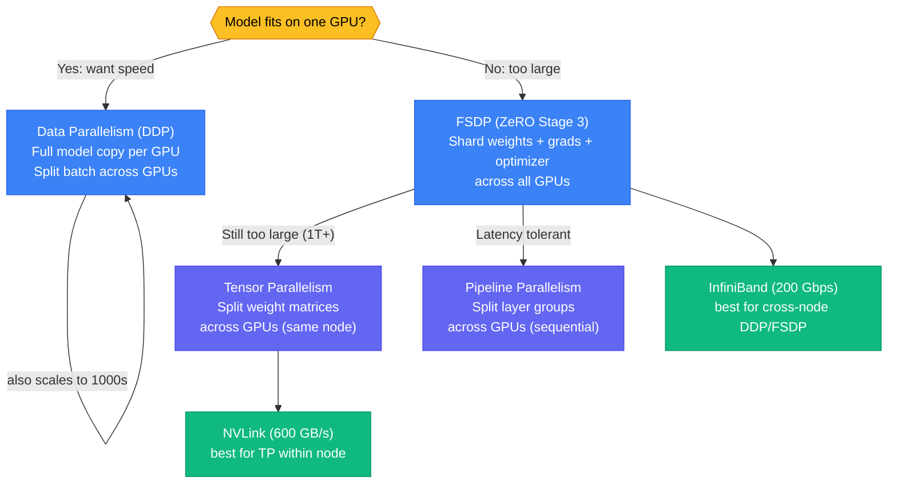
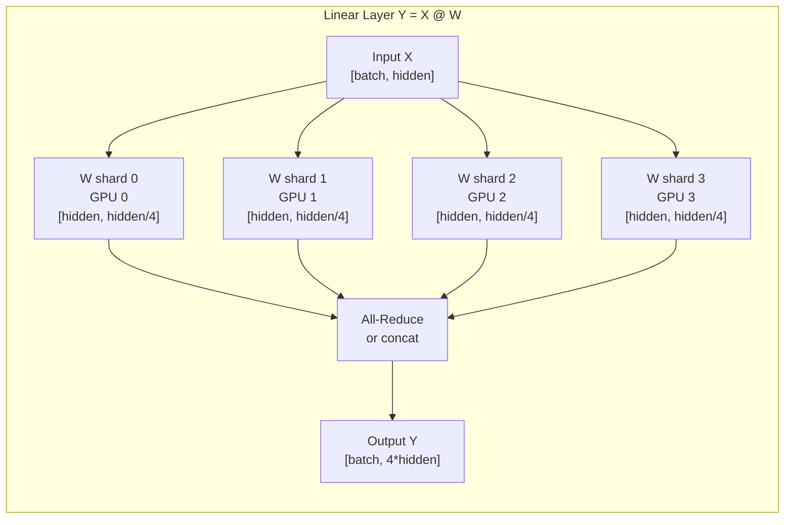

# Distributed Training

A single NVIDIA A100 80GB GPU holds ~80GB of model weights. A 70B-parameter model in FP16 requires ~140GB — it doesn't fit. Even when a model fits on one GPU, distributing training across 8 GPUs reduces wall-clock time by roughly 8×. Distributed training is not optional at scale; it's the only path.

<div class="quiz-progress" data-quiz-progress>
  <span class="quiz-progress-label">0/0 checks</span>
  <span class="quiz-progress-bar"><span class="quiz-progress-fill"></span></span>
</div>

---

## Parallelism Strategy Overview



---

## Data Parallelism — DDP

**DDP (DistributedDataParallel)** is the default strategy when the full model fits on each GPU. Every GPU holds a complete copy of the model weights. The global batch is split evenly across GPUs — each GPU processes its shard independently (forward + backward), then gradients are synchronized via **AllReduce** so every GPU applies an identical update.

### Ring-AllReduce

GPUs are logically arranged in a ring. Each GPU passes a chunk of gradients to its neighbor, receives a chunk from its other neighbor, and accumulates. After N-1 steps, every GPU has the full reduced gradient. Bandwidth scales near-linearly because each GPU only sends/receives `(N-1)/N` of its data per step.

```
GPU0 → GPU1 → GPU2 → GPU3
 ↑                      ↓
 └──────────────────────┘
Each GPU sends + receives one chunk per round.
After 2(N-1) rounds: all GPUs have sum of all gradients.
```

### PyTorch DDP — Minimal Setup

```python
import os
import torch
import torch.distributed as dist
from torch.nn.parallel import DistributedDataParallel as DDP

def setup():
    dist.init_process_group(backend="nccl", init_method="env://")

def main():
    setup()
    local_rank = int(os.environ["LOCAL_RANK"])
    torch.cuda.set_device(local_rank)

    model = MyModel().cuda(local_rank)
    model = DDP(model, device_ids=[local_rank])

    # DistributedSampler ensures each GPU gets a non-overlapping shard
    sampler = torch.utils.data.distributed.DistributedSampler(dataset)
    loader = DataLoader(dataset, sampler=sampler, batch_size=32)

    for batch in loader:
        loss = model(batch)
        loss.backward()        # DDP hooks AllReduce here automatically
        optimizer.step()
```

**Launch:** `torchrun --nproc_per_node=4 train.py`

### DDP Memory Budget

Each GPU holds: model weights + optimizer state + gradients. In mixed-precision FP16/FP32 training:

| Component | Size (per param) |
|-----------|-----------------|
| Weights (FP16) | 2 bytes |
| Gradients (FP16) | 2 bytes |
| Master weights (FP32) | 4 bytes |
| Adam m1 + m2 (FP32) | 8 bytes |
| **Total** | **16 bytes/param** |

For a 7B-parameter model: 7×10⁹ × 16 = **112 GB** — doesn't fit on one A100 80GB. DDP is only viable when `params × 16 < VRAM`.

<div class="quiz-card"><p class="quiz-q">You have 8 A100 80GB GPUs and a 7B-parameter model. After DDP setup, how much GPU memory does each GPU need just for the model and optimizer state (FP16 weights + FP32 Adam)?</p><button class="quiz-reveal">Reveal answer</button><div class="quiz-a" hidden>~112 GB (7B × 16 bytes/param). This exceeds the 80GB A100 — DDP won't work here. You need FSDP or tensor parallelism to shard the optimizer state.</div></div>

---

## Fully Sharded Data Parallel — FSDP

FSDP implements **ZeRO Stage 3** (Zero Redundancy Optimizer). Instead of every GPU holding a full model copy, FSDP shards weights, gradients, and optimizer state across all GPUs. Each GPU holds only `1/N` of each tensor at rest.

### ZeRO Stages

| Stage | What's sharded | Memory saving |
|-------|---------------|---------------|
| ZeRO-1 | Optimizer state only | ~4× |
| ZeRO-2 | Optimizer state + gradients | ~8× |
| ZeRO-3 (FSDP) | All of the above + weights | ~N× |

### How FSDP Forward Pass Works

1. GPU needs layer L's weights → **all-gather** from all GPUs (reconstruct full layer temporarily)
2. Run forward pass for layer L
3. **Discard** gathered weights (free memory immediately)
4. Move to layer L+1, repeat

The trade-off: DDP does one AllReduce at the end of backward. FSDP does an all-gather *per layer* during forward and a reduce-scatter during backward — more communication, but memory scales with GPU count.

### Memory with FSDP — 70B Model on 8 GPUs

```
70B params × 16 bytes = 1,120 GB total
÷ 8 GPUs = 140 GB per GPU at ZeRO-0
÷ 8 GPUs with ZeRO-3 = ~17.5 GB per GPU at rest
(plus activation memory during forward ~10-20 GB)
→ Fits comfortably in 80GB A100
```

### PyTorch FSDP — Setup

```python
from torch.distributed.fsdp import FullyShardedDataParallel as FSDP
from torch.distributed.fsdp.wrap import transformer_auto_wrap_policy
from transformers.models.llama.modeling_llama import LlamaDecoderLayer

auto_wrap_policy = functools.partial(
    transformer_auto_wrap_policy,
    transformer_layer_cls={LlamaDecoderLayer},
)

model = FSDP(
    model,
    auto_wrap_policy=auto_wrap_policy,
    mixed_precision=MixedPrecision(
        param_dtype=torch.float16,
        reduce_dtype=torch.float32,
        buffer_dtype=torch.float16,
    ),
    device_id=local_rank,
)
```

**Key gotcha:** FSDP checkpointing must use `FSDP.state_dict()` with `StateDictType.FULL_STATE_DICT` on rank 0 only — naive `torch.save(model.state_dict())` saves only the local shard.

<div class="quiz-card"><p class="quiz-q">With FSDP ZeRO-3, when does GPU 0 have access to all of layer 5's weights simultaneously?</p><button class="quiz-reveal">Reveal answer</button><div class="quiz-a" hidden>Only during the all-gather immediately before layer 5's forward pass. After the forward completes, the gathered weights are discarded. At rest, each GPU holds only 1/N of layer 5's weights.</div></div>

---

## Tensor Parallelism

Tensor parallelism splits individual **weight matrices** across GPUs. A linear layer `Y = X @ W` with W of shape `[hidden, 4*hidden]` can be split column-wise across N GPUs: GPU k holds `W[:, k*chunk:(k+1)*chunk]`. Each GPU computes a partial matrix multiply; results are concatenated (no all-reduce for column-wise, all-reduce for row-wise partitions).



**Transformer attention heads** are naturally tensor-parallel: each head's QKV projection can live on a separate GPU. FFN layers split similarly. Used in Megatron-LM, configured via `tensor_parallel_size=8`.

**Requirement:** Tensor parallelism needs **NVLink** (600 GB/s) — the all-reduce latency on PCIe (64 GB/s) or across nodes kills efficiency. Keep tensor-parallel groups within a single node.

---

## Pipeline Parallelism

Pipeline parallelism assigns contiguous **groups of layers** to different GPUs:

```
GPU 0: layers  0-11   (embedding + first 12 transformer blocks)
GPU 1: layers 12-23
GPU 2: layers 24-35
GPU 3: layers 36-47 + LM head
```

Data flows sequentially: GPU 0 processes a mini-batch → sends activations to GPU 1 → GPU 1 processes → sends to GPU 2, etc.

**The pipeline bubble problem:** GPU 1 can't start until GPU 0 finishes its forward pass. In naive 1-GPU-at-a-time scheduling, GPUs spend time idle. Solution: **micro-batching**.

### 1F1B Schedule (One Forward One Backward)

Split the global batch into M micro-batches (M ≥ pipeline_stages). Alternate forward and backward passes per micro-batch:

```
Time →
GPU 0: F0  F1  F2  F3  B3  B2  B1  B0
GPU 1:     F0  F1  F2  F3  B3  B2  B1  B0
GPU 2:         F0  F1  F2  F3  B3  B2  B1  B0
GPU 3:             F0  F1  F2  F3  B3  B2  B1  B0
                                   ↑
                              "bubble" shrinks with more micro-batches
```

Pipeline bubble fraction ≈ `(pipeline_stages - 1) / (pipeline_stages - 1 + micro_batches)`. Use `micro_batches ≥ 4 × pipeline_stages` to keep bubble < 20%.

---

## Communication Backends

| Backend | Hardware | Use case |
|---------|----------|----------|
| **NCCL** | NVIDIA GPU (NVLink, IB, RoCE) | Default for all GPU training; optimal GPU↔GPU collectives |
| **Gloo** | CPU / any | Debugging, CPU-only training; no GPU optimization |
| **MPI** | Cluster HPC | Multi-node when NCCL init is unavailable; usually wraps NCCL internally |

**Bandwidth reality:**

| Link | Bandwidth | Training use |
|------|-----------|-------------|
| NVLink 4.0 | 900 GB/s (intra-node) | Tensor parallelism, FSDP within node |
| PCIe Gen4 | 64 GB/s (intra-node) | DDP within node (viable but slower) |
| InfiniBand HDR | 200 Gbps ≈ 25 GB/s (cross-node) | DDP / FSDP across nodes |
| 100GbE | 100 Gbps ≈ 12.5 GB/s (cross-node) | DDP for small models; FSDP painful |

---

## Parallelism Comparison

| Strategy | Memory/GPU | Communication | Complexity | Best for |
|----------|-----------|---------------|------------|----------|
| **DDP** | Full model × N | 1 AllReduce/step | Low | Model fits per GPU, maximize throughput |
| **FSDP** | Model/N + activation | All-gather per layer | Medium | Model too large for single GPU |
| **Tensor Parallel** | Model/N (intra-layer) | All-reduce per layer | High | Ultra-large models, NVLink required |
| **Pipeline Parallel** | Model/pipeline_stages | Point-to-point activations | High | Models too large for FSDP; latency tolerant |
| **3D Parallel** | Combines all three | All of the above | Very high | 1T+ parameter models (GPT-4 scale) |

---

## K8s Training — PyTorchJob (Kubeflow)

Kubeflow's `PyTorchJob` CRD launches distributed training pods with environment variables pre-configured:

```yaml
apiVersion: kubeflow.org/v1
kind: PyTorchJob
metadata:
  name: llama-finetune
spec:
  pytorchReplicaSpecs:
    Master:
      replicas: 1
      template:
        spec:
          containers:
            - name: pytorch
              image: my-registry/train:latest
              command: ["torchrun", "--nnodes=2", "--nproc_per_node=4", "train.py"]
              resources:
                limits:
                  nvidia.com/gpu: "4"
              volumeMounts:
                - name: dataset
                  mountPath: /data
          volumes:
            - name: dataset
              persistentVolumeClaim:
                claimName: training-data-pvc   # ReadWriteMany (NFS / GCS FUSE)
    Worker:
      replicas: 1    # Total nodes = Master(1) + Worker(1) = 2
      template:
        spec:
          containers:
            - name: pytorch
              image: my-registry/train:latest
              command: ["torchrun", "--nnodes=2", "--nproc_per_node=4", "train.py"]
              resources:
                limits:
                  nvidia.com/gpu: "4"
          nodeSelector:
            cloud.google.com/gke-accelerator: "nvidia-a100-80gb"
```

**Injected env vars:** `MASTER_ADDR`, `MASTER_PORT`, `WORLD_SIZE`, `RANK`. Your training script calls `dist.init_process_group(backend="nccl", init_method="env://")` and reads `LOCAL_RANK` from the env.

**PVC strategy:**
- Dataset: `ReadWriteMany` PVC (NFS or cloud-native) — all workers read the same data
- Checkpoints: one `ReadWriteOnce` PVC per worker pod, or rank 0 saves to shared RWX PVC

---

## K8s Training — KubeRay

KubeRay wraps Ray on Kubernetes. Ray Train handles DDP setup automatically via `TorchTrainer`:

```python
from ray.train.torch import TorchTrainer
from ray.train import ScalingConfig

def train_func():
    # Ray injects: LOCAL_RANK, WORLD_SIZE, MASTER_ADDR, MASTER_PORT
    model = DDP(MyModel().cuda())
    # ... training loop

trainer = TorchTrainer(
    train_loop_per_worker=train_func,
    scaling_config=ScalingConfig(
        num_workers=8,
        use_gpu=True,
        resources_per_worker={"GPU": 1},
    ),
)
result = trainer.fit()
```

**Advantages over raw PyTorchJob:**
- Automatic fault tolerance: if a worker pod dies, Ray checkpoints and relaunches it without restarting the full job
- KubeRay autoscaler can add nodes mid-training based on queue depth
- Ray Tune integration: run hyperparameter sweeps as distributed trials

---

## Distributed Training Setup — Step by Step

<div class="stepper">
  <div class="stepper-panels">
    <div class="stepper-panel active">
      <strong>1. Verify NCCL and GPU topology.</strong>
      <p>Run <code>nvidia-smi topo -m</code> to confirm NVLink connectivity between GPUs. Run <code>nccl-tests</code> (all_reduce_perf) to measure actual bandwidth and latency — target 90%+ of theoretical NVLink bandwidth. If bandwidth is low, check <code>NCCL_DEBUG=INFO</code> output for fallback to PCIe.</p>
    </div>
    <div class="stepper-panel">
      <strong>2. Write the DDP/FSDP training script.</strong>
      <p>Call <code>dist.init_process_group(backend="nccl", init_method="env://")</code> at startup. Wrap model with <code>DDP(model, device_ids=[local_rank])</code> or <code>FSDP(model, auto_wrap_policy=...)</code>. Use <code>DistributedSampler</code> on your DataLoader. Add gradient checkpointing (<code>model.gradient_checkpointing_enable()</code>) to reduce activation memory.</p>
    </div>
    <div class="stepper-panel">
      <strong>3. Build and push the training image.</strong>
      <p>Base image: <code>nvcr.io/nvidia/pytorch:24.01-py3</code> (includes NCCL, CUDA, cuDNN). Install your dependencies on top. Tag with the commit SHA: <code>docker build -t registry/train:sha-abc123 .</code>. Push to your registry. Verify NCCL version matches across all nodes (<code>python -c "import torch; print(torch.cuda.nccl.version())"</code>).</p>
    </div>
    <div class="stepper-panel">
      <strong>4. Submit the PyTorchJob or RayJob.</strong>
      <p>For PyTorchJob: <code>kubectl apply -f pytorchjob.yaml</code>. Watch pods: <code>kubectl get pods -l job-name=llama-finetune -w</code>. For RayJob: <code>kubectl apply -f rayjob.yaml</code>, then <code>kubectl logs -f rayjob-launcher</code>. Confirm all worker pods reach <code>Running</code> state before training begins.</p>
    </div>
    <div class="stepper-panel">
      <strong>5. Monitor training progress.</strong>
      <p>Stream rank 0 logs: <code>kubectl logs -f llama-finetune-master-0</code>. Watch GPU utilization: <code>kubectl exec -it &lt;pod&gt; -- nvidia-smi dmon -s u</code>. Target: GPU-SM utilization > 85%. If utilization is low, the bottleneck is data loading (increase DataLoader workers) or communication (check NCCL bandwidth). Save checkpoints every N steps to your shared PVC.</p>
    </div>
  </div>
  <div class="stepper-controls">
    <button class="stepper-prev">← Prev</button>
    <span class="stepper-dots"></span>
    <span class="stepper-label"></span>
    <button class="stepper-next">Next →</button>
  </div>
</div>

---

## Debugging Common Issues

| Symptom | Likely Cause | Fix |
|---------|-------------|-----|
| `NCCL timeout` after N minutes | Worker pod died; rank mismatch | Check pod logs; ensure all workers started; set `NCCL_TIMEOUT` |
| GPU utilization < 50% | Data loading bottleneck | Increase `DataLoader(num_workers=8, pin_memory=True, prefetch_factor=2)` |
| OOM on GPU despite FSDP | Activation memory too large | Enable gradient checkpointing; reduce micro-batch size |
| NaN loss after first step | LR too high, or mixed-precision overflow | Use GradScaler; add `torch.nn.utils.clip_grad_norm_(model.parameters(), 1.0)` |
| Slow cross-node training | Falling back to Ethernet instead of IB | Set `NCCL_IB_DISABLE=0`, verify `ibstat` shows IB connected |
| Pipeline bubble > 30% | Too few micro-batches | Increase `gradient_accumulation_steps` (= micro-batch count) |

<div class="quiz-card"><p class="quiz-q">Your 8-GPU DDP job shows GPU utilization oscillating between 0% and 95% with a ~2-second period. What is the most likely bottleneck?</p><button class="quiz-reveal">Reveal answer</button><div class="quiz-a" hidden>Data loading — the GPU is idle while waiting for the CPU DataLoader to prepare the next batch. Fix: increase DataLoader num_workers (to match CPU cores), enable pin_memory=True, and set prefetch_factor=2 so the next batch is loaded while the current one trains.</div></div>

---

## Gradient Checkpointing — Memory vs Compute Trade-off

By default, PyTorch retains all intermediate activations during the forward pass for use in backprop. For a 32-layer transformer, that's 32× the activation memory.

**Gradient checkpointing** discards activations during forward and recomputes them during backward — trading ~33% more compute for dramatically less memory.

```python
# Transformers integration
model.gradient_checkpointing_enable()

# Manual: wrap specific layers
from torch.utils.checkpoint import checkpoint
output = checkpoint(layer, input)  # activations discarded; recomputed on backward
```

Use checkpointing when you're OOM during forward pass but have compute budget to spare.
