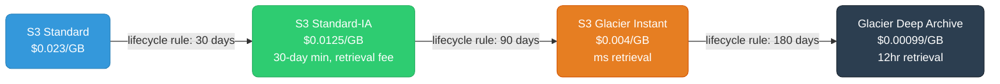

# AWS Cost Optimization

AWS bills grow quietly until they don't — understanding the commitment models, transfer pricing, and rightsizing levers is what separates teams that control their bill from teams that react to it.

<div class="quiz-progress" data-quiz-progress>
  <span class="quiz-progress-label">0/0 checks</span>
  <span class="quiz-progress-bar"><span class="quiz-progress-fill"></span></span>
</div>

---

## Commitment Models: On-Demand, Reserved, Savings Plans, Spot

Four pricing tiers govern EC2, Lambda, and Fargate costs. The right mix depends on workload predictability and risk tolerance.

<div class="tab-group">
  <div class="tab-buttons">
    <button data-tab="od" class="active">On-Demand</button>
    <button data-tab="ri">Reserved Instances</button>
    <button data-tab="sp">Savings Plans</button>
    <button data-tab="spot">Spot</button>
  </div>
  <div class="tab-panels">
    <div class="tab-panel active" data-tab-panel="od">

**On-Demand** — pay per second (or hour), no commitment. Full flexibility. Full price.

- Baseline: `t3.medium` ~$0.0416/hr in us-east-1
- Use for: unpredictable workloads, short-lived jobs, testing, anything you can't commit to for 1–3 years
- Never use for: steady-state production workloads you know will run 24/7

On-Demand is the reference price — every other model is a discount off this number.

    </div>
    <div class="tab-panel" data-tab-panel="ri">

**Reserved Instances (RIs)** — 1-year or 3-year commitment to a specific instance family in a specific region. Up to 72% discount vs On-Demand.

Types:
- **Standard RI**: locked to instance family + OS + tenancy. Largest discount. Can be sold on the RI Marketplace if unused.
- **Convertible RI**: can change instance family, OS, tenancy. ~54% discount. Not sellable.
- **Zonal RI**: reserved in a specific AZ; guarantees capacity reservation. Slightly lower discount than regional.

Payment options: All Upfront > Partial Upfront > No Upfront (same discount, different cash flow).

Best for: EC2 instances you know will run for 1+ years (production databases, always-on services). RIs are instance-specific — a `m5.xlarge` RI doesn't apply to a `m6i.xlarge` instance.

    </div>
    <div class="tab-panel" data-tab-panel="sp">

**Savings Plans** — commitment to a dollar-per-hour spend, not a specific instance. More flexible than RIs. Up to 66% discount.

Three types:
- **Compute Savings Plan**: applies to EC2 (any family, region, OS), Lambda, and Fargate. Most flexible.
- **EC2 Instance Savings Plan**: applies to one instance family in one region (e.g., all `m` instances in us-east-1). Larger discount than Compute SP.
- **SageMaker Savings Plan**: SageMaker ML instance hours only.

```bash
# View recommendations from AWS
aws ce get-savings-plans-purchase-recommendation \
  --savings-plans-type COMPUTE_SP \
  --term-in-years ONE_YEAR \
  --payment-option NO_UPFRONT \
  --lookback-period-in-days SIXTY_DAYS
```

Savings Plans apply automatically — the hourly commitment is deducted from your bill across covered services. Unused commitment is still charged. Start with a conservative commitment (70% of steady-state spend) and top up over time.

    </div>
    <div class="tab-panel" data-tab-panel="spot">

**Spot Instances** — unused EC2 capacity at 60–90% discount. AWS can reclaim with a 2-minute warning (`SIGTERM` → instance termination).

Use Spot for: batch jobs, ML training, CI runners, stateless web tier behind a load balancer, Spark/EMR workers.

Never use Spot for: databases, stateful applications that can't checkpoint, anything where a 2-minute warning is insufficient.

```bash
# EKS managed node group with mixed On-Demand + Spot
aws eks create-nodegroup \
  --cluster-name prod \
  --nodegroup-name mixed-pool \
  --instance-types m5.xlarge m5a.xlarge m4.xlarge \  # multiple families = fewer interruptions
  --capacity-type SPOT \
  --scaling-config minSize=2,maxSize=20,desiredSize=5
```

Use **Spot Fleet** with `diversified` allocation strategy across multiple instance types and AZs — the more substitutes you allow, the rarer the interruption.

    </div>
  </div>
</div>

---

## EC2 Rightsizing

**Rightsizing** — matching instance size to actual resource consumption. Over-provisioned instances are the most common source of wasted AWS spend.

**Compute Optimizer** — AWS's ML-based rightsizing service. Analyzes 14 days of CloudWatch metrics and recommends instance changes.

```bash
# Get recommendations for all EC2 instances in the account
aws compute-optimizer get-ec2-instance-recommendations \
  --filters name=Finding,values=Overprovisioned
```

Findings:
- **Overprovisioned**: CPU/memory consistently below 40% — downsize.
- **Underprovisioned**: CPU/memory spiking — upsize or use auto-scaling.
- **Optimized**: leave it.

Signals that indicate overprovisioning:
- `CPUUtilization` (CloudWatch) < 10% average over 14 days
- Memory (via CloudWatch agent) < 30% average
- Network throughput < 20% of baseline bandwidth

**Instance family selection** — don't default to `m` (general purpose). Match the instance family to the workload:

| Workload | Family | Why |
|----------|--------|-----|
| General compute | `m7i`, `m7g` | Balanced CPU/memory |
| CPU-intensive (transcoding, HPC) | `c7i`, `c7g` | Higher CPU-to-memory ratio, lower $/vCPU |
| Memory-intensive (Redis, SAP, in-memory DB) | `r7i`, `r7g` | Higher memory-to-CPU ratio |
| Storage-intensive (Kafka brokers, Cassandra) | `i4i`, `im4gn` | NVMe local SSDs |
| ML training (GPU) | `p4de`, `g5` | A100 / A10G GPUs |

Graviton (`g` suffix: `m7g`, `c7g`, `r7g`) costs 10–20% less than x86 equivalents at the same performance tier for most workloads. Switch if your software runs on ARM.

---

## Spot Instances in Practice

**Interruption model** — AWS sends a `instance-action: terminate` metadata notification 2 minutes before reclaiming. Poll `http://169.254.169.254/latest/meta-data/spot/instance-action` every 5 seconds, or use EventBridge rule on `EC2 Spot Instance Interruption Warning`.

```python
# Graceful shutdown handler on Spot interruption
import requests, time, subprocess

def check_interruption():
    resp = requests.get(
        "http://169.254.169.254/latest/meta-data/spot/instance-action",
        timeout=0.1
    )
    if resp.status_code == 200:
        # 2 minutes to clean up
        subprocess.run(["systemctl", "stop", "my-worker"])
        drain_queue_and_checkpoint()
```

**Karpenter NodePool with Spot fallback:**

```yaml
apiVersion: karpenter.sh/v1beta1
kind: NodePool
metadata:
  name: default
spec:
  template:
    spec:
      requirements:
        - key: karpenter.sh/capacity-type
          operator: In
          values: ["spot", "on-demand"]  # prefer spot, fall back to on-demand
        - key: node.kubernetes.io/instance-type
          operator: In
          values: ["m5.xlarge", "m5a.xlarge", "m6i.xlarge", "m6a.xlarge"]
      nodeClassRef:
        name: default
  disruption:
    consolidationPolicy: WhenUnderutilized
    consolidateAfter: 30s
```

Karpenter handles Spot interruption by proactively cordoning and draining the node when the 2-minute warning arrives. PodDisruptionBudgets are honored during drain.

---

## S3 Cost Levers

S3 costs have three components: storage ($/GB/month), requests ($/1000), and data transfer ($/GB out).

**Storage classes and transitions:**



**Intelligent-Tiering** — AWS automatically moves objects between Standard and IA (after 30 days inactive) and optionally to Glacier tiers. No retrieval fees (unlike Standard-IA). Add a $0.0025/1000 objects monitoring charge. Enable on buckets where access patterns are unknown.

```bash
aws s3api put-bucket-intelligent-tiering-configuration \
  --bucket my-logs \
  --id EntireBucket \
  --intelligent-tiering-configuration '{
    "Id": "EntireBucket",
    "Status": "Enabled",
    "Tierings": [
      {"Days": 90, "AccessTier": "ARCHIVE_ACCESS"},
      {"Days": 180, "AccessTier": "DEEP_ARCHIVE_ACCESS"}
    ]
  }'
```

**S3 request costs** — PUT/COPY/POST/LIST cost $0.005/1000; GET $0.0004/1000. High PUT rates (logging, streaming writes) add up fast. Batch small writes into larger objects where possible.

**S3 Lens** — organization-wide storage analytics dashboard. Identifies: largest buckets, buckets with most PUT/GET costs, buckets missing lifecycle rules, cross-region replication costs.

---

## Data Transfer Costs

Data transfer is often the hidden cost that grows with scale. The pricing hierarchy:

| Transfer type | Cost |
|--------------|------|
| Same AZ (within VPC, between EC2 instances) | Free |
| Same region, different AZ | $0.01/GB each direction |
| Between regions | $0.02–$0.09/GB depending on regions |
| To internet (egress) | First 100 GB/month free, then $0.09/GB |
| From internet (ingress) | Free |
| CloudFront → internet | $0.0085–$0.12/GB (cheaper than direct egress) |

**Common waste patterns:**

1. **Cross-AZ RDS traffic**: if your app server is in AZ-a and reads from a read replica in AZ-b, every query incurs $0.01/GB both ways. Place read replicas in the same AZ as the app tier — or use a single-AZ read replica and accept the HA tradeoff.

2. **NAT Gateway for intra-VPC calls**: traffic from a private subnet to an S3 or DynamoDB endpoint via NAT Gateway costs $0.045/GB NAT processing + $0.09/GB transfer. Use **VPC Gateway Endpoints** (free) for S3 and DynamoDB, and **PrivateLink Interface Endpoints** for other AWS services.

```bash
# Free VPC Gateway Endpoint for S3 — eliminates NAT Gateway charges for S3 traffic
aws ec2 create-vpc-endpoint \
  --vpc-id vpc-0abc123 \
  --service-name com.amazonaws.us-east-1.s3 \
  --route-table-ids rtb-0def456
```

3. **CloudWatch Logs cross-region**: shipping logs from us-west-2 to a central us-east-1 bucket incurs cross-region transfer. Keep logs in their origin region and query with CloudWatch Logs Insights cross-account, or use S3 replication with lifecycle rules.

---

## RDS Cost Optimization

**Reserved Instances for RDS** — 1-year or 3-year commitment, up to 69% savings. Unlike EC2 RIs, RDS RIs apply to the instance class + engine combination (e.g., `db.r6g.xlarge` + PostgreSQL).

**Aurora Serverless v2** — scales ACUs (Aurora Capacity Units) in 0.5 ACU increments (0.5 ACU ≈ 1 GB RAM). Cost: $0.12/ACU-hour. Minimum 0.5 ACU. Use for: dev/staging databases with variable traffic, databases that can drop to near-zero during off-hours.

**Stopping dev databases** — RDS instances can be stopped for up to 7 days (they auto-start after 7 days). Automate start/stop with EventBridge + Lambda:

```bash
# Stop all tagged dev instances at 7pm weekdays
# EventBridge rule: cron(0 13 ? * MON-FRI *)
aws rds stop-db-instance --db-instance-identifier dev-postgres
```

Stopped instances still charge for storage. Move snapshots to S3 for long-term storage.

---

## EKS Cost Optimization

**Karpenter bin-packing** — consolidates workloads onto fewer, fuller nodes. Unlike Cluster Autoscaler (which only adds/removes nodes), Karpenter's consolidation actively replaces underutilized nodes with smaller ones.

```yaml
disruption:
  consolidationPolicy: WhenUnderutilized
  consolidateAfter: 30s  # how long to wait before acting on underutilization
```

**Goldilocks** — installs VPA in recommendation-only mode and surfaces per-namespace right-sizing suggestions in a dashboard. Shows current requests vs VPA recommendation for every deployment.

```bash
helm repo add fairwinds-stable https://charts.fairwinds.com/stable
helm install goldilocks fairwinds-stable/goldilocks -n goldilocks --create-namespace
kubectl label namespace my-app goldilocks.fairwinds.com/enabled=true
kubectl port-forward -n goldilocks svc/goldilocks-dashboard 8080:80
```

**Kubecost** — per-namespace, per-label, per-team cost attribution using real AWS pricing data.

```bash
helm repo add kubecost https://kubecost.github.io/cost-analyzer/
helm install kubecost kubecost/cost-analyzer -n kubecost --create-namespace \
  --set kubecostToken="$(echo -n 'your-token' | base64)"
```

Key views: Allocations (cost by namespace/label), Savings (idle resources, over-provisioned pods, abandoned PVCs), Assets (EC2 cost by node).

---

## Cost Allocation and Visibility

**Cost allocation tags** — tag EC2, RDS, S3, and other resources. Activate tags in the Billing Console. Tagged resources appear as dimensions in Cost Explorer.

```bash
# Tag resources at creation
aws ec2 run-instances ... --tag-specifications \
  'ResourceType=instance,Tags=[{Key=team,Value=payments},{Key=env,Value=prod}]'

# Or retroactively (for existing resources)
aws ec2 create-tags --resources i-0abc123 \
  --tags Key=team,Value=payments Key=env,Value=prod
```

**Cost and Usage Report (CUR)** — line-item billing data delivered to S3 (hourly or daily). Query with Athena for custom analysis:

```sql
-- Top 10 services by cost last 30 days
SELECT line_item_product_code,
       ROUND(SUM(line_item_unblended_cost), 2) AS total_cost
FROM "aws_cur"."cur"
WHERE month = '2024-01'
GROUP BY line_item_product_code
ORDER BY total_cost DESC
LIMIT 10;
```

Use AWS Organizations with a management account CUR to get cross-account visibility in a single Athena table.

<div class="quiz-card">
  <p class="quiz-q">Your team runs 20 `m5.xlarge` EC2 instances 24/7 for a production service that has run stably for 18 months. You're considering a Compute Savings Plan vs Standard Reserved Instances. Which should you choose and why?</p>
  <button class="quiz-reveal">Reveal answer</button>
  <div class="quiz-a" hidden>If you're confident you'll stay on `m5.xlarge` (or equivalent) for 1–3 years, Standard Reserved Instances give the highest discount (up to 72% vs On-Demand). If you might migrate to Graviton (`m6g`, `m7g`) or change regions in the commitment period, a Compute Savings Plan is better — it applies to any EC2 family in any region plus Lambda and Fargate, so a future architecture change doesn't strand your commitment. The tradeoff is ~6% less discount for the flexibility. Given 18 months of stability, the RI is the better financial choice, but buy Convertible RIs if there's any chance of switching instance families (e.g., to Graviton for cost savings).</div>
</div>

<div class="quiz-card">
  <p class="quiz-q">Your application in a private VPC subnet makes 10 million S3 GET requests per day to a bucket in the same region. CloudWatch shows NAT Gateway processed 50 GB/day of this traffic. What's the monthly cost impact, and what's the fix?</p>
  <button class="quiz-reveal">Reveal answer</button>
  <div class="quiz-a" hidden>NAT Gateway charges $0.045/GB for data processing. 50 GB/day × 30 days × $0.045 = $67.50/month just for NAT processing, plus $0.09/GB egress if the data leaves the VPC (though S3 same-region is free when not going through NAT). The fix: create a VPC Gateway Endpoint for S3. It's free, requires no NAT Gateway, and routes S3 traffic over AWS's internal network. Update the route table to add a route for the S3 prefix list pointing to the gateway endpoint. The traffic bypasses NAT Gateway entirely. For other AWS services (SSM, Secrets Manager, ECR), use Interface Endpoints (PrivateLink) — they cost $0.01/hour/AZ but eliminate NAT processing charges for high-traffic services.</div>
</div>

<div class="quiz-card">
  <p class="quiz-q">You use Karpenter with a NodePool that allows both Spot and On-Demand. A Spot interruption warning arrives for a node running 3 pods, one of which has a PodDisruptionBudget allowing maxUnavailable: 0. What does Karpenter do, and what happens to the pods?</p>
  <button class="quiz-reveal">Reveal answer</button>
  <div class="quiz-a" hidden>Karpenter receives the EC2 Spot Instance Interruption Warning (2-minute notice via EventBridge) and immediately cordons the node (marks it unschedulable) and begins draining it. During drain, it respects PodDisruptionBudgets — it will attempt to evict the PDB-protected pod, but if eviction is blocked (maxUnavailable: 0 means no pod of that deployment can be unavailable), Karpenter will wait for another pod of the same deployment to become ready on a different node before proceeding. If a replacement node provisions and the pod reschedules within the 2-minute window, the drain succeeds cleanly. If not, the node terminates and the PDB-protected pod is forcibly removed — AWS doesn't extend the 2-minute window for PDB compliance. Mitigation: ensure deployments with strict PDBs have sufficient replicas on healthy nodes before Spot interruptions occur (use pod anti-affinity to spread replicas across nodes/AZs).</div>
</div>
