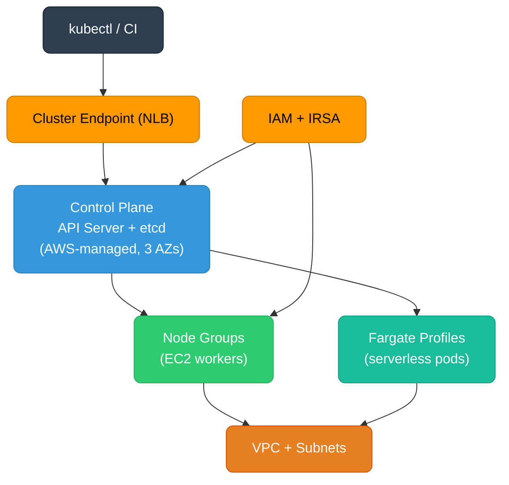

# Amazon EKS: Architecture, Node Groups, and Production Operations

Amazon Elastic Kubernetes Service (EKS) is AWS's managed Kubernetes control plane — it runs the API server, etcd, and scheduler for you, while you own the worker nodes and workloads.

<div class="quiz-progress" data-quiz-progress>
  <span class="quiz-progress-label">0/0 checks</span>
  <span class="quiz-progress-bar"><span class="quiz-progress-fill"></span></span>
</div>

---

## Architecture

**Control plane** — AWS runs one API server + etcd cluster per EKS cluster, across three AZs, automatically upgraded for minor patches. You never SSH into a control plane node.

**Data plane** — EC2 instances (worker nodes) that you provision and manage. They run kubelet, kube-proxy, and the VPC CNI plugin. Nodes join the cluster by calling the API server over the cluster endpoint.

**Cluster endpoint** — an AWS-managed NLB DNS name. Can be public (default), private (VPC-only), or both. Private-only forces all kubectl traffic through VPC, at the cost of requiring a bastion or VPN for developer access.



**VPC CNI (aws-node)** — each pod gets a real VPC IP from the node's ENI secondary IPs. This means pod IPs are routable within the VPC — no overlay network. Trade-off: you need enough IP space (`/22` or larger subnets recommended).

---

## Node Group Types

<div class="tab-group">
  <div class="tab-buttons">
    <button data-tab="managed" class="active">Managed Node Groups</button>
    <button data-tab="self-managed">Self-Managed</button>
    <button data-tab="fargate">Fargate Profiles</button>
  </div>
  <div class="tab-panels">
    <div class="tab-panel active" data-tab-panel="managed">

**Managed Node Groups** — AWS creates and manages the underlying Auto Scaling Group. Drains nodes before termination, handles AMI upgrades, integrates with EC2 health checks.

```bash
# Create a managed node group
eksctl create nodegroup \
  --cluster my-cluster \
  --name general-purpose \
  --node-type m5.xlarge \
  --nodes 3 \
  --nodes-min 2 \
  --nodes-max 10 \
  --managed

# Upgrade the AMI (drains nodes one at a time)
eksctl upgrade nodegroup \
  --cluster my-cluster \
  --name general-purpose
```

Best for: most production workloads. AWS handles node drain ordering, which prevents sudden termination of running pods.

When NOT to use: if you need custom AMIs with kernel patches, GPU drivers not yet in EKS-optimized AMI, or spot interruption handling beyond what managed groups provide.

    </div>
    <div class="tab-panel" data-tab-panel="self-managed">

**Self-Managed Node Groups** — you create the EC2 Auto Scaling Group using an EKS-optimized AMI (or your own). You script the `bootstrap.sh` call and handle node drains on scale-in.

```bash
# User data for self-managed nodes
/etc/eks/bootstrap.sh my-cluster \
  --b64-cluster-ca $CA \
  --apiserver-endpoint $ENDPOINT \
  --kubelet-extra-args '--node-labels=role=gpu'

# Add a lifecycle hook for graceful drain on scale-in
aws autoscaling put-lifecycle-hook \
  --lifecycle-hook-name drain-hook \
  --auto-scaling-group-name my-ng-asg \
  --lifecycle-transition autoscaling:EC2_INSTANCE_TERMINATING \
  --heartbeat-timeout 300
```

Requires a separate Lambda or Karpenter interrupt handler to drain the node before ASG terminates it. Without this, pods get killed without graceful termination.

Best for: custom kernels, GPU nodes with specific driver versions, compliance-required hardened AMIs.

    </div>
    <div class="tab-panel" data-tab-panel="fargate">

**Fargate Profiles** — pods run on AWS-managed micro-VMs. No nodes to manage. AWS allocates vCPU/memory matching the pod's resource request, rounds up to the nearest Fargate size.

```yaml
# Fargate profile: route namespace to Fargate
apiVersion: eksctl.io/v1alpha5
kind: ClusterConfig
metadata:
  name: my-cluster
  region: us-east-1
fargateProfiles:
  - name: serverless
    selectors:
      - namespace: serverless-workloads
      - namespace: kube-system
        labels:
          k8s-app: kube-dns
```

Constraints: no DaemonSets (no node to run them on), no privileged containers, no hostNetwork, no persistent volumes (EBS not supported — use EFS). Max 4 vCPU / 30 GB per pod.

Cost model: billed per vCPU-second + GB-second consumed, rounded up to 1-minute minimum. For bursty, short-lived batch jobs — cheaper than always-on nodes. For long-running services — managed node groups are almost always cheaper.

    </div>
  </div>
</div>

<div class="quiz-card">
  <p class="quiz-q">A team deploys a DaemonSet for log collection and finds it only runs on EC2 nodes, not on pods in the `serverless-workloads` namespace. Why?</p>
  <button class="quiz-reveal">Reveal answer</button>
  <div class="quiz-a" hidden>Fargate profiles route pods to AWS-managed micro-VMs, one VM per pod. DaemonSets are scheduled to nodes — since there are no visible nodes backing Fargate pods, there's no node for the DaemonSet to land on. The log collection DaemonSet simply never gets scheduled to "nodes" backing the Fargate pods. The standard workaround is to use Fluent Bit as a sidecar container in each Fargate pod, or route logs via application-level shipping (e.g., structured JSON to stdout → AWS Firehose).</div>
</div>

---

## IAM and Authentication

EKS uses two separate auth mechanisms that must both grant access before a principal can use the cluster.

**Step 1 — AWS auth**: the caller must have valid AWS credentials that pass IAM policy evaluation (e.g., `eks:DescribeCluster`, `eks:AccessKubernetesApi`).

**Step 2 — Kubernetes RBAC**: the caller's IAM identity must be mapped to a Kubernetes user/group in `aws-auth` ConfigMap (legacy) or EKS Access Entries (newer API).

```yaml
# Legacy: aws-auth ConfigMap in kube-system
apiVersion: v1
kind: ConfigMap
metadata:
  name: aws-auth
  namespace: kube-system
data:
  mapRoles: |
    - rolearn: arn:aws:iam::123456789:role/NodeInstanceRole
      username: system:node:{{EC2PrivateDNSName}}
      groups:
        - system:bootstrappers
        - system:nodes
    - rolearn: arn:aws:iam::123456789:role/dev-team-role
      username: dev-team
      groups:
        - dev-readonly
```

```bash
# Preferred: EKS Access Entries (no ConfigMap edits needed)
aws eks create-access-entry \
  --cluster-name my-cluster \
  --principal-arn arn:aws:iam::123456789:role/dev-team-role \
  --type STANDARD

aws eks associate-access-policy \
  --cluster-name my-cluster \
  --principal-arn arn:aws:iam::123456789:role/dev-team-role \
  --policy-arn arn:aws:eks::aws:cluster-access-policy/AmazonEKSViewPolicy \
  --access-scope '{"type":"namespace","namespaces":["staging"]}'
```

**IRSA (IAM Roles for Service Accounts)** — binds an IAM role to a Kubernetes ServiceAccount via OIDC. Pods using that ServiceAccount get temporary AWS credentials injected as environment variables by the pod identity webhook.

```bash
# Create OIDC provider for the cluster
eksctl utils associate-iam-oidc-provider \
  --cluster my-cluster --approve

# Create IAM role trusted by the SA
eksctl create iamserviceaccount \
  --cluster my-cluster \
  --namespace production \
  --name s3-reader \
  --attach-policy-arn arn:aws:iam::aws:policy/AmazonS3ReadOnlyAccess \
  --approve
```

<div class="quiz-card">
  <p class="quiz-q">A pod using IRSA needs to read from S3. The ServiceAccount is correctly annotated, but the pod gets `AccessDenied`. The node's instance profile has `AmazonS3FullAccess`. What's the likely issue?</p>
  <button class="quiz-reveal">Reveal answer</button>
  <div class="quiz-a" hidden>With IRSA, the pod's AWS SDK prefers the projected ServiceAccount token (OIDC-based) over the EC2 instance metadata. When IRSA is configured correctly, the pod assumes its IAM role — not the node's instance profile. `AccessDenied` means the IRSA role itself lacks the S3 permission. Check the role's trust policy (OIDC condition must match namespace + SA name exactly) and its attached policies. The node's `AmazonS3FullAccess` is irrelevant to the pod's credential chain once IRSA is active.</div>
</div>

---

## Networking

**VPC CNI** assigns each pod a secondary IP from the node's ENI. Node must have capacity: an `m5.large` supports 3 ENIs × 10 secondary IPs = 29 pods max (minus one per ENI for the primary IP). Plan instance type based on pod density.

```bash
# Check ENI limits for instance types
aws ec2 describe-instance-types \
  --instance-types m5.large m5.xlarge \
  --query 'InstanceTypes[*].{Type:InstanceType,MaxENI:NetworkInfo.MaximumNetworkInterfaces,MaxIPs:NetworkInfo.Ipv4AddressesPerInterface}'
```

**CoreDNS** runs as a Deployment (2 replicas by default) in `kube-system`. Every pod's `/etc/resolv.conf` points to the CoreDNS ClusterIP (`10.96.0.10` by default). DNS queries for `.cluster.local` are resolved by CoreDNS; all others are forwarded to the VPC resolver at `169.254.169.253`.

**AWS Load Balancer Controller** — replaces the deprecated in-tree cloud controller. Provisions ALBs for `Ingress` resources and NLBs for `Service type=LoadBalancer`. Install via Helm:

```bash
helm repo add eks https://aws.github.io/eks-charts
helm install aws-load-balancer-controller eks/aws-load-balancer-controller \
  -n kube-system \
  --set clusterName=my-cluster \
  --set serviceAccount.create=false \
  --set serviceAccount.name=aws-load-balancer-controller
```

**Key Ingress annotations**:

```yaml
apiVersion: networking.k8s.io/v1
kind: Ingress
metadata:
  annotations:
    kubernetes.io/ingress.class: alb
    alb.ingress.kubernetes.io/scheme: internet-facing
    alb.ingress.kubernetes.io/target-type: ip         # pod IPs directly, no NodePort
    alb.ingress.kubernetes.io/certificate-arn: arn:aws:acm:...
    alb.ingress.kubernetes.io/listen-ports: '[{"HTTP":80,"HTTPS":443}]'
    alb.ingress.kubernetes.io/ssl-redirect: '443'
```

---

## Autoscaling

**Cluster Autoscaler (CA)** — watches for unschedulable pods, scales the matching ASG up. On scale-down, finds underutilized nodes and cordons/drains before terminating. Requires a node group per AZ (or use `--balance-similar-node-groups`).

```yaml
# Cluster Autoscaler deployment snippet
containers:
- command:
  - ./cluster-autoscaler
  - --cloud-provider=aws
  - --namespace=kube-system
  - --node-group-auto-discovery=asg:tag=k8s.io/cluster-autoscaler/enabled,k8s.io/cluster-autoscaler/my-cluster
  - --balance-similar-node-groups
  - --skip-nodes-with-system-pods=false
  - --scale-down-delay-after-add=10m
```

**Karpenter** — replaces CA for most use cases. Watches for unschedulable pods and launches EC2 instances directly (bypasses ASG), selecting the cheapest instance type that fits the pod's resource request. Interruption handling built-in.

```yaml
apiVersion: karpenter.sh/v1beta1
kind: NodePool
metadata:
  name: general
spec:
  template:
    spec:
      requirements:
        - key: karpenter.sh/capacity-type
          operator: In
          values: ["spot", "on-demand"]
        - key: node.kubernetes.io/instance-type
          operator: In
          values: ["m5.large", "m5.xlarge", "m4.large"]
      nodeClassRef:
        apiVersion: karpenter.k8s.aws/v1beta1
        kind: EC2NodeClass
        name: default
  limits:
    cpu: 1000
  disruption:
    consolidationPolicy: WhenUnderutilized
    consolidateAfter: 30s
```

Karpenter consolidation reclaims underutilized nodes by bin-packing pods onto fewer nodes and terminating the empties. CA scale-down takes minutes; Karpenter consolidation can act in seconds.

<div class="quiz-card">
  <p class="quiz-q">Cluster Autoscaler is configured with a node group per AZ. A pod with `topologySpreadConstraints` requiring one replica per AZ lands, but CA only adds nodes in us-east-1a and us-east-1b. us-east-1c gets no new node. What's wrong?</p>
  <button class="quiz-reveal">Reveal answer</button>
  <div class="quiz-a" hidden>CA simulates pod scheduling to decide which node group to expand. If the node group for us-east-1c has a `maxSize` already reached, or if the ASG ran into an EC2 capacity shortage in that AZ, CA won't expand it and the pod remains unschedulable. Check: (1) the node group's `maxSize` in the ASG, (2) EC2 capacity (CA logs will show "not enough capacity" events), and (3) whether `--balance-similar-node-groups` is set — without it, CA may favor one AZ's group consistently. Karpenter avoids this by launching instances directly across AZs based on pod topology constraints.</div>
</div>

---

## Storage

**EBS CSI Driver** — provisions EBS volumes as PersistentVolumes. EBS is AZ-scoped: a pod can only mount a volume in the same AZ as its node. Use `volumeBindingMode: WaitForFirstConsumer` to delay provisioning until the pod is scheduled (so PV lands in the right AZ).

```yaml
apiVersion: storage.k8s.io/v1
kind: StorageClass
metadata:
  name: gp3
provisioner: ebs.csi.aws.com
volumeBindingMode: WaitForFirstConsumer
parameters:
  type: gp3
  iops: "3000"
  throughput: "125"
```

**EFS CSI Driver** — NFS-backed, multi-AZ, ReadWriteMany support. Works with Fargate. Use for shared config, ML model weights, or any workload needing shared persistent storage across pods.

```bash
# Install EFS CSI driver
helm install aws-efs-csi-driver \
  aws-efs-csi-driver/aws-efs-csi-driver \
  -n kube-system \
  --set controller.serviceAccount.annotations."eks\.amazonaws\.com/role-arn"=arn:aws:iam::123456789:role/efs-csi-role
```

---

## Observability

**CloudWatch Container Insights** — collects CPU, memory, disk, and network metrics per pod/node. Enabled by deploying the CloudWatch agent as a DaemonSet. Charges per metric ingested — watch costs on large clusters.

```bash
ClusterName=my-cluster
RegionName=us-east-1
FluentBitHttpPort='2020'
FluentBitReadFromHead='Off'
curl https://raw.githubusercontent.com/aws-samples/amazon-cloudwatch-container-insights/latest/k8s-deployment-manifest-templates/deployment-mode/daemonset/container-insights-monitoring/quickstart/cwagent-fluent-bit-quickstart.yaml | \
  sed "s/{{cluster_name}}/$ClusterName/;s/{{region_name}}/$RegionName/;s/{{http_server_port}}/$FluentBitHttpPort/;s/{{read_from_head}}/$FluentBitReadFromHead/" | kubectl apply -f -
```

**ADOT (AWS Distro for OpenTelemetry)** — AWS-supported OTel collector for shipping traces to X-Ray and metrics to CloudWatch or AMP (Amazon Managed Prometheus). Prefer ADOT over installing upstream OTel collector when using AWS backends — ADOT handles authentication natively.

---

## Cluster Upgrade Process

EKS releases new Kubernetes minor versions roughly every 3 months, and supports each for ~14 months. Control plane and data plane must be upgraded separately.

```bash
# 1. Upgrade control plane (in-place, zero downtime for managed control plane)
aws eks update-cluster-version \
  --name my-cluster \
  --kubernetes-version 1.30

# Wait for control plane upgrade to complete
aws eks wait cluster-active --name my-cluster

# 2. Upgrade add-ons to versions compatible with 1.30
aws eks update-addon \
  --cluster-name my-cluster \
  --addon-name kube-proxy \
  --addon-version v1.30.0-eksbuild.2

aws eks update-addon --cluster-name my-cluster --addon-name vpc-cni --addon-version v1.18.3-eksbuild.1
aws eks update-addon --cluster-name my-cluster --addon-name coredns --addon-version v1.11.1-eksbuild.4

# 3. Upgrade managed node groups (drains one node at a time)
aws eks update-nodegroup-version \
  --cluster-name my-cluster \
  --nodegroup-name general-purpose
```

**Skew policy**: kubelet can be at most two minor versions behind the API server. So when upgrading from 1.28 → 1.30, the node group running 1.28 kubelet is still valid (1.30 API, 1.28 kubelet = 2 versions behind = allowed). Don't skip minor versions on control plane.

<div class="quiz-card">
  <p class="quiz-q">After upgrading the EKS control plane from 1.28 to 1.29, a managed node group is still on 1.28 AMI. A deployment using a 1.29 API field fails to apply. Is the node version the cause?</p>
  <button class="quiz-reveal">Reveal answer</button>
  <div class="quiz-a" hidden>No — nodes running 1.28 kubelet against a 1.29 API server are within the two-version skew policy. The issue is the API request itself: the control plane is at 1.29 and handles API requests, regardless of node versions. If the manifest uses a 1.29-specific field, the control plane should accept it. The real cause is likely a client-side issue: kubectl or the CI tool is sending a 1.28-format request that doesn't include the new field, or the field is being silently dropped by a validating webhook. Check with `kubectl --v=8` to see the exact API call being sent.</div>
</div>

---

## Security Hardening

**Pod Security Standards** — enforced at the namespace level. Replace PodSecurityPolicy (removed in 1.25).

```bash
# Enforce restricted PSS on a namespace
kubectl label namespace production \
  pod-security.kubernetes.io/enforce=restricted \
  pod-security.kubernetes.io/enforce-version=v1.29
```

**Network policies** — EKS VPC CNI supports Kubernetes NetworkPolicy natively (1.14+ with `--enable-network-policy` flag on the CNI). Default-deny all ingress + explicit allows is the baseline.

```yaml
# Default deny all ingress in a namespace
apiVersion: networking.k8s.io/v1
kind: NetworkPolicy
metadata:
  name: default-deny-ingress
  namespace: production
spec:
  podSelector: {}
  policyTypes: [Ingress]
```

**Secrets encryption** — enable envelope encryption of Kubernetes secrets with a KMS key. Once enabled, all secrets at rest in etcd are encrypted under the KMS CMK.

```bash
aws eks create-cluster \
  --encryption-config '[{"resources":["secrets"],"provider":{"keyArn":"arn:aws:kms:us-east-1:123456789:key/..."}}'
```

**Control plane logging** — enable API server, audit, authenticator, controller manager, and scheduler logs to CloudWatch. Audit logs are most useful for security investigations.

```bash
aws eks update-cluster-config \
  --name my-cluster \
  --logging '{"clusterLogging":[{"types":["api","audit","authenticator","controllerManager","scheduler"],"enabled":true}]}'
```
