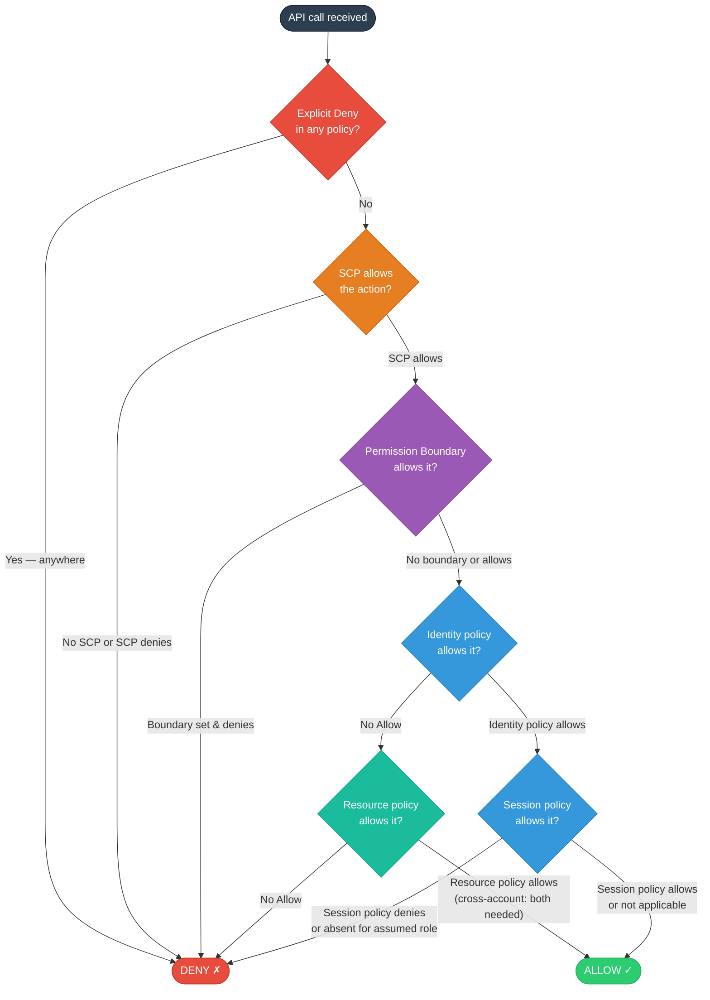
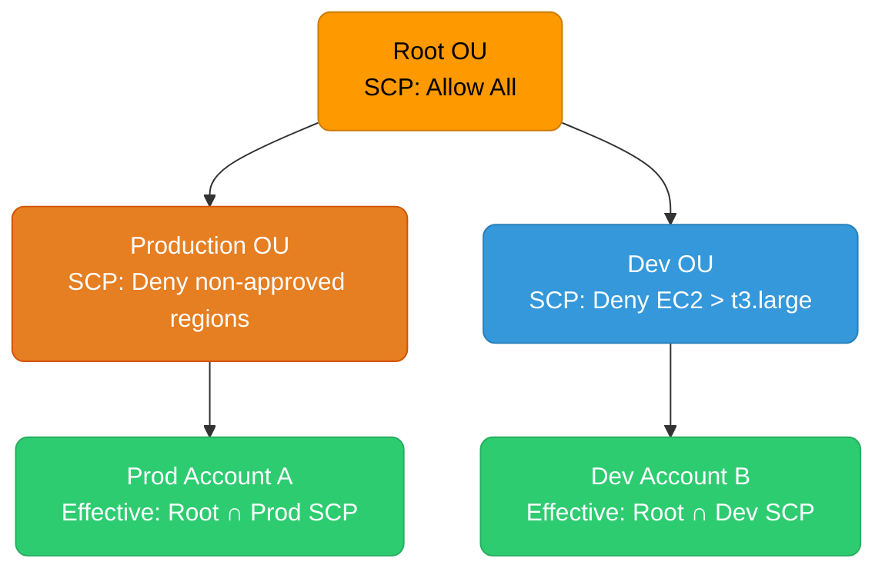

# IAM Deep Dive: Policies, Roles, and Permission Boundaries

IAM is the authorization fabric of AWS — every API call, from every principal, is evaluated against a chain of policy documents before being allowed or denied.

<div class="quiz-progress" data-quiz-progress>
  <span class="quiz-progress-label">0/0 checks</span>
  <span class="quiz-progress-bar"><span class="quiz-progress-fill"></span></span>
</div>

---

## Policy Evaluation Logic

When AWS receives an API call, it runs every applicable policy through a deterministic decision tree. The order matters: an explicit deny at any layer wins over any allow.



**Explicit Deny** — any `"Effect": "Deny"` in any evaluated policy immediately ends evaluation with DENY. Not even a root user can override an explicit deny in an SCP.

**SCPs (Service Control Policies)** — org-level guardrails. They don't grant permissions; they set the maximum permissions for any identity in the account. If an SCP doesn't allow S3:DeleteBucket, no role in the account can delete S3 buckets — even if the role policy allows it.

**Permission boundaries** — an IAM policy attached to a role or user that caps what that identity can do. A role with `AdministratorAccess` but a boundary of `S3ReadOnly` can only read S3.

**Identity policies** — attached to the calling role/user. The standard policy type.

**Resource policies** — attached to the target resource (S3 bucket policy, KMS key policy, SQS queue policy). For cross-account calls, both the caller's identity policy AND the resource policy must allow the action.

**Session policies** — passed inline when calling `sts:AssumeRole`, `sts:GetFederationToken`. Can only further restrict the assumed role's permissions, never expand them.

<div class="quiz-card">
  <p class="quiz-q">A role has `AdministratorAccess` attached. An SCP on the account allows all actions. A permission boundary is set to allow only `s3:*` and `ec2:*`. The role calls `iam:CreateUser`. What happens?</p>
  <button class="quiz-reveal">Reveal answer</button>
  <div class="quiz-a" hidden>DENY. The permission boundary caps what the role can do — it only allows `s3:*` and `ec2:*`. Even though the identity policy (`AdministratorAccess`) allows `iam:CreateUser` and the SCP doesn't restrict it, the permission boundary evaluation step returns "deny" for `iam:CreateUser`. The effective permissions are the intersection of identity policy AND permission boundary.</div>
</div>

---

## Policy Types in Depth

<div class="tab-group">
  <div class="tab-buttons">
    <button data-tab="managed" class="active">AWS Managed</button>
    <button data-tab="customer">Customer Managed</button>
    <button data-tab="inline">Inline</button>
    <button data-tab="resource">Resource-Based</button>
  </div>
  <div class="tab-panels">
    <div class="tab-panel active" data-tab-panel="managed">

**AWS Managed Policies** — maintained by AWS. Versioned automatically when AWS adds new services or actions. Safe to use for broad permissions.

```json
{
  "Arn": "arn:aws:iam::aws:policy/AmazonS3ReadOnlyAccess",
  "PolicyName": "AmazonS3ReadOnlyAccess"
}
```

Pros: zero maintenance, automatically cover new S3 API actions as AWS releases them.

Cons: often over-permissive (`ReadOnlyAccess` grants read on dozens of services). Use only when broad access is intentional.

    </div>
    <div class="tab-panel" data-tab-panel="customer">

**Customer Managed Policies** — you define and version them. Reusable across roles. IAM keeps up to 5 versions; you choose the default.

```json
{
  "Version": "2012-10-17",
  "Statement": [
    {
      "Sid": "ReadSpecificBucket",
      "Effect": "Allow",
      "Action": ["s3:GetObject", "s3:ListBucket"],
      "Resource": [
        "arn:aws:s3:::my-app-data",
        "arn:aws:s3:::my-app-data/*"
      ]
    }
  ]
}
```

Best practice for production roles: least privilege, scoped to specific resources, version-controlled in infrastructure-as-code.

    </div>
    <div class="tab-panel" data-tab-panel="inline">

**Inline Policies** — embedded directly in a single user, role, or group. Not reusable. Deleted when the identity is deleted.

```bash
aws iam put-role-policy \
  --role-name my-role \
  --policy-name emergency-s3-access \
  --policy-document file://policy.json
```

Use case: emergency break-glass permissions that must disappear with the role. Avoid for standard policies — they can't be audited across identities without listing each entity individually.

    </div>
    <div class="tab-panel" data-tab-panel="resource">

**Resource-Based Policies** — attached to the resource, not the caller. Grant access to other accounts or services without requiring AssumeRole.

```json
{
  "Version": "2012-10-17",
  "Statement": [{
    "Effect": "Allow",
    "Principal": {
      "AWS": "arn:aws:iam::OTHER-ACCOUNT:role/data-reader"
    },
    "Action": ["s3:GetObject"],
    "Resource": "arn:aws:s3:::shared-data-bucket/*"
  }]
}
```

Services that support resource-based policies: S3, KMS, SQS, SNS, Lambda, Secrets Manager, ECR, API Gateway. Services that don't: EC2, RDS (use identity policies + VPC security groups instead).

    </div>
  </div>
</div>

---

## Roles and AssumeRole

**IAM roles** — identities with no static credentials. Assumed temporarily via STS, which issues time-limited access key + session token (15 min to 12 hrs).

**Trust policy** — the resource-based policy on the role that says who can assume it. A role is useless without a trust policy.

```json
{
  "Version": "2012-10-17",
  "Statement": [
    {
      "Effect": "Allow",
      "Principal": {
        "Service": "ec2.amazonaws.com"
      },
      "Action": "sts:AssumeRole"
    },
    {
      "Effect": "Allow",
      "Principal": {
        "AWS": "arn:aws:iam::CICD-ACCOUNT:role/github-actions"
      },
      "Action": "sts:AssumeRole",
      "Condition": {
        "StringEquals": {
          "sts:ExternalId": "unique-external-id-12345"
        }
      }
    }
  ]
}
```

**ExternalId** — prevents the confused deputy problem: a third-party service that assumes your role on behalf of many customers must prove it's acting for *your* account by providing a customer-specific ExternalId. Without it, a malicious customer of the third party could trick it into operating on your account.

```mermaid
sequenceDiagram
    classDef aws fill:#ff9900,stroke:#cc7a00,color:#000,rx:8

    participant App as Application
    participant STS as AWS STS
    participant Role as Target Role
    participant S3 as S3 (resource)

    App->>STS: AssumeRole(roleArn, sessionName, durationSeconds)
    STS->>STS: Evaluate trust policy
    STS-->>App: AccessKeyId + SecretAccessKey + SessionToken (temp)
    App->>S3: GetObject (signed with temp creds)
    S3->>STS: Validate token
    S3-->>App: Object data
    Note over App,STS: Creds expire after durationSeconds (max 12h)
```

**Role chaining** — assuming a role from within another assumed-role session. Maximum session duration is capped at 1 hour regardless of the role's `MaxSessionDuration`, and temporary credentials from chaining can't be used for some console operations.

---

## IRSA and EKS Pod Identity

Two mechanisms for giving Kubernetes pods AWS credentials without static keys.

<div class="tab-group">
  <div class="tab-buttons">
    <button data-tab="irsa" class="active">IRSA (OIDC)</button>
    <button data-tab="pod-identity">EKS Pod Identity</button>
  </div>
  <div class="tab-panels">
    <div class="tab-panel active" data-tab-panel="irsa">

**IRSA (IAM Roles for Service Accounts)** — uses the cluster's OIDC provider. The pod identity webhook injects `AWS_WEB_IDENTITY_TOKEN_FILE` and `AWS_ROLE_ARN` into pods whose ServiceAccount is annotated with a role ARN. The SDK exchanges the OIDC token for STS credentials.

```bash
# 1. Associate OIDC provider with cluster
eksctl utils associate-iam-oidc-provider \
  --cluster my-cluster --region us-east-1 --approve

# 2. Create role with trust policy scoped to SA
eksctl create iamserviceaccount \
  --cluster my-cluster \
  --namespace production \
  --name s3-reader \
  --attach-policy-arn arn:aws:iam::aws:policy/AmazonS3ReadOnlyAccess \
  --approve

# Trust policy generated automatically:
# Condition: StringEquals
#   token.actions.githubusercontent.com:sub: system:serviceaccount:production:s3-reader
```

Limitation: trust policy must be updated when moving ServiceAccount across namespaces. One role per SA (or use `StringLike` with wildcards, which is less secure).

    </div>
    <div class="tab-panel" data-tab-panel="pod-identity">

**EKS Pod Identity** — newer mechanism (2023). Uses an agent DaemonSet on each node instead of OIDC. Simpler: no OIDC provider setup, no trust policy conditions per namespace/SA.

```bash
# Install the Pod Identity Agent add-on
aws eks create-addon \
  --cluster-name my-cluster \
  --addon-name eks-pod-identity-agent

# Create association: role ↔ namespace/SA
aws eks create-pod-identity-association \
  --cluster-name my-cluster \
  --namespace production \
  --service-account s3-reader \
  --role-arn arn:aws:iam::123456789:role/s3-reader-role
```

The role trust policy only needs to trust `pods.eks.amazonaws.com` — no per-cluster or per-namespace conditions. Moving the SA to another namespace doesn't require trust policy updates.

Limitation: not yet supported on Fargate. IRSA is still required for Fargate pods.

    </div>
  </div>
</div>

<div class="quiz-card">
  <p class="quiz-q">A pod using IRSA works in the `staging` namespace but fails with `AccessDenied` after the team moves the ServiceAccount to `production`. The role ARN annotation is correct. What's wrong?</p>
  <button class="quiz-reveal">Reveal answer</button>
  <div class="quiz-a" hidden>The IRSA trust policy uses a condition that includes the namespace in the OIDC subject claim: `system:serviceaccount:staging:s3-reader`. Moving the ServiceAccount to `production` changes the subject to `system:serviceaccount:production:s3-reader`, which no longer matches the trust policy condition. Fix: update the trust policy condition to use `production` instead of `staging`, or use `StringLike` with `system:serviceaccount:*:s3-reader` (less secure). EKS Pod Identity avoids this problem entirely — the association is namespace-scoped separately from the role trust policy.</div>
</div>

---

## Permission Boundaries

Permission boundaries set the maximum permissions an identity can have. They don't grant anything — they only cap.

```json
{
  "Version": "2012-10-17",
  "Statement": [
    {
      "Effect": "Allow",
      "Action": [
        "s3:*",
        "cloudwatch:*",
        "logs:*"
      ],
      "Resource": "*"
    },
    {
      "Effect": "Deny",
      "Action": [
        "iam:*",
        "organizations:*"
      ],
      "Resource": "*"
    }
  ]
}
```

**Key use case — delegated role creation**: allow a developer team to create their own IAM roles (for Lambda functions, etc.) without being able to escalate privileges. The boundary attached to every role they create prevents those roles from having IAM or Organizations permissions.

```json
{
  "Effect": "Allow",
  "Action": "iam:CreateRole",
  "Resource": "*",
  "Condition": {
    "StringEquals": {
      "iam:PermissionsBoundary": "arn:aws:iam::123456789:policy/DeveloperBoundary"
    }
  }
}
```

This policy says: you can create roles, but only if you attach `DeveloperBoundary` as the permission boundary. Without the Condition, the developer could create a role with `AdministratorAccess` and use it to escalate.

---

## SCPs and AWS Organizations

**SCPs** apply to all identities in an account (including root), but not to the management account itself (the org root account is exempt from SCPs).

```json
{
  "Version": "2012-10-17",
  "Statement": [
    {
      "Sid": "DenyLeavingOrg",
      "Effect": "Deny",
      "Action": "organizations:LeaveOrganization",
      "Resource": "*"
    },
    {
      "Sid": "RequireIMDSv2",
      "Effect": "Deny",
      "Action": "ec2:RunInstances",
      "Resource": "arn:aws:ec2:*:*:instance/*",
      "Condition": {
        "StringNotEquals": {
          "ec2:MetadataHttpTokens": "required"
        }
      }
    },
    {
      "Sid": "DenyNonApprovedRegions",
      "Effect": "Deny",
      "NotAction": [
        "iam:*",
        "organizations:*",
        "support:*",
        "sts:*"
      ],
      "Resource": "*",
      "Condition": {
        "StringNotEquals": {
          "aws:RequestedRegion": ["us-east-1", "us-west-2", "eu-west-1"]
        }
      }
    }
  ]
}
```

**SCP inheritance** — SCPs are attached to the root, OUs (organizational units), or individual accounts. A child OU inherits the parent's SCPs, and the effective SCP is the intersection of all SCPs from root to the account.



---

## Conditions and Context Keys

Conditions make policies context-aware. Common condition keys:

| Condition key | What it checks |
|---|---|
| `aws:RequestedRegion` | Region of the API call |
| `aws:SourceIp` / `aws:VpcSourceIp` | Caller's IP address |
| `aws:MultiFactorAuthPresent` | Whether the caller used MFA |
| `aws:CalledVia` | Which service called on the caller's behalf |
| `aws:PrincipalTag` | IAM tags on the calling identity |
| `aws:ResourceTag` | Tags on the target resource |
| `s3:prefix` | S3 key prefix being listed |
| `iam:PassedToService` | Which service a role is being passed to |

**Attribute-based access control (ABAC)** — use tags to control access instead of hardcoding ARNs. Scale to hundreds of resources without updating policies.

```json
{
  "Effect": "Allow",
  "Action": ["ec2:StartInstances", "ec2:StopInstances"],
  "Resource": "*",
  "Condition": {
    "StringEquals": {
      "aws:ResourceTag/Team": "${aws:PrincipalTag/Team}"
    }
  }
}
```

This policy lets any caller start/stop EC2 instances where the `Team` tag on the instance matches the `Team` tag on the caller's role. Adding a new team and tagging their instances is enough — no policy update needed.

**MFA enforcement**:

```json
{
  "Effect": "Deny",
  "NotAction": [
    "iam:CreateVirtualMFADevice",
    "iam:EnableMFADevice",
    "iam:GetUser",
    "iam:ListMFADevices",
    "iam:ListVirtualMFADevices",
    "iam:ResyncMFADevice",
    "sts:GetSessionToken"
  ],
  "Resource": "*",
  "Condition": {
    "BoolIfExists": {
      "aws:MultiFactorAuthPresent": "false"
    }
  }
}
```

---

## IAM Access Analyzer

Access Analyzer identifies resources with external access (cross-account or public) by analyzing resource-based policies.

```bash
# Create an analyzer for the account
aws accessanalyzer create-analyzer \
  --analyzer-name account-analyzer \
  --type ACCOUNT

# List active findings (externally accessible resources)
aws accessanalyzer list-findings \
  --analyzer-arn arn:aws:access-analyzer:us-east-1:123456789:analyzer/account-analyzer \
  --filter '{"status":{"eq":["ACTIVE"]}}'

# Generate least-privilege policy from CloudTrail activity
aws accessanalyzer generate-policy \
  --policy-generation-details '{"principalArn":"arn:aws:iam::123456789:role/my-role"}' \
  --cloud-trail-details '{"trails":[{"cloudTrailArn":"arn:aws:cloudtrail:...","allRegions":true}],"accessRole":"arn:aws:iam::123456789:role/AccessAnalyzerRole","startTime":"2024-01-01T00:00:00Z","endTime":"2024-03-01T00:00:00Z"}'
```

**Policy generation** — Access Analyzer reads 90 days of CloudTrail and generates a least-privilege policy for a role based on what it actually called. Use this to right-size roles that started with broad permissions.

---

## Common Patterns and Pitfalls

**The PassRole trap** — `iam:PassRole` allows a principal to assign a role to a service (EC2, Lambda, ECS). Without it, a developer can't launch EC2 with an instance profile. With it unrestricted, they can pass any role — including one with more permissions than they have — creating a privilege escalation path.

```json
{
  "Effect": "Allow",
  "Action": "iam:PassRole",
  "Resource": "arn:aws:iam::123456789:role/lambda-execution-*",
  "Condition": {
    "StringEquals": {
      "iam:PassedToService": "lambda.amazonaws.com"
    }
  }
}
```

**Wildcards in resource ARNs** — `"Resource": "arn:aws:s3:::my-*"` matches any bucket whose name starts with `my-`. Use carefully in policies granting destructive actions.

**Action wildcards** — `"Action": "s3:*"` grants all S3 actions including `s3:DeleteBucket`. Prefer explicit action lists for production roles.

**The `aws:CalledVia` condition** — some services call AWS APIs on your behalf (e.g., CloudFormation calling EC2). Without `aws:CalledVia`, a policy can't distinguish a direct call from a service-mediated call. Use this to allow Athena to call S3 and Glue only when the call originates from Athena:

```json
{
  "Effect": "Allow",
  "Action": ["s3:GetObject", "glue:GetTable"],
  "Resource": "*",
  "Condition": {
    "ForAnyValue:StringEquals": {
      "aws:CalledVia": ["athena.amazonaws.com"]
    }
  }
}
```

<div class="quiz-card">
  <p class="quiz-q">A developer has an IAM policy that allows `iam:CreateRole` and `iam:AttachRolePolicy` with no conditions. They don't have `AdministratorAccess`. Explain the privilege escalation risk.</p>
  <button class="quiz-reveal">Reveal answer</button>
  <div class="quiz-a" hidden>The developer can create a new role and attach `AdministratorAccess` to it, then assume that role (if they also have `sts:AssumeRole`) or pass it to an EC2 instance they control. This gives them full admin access even though their own role is restricted. Mitigation: (1) require a permission boundary condition on `iam:CreateRole` so any role they create can't exceed their own permissions, (2) restrict `iam:AttachRolePolicy` to a specific list of approved policy ARNs, (3) use `iam:PermissionsBoundary` condition on both actions. IAM privilege escalation paths are a common finding in AWS security reviews.</div>
</div>
