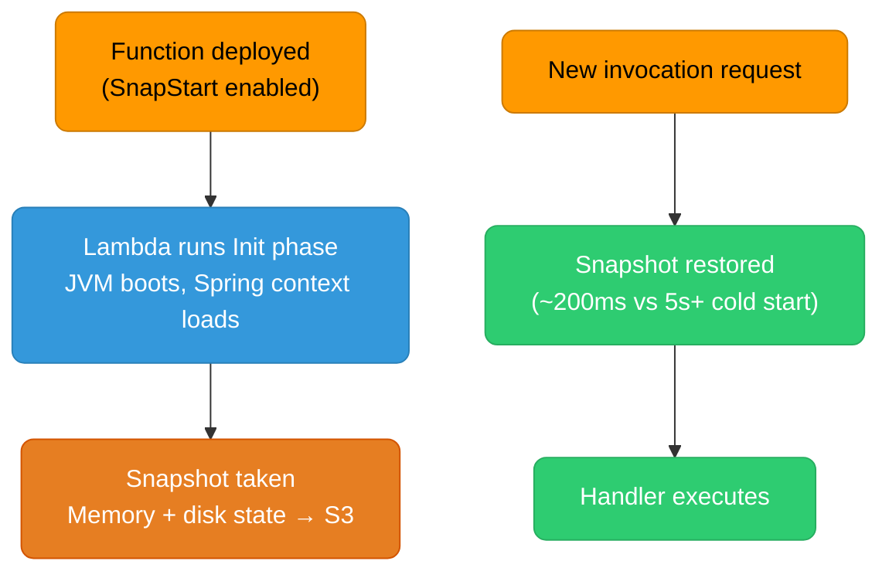
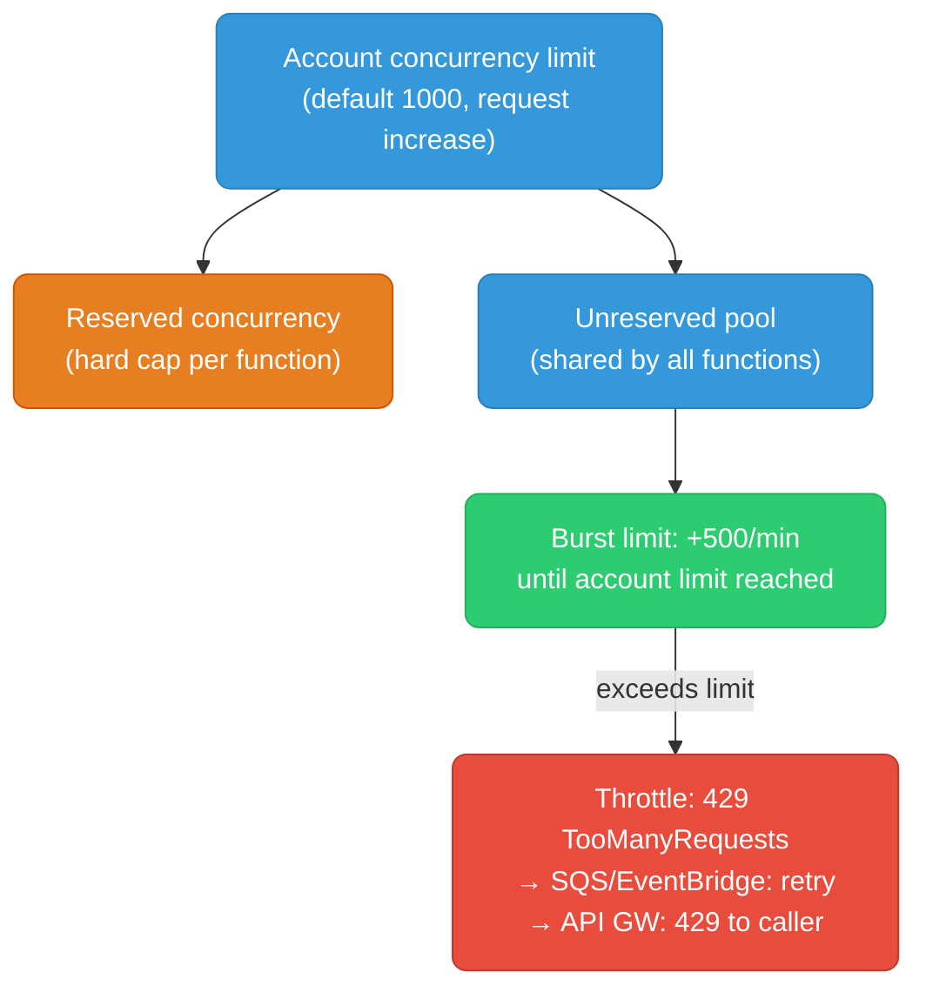

# AWS Lambda: Execution Model, SnapStart, and Production Patterns

Lambda abstracts servers entirely — understanding its execution environment, concurrency model, and cold-start mechanics is what separates functions that scale predictably from functions that surprise you at 3am.

<div class="quiz-progress" data-quiz-progress>
  <span class="quiz-progress-label">0/0 checks</span>
  <span class="quiz-progress-bar"><span class="quiz-progress-fill"></span></span>
</div>

---

## Execution Environment Lifecycle

Every Lambda invocation runs inside a **MicroVM** — a Firecracker virtual machine provisioned by AWS. The lifecycle has three phases: Init, Invoke, and Shutdown.


**Cold start** — the Init phase — is the source of Lambda latency spikes. It has four layers:

| Layer | Typical duration | Who controls it |
|-------|-----------------|----------------|
| Hypervisor slot allocation | 50–200ms | AWS only |
| MicroVM boot (Firecracker) | 100–200ms | AWS only |
| Language runtime init (JVM, Node, Python) | 10ms–1000ms | Language choice |
| Handler init (your `import` statements, DB pool) | 10ms–500ms | You |

The first two layers are AWS internals. You can only improve the last two.

**Warm invocation** — if the execution environment is frozen and a new request arrives, Lambda thaws it and calls your handler directly. The Init phase does not repeat. A warm invocation adds only the handler execution time.

---

## Cold Start Mitigation

### Provisioned Concurrency

**Provisioned concurrency** — pre-initialized execution environments that Lambda keeps warm and ready. With provisioned concurrency, Init runs at provisioning time, not at request time. Invocations from a provisioned environment have no cold start.

```bash
# Provision 10 warm environments for a specific function version
aws lambda put-provisioned-concurrency-config \
  --function-name payments-processor \
  --qualifier v42 \
  --provisioned-concurrent-executions 10

# Verify they're initialized (wait for Status: READY)
aws lambda get-provisioned-concurrency-config \
  --function-name payments-processor \
  --qualifier v42
```

Cost: provisioned concurrency is billed per GB-second of provisioned time, even when idle. Use Application Auto Scaling to scale it by schedule (e.g., 10 environments during business hours, 2 overnight).

### Lambda Layers for Dependency Caching

**Lambda Layers** — ZIP archives containing shared libraries attached to functions at deploy time. The layer is extracted to `/opt/` before your function code. Moving large dependencies (numpy, boto3, vendor SDKs) into a layer keeps your deployment package small, which speeds up code download during cold start.

```bash
# Create a layer with your Python dependencies
pip install -r requirements.txt -t python/lib/python3.12/site-packages/
zip -r deps-layer.zip python/
aws lambda publish-layer-version \
  --layer-name my-deps \
  --zip-file fileb://deps-layer.zip \
  --compatible-runtimes python3.12
```

Layers do not eliminate the runtime init time for large libraries (numpy still loads), but they decouple dependency updates from code deployments.

---

## SnapStart (Java)

**SnapStart** — Lambda's checkpoint-restore mechanism for Java functions. Instead of booting the JVM from scratch on each cold start, Lambda takes a snapshot of the fully-initialized execution environment (after your `@PostConstruct` beans are wired up), stores it encrypted in S3, and restores it on demand. Cold start drops from 3–10s (JVM boot + Spring context) to under 1s.



Enable SnapStart on a Java 21 (or 17/11) function:

```bash
aws lambda update-function-configuration \
  --function-name my-java-fn \
  --snap-start ApplyOn=PublishedVersions
aws lambda publish-version --function-name my-java-fn
```

### Uniqueness Requirements After Restore

The snapshot is shared across multiple environments restored in parallel. Any state initialized before the snapshot is identical across all restored clones. This breaks:

- **Random seeds**: `Random()` seeded at init time → all clones produce the same sequence. Use `SecureRandom` which re-seeds from `/dev/urandom` on each JVM operation.
- **UUIDs generated at init**: Move UUID generation into the handler, not static initializers.
- **Timestamp-based IDs**: Fine if generated per-request.

Use restore hooks to re-initialize anything that must be unique post-restore:

```java
import com.amazonaws.services.lambda.runtime.events.SnapStartEvent;
import com.amazonaws.services.lambda.runtime.hooks.RuntimeHook;

@RuntimeHook
public class MyRestoreHook implements RuntimeHook {
    @Override
    public void afterRestore(SnapStartEvent event) {
        // Re-seed random, refresh short-lived tokens, reset connection pools
        MyApp.refreshCredentials();
    }
}
```

---

## Concurrency Model

Lambda concurrency is per-function, per-region. Understanding the math prevents 429 errors at scale.

**concurrent executions formula:**
```
concurrent_executions = RPS × avg_duration_seconds
```

A function receiving 1000 RPS with average 200ms duration needs `1000 × 0.2 = 200` concurrent executions.



**Reserved concurrency** — `put-function-concurrency` sets a hard cap. No more than N concurrent executions ever. Use to protect downstream databases from Lambda connection storms.

**Unreserved concurrency** — all functions without a reserved concurrency setting share this pool. A spike in one function can starve others.

**Burst limit** — Lambda can add 500 new execution environments per minute (not per second). A sudden 10,000 RPS spike needs 20 minutes to fully scale. Pre-provision or use provisioned concurrency for spiky workloads.

```bash
# Set reserved concurrency (hard cap at 50 concurrent executions)
aws lambda put-function-concurrency \
  --function-name payments-processor \
  --reserved-concurrent-executions 50
```

---

## Lambda Extensions

**Lambda extensions** — processes that run alongside your function handler in the same execution environment. They receive lifecycle events (Init, Invoke, Shutdown) via a local HTTP API.

Two types:

| Type | Process model | Use cases |
|------|--------------|-----------|
| **External extension** | Separate process, starts before handler | Telemetry agents, secret fetchers, log shippers |
| **Internal extension** | In-process (language hook) | Lightweight wrappers, Datadog tracer |

External extensions register with the Lambda runtime API and receive Invoke events after the handler completes:

```bash
# Extensions are deployed as Lambda Layers
# The extension binary lives at /opt/extensions/<name>
# It must call RegisterExtension before receiving events
POST http://${AWS_LAMBDA_RUNTIME_API}/2020-01-01/extension/register
{"events": ["INVOKE", "SHUTDOWN"]}
```

The **Telemetry API** lets extensions subscribe to Lambda's internal telemetry stream (function logs, platform events, extension logs) without piping through CloudWatch Logs first. Useful for shipping logs to a SIEM or log aggregator directly.

---

## Memory, CPU, and Right-Sizing

**Lambda vCPU** — scales linearly with memory allocation. There is no separate CPU setting.

| Memory | vCPU equivalent | Notes |
|--------|----------------|-------|
| 128 MB | 0.077 vCPU | Minimum; adequate for simple I/O-bound tasks |
| 1769 MB | 1 full vCPU | First point of full core |
| 3008 MB | ~1.7 vCPU | |
| 10240 MB | ~6 vCPU | Maximum |

A CPU-bound function (image processing, crypto) should be sized at 1769 MB or multiples. An I/O-bound function (calls an API, waits for DynamoDB) rarely benefits from more than 512 MB.

**Lambda Power Tuning** — open-source Step Functions state machine that invokes your function across 10+ memory configurations and reports cost vs duration. Run it before committing to a memory setting.

```bash
# Deploy via SAR (Serverless Application Repository)
aws serverlessrepo create-cloud-formation-change-set \
  --application-id arn:aws:serverlessrepo:us-east-1:451282441545:applications/aws-lambda-power-tuning \
  --stack-name lambda-power-tuning \
  --capabilities CAPABILITY_IAM
```

---

## VPC-Attached Lambda

Attaching a Lambda to a VPC lets it reach RDS, ElastiCache, or other private resources. Before 2020, VPC attachment caused an additional 10–30s cold start (ENI allocation). Since 2020, Lambda uses **Hyperplane ENIs** — pre-allocated elastic network interfaces managed by AWS and shared across functions.

**Current behavior:** VPC Lambda cold starts are now within ~100ms of non-VPC Lambdas. The ENI is allocated from a warm pool when the function is first deployed (takes a few minutes), not at invocation time.

```yaml
# Serverless Framework / SAM equivalent
VpcConfig:
  SubnetIds:
    - subnet-0abc123  # private subnet, no internet route
    - subnet-0def456
  SecurityGroupIds:
    - sg-0xyz789     # allows outbound to RDS port 5432
```

Ensure your private subnets have enough IP addresses. Each Lambda execution environment consumes one IP from the subnet. At 500 concurrent executions, you need 500+ free IPs.

For outbound internet access from a VPC Lambda: route through a NAT Gateway (not a NAT instance; NAT instances are a bottleneck).

---

## Function URLs vs API Gateway

**Function URL** — a dedicated HTTPS endpoint for a Lambda, no API Gateway required.

| | Function URL | API Gateway HTTP API | API Gateway REST API |
|--|-------------|--------------------|--------------------|
| **Cost** | Free (pay only for Lambda) | $1/million requests | $3.50/million requests |
| **Auth** | IAM or none | JWT, IAM, Lambda authorizer | Multiple |
| **Features** | Basic HTTP | Throttling, usage plans | Full (caching, WAF, stages) |
| **Latency** | Lowest | Low | Higher |
| **Use case** | Direct invocations, webhooks | Most new APIs | Complex routing, legacy |

```bash
aws lambda create-function-url-config \
  --function-name my-webhook \
  --auth-type NONE \
  --cors '{"AllowOrigins":["*"],"AllowMethods":["POST"]}'
```

---

## Observability

**X-Ray active tracing** — enable per function to get distributed traces across Lambda → downstream AWS services. X-Ray SDK automatically traces DynamoDB, SQS, and HTTP clients.

```bash
aws lambda update-function-configuration \
  --function-name payments-processor \
  --tracing-config Mode=Active
```

The trace ID is injected via the `_X_AMZN_TRACE_ID` environment variable on each invocation. Pass it in downstream HTTP headers (`X-Amzn-Trace-Id`) for end-to-end trace correlation.

**Lambda Insights** — enhanced CloudWatch monitoring via the `LambdaInsightsExtension` layer. Adds metrics not available in basic CloudWatch: memory utilization, CPU total time, initialization duration, number of cold starts per time window.

**CloudWatch EMF (Embedded Metric Format)** — write structured JSON logs that CloudWatch parses as custom metrics with zero additional API calls:

```python
import json

def handler(event, context):
    # EMF log line — CloudWatch creates a metric from this automatically
    print(json.dumps({
        "_aws": {
            "Timestamp": 1701000000000,
            "CloudWatchMetrics": [{
                "Namespace": "Payments",
                "Dimensions": [["FunctionName"]],
                "Metrics": [{"Name": "OrdersProcessed", "Unit": "Count"}]
            }]
        },
        "FunctionName": context.function_name,
        "OrdersProcessed": 42
    }))
```

<div class="quiz-card">
  <p class="quiz-q">A Java Lambda using Spring Boot takes 8 seconds on cold start. You enable SnapStart and the cold start drops to 800ms. Three months later, a developer adds a static initializer that generates a UUID and stores it as a class variable. What runtime problem will this cause?</p>
  <button class="quiz-reveal">Reveal answer</button>
  <div class="quiz-a" hidden>All concurrently restored environments will have the same UUID — the one generated before the snapshot was taken. SnapStart restores an identical memory image across all environments, so any state initialized before the snapshot checkpoint is shared. If that UUID is used as a correlation ID or idempotency key, multiple execution environments will produce collisions. Fix: move UUID generation into the handler method (per-invocation), or use a restore hook to regenerate the UUID after restore. SecureRandom also needs careful handling — use it in the handler, not in static initializers, as it re-seeds from the OS entropy pool on each use post-restore.</div>
</div>

<div class="quiz-card">
  <p class="quiz-q">Your Lambda function receives 500 RPS with an average duration of 400ms. Your account default concurrency limit is 1000 and the function has no reserved concurrency set. A second function in the same account suddenly spikes to 800 concurrent executions. What happens to your payments function?</p>
  <button class="quiz-reveal">Reveal answer</button>
  <div class="quiz-a" hidden>Your payments function needs 500 × 0.4 = 200 concurrent executions. Together with the spiking function (800), total demand is 1000 — exactly at the account limit. Any additional concurrency for either function gets throttled (429). Since payments has no reserved concurrency, it competes with the spiking function from the shared unreserved pool. If the spike continues, payments invocations will start throttling too. Fix: set reserved concurrency on the payments function (e.g., 250) to guarantee it always has headroom, isolating it from other functions' spikes. The tradeoff: the payments function can then never use more than 250 concurrent executions, so size it with headroom.</div>
</div>

<div class="quiz-card">
  <p class="quiz-q">You have a Lambda function running in a VPC private subnet that needs to call an external HTTPS API (api.example.com). What do you need to add, and what's the common mistake teams make when setting this up?</p>
  <button class="quiz-reveal">Reveal answer</button>
  <div class="quiz-a" hidden>Add a NAT Gateway in a public subnet and a route in the private subnet's route table pointing 0.0.0.0/0 to the NAT Gateway. The NAT Gateway's Elastic IP provides outbound internet access. Common mistake: using a NAT instance instead of a NAT Gateway. NAT instances are a single EC2 instance that becomes a bandwidth and availability bottleneck — they require manual scaling, patching, and have lower throughput limits. NAT Gateway is fully managed, scales automatically to 100 Gbps, and is multi-AZ when deployed per-AZ. Second common mistake: placing the Lambda in a public subnet and expecting it to have internet access — Lambda ENIs don't get public IPs regardless of subnet type.</div>
</div>
