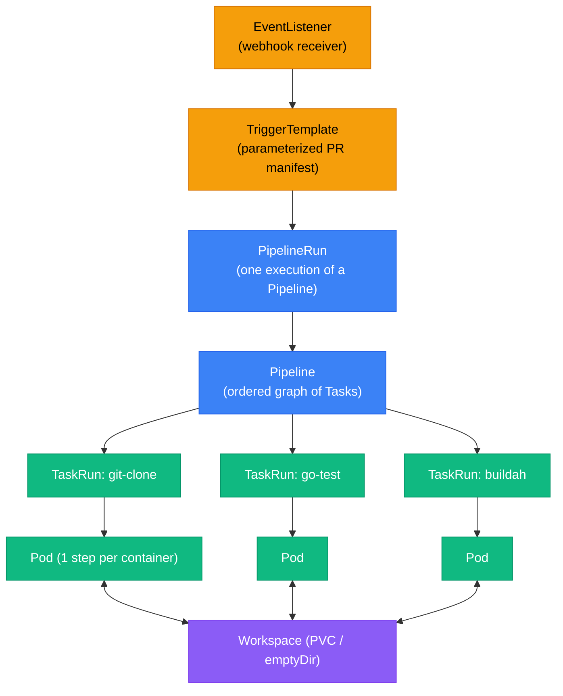

# Tekton: Kubernetes-Native CI/CD

Tekton is a Kubernetes-native CI/CD framework — pipelines are CRDs, steps are containers, and no agent infrastructure exists to manage. Everything runs in-cluster as ordinary Kubernetes workloads, giving you full auditability and reproducibility.

<div class="quiz-progress" data-quiz-progress>
  <span class="quiz-progress-label">0/0 checks</span>
  <span class="quiz-progress-bar"><span class="quiz-progress-fill"></span></span>
</div>

---

## Architecture



**Key insight:** A TaskRun is a Pod. Each Step in a Task becomes one container in that Pod — they share a `/workspace` volume and run sequentially. Tekton adds no agents; it just creates Pods.

---

## Core CRDs

### StepAction — reusable atomic step

The smallest unit. Lives in Tekton Hub; installed with `kubectl apply`.

```yaml
apiVersion: tekton.dev/v1alpha1
kind: StepAction
metadata:
  name: go-test
spec:
  image: golang:1.21
  command: ["go", "test"]
  args: ["$(params.flags)", "./..."]
  params:
    - name: flags
      default: "-race"
```

### Task — ordered list of Steps

Each Step is one container. All Steps share the workspace volume at `/workspace/source`.

```yaml
apiVersion: tekton.dev/v1
kind: Task
metadata:
  name: go-build-test
spec:
  params:
    - name: goflags
      default: "-race"
  workspaces:
    - name: source
  results:
    - name: go-version
      description: Go version used
  steps:
    - name: go-version
      image: golang:1.21
      script: |
        go version | tee $(results.go-version.path)
    - name: go-test
      image: golang:1.21
      workingDir: $(workspaces.source.path)
      env:
        - name: GOFLAGS
          value: $(params.goflags)
      script: |
        go test ./...
    - name: go-vet
      image: golang:1.21
      workingDir: $(workspaces.source.path)
      script: |
        go vet ./...
```

**Results** are small string values (max 4096 bytes) written to `/tekton/results/<name>`. Pass results between Tasks: `$(tasks.go-build-test.results.go-version)`.

### TaskRun — one execution of a Task

```bash
kubectl create -f taskrun.yaml
kubectl get taskruns -w           # watch progress
tkn taskrun logs go-build-test-run -f   # stream logs
```

A TaskRun creates exactly one Pod. When it completes, the Pod stays (for log access) until pruned.

### Pipeline — task graph

```yaml
apiVersion: tekton.dev/v1
kind: Pipeline
metadata:
  name: go-pipeline
spec:
  params:
    - name: image-url
  workspaces:
    - name: shared-source
  tasks:
    - name: git-clone
      taskRef:
        resolver: hub
        params:
          - name: catalog
            value: tekton
          - name: type
            value: task
          - name: name
            value: git-clone
          - name: version
            value: "0.9"
      workspaces:
        - name: output
          workspace: shared-source
      params:
        - name: url
          value: https://github.com/example/app

    - name: go-test
      runAfter: [git-clone]
      taskRef:
        name: go-build-test
      workspaces:
        - name: source
          workspace: shared-source

    - name: buildah
      runAfter: [go-test]
      taskRef:
        resolver: hub
        params:
          - name: name
            value: buildah
          - name: version
            value: "0.6"
      params:
        - name: IMAGE
          value: $(params.image-url):$(tasks.git-clone.results.commit)
      workspaces:
        - name: source
          workspace: shared-source
```

Tasks without `runAfter` run in parallel. The DAG is explicit — no implicit ordering.

### PipelineRun — one execution of a Pipeline

```yaml
apiVersion: tekton.dev/v1
kind: PipelineRun
metadata:
  generateName: go-pipeline-run-
spec:
  pipelineRef:
    name: go-pipeline
  params:
    - name: image-url
      value: ghcr.io/example/app
  workspaces:
    - name: shared-source
      volumeClaimTemplate:
        spec:
          accessModes: [ReadWriteOnce]
          resources:
            requests:
              storage: 1Gi
```

`generateName` creates a unique name on each apply. `volumeClaimTemplate` creates a fresh PVC per run (deleted when the run is pruned).

---

## Tekton Hub Tasks

Install official tasks directly:

```bash
# git-clone: checkout source code
kubectl apply -f https://api.hub.tekton.dev/v1/resource/tekton/task/git-clone/0.9/raw

# buildah: build OCI images without Docker daemon (rootless)
kubectl apply -f https://api.hub.tekton.dev/v1/resource/tekton/task/buildah/0.6/raw

# kaniko: alternative image builder (runs as non-root)
kubectl apply -f https://api.hub.tekton.dev/v1/resource/tekton/task/kaniko/0.6/raw

# helm-upgrade-from-repo: deploy via Helm
kubectl apply -f https://api.hub.tekton.dev/v1/resource/tekton/task/helm-upgrade-from-repo/0.4/raw
```

**buildah vs kaniko:** Both build without the Docker daemon. `buildah` uses user namespaces (preferred on recent kernels). `kaniko` works without user namespace support (older clusters, restricted environments).

<div class="quiz-card"><p class="quiz-q">A TaskRun completes but the pod logs are gone. What happened, and how do you prevent it?</p><button class="quiz-reveal">Reveal answer</button><div class="quiz-a" hidden>Tekton keeps completed pods for log access, but they get garbage-collected if PipelineRun pruning runs aggressively or the node runs low on resources. Prevent it: configure <code>kubectl describe configmap/config-leader-election -n tekton-pipelines</code> pruning settings, or stream logs immediately with <code>tkn pipelinerun logs -f</code> before completion, or forward to a log aggregator (Loki/CloudWatch) via a logging DaemonSet.</div></div>

---

## Workspaces

Workspaces are named volume slots. The Pipeline declares them; the PipelineRun binds them to actual volumes.

| Type | Use case | Persistence |
|------|----------|-------------|
| `emptyDir` | Intra-pipeline scratch | Deleted with Pod |
| `PVC` | Cache between runs (Go modules, Maven) | Survives runs |
| `Secret` | Credentials (registry auth, SSH key) | K8s Secret |
| `ConfigMap` | Config files injected into steps | K8s ConfigMap |

```yaml
# In PipelineRun: bind workspace to an existing PVC for cross-run caching
workspaces:
  - name: go-cache
    persistentVolumeClaim:
      claimName: go-module-cache
      readOnly: false
```

---

## Tekton Chains — Supply Chain Security

Tekton Chains watches TaskRuns and automatically signs build attestations.

```bash
# Install Chains
kubectl apply -f https://storage.googleapis.com/tekton-releases/chains/latest/release.yaml

# Configure: sign with cosign, store in OCI registry
kubectl patch configmap chains-config -n tekton-chains --type=merge \
  -p='{"data":{"artifacts.taskrun.format":"slsa/v1","artifacts.taskrun.storage":"oci","signers.x509.fulcio.address":"https://fulcio.sigstore.dev"}}'
```

**How it works:**
1. TaskRun finishes; Chains sees it via watch.
2. Chains reads the `IMAGES` result (image digest built by buildah/kaniko).
3. Signs the attestation with cosign (keyless via Sigstore Fulcio, or your own key).
4. Stores the DSSE envelope in the OCI registry alongside the image, or pushes to Rekor transparency log.
5. Result: SLSA Level 2 provenance — anyone can verify the image was built by your pipeline.

```bash
# Verify an image's provenance
cosign verify-attestation --type slsa ghcr.io/example/app:sha-abc1234
```

<div class="quiz-card"><p class="quiz-q">Tekton Chains is installed but no attestations appear after builds. What's the first thing to check?</p><button class="quiz-reveal">Reveal answer</button><div class="quiz-a" hidden>Check that the TaskRun produces an <code>IMAGES</code> result — Chains only acts when it sees that result with a valid image reference + digest. Also check <code>kubectl get taskruns -n tekton-chains</code> for Chains' own internal TaskRuns and check its controller logs: <code>kubectl logs -n tekton-chains deploy/tekton-chains-controller</code>.</div></div>

---

## GitHub Actions Runner Controller (ARC)

ARC lets you run GitHub Actions workflows on your Kubernetes cluster, with ephemeral runners that scale to zero.

```bash
# Install ARC
helm install arc \
  --namespace arc-systems \
  --create-namespace \
  oci://ghcr.io/actions/actions-runner-controller-charts/gha-runner-scale-set-controller

# Create a runner scale set (AutoscalingRunnerSet)
helm install arc-runner-set \
  --namespace arc-runners \
  --create-namespace \
  --set githubConfigUrl="https://github.com/YOUR_ORG/YOUR_REPO" \
  --set githubConfigSecret=github-pat-secret \
  oci://ghcr.io/actions/actions-runner-controller-charts/gha-runner-scale-set
```

**Customizing runner pods** — add cloud credentials via service account annotation (Workload Identity / IRSA):

```yaml
# values.yaml for the scale set
template:
  spec:
    serviceAccountName: arc-runner-sa   # annotated with iam.gke.io/gcp-service-account
    containers:
      - name: runner
        image: ghcr.io/actions/actions-runner:latest
        resources:
          requests:
            cpu: "1"
            memory: "2Gi"
```

Runners are **ephemeral** — a new Pod per workflow job, deleted on completion. No shared state between jobs; no runner drift.

---

## Tekton vs GitHub Actions

<div class="tab-group">
  <div class="tab-buttons">
    <button data-tab="tekton" class="active">Tekton</button>
    <button data-tab="gha">GitHub Actions</button>
  </div>
  <div class="tab-panels">
    <div class="tab-panel active" data-tab-panel="tekton">
      <p><strong>Kubernetes-native:</strong> Pipelines are CRDs. Steps are Pods. Everything is auditable via <code>kubectl</code> and Prometheus metrics.</p>
      <p><strong>No external dependency:</strong> Runs air-gapped. No GitHub, no SaaS. Good for regulated industries (banking, defense).</p>
      <p><strong>Full control:</strong> Custom images per step, node selectors, GPU scheduling, priority classes — any K8s feature works.</p>
      <p><strong>Supply chain security:</strong> Tekton Chains + cosign gives SLSA L2 provenance out of the box.</p>
      <p><strong>Steeper learning curve:</strong> YAML-heavy CRDs; debugging requires <code>kubectl</code> + <code>tkn</code> CLI familiarity.</p>
      <p><strong>Smaller ecosystem:</strong> Tekton Hub has ~100 tasks; GitHub Marketplace has 20,000+ actions.</p>
    </div>
    <div class="tab-panel" data-tab-panel="gha">
      <p><strong>Managed:</strong> No infrastructure to run. GitHub handles the control plane, scheduler, and runner fleet.</p>
      <p><strong>Huge marketplace:</strong> 20,000+ community actions for every tool imaginable.</p>
      <p><strong>Simple YAML:</strong> <code>on: push</code>, <code>jobs:</code>, <code>steps:</code> — minimal cognitive overhead for simple workflows.</p>
      <p><strong>GitHub-dependent:</strong> Outages affect your CI. No air-gap option with hosted runners.</p>
      <p><strong>ARC bridges the gap:</strong> Self-hosted runners on Kubernetes give you managed YAML syntax with your own infrastructure and cloud credentials.</p>
      <p><strong>Cost:</strong> GitHub-hosted runners have per-minute billing; self-hosted (ARC) uses your own cluster capacity.</p>
    </div>
  </div>
</div>

**Decision:** Regulated/air-gapped → Tekton. GitHub-first team that needs K8s access → GitHub Actions + ARC.

---

## First Pipeline Walkthrough

<div class="stepper">
  <div class="stepper-panels">
    <div class="stepper-panel active">
      <strong>Step 1. Install Tekton Pipelines.</strong>
      <p><code>kubectl apply -f https://storage.googleapis.com/tekton-releases/pipeline/latest/release.yaml</code></p>
      <p>Wait for controllers: <code>kubectl rollout status deploy/tekton-pipelines-controller -n tekton-pipelines</code></p>
    </div>
    <div class="stepper-panel">
      <strong>Step 2. Install the Tekton CLI and Hub tasks.</strong>
      <p><code>brew install tektoncd-cli</code> (or download from GitHub releases)</p>
      <p><code>kubectl apply -f https://api.hub.tekton.dev/v1/resource/tekton/task/git-clone/0.9/raw</code></p>
      <p>Verify: <code>tkn task list</code></p>
    </div>
    <div class="stepper-panel">
      <strong>Step 3. Create the workspace PVC.</strong>
      <p>The Pipeline needs a PVC to pass source code between tasks:</p>
      <pre><code>kubectl apply -f - &lt;&lt;EOF
apiVersion: v1
kind: PersistentVolumeClaim
metadata:
  name: pipeline-workspace
spec:
  accessModes: [ReadWriteOnce]
  resources:
    requests:
      storage: 1Gi
EOF</code></pre>
    </div>
    <div class="stepper-panel">
      <strong>Step 4. Apply your Pipeline manifest.</strong>
      <p><code>kubectl apply -f go-pipeline.yaml</code></p>
      <p>Verify the DAG is valid: <code>tkn pipeline describe go-pipeline</code></p>
    </div>
    <div class="stepper-panel">
      <strong>Step 5. Create a PipelineRun.</strong>
      <p><code>kubectl create -f pipeline-run.yaml</code></p>
      <p>Use <code>generateName</code> so each run gets a unique name. Check status:</p>
      <p><code>tkn pipelinerun list</code></p>
    </div>
    <div class="stepper-panel">
      <strong>Step 6. Stream logs.</strong>
      <p><code>tkn pipelinerun logs -f --last</code></p>
      <p>Each TaskRun's logs are prefixed with the task name. On failure: <code>kubectl describe taskrun &lt;name&gt;</code> shows the exact exit code and step that failed.</p>
    </div>
  </div>
  <div class="stepper-controls">
    <button class="stepper-prev">← Prev</button>
    <span class="stepper-dots"></span>
    <span class="stepper-label"></span>
    <button class="stepper-next">Next →</button>
  </div>
</div>

---

## Monitoring and Housekeeping

**Prometheus metrics** (emitted by the Tekton Pipelines controller):

| Metric | Description |
|--------|-------------|
| `tekton_pipelines_controller_pipelinerun_count` | Total PipelineRuns by namespace/status |
| `tekton_pipelines_controller_pipelinerun_duration_seconds` | Pipeline run duration histogram |
| `tekton_pipelines_controller_taskrun_count` | TaskRun counts |
| `tekton_pipelines_controller_taskrun_duration_seconds` | Step-level durations |

**PipelineRun pruning** — completed runs accumulate and bloat etcd:

```bash
# Keep only the last 50 PipelineRuns
tkn pipelinerun delete --keep 50 --namespace my-namespace

# Automate with a CronJob
kubectl apply -f - <<EOF
apiVersion: batch/v1
kind: CronJob
metadata:
  name: tekton-pruner
spec:
  schedule: "0 * * * *"
  jobTemplate:
    spec:
      template:
        spec:
          serviceAccountName: tekton-pruner-sa
          restartPolicy: Never
          containers:
            - name: tkn
              image: gcr.io/tekton-releases/github.com/tektoncd/cli/cmd/tkn:latest
              command: ["tkn", "pipelinerun", "delete", "--keep", "50", "--namespace", "default", "--force"]
EOF
```

<div class="quiz-card"><p class="quiz-q">You need to pass a Docker registry password to a Tekton Task step without it appearing in the PipelineRun spec or logs. What's the correct approach?</p><button class="quiz-reveal">Reveal answer</button><div class="quiz-a" hidden>Bind a Kubernetes Secret as a workspace in the Pipeline spec, then mount it in the Task as a workspace of type <code>secret</code>. Alternatively, annotate the Secret with <code>tekton.dev/docker-0: https://ghcr.io</code> and bind it to the ServiceAccount that runs the TaskRun — Tekton will mount it as a Docker config automatically. Either way, the credential never appears in YAML or logs.</div></div>

---

## EventListeners — Webhook Triggers

```yaml
apiVersion: triggers.tekton.dev/v1beta1
kind: EventListener
metadata:
  name: github-listener
spec:
  serviceAccountName: tekton-triggers-sa
  triggers:
    - name: github-push
      interceptors:
        - ref:
            name: github
          params:
            - name: secretRef
              value:
                secretName: github-webhook-secret
                secretKey: secret
            - name: eventTypes
              value: [push]
      bindings:
        - ref: github-push-binding
      template:
        ref: go-pipeline-run-template
```

The EventListener creates a Service + Deployment that receives webhooks. GitHub sends a POST → Tekton validates the HMAC signature → creates a PipelineRun from the template.
