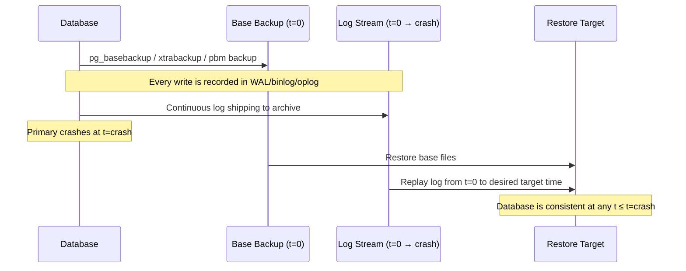
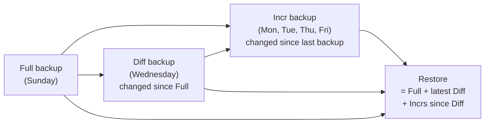

# Database Backup Strategies

Cross-database backup reference — hot vs cold, physical vs logical, PITR, incremental, and tool selection.

<div class="quiz-progress" data-quiz-progress>
  <span class="quiz-progress-label">0/0 checks</span>
  <span class="quiz-progress-bar"><span class="quiz-progress-fill"></span></span>
</div>

---

## 1. Hot vs Cold Backup

A **hot backup** is taken while the database is live and serving traffic. No downtime. The tool must ensure a consistent snapshot despite concurrent writes — typically by coordinating with the storage engine's redo log (the backup captures in-flight changes and replays them on restore).

A **cold backup** stops the database first, copies the files, then restarts. Simple — no redo log coordination needed — but it means planned downtime.

| | Hot Backup | Cold Backup |
|---|---|---|
| **Downtime** | None | Duration of copy |
| **Consistency mechanism** | Redo log replay on restore | Quiesced filesystem (no concurrent writes) |
| **Tool examples** | XtraBackup, pg_basebackup, PBM | `cp -r`, `rsync`, LVM snapshot |
| **Use case** | Production, 24/7 SLA | Dev environments, low-traffic windows |
| **Complexity** | Higher (engine-aware) | Minimal |

**When cold is acceptable:** dev or staging environments, databases with scheduled maintenance windows (e.g. 2am Sunday), very small datasets where a 2-minute stop is acceptable.

---

## 2. Physical vs Logical Backup

**Physical backup** copies raw data files from disk — InnoDB `.ibd` files, Postgres `pg_data/`, MongoDB WiredTiger files. The tool works at the storage engine level. Restore is fast (file copy + redo replay). Enables PITR. Requires a tool that understands engine internals.

**Logical backup** exports data as SQL or BSON: `pg_dump`, `mysqldump`, `mongodump`. Human-readable and portable across versions. Restore is slow (re-executing every INSERT). No PITR — you get a point-in-time snapshot only.

<div class="tab-group">
  <div class="tab-buttons">
    <button data-tab="physical">Physical</button>
    <button data-tab="logical">Logical</button>
  </div>
  <div class="tab-panels">
    <div data-tab-content="physical">
      <strong>Restore time (1 TB):</strong> ~20 minutes — file copy at disk throughput + short redo replay.<br/>
      <strong>PITR:</strong> ✅ — combine with WAL/binlog archiving to restore to any second in time.<br/>
      <strong>Portability:</strong> Same engine version required. Cannot upgrade MySQL 5.7 → 8.0 via physical restore.<br/>
      <strong>Consistency:</strong> Redo log ensures a consistent view even if files were copied mid-write.<br/>
      <strong>Tools:</strong> XtraBackup (MySQL), pg_basebackup / pgBackRest / wal-g (Postgres), PBM (MongoDB), <code>BACKUP TO</code> (ClickHouse).
    </div>
    <div data-tab-content="logical">
      <strong>Restore time (1 TB):</strong> 4–8 hours — every row re-inserted and every index rebuilt.<br/>
      <strong>PITR:</strong> ❌ — snapshot only, no continuous log replay.<br/>
      <strong>Portability:</strong> Cross-version, cross-platform, readable with any text editor.<br/>
      <strong>Consistency:</strong> Single-transaction dump (e.g. <code>--single-transaction</code> in mysqldump) ensures snapshot consistency without locking.<br/>
      <strong>Tools:</strong> mysqldump, pg_dump/pg_restore, mongodump/mongorestore.
    </div>
  </div>
</div>

| Metric | Physical (1 TB) | Logical (1 TB) |
|---|---|---|
| Backup size | ~equal to data files | Often smaller (no index bloat) |
| Restore time | ~20 min | 4–8 hours |
| PITR capable | ✅ | ❌ |
| Cross-version | ❌ | ✅ |
| Human-readable | ❌ | ✅ |

---

## 3. WAL / Redo Log / Oplog — The PITR Foundation

Point-in-Time Recovery (PITR) is the ability to restore a database to any moment in the past — not just the last scheduled backup. It requires two things: a **base backup** (physical snapshot) plus a **continuous stream of changes** recorded after that snapshot.

All major databases implement this same pattern under different names:



| Database | Log name | Format | PITR tool | Retention control |
|---|---|---|---|---|
| MySQL | Binary log (binlog) | Row or statement events | XtraBackup + mysqlbinlog | `binlog_expire_logs_seconds` |
| PostgreSQL | WAL (Write-Ahead Log) | Physical page-change records | pgBackRest, wal-g | Archive storage size |
| MongoDB | Oplog | BSON operation documents | Percona PBM | `oplogSizeMB` (capped collection) |
| ClickHouse | — | No WAL-based PITR | N/A | Replicas provide HA, not PITR |
| Kafka | Log segments | The log IS the data | MirrorMaker2 (cross-cluster) | `retention.ms` / `retention.bytes` |

**Key constraint for MongoDB:** the oplog is a capped collection. If it fills before you take a backup, earlier entries are evicted and PITR back to that point is impossible. Size the oplog so it covers at least `backup_interval + 2× longest_maintenance_window`.

---

## 4. Incremental Backups

Full backups are expensive: time, bandwidth, storage. Incremental backups copy only what changed since the last backup, dramatically reducing all three.



Three implementations across the stack:

**XtraBackup (MySQL)** — tracks InnoDB LSN (Log Sequence Number). Each data page carries the LSN of the last write that modified it. An incremental backup copies only pages with LSN > `last_lsn`. Prepare step merges incrementals before restore.

```bash
# Full backup
xtrabackup --backup --target-dir=/backup/full

# Incremental (copies pages with LSN > last full's LSN)
xtrabackup --backup --incremental-basedir=/backup/full --target-dir=/backup/incr/monday

# Prepare: merge incrementals into full before restore
xtrabackup --prepare --apply-log-only --target-dir=/backup/full
xtrabackup --prepare --apply-log-only --target-dir=/backup/full --incremental-dir=/backup/incr/monday
```

**pgBackRest (PostgreSQL)** — tracks WAL segments. Three modes:
- `full`: complete base backup + all required WAL
- `diff`: changed files since last `full`
- `incr`: changed files since last backup of any type (default)

```bash
pgbackrest --stanza=main --type=full backup    # Sunday
pgbackrest --stanza=main --type=diff backup    # Wednesday
pgbackrest --stanza=main --type=incr backup    # Daily (Mon/Tue/Thu/Fri)
```

**Elasticsearch** — Lucene segments are immutable. Once written, a segment never changes (only deleted via merge). The snapshot API exploits this: after the first snapshot, subsequent snapshots copy only new or changed segment files. Unchanged segments are referenced from the previous snapshot — no re-upload.

---

## 5. Backup Verification

> An untested backup is not a backup.

Most teams discover their backup is broken when they need it. The fix is automated restore testing, not hoping.

**Shadow-instance restore pattern:**

<div class="stepper">
  <div class="stepper-panels">
    <div class="stepper-panel">
      <strong>1. Take backup on production</strong>
      <p>Run your normal scheduled backup: XtraBackup, pgBackRest, mongodump, etc. This is the backup under test.</p>
    </div>
    <div class="stepper-panel">
      <strong>2. Spin up shadow instance</strong>
      <p>Launch a fresh VM or container with the same DB version as production. It does not need production-scale hardware — use a smaller instance. It must not be reachable by the application.</p>
    </div>
    <div class="stepper-panel">
      <strong>3. Restore backup to shadow</strong>
      <p>Run the full restore procedure — not a shortcut, the real runbook. Measure how long it takes. This is your actual RTO.</p>
    </div>
    <div class="stepper-panel">
      <strong>4. Verify and alert</strong>
      <p>Run spot-checks: row counts on critical tables, a known query that returns a known value, application-level health endpoint. Alert if any check fails. Tear down the shadow instance.</p>
    </div>
  </div>
  <div class="stepper-controls">
    <button class="stepper-prev">←</button>
    <button class="stepper-next">→</button>
  </div>
</div>

**Automating verification:**

```bash
#!/bin/bash
# Run daily after backup — restore yesterday's backup to shadow, spot-check, alert on failure
SHADOW_HOST="shadow-db.internal"

# Restore (example: pgBackRest)
pgbackrest --stanza=main --target="$(date -d yesterday +%Y-%m-%d) 23:59:00" restore

# Spot-check
ORDERS=$(psql -h $SHADOW_HOST -c "SELECT COUNT(*) FROM orders" -t)
EXPECTED=$(psql -h prod-db.internal -c "SELECT COUNT(*) FROM orders WHERE created_at < NOW() - INTERVAL '1 hour'" -t)

if [ "$ORDERS" -lt "$EXPECTED" ]; then
  echo "BACKUP VERIFICATION FAILED: order count mismatch" | alert-slack
  exit 1
fi
```

<div class="quiz-card">
  <p class="quiz-q">Your nightly backup completes without error every night. Has your backup strategy been tested?</p>
  <button class="quiz-reveal">Reveal answer</button>
  <div class="quiz-a" hidden>No. A backup that completes without error proves the backup tool ran. It does not prove the files are uncorrupted, that the restore procedure works, or that the application can connect to the restored database. Until you have successfully restored from that backup and verified data integrity, you have only a hypothesis that recovery is possible.</div>
</div>

---

## 6. RTO and RPO

These two metrics define what your backup strategy must achieve.

**RPO — Recovery Point Objective:** the maximum acceptable data loss, expressed as time. "We can lose at most 1 hour of orders." Drives how often you archive logs and how frequently you take backups.

**RTO — Recovery Time Objective:** the maximum acceptable downtime during a recovery. "The database must be back in under 30 minutes." Drives which backup type you choose.

| Strategy | RPO | RTO | Relative cost |
|---|---|---|---|
| Synchronous replication only | ~0 sec | Seconds (failover) | High (latency on every write) |
| Physical backup + continuous WAL/binlog archiving | Minutes (archive lag) | 20–40 min | Medium |
| Physical backup, no log archiving | Hours (backup interval) | 20–40 min | Lower |
| Logical dump only | Hours (dump interval) | Hours (re-insert all rows) | Lowest |
| No backup | Total loss | N/A | $0 until it isn't |

**The trap:** teams optimise for RPO (frequent backups) without measuring RTO. A 6-hour restore from a logical dump that nobody ever tested may not meet a 2-hour RTO SLA.

---

## 7. Tool Comparison

| Database | Hot backup tool | Logical tool | PITR | Incremental | Cloud-native |
|---|---|---|---|---|---|
| MySQL | XtraBackup | mysqldump | ✅ (binlog) | ✅ (LSN-based) | RDS automated backups |
| PostgreSQL | pg_basebackup / pgBackRest / wal-g | pg_dump | ✅ (WAL) | ✅ (pgBackRest diff/incr) | RDS / Cloud SQL |
| MongoDB | Percona PBM | mongodump | ✅ (oplog-tail) | ✅ | Atlas continuous backup |
| ClickHouse | `BACKUP TABLE … TO S3(…)` | — | ❌ | ✅ (frozen partitions) | ClickHouse Cloud |
| Redis | BGSAVE (RDB) / AOF | — | ❌ | ❌ | ElastiCache snapshots |
| Elasticsearch | Snapshot API | — | ❌ | ✅ (segment-level) | ECE managed snapshots |
| Kafka | MirrorMaker2 | — | ✅ (offset replay) | N/A | Confluent Cloud |

**Picking a tool:** start with PITR requirement. If RPO < backup interval → you need log archiving. If RPO < 1 min → you need synchronous replication, not just backups. Physical beats logical for RTO in every production scenario.

<div class="quiz-card">
  <p class="quiz-q">Your RPO is 15 minutes. You're running PostgreSQL with pgBackRest taking daily full backups. What additional configuration is required?</p>
  <button class="quiz-reveal">Reveal answer</button>
  <div class="quiz-a" hidden>WAL archiving. Set <code>archive_mode = on</code> and <code>archive_command</code> to ship WAL segments continuously to a remote store (S3, GCS). Without archiving, your RPO equals the time since the last full backup — up to 24 hours. With continuous WAL archiving, RPO equals the WAL archive lag, typically under 5 minutes with a healthy archive_command.</div>
</div>

<div class="quiz-card">
  <p class="quiz-q">A physical backup is 500 GB. A logical dump of the same data is 180 GB (indexes excluded). Which do you restore during a production incident at 3am?</p>
  <button class="quiz-reveal">Reveal answer</button>
  <div class="quiz-a" hidden>Physical. Despite being larger, physical restore is 10–20× faster: it's a file copy plus a short redo replay, not re-executing every INSERT and rebuilding every index. The 180 GB logical dump could take 4+ hours to restore on production-class hardware. The 500 GB physical backup restores in 20–30 minutes. Disk throughput is measured in GB/min; SQL execution is measured in rows/sec against a contended engine. At 3am, you want the database back, not a smaller file on S3.</div>
</div>
