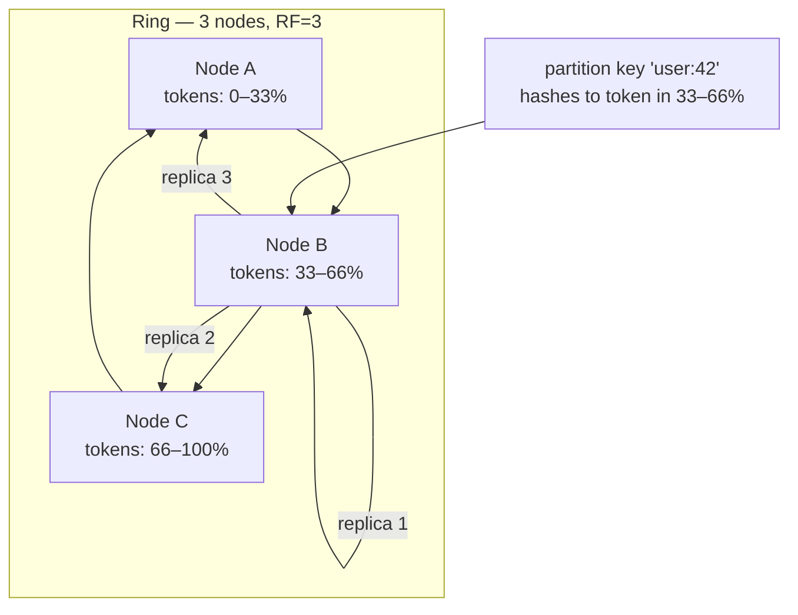
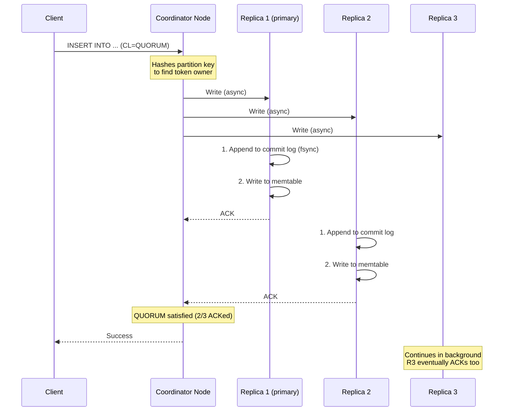
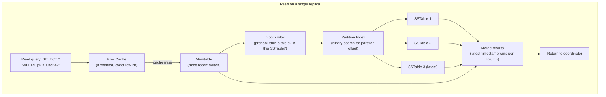
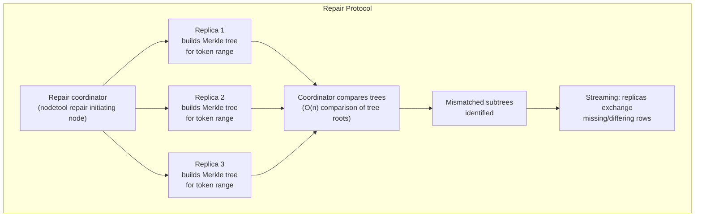

# Apache Cassandra Internals

Ring topology, tunable consistency, and the operational playbook for running Cassandra for real — how writes and reads flow through the ring, compaction strategies, anti-entropy repair, and the nodetool commands that matter during an incident.

<div class="quiz-progress" data-quiz-progress>
  <span class="quiz-progress-label">0/0 checks</span>
  <span class="quiz-progress-bar"><span class="quiz-progress-fill"></span></span>
</div>

---

## Ring Topology & Vnodes

Cassandra uses **consistent hashing** to distribute data. Every node owns a range of the hash token space (by default 0 to 2^63 - 1). A partition key is hashed to a token, and the node responsible for that token range handles it as the **primary replica**.



**Replication Factor (RF):** With RF=3, each row is stored on 3 nodes — the primary and the next two nodes clockwise on the ring. Losing one node means data is still available on 2 replicas.

**Vnodes (virtual nodes):** Instead of one token range per node, each node owns 256 virtual token ranges by default (`num_tokens=256` in `cassandra.yaml`). Advantages:
- Adding a new node takes a proportional slice of load from every existing node — no manual token calculation.
- Node removal distributes departed load across many nodes instead of one neighbor.
- Vnodes trade slightly higher streaming overhead during bootstrap for much better load balance.

<div class="quiz-card">
  <p class="quiz-q">A 3-node Cassandra ring with RF=3 loses one node. Is the cluster still available for reads and writes? Under what conditions?</p>
  <button class="quiz-reveal">Reveal answer</button>
  <div class="quiz-a" hidden>
    With RF=3 and only 3 nodes, every row exists on all 3 nodes. Losing one node means 2 replicas remain. The cluster stays available as long as the consistency level (CL) doesn't require responses from the dead node. CL=ONE and CL=QUORUM (which requires 2 out of 3) both succeed — QUORUM reads and writes keep working. CL=ALL fails immediately because the third replica is unavailable. The practical rule: RF=3 + CL=QUORUM tolerates exactly one node failure.
  </div>
</div>

---

## Write Path

Every write in Cassandra hits two structures atomically: the **commit log** (durability) and the **memtable** (in-memory structure for fast reads).



**Commit log:** Sequential write to disk for crash recovery. On restart, Cassandra replays commit log entries to reconstruct memtables. Flushed memtable segments are removed from the commit log.

**Memtable:** Sorted in-memory structure (one per table). When the memtable reaches `memtable_heap_space_in_mb` or `memtable_flush_period_in_ms`, it's flushed to disk as a new **SSTable**. Multiple SSTables accumulate until compaction merges them.

**Hinted handoff:** If a replica is down when a write arrives, the coordinator stores a **hint** — a short record of the missed write. When the replica comes back, hints are replayed. Hints expire after `max_hint_window_in_ms` (default 3 hours).

---

## Read Path

Reads involve more work than writes because data for a row can be spread across multiple SSTables.



**Key Cassandra read optimizations:**

| Mechanism | Purpose |
|-----------|---------|
| Bloom filter | Probabilistic check — tells you an SSTable definitely does NOT have a partition (false negatives impossible). Avoids disk I/O for most misses. |
| Partition index | Sparse index of partition keys to file offsets. Binary search to find the right offset in the SSTable. |
| Row cache | Full row stored in off-heap memory. Useful for hot rows; bypasses all SSTable reads on hit. |
| Key cache | Stores partition index entries — skips the index file read but still reads the SSTable data. Default on. |

**Read repair:** The coordinator compares responses from multiple replicas (digest read). If digests differ, the coordinator reads full data from all replicas and writes the most recent version back to stale replicas. Background read repair runs asynchronously even on CL=ONE.

<div class="quiz-card">
  <p class="quiz-q">A partition has been updated 100 times, spread across 5 SSTables and the current memtable. How does a read reconstruct the current row state?</p>
  <button class="quiz-reveal">Reveal answer</button>
  <div class="quiz-a" hidden>
    Cassandra reads the relevant partition from every SSTable that the Bloom filter says might contain it, plus the current memtable, then merges all the results. Each column value carries a timestamp; the highest timestamp wins per column. This is why Cassandra is a multi-version store — you can update individual columns independently, and the read path merges the latest version of each. This also means reads get slower as SSTables accumulate, which is why compaction is critical: it merges SSTables so a read only needs to touch one (in LCS) instead of many (in STCS with lots of levels).
  </div>
</div>

---

## Tunable Consistency

Consistency in Cassandra is per-operation, not per-table. The key insight: **strong consistency requires W + R > RF**.

| Consistency Level | Writes required | Reads required | Tradeoff |
|-------------------|----------------|----------------|----------|
| ONE | 1 replica | 1 replica | Fastest; may return stale data |
| TWO | 2 replicas | 2 replicas | Slightly stronger |
| QUORUM | RF/2+1 | RF/2+1 | Balanced — tolerates one failure with RF=3 |
| LOCAL_QUORUM | Majority in local DC | Majority in local DC | Multi-DC safe; no cross-DC latency |
| EACH_QUORUM | Majority in each DC | — | Write only; ensures full multi-DC consistency |
| ALL | All replicas | All replicas | Slowest; any replica down = failure |
| ANY | 1 (hint counts) | — | Write only; highest availability, stalest reads |

**Strong consistency rule:** With RF=3 and CL=QUORUM for both reads and writes: W=2, R=2, W+R=4 > RF=3 ✓. Any value returned by a QUORUM read was written by at least one replica that also participated in the last QUORUM write.

**Multi-datacenter deployments:** Use `LOCAL_QUORUM` for standard applications. It provides consistency within the local DC without the latency penalty of waiting for cross-DC replicas. `EACH_QUORUM` is for writes that must be durable in every DC before acking.

<div class="quiz-card">
  <p class="quiz-q">You write with CL=ONE and read with CL=ONE in a 3-node ring with RF=3. Why might you read stale data even though the write succeeded?</p>
  <button class="quiz-reveal">Reveal answer</button>
  <div class="quiz-a" hidden>
    CL=ONE means only one replica needs to acknowledge. The write may have been acknowledged by replica A, but your subsequent read might route to replica B or C, which haven't received the write yet (replication is asynchronous). Since W + R = 2, which is not greater than RF=3, there's no guaranteed overlap between the replica that acknowledged the write and the replica that serves the read. You can get strong consistency only when W + R > RF — with ONE + ONE that's 2 > 3, which is false.
  </div>
</div>

---

## Compaction Strategies

As SSTables accumulate, reads become slower (more files to check) and disk space grows (old versions of rows retained). Compaction merges SSTables and discards tombstones (deleted data markers).

<div class="tab-group">
  <div class="tab-buttons">
    <button data-tab="stcs" class="active">STCS</button>
    <button data-tab="lcs">LCS</button>
    <button data-tab="twcs">TWCS</button>
  </div>
  <div class="tab-panels">
    <div class="tab-panel active" data-tab-panel="stcs">
      <strong>SizeTieredCompactionStrategy (STCS)</strong> — the default.
      <p>Merges SSTables of similar size. When 4+ SSTables reach the same size tier, they're compacted into one larger SSTable. Multiple size tiers accumulate, so reads may touch many SSTables simultaneously.</p>
      <ul>
        <li><strong>Best for:</strong> Write-heavy workloads where read performance is secondary (time-series ingestion, event logs)</li>
        <li><strong>Weakness:</strong> Space amplification — during compaction, both input and output SSTables exist simultaneously (up to 2× peak disk use)</li>
        <li><strong>Read amplification:</strong> High — a partition may span many SSTables at different tiers</li>
      </ul>
      <pre><code>ALTER TABLE events WITH compaction = {
  'class': 'SizeTieredCompactionStrategy',
  'min_threshold': 4,
  'max_threshold': 32
};</code></pre>
    </div>
    <div class="tab-panel" data-tab-panel="lcs">
      <strong>LeveledCompactionStrategy (LCS)</strong>
      <p>Maintains multiple levels (L0, L1, L2...) of size-bounded SSTables. L1 SSTables are 10MB each; each level is 10× the size of the previous. Non-overlapping key ranges within each level guarantee a partition exists in at most one SSTable per level.</p>
      <ul>
        <li><strong>Best for:</strong> Read-heavy workloads needing predictable latency (user profile lookups, catalogs)</li>
        <li><strong>Weakness:</strong> Higher write amplification — data gets rewritten many times as it moves through levels</li>
        <li><strong>Read amplification:</strong> Low — at most one SSTable per level to check (typically 1–2 I/Os total)</li>
      </ul>
      <pre><code>ALTER TABLE user_profiles WITH compaction = {
  'class': 'LeveledCompactionStrategy',
  'sstable_size_in_mb': 160
};</code></pre>
    </div>
    <div class="tab-panel" data-tab-panel="twcs">
      <strong>TimeWindowCompactionStrategy (TWCS)</strong>
      <p>Groups SSTables by time window (e.g., 1 hour). Only compacts SSTables within the current window; sealed past windows are never recompacted. When all data in a window has TTL-expired, the entire SSTable is dropped without reading it.</p>
      <ul>
        <li><strong>Best for:</strong> Time-series data with TTL (metrics, logs, IoT sensor data)</li>
        <li><strong>Weakness:</strong> Terrible for non-time-ordered writes — historical backfill causes massive cross-window compaction</li>
        <li><strong>Key requirement:</strong> Partition keys must be time-based or time-correlated for TWCS to work correctly</li>
      </ul>
      <pre><code>ALTER TABLE metrics WITH compaction = {
  'class': 'TimeWindowCompactionStrategy',
  'compaction_window_unit': 'HOURS',
  'compaction_window_size': 1
} AND default_time_to_live = 86400;</code></pre>
    </div>
  </div>
</div>

**Tombstones:** Deletes in Cassandra write a tombstone marker (not a deletion). Tombstones are kept until `gc_grace_seconds` (default 10 days) expires, after which compaction can remove them. A table with many deletes accumulates tombstones that slow reads — `nodetool cfstats` shows the tombstone count per read.

---

## nodetool Reference

`nodetool` is the primary operational interface for a running Cassandra node. It talks to the JMX interface on the local node.

| Command | What it shows | When to use |
|---------|--------------|-------------|
| `nodetool status` | Ring membership, load per node, state (Up/Down/Leaving) | First thing to run — is the ring healthy? |
| `nodetool info` | Node uptime, heap usage, key cache hit rate, exception count | Node-level health check |
| `nodetool tpstats` | Thread pool queue depths and dropped messages | Diagnose overload — are stages backed up? |
| `nodetool compactionstats` | In-progress compactions, bytes remaining | High compaction = read slowness |
| `nodetool cfstats [keyspace.table]` | SSTable count, read/write latency, tombstone stats | Table-level perf deep-dive |
| `nodetool repair -pr` | Anti-entropy repair on primary ranges | Run on all nodes in sequence for consistency |
| `nodetool flush [keyspace]` | Force memtable flush to SSTable | Before planned shutdown or snapshot |
| `nodetool decommission` | Safely removes node, streams data to neighbors | Clean node removal |
| `nodetool removenode HOST_ID` | Removes a dead node that can't decommission itself | Emergency removal only |
| `nodetool describering KEYSPACE` | Shows token ranges per node | Debug uneven load |
| `nodetool getcompactionthreshold KEYSPACE TABLE` | Min/max SSTable count before compaction triggers | Tune compaction aggressiveness |

<div class="stepper">
  <div class="stepper-panels">
    <div class="stepper-panel active">
      <strong>Step 1: Check ring health.</strong> <code>nodetool status</code> shows each node's state (UN=Up Normal, DN=Down, UL=Up Leaving, etc.) and data load. All nodes should show UN. A DN node with high load means the others are holding hints for it.
    </div>
    <div class="stepper-panel">
      <strong>Step 2: Identify the bottleneck with tpstats.</strong> <code>nodetool tpstats</code> lists thread pools — ReadStage, MutationStage, CompactionExecutor, etc. High "Pending" or "Blocked" in ReadStage means reads are queuing. Dropped messages in ReadStage are the worst signal — those requests timed out in the queue and the client received an error.
    </div>
    <div class="stepper-panel">
      <strong>Step 3: Check compaction backlog.</strong> <code>nodetool compactionstats</code> shows active compactions. Heavy compaction saturates disk I/O, which starves reads. If compaction is consuming all I/O, consider throttling with <code>nodetool setcompactionthroughput 16</code> (MB/s). The default is 0 (unlimited).
    </div>
    <div class="stepper-panel">
      <strong>Step 4: Drill into a specific table.</strong> <code>nodetool cfstats keyspace.table</code> shows SSTable count (high = compaction behind), tombstone count per read (above 1000 = serious problem), Bloom filter false positive ratio, and per-operation latency. This is where you find the table causing the incident.
    </div>
    <div class="stepper-panel">
      <strong>Step 5: Decide on repair or compaction.</strong> If tombstone count is high: trigger compaction with <code>nodetool compact keyspace table</code>. If SSTable count is high but tombstones are low: compaction is just lagging, increase throughput limit. If data is inconsistent across replicas: run <code>nodetool repair -pr keyspace</code> on each node in sequence.
    </div>
  </div>
  <div class="stepper-controls">
    <button class="stepper-prev">← Prev</button>
    <span class="stepper-dots"></span>
    <span class="stepper-label"></span>
    <button class="stepper-next">Next →</button>
  </div>
</div>

---

## Anti-Entropy & Repair

Cassandra is eventually consistent — replicas can drift apart due to hinted handoff expiration, missed writes during downtime, or bitrot. **Repair** reconciles replicas using Merkle trees.



**How Merkle tree repair works:**
1. Each replica computes a Merkle tree (hash tree) over the rows in the repaired token range.
2. The coordinator collects tree roots and does a top-down comparison. Subtrees with identical hashes are skipped.
3. Only the differing leaf ranges are streamed between replicas.
4. Streaming replaces stale data with the most recent version (highest timestamp).

**Repair modes:**

| Mode | Command | When to use |
|------|---------|-------------|
| Full repair | `nodetool repair` | After hardware failure or for infrequent deep sync |
| Primary range repair | `nodetool repair -pr` | Regular scheduled repair — run on each node, each node repairs its primary range |
| Incremental repair | `nodetool repair -ir` | Marks repaired SSTables, skips them next time; reduces repair time but more complex |
| Sub-range repair | `nodetool repair -st TOKEN -et TOKEN` | Repair a specific token range during rebalancing |

**The gc_grace_seconds constraint:** Tombstones are kept for `gc_grace_seconds` (default 10 days). Repair must complete within this window. If a node is down for more than `gc_grace_seconds` and then comes back, deleted data may re-appear — because the tombstone was already purged on the repaired nodes, but the dead node never got the delete. Always repair before `gc_grace_seconds` expires.

<div class="quiz-card">
  <p class="quiz-q">A Cassandra node was offline for 12 days. gc_grace_seconds is 864000 (10 days). The node is brought back. Why might data that was deleted during the outage reappear?</p>
  <button class="quiz-reveal">Reveal answer</button>
  <div class="quiz-a" hidden>
    The delete was written as a tombstone on the other replicas while the node was down. Hinted handoff only retains hints for max_hint_window_in_ms (default 3 hours), so the delete hint was discarded long before the node came back. After 10 days, gc_grace_seconds passed on the live replicas — their next compaction removed the tombstone entirely. When the recovered node rejoins, it still has the old un-deleted row, and since there's no tombstone left to override it, a read may return that row. The fix: run nodetool repair immediately after the node rejoins, before gc_grace_seconds expires, so the tombstone is propagated while it's still alive on the other replicas.
  </div>
</div>

---

## Common Failure Patterns

| Symptom | Likely cause | Confirm with | Fix |
|---------|-------------|-------------|-----|
| Read timeouts, client errors | Tombstone storm or high SSTable count | `nodetool cfstats` (tombstone count, SSTable count) | Run compaction; reduce TTL; add read_repair_chance |
| Write timeouts under normal load | Commitlog disk I/O saturation | `nodetool tpstats` (MutationStage pending) | Move commitlog to separate disk; reduce fsync interval |
| Node DN in `nodetool status` | Node crashed or network partition | `journalctl -u cassandra -n 200` on the node | Fix hardware/network; run `nodetool repair -pr` after rejoin |
| Uneven load (one node has 5× data) | Hot partition key or vnode misconfiguration | `nodetool status` (Load column), `nodetool describering` | Fix partition key design; redistribute vnodes |
| Repair takes days | Huge data volume or full repair instead of primary-range | `nodetool compactionstats` during repair | Use `-pr` (primary range only); run repair per table |
| OOM on Cassandra JVM | Heap too small or Bloom filters consuming off-heap | `nodetool info` (heap usage), GC logs | Increase `-Xmx`; tune bloom_filter_fp_chance |
| Slow reads on a specific table | Missing secondary index or too many SSTables | `nodetool cfstats keyspace.table` | Add index or run compaction on that table specifically |

**Key thresholds to monitor:**

```bash
# SSTable count per table — alert if > 20 (STCS) or > 5 per level (LCS)
nodetool cfstats keyspace.table | grep 'SSTable count'

# Tombstones per read — alert if p99 > 1000
nodetool cfstats keyspace.table | grep 'Tombstone'

# Pending compactions
nodetool compactionstats | grep 'pending tasks'

# Thread pool drops (non-zero is a problem)
nodetool tpstats | grep -E 'ReadStage|MutationStage|Dropped'
```

<div class="quiz-card">
  <p class="quiz-q">nodetool tpstats shows ReadStage with 500 pending and 200 dropped messages. What does "dropped" mean in this context, and why is it worse than "pending"?</p>
  <button class="quiz-reveal">Reveal answer</button>
  <div class="quiz-a" hidden>
    Pending means requests are queued waiting for a thread — they'll eventually be served, just with added latency. Dropped means requests waited longer than the read_request_timeout_in_ms (default 5 seconds) and were silently discarded from the queue. The client that sent a dropped request already received a timeout error — Cassandra never responded. Dropped messages are client-visible failures, not just slowness. They indicate the node is overloaded beyond what the queue can absorb. The fix is to reduce compaction I/O load, add nodes to distribute the read load, or reduce concurrency at the application layer.
  </div>
</div>
