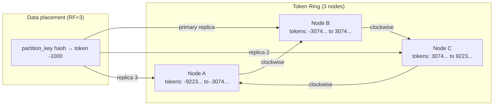

# Cassandra Internals

Cassandra is a masterless distributed database built for write-heavy, always-available workloads. Every node is equal — no primary, no single point of failure. Understanding the ring, consistency levels, and compaction is what separates operators who can tune it from those who fight it.

<div class="quiz-progress" data-quiz-progress>
  <span class="quiz-progress-label">0/0 checks</span>
  <span class="quiz-progress-bar"><span class="quiz-progress-fill"></span></span>
</div>

---

## Ring Topology and Token Assignment

Cassandra uses **consistent hashing** to distribute data across nodes. Every row's partition key is hashed to a 64-bit token in the range `-2^63` to `2^63 - 1`. That token determines which node stores the row.



**Virtual nodes (vnodes)** are the key to operational flexibility. Instead of each physical node owning one large continuous token range, each physical node owns **256 small token ranges** (configurable via `num_tokens: 256` in `cassandra.yaml`). When a node joins or leaves the cluster:

- With vnodes: its 256 ranges are spread across many different neighbors — data streams from/to many nodes in parallel, minimizing load on any single node.
- Without vnodes (legacy): the new node owns one range, and must stream from exactly one neighbor — that neighbor gets hammered during the operation.

```bash
# View the token ring and which node owns each range
nodetool ring

# Check node status during bootstrap
# UJ = Up/Joining, UN = Up/Normal, DN = Down/Normal
nodetool status

# Do NOT change num_tokens on a running cluster
# Changing it requires a full decommission + re-add of each node
```

**Adding a node:** `nodetool bootstrap` runs automatically when a new node starts and joins the cluster. The node transitions through `UJ` (Up/Joining) while streaming token ranges from neighbors. `nodetool status` shows streaming progress; `nodetool netstats` shows bytes transferred.

---

## Replication

**Replication factor (RF)** controls how many copies of each partition exist in the cluster. RF=3 means every partition is stored on 3 different nodes. Higher RF = more fault tolerance, more storage cost.

**Replication strategies:**

- **SimpleStrategy:** places RF copies on the next N nodes clockwise on the ring. No rack or datacenter awareness. Only suitable for single-datacenter development clusters.
- **NetworkTopologyStrategy:** specify RF per datacenter. Respects rack awareness within each DC — replicas go on different racks to survive rack-level failures. Always use in production.

```sql
-- Production: always NetworkTopologyStrategy
CREATE KEYSPACE my_app WITH REPLICATION = {
    'class': 'NetworkTopologyStrategy',
    'dc1': 3,
    'dc2': 2
};

-- Development only
CREATE KEYSPACE dev WITH REPLICATION = {
    'class': 'SimpleStrategy',
    'replication_factor': 1
};
```

**Rack awareness:** Configure `endpoint_snitch: GossipingPropertyFileSnitch` in `cassandra.yaml` and set the `dc` and `rack` labels in `cassandra-rackdc.properties` on each node. Cassandra will then place replicas on different racks. With RF=3 and 3 racks, each rack gets exactly one replica — the cluster survives a full rack failure.

```bash
# cassandra-rackdc.properties (on each node)
dc=dc1
rack=rack2

# Verify Cassandra sees rack topology correctly
nodetool status
# Output shows DC and rack for each node
```

---

## Tunable Consistency

Cassandra trades consistency for availability. The consistency level per-operation controls how many replicas must agree before a read or write returns to the client. **The application chooses at query time — there is no global setting.**

| Level | Writes require | Reads require | Notes |
|---|---|---|---|
| ONE | 1 replica ACK | 1 replica response | Fastest; stale reads possible |
| QUORUM | majority of RF ACK | majority respond | Default production choice |
| ALL | all replicas ACK | all respond | Slowest; any replica down = failure |
| LOCAL_ONE | 1 replica in local DC | 1 in local DC | Avoids cross-DC for non-critical reads |
| LOCAL_QUORUM | majority in local DC | majority in local DC | Multi-DC production standard |
| EACH_QUORUM | majority in each DC | N/A | Write-side only; ensures global durability |

**Quorum math:** `QUORUM = floor(RF / 2) + 1`
- RF=3 → QUORUM=2 (majority of 3 = 2)
- RF=5 → QUORUM=3 (majority of 5 = 3)
- RF=7 → QUORUM=4

**Strong consistency guarantee:** `WRITE at QUORUM + READ at QUORUM` guarantees that at least one node in the read set saw the write. With RF=3, a QUORUM write hits 2 nodes and a QUORUM read asks 2 nodes — they overlap by at least 1.

**Lightweight Transactions (LWT):** Cassandra's compare-and-set operations use Paxos consensus.

```sql
-- Only insert if user doesn't exist (IF NOT EXISTS uses Paxos)
INSERT INTO users (user_id, email) VALUES (uuid(), 'user@example.com')
IF NOT EXISTS;

-- Conditional update
UPDATE accounts SET balance = 500
WHERE account_id = 123
IF balance = 600;
```

LWT uses `SERIAL` consistency level. It requires 4 round trips (prepare → promise → propose → commit) and is 3–5× slower than a regular write. Only use for operations that truly require atomicity, like user registration uniqueness or inventory decrement.

---

## Write Path

<div class="stepper">
  <div class="stepper-panels">
    <div class="stepper-panel active">
      <strong>Step 1. Client → coordinator node.</strong>
      <p>The client sends the write to any Cassandra node — it doesn't matter which. That node becomes the <strong>coordinator</strong> for this request. The coordinator is not a master; it's simply the node that happens to handle this write. It uses the token ring to determine which replica nodes should receive the write, then forwards it to them.</p>
    </div>
    <div class="stepper-panel">
      <strong>Step 2. Commit log write (durable).</strong>
      <p>Each replica node that receives the write first appends it to the <strong>commit log</strong> — a sequential, append-only file on disk. This is the durability guarantee: if the node crashes after writing to the commit log but before flushing to an SSTable, the write can be replayed from the commit log on restart. The commit log is written synchronously before the memtable.</p>
    </div>
    <div class="stepper-panel">
      <strong>Step 3. Memtable write (in-memory).</strong>
      <p>After the commit log, the write goes into the <strong>memtable</strong> — an in-memory sorted structure (one per table). The coordinator returns success to the client once the required number of replicas (per consistency level) have ACKed the memtable write. At this point the write is considered complete, even though it's not yet on disk as an SSTable.</p>
    </div>
    <div class="stepper-panel">
      <strong>Step 4. Hinted handoff (for down replicas).</strong>
      <p>If a replica node is down at write time, the coordinator stores a <strong>hint</strong> — a small entry containing the write — locally. When the replica comes back up, the coordinator replays its hints to bring it up to date. Hints expire after <code>max_hint_window_in_ms</code> (default 3 hours). If a node is down longer than the hint window, it must be repaired with <code>nodetool repair</code> after rejoining.</p>
    </div>
    <div class="stepper-panel">
      <strong>Step 5. SSTable flush (async).</strong>
      <p>When the memtable exceeds the flush threshold (or <code>memtable_cleanup_threshold</code> is hit, or <code>nodetool flush</code> is called), the memtable is written to an immutable <strong>SSTable</strong> (Sorted String Table) on disk. Once flushed, the corresponding commit log segment can be discarded. SSTables are immutable — updates and deletes don't modify existing SSTables; they create new entries with newer timestamps.</p>
    </div>
  </div>
  <div class="stepper-controls">
    <button class="stepper-prev">← Prev</button>
    <span class="stepper-dots"></span>
    <span class="stepper-label"></span>
    <button class="stepper-next">Next →</button>
  </div>
</div>

---

## Read Path

Reading in Cassandra is more complex than writing because data for a single partition may be spread across multiple SSTables from different flush cycles.

**Bloom filter first:** Every SSTable has an associated bloom filter. Before doing any disk I/O, Cassandra checks the bloom filter for each SSTable — it can say "definitely not in this SSTable" (skip it) or "maybe in this SSTable" (read it). False positives cause unnecessary disk reads; false negatives don't happen. The bloom filter is always in memory.

**Partition index lookup:** If the bloom filter says "maybe", Cassandra does a binary search on the partition index to find the exact byte offset in the SSTable data file. This avoids a full scan.

**Multi-SSTable merge:** A single partition's data may exist in many SSTables (one per flush). Cassandra reads all relevant SSTables and merges their results, with the **newest timestamp winning** for any conflicting column values. This is how updates work — not in-place modification, but newer cells shadow older ones.

**Read repair:** When reading at QUORUM, the coordinator compares responses from multiple replicas. If they differ (one replica is stale), it sends a background repair to update the stale replica with the most recent values. Read repair is asynchronous — it doesn't block the read response.

**Speculative execution:** If a replica is slow, the coordinator may send the same read to a second replica and use whichever responds first. Configure with `speculative_retry: 99percentile` (only speculate when a replica is in the slowest 1% of responses for that table).

```bash
# Force a memtable flush to disk (useful before maintenance)
nodetool flush <keyspace> <table>

# Check SSTable count and bloom filter stats
nodetool tablestats <keyspace>.<table>
# Look for: SSTable count, bloom filter false ratio, read/write latency
```

---

## Compaction Strategies

SSTables accumulate over time — every memtable flush creates a new one. Without compaction, reads must check more and more SSTables, tombstones pile up, and disk usage grows with redundant data. Compaction merges SSTables, discards old cell versions, and purges expired tombstones.

| Strategy | Mechanism | Best for | Avoid when |
|---|---|---|---|
| **STCS** (SizeTieredCompactionStrategy) | Merges SSTables of similar size into one larger SSTable | Write-heavy; time-series; append-only | Read-heavy (high read amplification — many SSTables per read) |
| **LCS** (LeveledCompactionStrategy) | Maintains levels; each level ~10× larger than the previous; SSTables within a level don't overlap | Read-heavy; random reads; bounded SSTable count (≤10 per level) | Very write-heavy (higher write amplification) |
| **TWCS** (TimeWindowCompactionStrategy) | Compacts data within configurable time windows (e.g., 1 hour); old closed windows are compacted once | Time-series with TTL; IoT; logs | Random writes that span time windows |

```sql
-- Check current strategy
SELECT compaction FROM system_schema.tables
WHERE keyspace_name = 'my_app' AND table_name = 'events';

-- Switch to TWCS for time-series with 1-hour windows
ALTER TABLE events WITH compaction = {
    'class': 'TimeWindowCompactionStrategy',
    'compaction_window_unit': 'HOURS',
    'compaction_window_size': '1'
};

-- Switch to LCS for read-heavy tables
ALTER TABLE user_profiles WITH compaction = {
    'class': 'LeveledCompactionStrategy',
    'sstable_size_in_mb': '160'
};
```

```bash
# Monitor active compactions
nodetool compactionstats

# Force major compaction (merges all SSTables into one - use carefully on large tables)
nodetool compact <keyspace> <table>
```

---

## Tombstones

Cassandra cannot delete data in-place because SSTables are immutable. Instead, **deletes write a tombstone** — a special marker with a deletion timestamp. The actual data is physically removed during compaction, but only after `gc_grace_seconds` has elapsed.

**Why gc_grace_seconds exists:** Consider this scenario:
1. You delete a row on Node A and Node B. Node C is down.
2. The tombstone is written on A and B.
3. You compact immediately, purging the tombstone from A and B.
4. Node C comes back up. It has the original data but no tombstone.
5. Read repair sees Node C's data is "newer" than the compacted A/B (which have nothing) — the deleted data reappears.

`gc_grace_seconds` (default `864000` = 10 days) gives a window for all replicas to receive the tombstone before it can be purged. Run `nodetool repair` before `gc_grace_seconds` expires if a node was down during a delete.

**Tombstone accumulation:** Tombstones must be skipped during reads. A partition with millions of tombstones causes slow queries and can trigger warnings or errors:

```yaml
# cassandra.yaml thresholds
tombstone_warn_threshold: 1000       # WARN in logs
tombstone_failure_threshold: 100000  # Throw TombstoneOverwhelmingException
```

**Mitigation for tombstone-heavy workloads:**

```sql
-- Use TTL instead of explicit DELETE for time-series data
-- Cassandra auto-expires cells without generating a tombstone object
INSERT INTO sensor_readings (device_id, ts, value)
VALUES ('sensor-1', toTimestamp(now()), 42.5)
USING TTL 86400;  -- expires in 24 hours

-- Set TTL at table level (default for all inserts)
ALTER TABLE sensor_readings WITH default_time_to_live = 86400;
```

---

## nodetool Operations

| Command | Purpose |
|---|---|
| `nodetool status` | Ring health — UN=Up/Normal, DN=Down/Normal, UJ=Up/Joining |
| `nodetool repair -pr` | Anti-entropy repair for primary token ranges; run weekly per node |
| `nodetool snapshot <keyspace>` | Create point-in-time hard-linked snapshot for backup |
| `nodetool flush <keyspace>` | Flush memtables to disk before maintenance or shutdown |
| `nodetool compactionstats` | Active compaction progress — pending tasks and bytes remaining |
| `nodetool tpstats` | Thread pool stats — dropped messages, pending tasks per stage |
| `nodetool tablestats <keyspace>.<table>` | SSTable count, read/write latency, bloom filter false ratio |
| `nodetool decommission` | Safely remove a node — streams its token ranges first, then leaves |
| `nodetool removenode <host-id>` | Remove a dead node that cannot decommission itself |
| `nodetool ring` | Show token ring and which node owns each token range |
| `nodetool netstats` | Active streaming operations — bytes sent/received during bootstrap or repair |
| `nodetool cfhistograms <ks> <table>` | Read/write latency histograms, row sizes, column counts |

**When to run repair:** Run `nodetool repair` (with `-pr` flag to repair only primary ranges, avoiding double-work in a cluster):
- Weekly as scheduled maintenance on each node in rotation
- Before reducing RF on a keyspace
- Before `gc_grace_seconds` expires if a node was down during a bulk delete
- After a node was down longer than `max_hint_window_in_ms` (3 hours)

```bash
# Repair primary token ranges for all keyspaces (run on each node)
nodetool repair -pr

# Repair a specific keyspace
nodetool repair -pr my_app

# Check if repair is running
nodetool compactionstats | grep "Validation"
```

---

## Backup and Restore

Cassandra backup is snapshot-based. There is **no WAL-equivalent for point-in-time recovery** — you can only restore to a snapshot point.

**Creating a snapshot:**

```bash
# Snapshot a keyspace (creates hard-linked SSTable copies)
nodetool snapshot my_app

# Snapshots are stored per-table under:
# /var/lib/cassandra/data/<keyspace>/<table>/snapshots/<snapshot-name>/

# List snapshots
nodetool listsnapshots

# Clear old snapshots (they pin disk space via hard links)
nodetool clearsnapshot my_app
```

**Backing up to object storage (run on every node — each owns different data):**

```bash
# Snapshot all nodes first, then copy from each node
nodetool snapshot my_app -t backup-$(date +%Y%m%d)

# Sync to S3 (repeat for each table)
aws s3 sync \
  /var/lib/cassandra/data/my_app/users/snapshots/backup-20241018/ \
  s3://my-backups/cassandra/dc1/node1/my_app/users/backup-20241018/
```

**Restore with sstableloader (cross-cluster or topology change):**

`sstableloader` streams SSTables to the correct nodes based on the current token ownership — it handles topology changes between backup and restore.

```bash
# Load SSTables into a running cluster (from a different node or cluster)
sstableloader -d <seed-node-ip> \
  /path/to/snapshots/my_app/users/

# sstableloader reads the cluster's token ring and routes data correctly
# Works even if the cluster has different nodes or vnodes than the backup source
```

**No PITR:** Unlike PostgreSQL (WAL replay) or MySQL (binlog), Cassandra cannot replay individual operations between snapshots. For workloads requiring PITR, consider streaming writes to a separate log (Kafka → replay) or using a supplementary RDBMS for transactional data.

---

## Data Modeling Rules

Cassandra's query model is the inverse of a relational database: **design the table for the query, not the query for the table.**

**Primary key components:**

```sql
CREATE TABLE sensor_readings (
    device_id  UUID,          -- partition key: which node stores this
    ts         TIMESTAMP,     -- clustering key: sort order within partition
    value      DOUBLE,
    PRIMARY KEY (device_id, ts)  -- (partition_key, clustering_key...)
) WITH CLUSTERING ORDER BY (ts DESC);  -- newest first
```

- **Partition key** → determines which node(s) store the data via token hash
- **Clustering key** → sorts rows within a partition on disk; enables range queries within a partition

**Rules for good data modeling:**

| Rule | Reason |
|---|---|
| **Design queries first** | No joins, no subqueries — each table serves one access pattern |
| **One table per query pattern** | Denormalize: duplicate data rather than join at read time |
| **Avoid `ALLOW FILTERING`** | Full cluster scan — reads from every node; never in production |
| **Partition size < ~100MB** | Very large partitions degrade GC and compaction performance |
| **Row count < ~100K per partition** | Wide partitions (many clustering rows) are fine up to this limit |
| **Avoid high-cardinality secondary indexes** | Cassandra secondary indexes are per-node local indexes; querying them on a high-cardinality column (like `user_id`) hits every node |

**Anti-patterns:**

```sql
-- BAD: ALLOW FILTERING = full cluster scan
SELECT * FROM orders WHERE status = 'pending' ALLOW FILTERING;

-- GOOD: separate table for this query pattern
CREATE TABLE orders_by_status (
    status    TEXT,
    order_id  UUID,
    created   TIMESTAMP,
    PRIMARY KEY (status, created, order_id)
) WITH CLUSTERING ORDER BY (created DESC, order_id ASC);

-- BAD: high-cardinality secondary index
CREATE INDEX ON orders (user_id);  -- one lookup = N node hits

-- GOOD: denormalized lookup table
CREATE TABLE orders_by_user (
    user_id   UUID,
    order_id  UUID,
    created   TIMESTAMP,
    PRIMARY KEY (user_id, created, order_id)
) WITH CLUSTERING ORDER BY (created DESC, order_id ASC);
```

**Materialized views:** Cassandra can auto-maintain a denormalized view from a base table. They work but have known limitations in multi-node scenarios — inconsistencies under heavy load. For production, prefer application-side dual writes to maintain lookup tables explicitly.

---

<div class="quiz-card">
  <p class="quiz-q">Your Cassandra read latency is spiking. <code>nodetool tablestats</code> shows one table has 50+ SSTables per read. What is happening and how do you fix it?</p>
  <button class="quiz-reveal">Reveal answer</button>
  <div class="quiz-a" hidden>
    <strong>50+ SSTables per read is compaction lag.</strong> SSTables are accumulating faster than STCS (SizeTieredCompactionStrategy) is compacting them. STCS only compacts SSTables of similar size — if write sizes vary a lot, no size tier fills and compaction never triggers. Each SSTable needs a bloom filter check and potentially a disk seek per read, so 50+ SSTables means 50+ bloom filter checks and potentially many disk seeks per partition read.<br><br>
    <strong>Immediate fix:</strong> <code>nodetool compact &lt;keyspace&gt; &lt;table&gt;</code> — forces a major compaction that merges all SSTables into one. This is expensive on a large table (heavy I/O, may cause GC pressure) — schedule during low traffic.<br><br>
    <strong>Long-term fix:</strong> switch to LeveledCompactionStrategy, which maintains ≤10 SSTables per level by design. Also check <code>nodetool compactionstats</code> for a huge pending queue that indicates the compactor is behind.
  </div>
</div>

<div class="quiz-card">
  <p class="quiz-q">A Cassandra node was down for 4 hours and just rejoined. A user ran <code>DELETE FROM orders WHERE user_id = 42</code> during the outage. After the node rejoins, that user's orders reappear. Why?</p>
  <button class="quiz-reveal">Reveal answer</button>
  <div class="quiz-a" hidden>
    <strong>Hint expiry caused the delete to be lost.</strong> When the node was down, the coordinator stored a hint for the delete operation. But hints expire after <code>max_hint_window_in_ms</code> — the default is 3 hours (10,800,000 ms). The node was down 4 hours, so the hint expired and was discarded.<br><br>
    When the node rejoined, it had the original order data (from before the delete) but no tombstone. Read repair then compared the rejoined node's data against the other replicas. The other replicas had the tombstone but it may have already been compacted away (if <code>gc_grace_seconds</code> passed), or read repair promoted the rejoined node's "live" data over the tombstone via the wrong timestamp comparison.<br><br>
    <strong>Fix:</strong> Always run <code>nodetool repair</code> immediately after a node rejoins that was down longer than the hint window. This syncs tombstones to the stale node before <code>gc_grace_seconds</code> allows them to be compacted away. This is why the repair schedule matters: a node down longer than gc_grace_seconds without repair is a data consistency hazard.
  </div>
</div>

<div class="quiz-card">
  <p class="quiz-q">Why does Cassandra need <code>gc_grace_seconds</code> (default 10 days) before purging tombstones? Can't it purge tombstones immediately after compaction?</p>
  <button class="quiz-reveal">Reveal answer</button>
  <div class="quiz-a" hidden>
    <strong>Purging tombstones immediately creates a resurrection window.</strong> Here's the failure mode:<br><br>
    1. You delete a row — tombstone written to Node A and Node B. Node C is down.<br>
    2. Compaction runs immediately on A and B, purging the tombstone (data is gone).<br>
    3. Node C comes back up. It has the original data row but no tombstone.<br>
    4. Read repair runs: Node C has data, A and B have nothing. Read repair sees C's data as present and A/B as "missing" — it promotes C's version and writes the deleted data back to A and B.<br><br>
    <code>gc_grace_seconds</code> (default 864,000 = 10 days) is the window during which Cassandra guarantees: "any node that was down during this delete should be repaired before this deadline." If you run <code>nodetool repair</code> within gc_grace_seconds, the tombstone propagates before it's purged. The tradeoff: tombstones consume disk space during this window. For workloads with heavy deletes, reduce gc_grace_seconds only if you have strict repair SLAs (e.g., repair every node within 1 day → gc_grace can be 86,400 seconds).
  </div>
</div>
