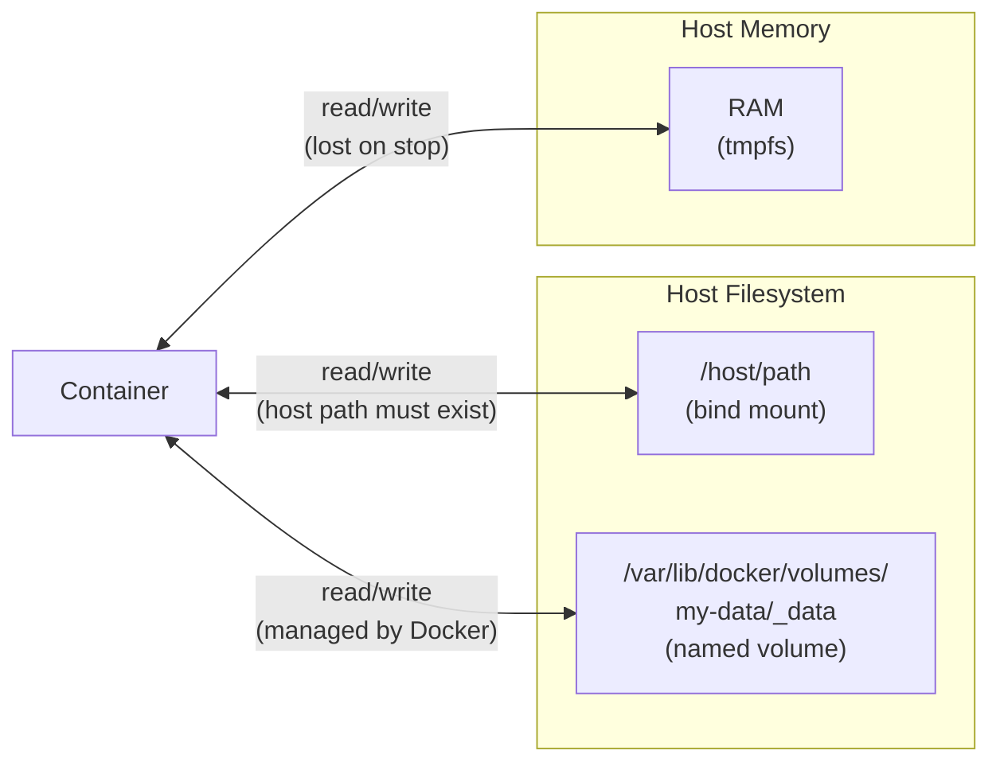
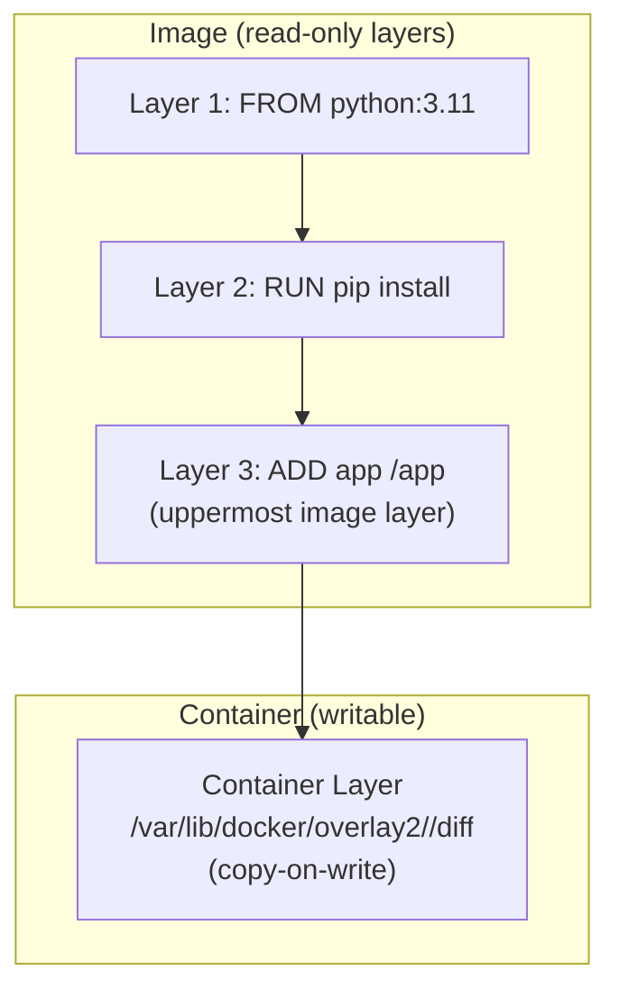

# Docker Volumes & Storage

Three ways to get data into and out of a container — bind mounts, named volumes, and tmpfs — each with a different lifecycle, portability, and performance story.

<div class="quiz-progress" data-quiz-progress>
  <span class="quiz-progress-label">0/0 checks</span>
  <span class="quiz-progress-bar"><span class="quiz-progress-fill"></span></span>
</div>

---

## 1. Storage Architecture



The fundamental difference:

| Type | Who manages path | Survives container deletion | Survives daemon restart | Portable |
|------|------------------|-----------------------------|------------------------|----------|
| Bind mount | You | ✅ (it's your file) | ✅ | ❌ (host-path specific) |
| Named volume | Docker | ✅ | ✅ | ✅ (docker volume commands) |
| tmpfs | Kernel (RAM) | ❌ | ❌ | ❌ |

---

## 2. Bind Mounts

Bind mounts map a host path directly into the container. The container sees your real files — writes go through immediately.

```bash
# Syntax: -v <absolute-host-path>:<container-path>[:options]
docker run -v /home/user/app:/app node:20 node /app/server.js

# Read-only bind mount (container cannot write back)
docker run -v /etc/nginx/nginx.conf:/etc/nginx/nginx.conf:ro nginx

# Using --mount (explicit, preferred in scripts)
docker run --mount type=bind,source=/home/user/app,target=/app node:20
```

**Use cases:**
- **Development hot-reload** — mount your source directory; changes appear in the container instantly without rebuilding the image.
- **Config injection** — mount a single config file from the host rather than baking it into the image.
- **Log collection** — mount `/var/log/app` into a logging sidecar.

**Gotchas:**

*UID mismatch* — The container process runs as a specific UID (e.g., `node:20` runs as UID 1000). If your host directory is owned by root (UID 0), the container process can't write to it. Fix: `chown 1000:1000 /host/path` or run with `--user $(id -u):$(id -g)`.

*Relative paths don't work* — `docker run -v ./app:/app` is rejected. Use `$(pwd)/app` or an absolute path.

*Host path must exist* — Docker will create the directory if it doesn't exist, but it will be owned by root and empty — usually not what you want. Pre-create it.

<div class="quiz-card"><p class="quiz-q">You run <code>docker run -v ./data:/data myapp</code> and get an error. What's wrong?</p><button class="quiz-reveal">Reveal answer</button><div class="quiz-a" hidden>Relative paths are not supported in <code>-v</code> flags. Use an absolute path: <code>-v $(pwd)/data:/data</code> or <code>-v /home/user/project/data:/data</code>.</div></div>

---

## 3. Named Volumes

Named volumes are managed by Docker. You create them with a name, Docker stores the data at `/var/lib/docker/volumes/<name>/_data`, and they survive container deletion.

```bash
# Create a named volume explicitly
docker volume create my-data

# Attach to a container
docker run -v my-data:/var/lib/postgresql/data postgres:16

# Using --mount
docker run --mount type=volume,source=my-data,target=/var/lib/postgresql/data postgres:16

# Inspect where it lives on the host
docker volume inspect my-data
# Output: "Mountpoint": "/var/lib/docker/volumes/my-data/_data"

# List all volumes
docker volume ls

# Remove unused volumes (dangling)
docker volume prune
```

**Volume sharing between containers:**

Two containers can share the same named volume — common for sidecar patterns:

```bash
# Primary container writes to /data
docker run -d --name app -v my-data:/data myapp

# Sidecar reads /data (backup, log forwarder, etc.)
docker run -d --name sidecar --volumes-from app busybox tail -f /data/app.log
```

`--volumes-from` mounts all volumes from the named container, at the same paths, into the new container. Used heavily for backup patterns (Section 7).

<div class="quiz-card"><p class="quiz-q">You delete a container that was using a named volume with <code>docker rm myapp</code>. What happens to the volume's data?</p><button class="quiz-reveal">Reveal answer</button><div class="quiz-a" hidden>The data is safe. Named volumes have an independent lifecycle from containers. <code>docker rm</code> removes the container, not its volumes. You need <code>docker rm -v myapp</code> or <code>docker volume rm my-data</code> to remove the volume. This is intentional — it prevents accidental data loss.</div></div>

---

## 4. tmpfs Mounts

tmpfs lives entirely in RAM. It is never written to disk. When the container stops, the data is gone — permanently.

```bash
# Mount a tmpfs at /tmp with a 256 MB size limit
docker run --tmpfs /tmp:rw,size=256m myapp

# Using --mount
docker run --mount type=tmpfs,destination=/tmp,tmpfs-size=268435456 myapp

# Multiple tmpfs mounts
docker run \
  --tmpfs /tmp:rw,size=128m \
  --tmpfs /run:rw,size=64m \
  myapp
```

**Use cases:**

- **Sensitive data** — API tokens, session keys, temporary credentials. They never touch disk and are never recoverable from disk forensics after the container exits.
- **Build cache / pip wheels** — mount pip's cache dir as tmpfs so layer writes don't hit the slow overlay2 copy-on-write path.
- **High-throughput scratch** — sorting, shuffling, or checkpointing data where you don't need the output to survive.

**Limits:** tmpfs counts against the host's available RAM. On a host with 8 GB RAM, a container with `--tmpfs /tmp:rw,size=4g` is reserving up to 4 GB. Actual allocation is lazy (only pages that are written consume RAM), but the limit is enforced.

---

## 5. Volume Driver Plugins

The default volume driver (`local`) stores data on the node running the container. For multi-host or cloud workloads, use a driver plugin.

<div class="tab-group">
  <div class="tab-buttons">
    <button data-tab="nfs" class="active">NFS</button>
    <button data-tab="efs">AWS EFS</button>
  </div>
  <div class="tab-panels">
    <div class="tab-panel active" data-tab-panel="nfs">
      <p>The <code>local</code> driver supports NFS directly via mount options — no extra plugin needed:</p>
      <pre><code>docker volume create \
  --driver local \
  --opt type=nfs \
  --opt o=addr=192.168.1.10,rw,nfsvers=4 \
  --opt device=:/exports/mydata \
  nfs-vol

docker run -v nfs-vol:/data myapp</code></pre>
      <p><strong>Options breakdown:</strong></p>
      <ul>
        <li><code>type=nfs</code> — mount type (passed to the kernel <code>mount</code> syscall)</li>
        <li><code>o=addr=...,rw,nfsvers=4</code> — mount options: NFS server IP, read-write, NFSv4</li>
        <li><code>device=:/exports/mydata</code> — the NFS export path (colon prefix is required)</li>
      </ul>
      <p><strong>Use case:</strong> shared volume across Docker Swarm nodes where all workers can reach the same NFS server. All containers see the same data regardless of which node they run on.</p>
      <p><strong>Gotcha:</strong> NFS adds network latency to every write. Not suitable for databases or anything with heavy random I/O.</p>
    </div>
    <div class="tab-panel" data-tab-panel="efs">
      <p>Use the <code>amazon/amazon-efs-utils</code> Docker plugin for EFS volumes:</p>
      <pre><code># Install the plugin once per Docker host
docker plugin install amazon/amazon-efs-utils

# Create a volume backed by an EFS filesystem
docker volume create \
  --driver amazon/amazon-efs-utils \
  --opt fs-id=fs-0123456789abcdef \
  --opt region=us-east-1 \
  efs-vol

docker run -v efs-vol:/data myapp</code></pre>
      <p><strong>Use case:</strong> multi-container shared storage in ECS tasks or across EC2 instances. EFS scales automatically, handles replication across AZs, and integrates with IAM for access control.</p>
      <p><strong>IAM access:</strong> The EC2 instance running Docker needs an IAM role with <code>elasticfilesystem:ClientMount</code> and <code>elasticfilesystem:ClientWrite</code> permissions. The plugin uses instance metadata to get credentials.</p>
      <p><strong>Performance:</strong> EFS Bursting Throughput is fine for most workloads. For sustained high-throughput, use Provisioned Throughput mode. Latency is higher than local disk — plan accordingly.</p>
    </div>
  </div>
</div>

---

## 6. Storage Driver: overlay2

The storage driver controls how image layers and the writable container layer are managed on the host. `overlay2` is the default and the right choice for all modern Linux kernels (4.x+).



**How copy-on-write works:**

When a container reads a file from an image layer, it reads the original. When it writes to that file for the first time, overlay2 copies the entire file up to the container layer, then modifies it there. All subsequent reads and writes happen on the container layer copy.

**Performance implication:** The first write to any file from an image layer is slow (copy-up). Named volumes bypass overlay2 entirely — data in a named volume is stored at `/var/lib/docker/volumes/`, not inside the overlay2 tree. This is why databases should always use named volumes, not the container filesystem.

```bash
# Inspect the overlay2 layers for a running container
docker inspect <container_id> | jq '.[0].GraphDriver.Data'
# Shows: LowerDir (image layers), UpperDir (container writes), MergedDir (unified view)
```

---

## 7. Volume Backup Patterns

**Pattern 1 — Live backup (container keeps running):**

```bash
# Backup /data from a running container to a local tar
docker run --rm \
  --volumes-from myapp \
  -v $(pwd):/backup \
  busybox \
  tar czf /backup/backup-$(date +%Y%m%d).tar.gz /data
```

The `--volumes-from myapp` mounts all of `myapp`'s volumes at the same paths. The busybox container reads them and writes a tar to the host. The `myapp` container continues running.

**Caveat:** Live backup of a database without quiescing writes may produce an inconsistent snapshot. For databases, either pause writes, use DB-native tools (`pg_dump`, `mongodump`), or use a volume snapshot.

**Pattern 2 — Clean backup (stopped container):**

```bash
docker stop myapp

docker run --rm \
  -v my-data:/source \
  -v $(pwd):/backup \
  busybox \
  tar czf /backup/backup.tar.gz /source

docker start myapp
```

**Restore:**

```bash
# Restore into a new (or existing) named volume
docker run --rm \
  -v my-data:/target \
  -v $(pwd):/backup \
  busybox \
  tar xzf /backup/backup.tar.gz -C /target --strip-components=1
```

`--strip-components=1` strips the leading `/source` directory component from the archive, so files land directly in `/target` rather than `/target/source/file`.

---

## 8. Multi-Host Volume Challenges

Named volumes are **node-local** by default. A volume created on node A is not visible on node B. When a container migrates to a different host (Swarm replanning, rolling restart), it finds an empty volume or no volume at all.

**Options for shared storage across hosts:**

1. **NFS or EFS driver** (Section 5) — all nodes mount the same network filesystem. Simple but adds network latency to every I/O.

2. **CSI drivers in Kubernetes** — Kubernetes PersistentVolumes with a CSI driver (EBS, GCE PD, Longhorn, Ceph RBD) handle volume attachment and detachment as pods reschedule. This is the production answer for stateful workloads.

3. **Docker Swarm volume constraints** — pin services to nodes that have the volume:
```bash
docker service create \
  --constraint 'node.labels.storage==ssd' \
  --mount type=volume,source=my-data,target=/data \
  myapp
```
Label the specific node, and constrain the service to it. A workaround, not a solution.

4. **Read-only replication** — some workloads (config files, ML model weights) are written once and read many. Use S3/GCS + an init container to pull the data at pod startup.

---

## 9. Comparison Table

| | Bind Mount | Named Volume | tmpfs |
|---|---|---|---|
| **Persistence** | Lives with host file | Independent lifecycle | Lost on container stop |
| **Portability** | Host-path specific | Transferable via `docker volume` | N/A |
| **Sharing** | Any process on host | Containers with access to same Docker socket | Single container |
| **Performance** | Native (host FS) | Native (host FS, no overlay2) | Fastest (RAM) |
| **Use case** | Dev, config injection | Databases, stateful apps | Secrets, build scratch |
| **Docker manages path** | ❌ You do | ✅ | ✅ (kernel) |

<div class="quiz-card"><p class="quiz-q">Your PostgreSQL container uses the default container filesystem (no volume). After <code>docker rm -f postgres</code>, can you recover the data?</p><button class="quiz-reveal">Reveal answer</button><div class="quiz-a" hidden>No. The container layer (where the DB files lived) is deleted with the container. You need a named volume (<code>-v pg-data:/var/lib/postgresql/data</code>) to persist data across container deletions. Always use named volumes for databases.</div></div>
