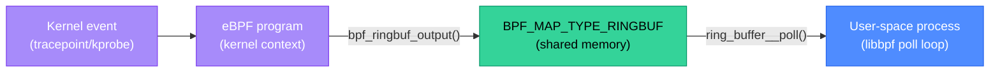

# BPF Fundamentals: Program Types, Maps, and CO-RE

Understanding eBPF at the program level — what hooks programs attach to, how data flows between kernel and user-space, and how portable programs are built — is the foundation for everything from writing a bpftrace one-liner to deploying Cilium or Tetragon. Tools like Cilium abstract away these details, but knowing them helps you debug when things don't work and reason about the performance implications of what you're running.

<div class="quiz-progress" data-quiz-progress>
  <span class="quiz-progress-label">0/0 checks</span>
  <span class="quiz-progress-bar"><span class="quiz-progress-fill"></span></span>
</div>

---

## 1. BPF Program Types

Every eBPF program is associated with a hook point — the kernel event that triggers it. The program type determines what context data is available and what the program can do.

| Program type | Hook | Context available | Return value meaning |
|-------------|------|------------------|---------------------|
| **kprobe** | Kernel function entry | Function arguments | Ignored |
| **kretprobe** | Kernel function return | Return value | Ignored |
| **tracepoint** | Stable kernel tracepoint (e.g., `sys_enter_openat`) | Tracepoint arguments | Ignored |
| **XDP** | Network driver (before kernel allocates skb) | Raw packet bytes | `XDP_PASS`, `XDP_DROP`, `XDP_TX` |
| **TC** (Traffic Control) | Network layer (after skb allocation) | sk_buff | `TC_ACT_OK`, `TC_ACT_SHOT` |
| **uprobe** | User-space function entry (e.g., `libssl.so:SSL_write`) | Function arguments | Ignored |
| **socket filter** | Socket receive path | sk_buff | Bytes to keep (0 = drop) |

**kprobes** vs **tracepoints**: kprobes attach to any kernel function by name — they are powerful but unstable. If the kernel is updated and the function is renamed or inlined, the kprobe breaks silently. Tracepoints are explicitly defined by kernel developers as stable interfaces — they survive kernel updates. Prefer tracepoints when they exist for the event you care about.

**XDP** vs **TC**: XDP runs at the network driver level, before the kernel allocates a socket buffer (`skb`). It's the fastest place to drop or redirect packets (e.g., DDoS mitigation, load balancing). TC runs after the `skb` is allocated, giving access to higher-level metadata (VLAN tags, marks) but with slightly higher overhead. Cilium uses TC for most of its eBPF packet processing.

**uprobe** examples:
```bash
# Trace SSL_write in openssl — intercepts encrypted data before encryption
bpftrace -e 'uprobe:/usr/lib/x86_64-linux-gnu/libssl.so.3:SSL_write { printf("pid=%d len=%d\n", pid, arg2); }'

# Trace Go function entry (note: Go uses a different calling convention)
bpftrace -e 'uprobe:/usr/local/bin/myapp:"main.processRequest" { printf("called\n"); }'
```

<div class="quiz-card">
  <p class="quiz-q">You want to trace every `openat` system call to detect which processes open `/etc/passwd`. You have two options: attach a kprobe to the `do_sys_openat2` kernel function, or attach to the `sys_enter_openat` tracepoint. Which should you choose and why?</p>
  <button class="quiz-reveal">Reveal answer</button>
  <div class="quiz-a" hidden>Use the **`sys_enter_openat` tracepoint**. Tracepoints are defined as stable kernel ABI — the `sys_enter_openat` tracepoint will exist and provide the same arguments (filename, flags, mode) across kernel versions from 4.17 onwards. `do_sys_openat2` is a kernel implementation function — in some kernel versions it's called `do_sys_open`, in others `__do_sys_openat2`, and the compiler may inline it entirely in optimized builds, making the kprobe silently fail. The tracepoint gives you `args->filename` (the path string), which you'd need to read with `bpf_probe_read_user_str()` — but this is well-documented. With kprobe, you'd need to reverse-engineer the function's calling convention from kernel source to find which argument is the filename, and it can change between minor kernel releases. The rule: tracepoint if it exists, kprobe as a last resort.</div>
</div>

---

## 2. BPF Maps

BPF maps are the communication channel between eBPF programs running in the kernel and user-space programs that read and write data. They are also used for communication between multiple eBPF programs (e.g., an XDP program that sets a mark read by a TC program).

| Map type | Data structure | Best use case |
|----------|---------------|---------------|
| **BPF_MAP_TYPE_HASH** | Hash table | Per-key counters (per-PID, per-IP) |
| **BPF_MAP_TYPE_ARRAY** | Fixed-size array indexed by uint32 | Per-CPU global counters; configuration passed from user-space |
| **BPF_MAP_TYPE_RINGBUF** | Lock-free ring buffer | High-throughput event streaming to user-space (preferred over perf event array in modern kernels) |
| **BPF_MAP_TYPE_PERF_EVENT_ARRAY** | Per-CPU perf ring buffer | Legacy event streaming; replaced by RINGBUF in most new code |
| **BPF_MAP_TYPE_LRU_HASH** | LRU hash table (auto-evicts old entries) | Connection tracking, caches with bounded memory |
| **BPF_MAP_TYPE_PERCPU_HASH** | Per-CPU hash (no locking needed) | High-frequency per-key counters without lock contention |

**Kernel program writes to a ring buffer, user-space reads:**



**Map pinning** — maps can be pinned to the BPF filesystem (`/sys/fs/bpf/`) so they persist after the program that created them exits. This allows different programs and user-space processes to share the same map:

```bash
# Pin a map to the BPF filesystem
bpftool map pin id 42 /sys/fs/bpf/my_counters

# A different process reads the pinned map
bpftool map dump pinned /sys/fs/bpf/my_counters
```

---

## 3. CO-RE: Compile Once, Run Everywhere

**The problem CO-RE solves:** eBPF programs written in C often access kernel internal structures (e.g., `struct task_struct` to read a process's PID). The exact layout of `task_struct` changes between kernel versions. Older eBPF programs required kernel headers matching the exact running kernel — they had to be compiled on the target host, or distributed as source code.

**BTF (BPF Type Format)** is metadata about the kernel's type system — the layout of every struct, enum, and typedef, embedded in the kernel image at compile time (available from kernel 5.4+ in most distributions: `/sys/kernel/btf/vmlinux`).

**CO-RE** (available from kernel 5.5+ with libbpf >= 0.3): the eBPF program is compiled once against a synthetic `vmlinux.h` (generated from BTF of any recent kernel). At load time, libbpf reads the running kernel's BTF and rewrites the struct field offsets in the compiled bytecode to match the actual running kernel. The program works on any kernel that has BTF, regardless of version.

```bash
# Generate vmlinux.h from the running kernel's BTF
bpftool btf dump file /sys/kernel/btf/vmlinux format c > vmlinux.h

# Compile a CO-RE eBPF program
clang -target bpf -D__TARGET_ARCH_x86 -O2 -g \
  -I/path/to/libbpf/include \
  -c openat_trace.bpf.c -o openat_trace.bpf.o
```

<div class="quiz-card">
  <p class="quiz-q">You deploy a Cilium version that was compiled on a Debian 12 kernel (5.10) to a cluster of nodes running Ubuntu 22.04 with kernel 5.15 and Rocky Linux 9 with kernel 5.14. Will Cilium's eBPF programs work correctly on all nodes? What is the prerequisite?</p>
  <button class="quiz-reveal">Reveal answer</button>
  <div class="quiz-a" hidden>Yes, if CO-RE is used (which all modern Cilium versions use) AND the nodes have BTF enabled in their kernels. The prerequisite is `/sys/kernel/btf/vmlinux` present on each node — this means the kernel was compiled with `CONFIG_DEBUG_INFO_BTF=y`, which is the default in Ubuntu 22.04 (kernel 5.15) and Rocky Linux 9 (kernel 5.14). When Cilium loads its eBPF programs, libbpf reads each node's BTF and patches the compiled bytecode's struct field accesses to match that specific kernel's layout. The `struct sk_buff` layout on kernel 5.10 vs 5.15 differs slightly (field ordering, added fields), but CO-RE handles this transparently. Without BTF (`/sys/kernel/btf/vmlinux` absent), Cilium would either fail to load (if compiled with strict CO-RE checks) or fall back to a non-eBPF mode. Always verify BTF support with `ls /sys/kernel/btf/vmlinux` before deploying eBPF-based tools to a new node type.</div>
</div>

---

## 4. libbpf

libbpf is the reference C library for loading and managing eBPF programs from user-space. Modern eBPF programs are written in two parts: the kernel-side BPF program (C compiled to BPF bytecode) and the user-space loader (C using libbpf, or Python/Go/Rust bindings).

**Skeleton generation** — libbpf-bootstrap generates a C header that provides a typed interface to the BPF program's maps and programs:

```bash
# Generate skeleton from compiled BPF object
bpftool gen skeleton openat_trace.bpf.o > openat_trace.skel.h
```

**User-space loader using the skeleton:**

```c
#include "openat_trace.skel.h"

int main() {
    struct openat_trace_bpf *skel;

    // Open the BPF object (apply CO-RE relocations)
    skel = openat_trace_bpf__open();

    // Load and verify the BPF program into the kernel
    openat_trace_bpf__load(skel);

    // Attach the program to its hook (tracepoint sys_enter_openat)
    openat_trace_bpf__attach(skel);

    // Poll the ring buffer for events
    struct ring_buffer *rb = ring_buffer__new(
        bpf_map__fd(skel->maps.events), handle_event, NULL, NULL);

    while (true) {
        ring_buffer__poll(rb, 100 /* timeout_ms */);
    }
}
```

Go and Rust bindings (`cilium/ebpf` for Go, `aya-rs/aya` for Rust) follow the same open → load → attach → poll lifecycle.

---

## 5. bpftool

bpftool is the standard debugging CLI for eBPF programs, maps, and links. Essential for understanding what's loaded in a running system.

```bash
# List all loaded BPF programs
bpftool prog list
# 42: kprobe  name sys_openat  tag abc123  gpl
#    loaded_at 2026-09-18T10:00:00+0000  uid 0
#    xlated 256B  jited 192B  memlock 4096B  map_ids 7,8

# Show the BPF bytecode (xlated) of a program
bpftool prog dump xlated id 42

# Show the JIT-compiled native code
bpftool prog dump jited id 42

# List all BPF maps
bpftool map list

# Dump a hash map's contents
bpftool map dump id 7
# key: 00 00 00 00 (PID=0)
# value: 12 00 00 00 (count=18)

# Show what eBPF programs are attached to network interfaces
bpftool net list

# Check BTF types for a program
bpftool prog show id 42 --json | jq '.btf_id'
```

Use `bpftool prog list` to verify that Cilium, Falco, or Tetragon's eBPF programs are actually loaded when troubleshooting why they're not working — sometimes the daemon is running but the programs failed to load silently.

---

## 6. BPF Maps: Advanced Patterns

The basic map types introduced in section 2 cover most use cases. Here's the full picture of map types and their tradeoffs.

**Complete map type reference:**

| Map type | Structure | Key insight |
|----------|-----------|-------------|
| `BPF_MAP_TYPE_HASH` | Hash table | Per-key counters (per-PID, per-IP); lock per bucket |
| `BPF_MAP_TYPE_ARRAY` | Fixed array indexed by u32 | Global configuration; index-only access, no delete |
| `BPF_MAP_TYPE_PERCPU_HASH` | Per-CPU hash | High-frequency counters; no locking; sum in userspace |
| `BPF_MAP_TYPE_PERCPU_ARRAY` | Per-CPU array | Per-CPU scratch space (avoids stack size limit) |
| `BPF_MAP_TYPE_LRU_HASH` | LRU hash | Connection tracking; auto-evicts on full (no ENOMEM) |
| `BPF_MAP_TYPE_LRU_PERCPU_HASH` | Per-CPU LRU hash | High-frequency connection tracking |
| `BPF_MAP_TYPE_RINGBUF` | Single shared ring (kernel 5.8+) | Event streaming; no sample loss; watermark wakeup |
| `BPF_MAP_TYPE_PERF_EVENT_ARRAY` | Per-CPU perf rings | Legacy event streaming; can drop under high rate |
| `BPF_MAP_TYPE_QUEUE` | FIFO queue | Producer-consumer between programs |
| `BPF_MAP_TYPE_STACK` | LIFO stack | Reverse-order event processing |
| `BPF_MAP_TYPE_SOCKHASH` / `SOCKMAP` | Socket table | Redirect sk_msg between sockets (proxy bypass) |
| `BPF_MAP_TYPE_LPM_TRIE` | Longest-prefix-match trie | IP prefix matching (CIDR blocklists, routing) |

**RINGBUF vs PERF_EVENT_ARRAY — choose RINGBUF for new code:**

`PERF_EVENT_ARRAY` is per-CPU: each CPU has its own ring buffer, and userspace must poll all of them. Under a burst of events, individual per-CPU rings can overflow and drop samples — there's no backpressure. `RINGBUF` is a single shared ring buffer. The BPF program reserves space (`bpf_ringbuf_reserve`), writes data, then commits atomically. If the ring is full, `reserve` returns NULL and the program can handle it explicitly. No samples are lost silently.

```c
/* RINGBUF pattern */
struct event *e = bpf_ringbuf_reserve(&events, sizeof(*e), 0);
if (!e) return 0;   /* ring full — decide to drop or handle */
e->pid = bpf_get_current_pid_tgid() >> 32;
bpf_ringbuf_submit(e, 0);   /* or bpf_ringbuf_discard(e, 0) */
```

**LRU eviction — use for connection tracking:**

`BPF_MAP_TYPE_LRU_HASH` automatically evicts the least-recently-used entry when the map is full, instead of returning `ENOMEM`. This is essential for maps that track unbounded sources (source IPs, connection 5-tuples) — you bound memory usage without needing a cleanup daemon.

**Map pinning — share maps across program reloads:**

```bash
# Pin map to BPF filesystem (persists after program exits)
bpftool map pin id 42 /sys/fs/bpf/my_counters

# Another process or new program version opens the pinned map
bpftool map dump pinned /sys/fs/bpf/my_counters

# libbpf: reuse pinned map instead of creating new one
bpf_map__set_pin_path(skel->maps.counters, "/sys/fs/bpf/my_counters");
```

**Sizing rules:** Hash maps: set `max_entries` to ~2× expected concurrent keys (hash table load factor). Ring buffers: size in bytes, must be a power of 2 and page-aligned (`1 << 20` = 1 MB is a good default for moderate event rates).

---

## 7. BTF and CO-RE: Deep Dive

Section 3 introduced CO-RE at a conceptual level. Here's the operational detail you need to actually use it.

**BTF encodes kernel type information:**

BTF (BPF Type Format) is DWARF-like debug metadata embedded in the kernel image, available at `/sys/kernel/btf/vmlinux`. It describes every struct, union, enum, typedef, and function signature in the kernel — including exact field offsets and sizes.

```bash
# Inspect BTF for a specific type
bpftool btf dump file /sys/kernel/btf/vmlinux format raw | grep task_struct

# Dump all types as C header
bpftool btf dump file /sys/kernel/btf/vmlinux format c > vmlinux.h
# vmlinux.h is ~4MB — it replaces all linux/ headers in your BPF program
```

**How CO-RE relocation works:**

When you compile a BPF program with `BPF_CORE_READ(task, mm->start_code)`, the compiler emits a special relocation record alongside the bytecode. At load time, libbpf reads the running kernel's BTF, finds `task_struct.mm` and `mm_struct.start_code`, gets their actual offsets in this kernel version, and patches the bytecode instruction to use those offsets.

```c
/* Include vmlinux.h instead of linux/ headers */
#include "vmlinux.h"
#include <bpf/bpf_helpers.h>
#include <bpf/bpf_core_read.h>

SEC("kprobe/do_execve")
int trace_exec(struct pt_regs *ctx) {
    struct task_struct *task = (struct task_struct *)bpf_get_current_task();

    /* CO-RE portable field access — offset patched at load time */
    __u32 pid = BPF_CORE_READ(task, pid);
    __u64 start_code = BPF_CORE_READ(task, mm, start_code);

    /* Direct dereference is NOT portable — don't do this: */
    /* __u32 pid = task->pid;  ← offset hardcoded at compile time */
    return 0;
}
```

**Kernel version requirements:**

| Feature | Minimum kernel | Note |
|---------|---------------|------|
| BTF present | 4.18 | Limited — only function signatures |
| Full type BTF | 5.2 | `CONFIG_DEBUG_INFO_BTF=y` |
| CO-RE support | 5.2 | With libbpf >= 0.3 |
| Ring buffer | 5.8 | `BPF_MAP_TYPE_RINGBUF` |
| `bpf_loop()` | 5.17 | Bounded loops without verifier bound annotation |

Check if BTF is present: `ls /sys/kernel/btf/vmlinux`. If the file exists, CO-RE programs will load. Ubuntu 20.04+ and RHEL 8.2+ enable this by default.

---

## 8. BPF Verifier Errors

The BPF verifier runs every program before it loads into the kernel. Understanding its error messages saves significant debugging time.

**Hard limits:**

- **Stack: 512 bytes** — the entire BPF program's stack. Large buffers (e.g., path strings, struct copies) must go in BPF maps. Use a `BPF_MAP_TYPE_PERCPU_ARRAY` with one element as a scratch buffer.
- **Instructions: 1 million** (older kernels: 4096) — complex programs stay within this with careful design.
- **Loops: must be bounded** — use `bpf_loop()` (kernel 5.17+) or explicit `for (i = 0; i < MAX_ITERS; i++)` with a constant bound.

**Common verifier errors:**

| Error message | Cause | Fix |
|--------------|-------|-----|
| `R0 !read_ok` / `R0 uninitialized` | Program returns without setting return register | Ensure all code paths return a value |
| `value escapes to map` | Storing a stack pointer into a map | Copy the value (not pointer) into the map |
| `invalid mem access 'inv'` | Accessing memory with unverified pointer | Add bounds check before dereference |
| `back-edge from insn X to Y` | Unbounded loop or backward jump | Add provable loop bound |
| `Arg#0 type PTR_TO_CTX expected` | Wrong context type for program type | Match function signature to program type |
| `math between map_value pointer and register` | Complex pointer arithmetic | Use `bpf_probe_read` instead of direct deref |

**The pointer arithmetic rule:** After any arithmetic on a pointer, the verifier no longer knows the pointer is valid. You must re-prove it stays within a known region (`data_end` for XDP, map value size for maps) before dereferencing.

```c
/* WRONG: verifier loses track of ptr after arithmetic */
char *p = data + offset;
char c = *p;  /* verifier: invalid mem access */

/* CORRECT: re-prove bounds after arithmetic */
char *p = data + offset;
if (p + 1 > data_end) return XDP_PASS;
char c = *p;  /* verifier: okay */
```

---

## 9. BCC Tools Reference

BCC (BPF Compiler Collection) provides a Python + C framework and a large library of ready-made observability tools. They're slower to start (compile at runtime) but require no pre-compiled BPF objects.

**Install:** `apt install bpfcc-tools` or `pip install bcc`

<div class="stepper">
  <div class="stepper-panels">
    <div class="stepper-panel active">
      <strong>Step 1. Process and syscall tracing</strong>
      <p><code>execsnoop-bpfcc</code> — trace every new process with its arguments, PID, and PPID. Essential for detecting unexpected child processes in containers.</p>
      <p><code>syscount-bpfcc -p &lt;PID&gt;</code> — count syscalls by type with latency for a specific process. Find which syscall a slow process is spending time in.</p>
    </div>
    <div class="stepper-panel">
      <strong>Step 2. File and I/O tracing</strong>
      <p><code>opensnoop-bpfcc -p &lt;PID&gt;</code> — every file open call with filename, flags, and return code. Diagnose "file not found" errors without strace overhead.</p>
      <p><code>biosnoop-bpfcc</code> — block I/O latency per disk request, with process name. Find which process is causing disk latency spikes.</p>
    </div>
    <div class="stepper-panel">
      <strong>Step 3. Network tracing</strong>
      <p><code>tcptracer-bpfcc</code> — TCP connect/accept/close with 4-tuple (src IP:port → dst IP:port). Works without packet capture — reads from kernel TCP state machine.</p>
      <p><code>tcpretrans-bpfcc</code> — TCP retransmit events with 4-tuple. Map retransmit sources to network congestion zones.</p>
    </div>
    <div class="stepper-panel">
      <strong>Step 4. Latency analysis</strong>
      <p><code>funclatency-bpfcc 'vfs_read'</code> — latency histogram for any kernel or user function. The argument is a function name (kernel) or <code>binary:function</code> (userspace).</p>
      <p><code>runqlat-bpfcc</code> — scheduler run queue latency histogram. If p99 is > 1ms, the system is CPU-saturated or misconfigured.</p>
    </div>
    <div class="stepper-panel">
      <strong>Step 5. CPU profiling</strong>
      <p><code>profile-bpfcc -F 99 -adf 30</code> — CPU flame graph data at 99 Hz for 30 seconds, output in folded format. Pipe to <code>flamegraph.pl</code> for an SVG. <code>-a</code> includes all threads, <code>-d</code> adds delimiter between user and kernel stacks.</p>
      <p><code>trace-bpfcc 'do_sys_openat2 "%s", arg2'</code> — custom one-liner kernel tracing with printf-style output. The quickest way to trace an arbitrary kernel function argument.</p>
    </div>
  </div>
  <div class="stepper-controls">
    <button class="stepper-prev">← Prev</button>
    <span class="stepper-dots"></span>
    <span class="stepper-label"></span>
    <button class="stepper-next">Next →</button>
  </div>
</div>

**Quick reference table:**

| Tool | Command | What it shows |
|------|---------|---------------|
| `execsnoop` | `execsnoop-bpfcc` | New process + args |
| `opensnoop` | `opensnoop-bpfcc -p <PID>` | File opens by process |
| `tcptracer` | `tcptracer-bpfcc` | TCP connect/accept/close |
| `funclatency` | `funclatency-bpfcc 'vfs_read'` | Kernel function latency histogram |
| `biosnoop` | `biosnoop-bpfcc` | Block I/O latency per request |
| `tcpretrans` | `tcpretrans-bpfcc` | TCP retransmit events |
| `runqlat` | `runqlat-bpfcc` | Scheduler run queue latency |
| `profile` | `profile-bpfcc -F 99 30` | CPU flame graph data |
| `trace` | `trace-bpfcc 'func "%s", arg0'` | Custom kernel function trace |
| `syscount` | `syscount-bpfcc -p <PID>` | Syscall count + latency by process |

---

<div class="quiz-card"><p class="quiz-q">Your BPF program fails to load with "value escapes to map". What does this mean and how do you fix it?</p><button class="quiz-reveal">Reveal answer</button><div class="quiz-a" hidden>The verifier detected that a pointer to the BPF stack is being stored into a BPF map. Map values are accessible from userspace and other kernel programs — the verifier won't allow kernel stack addresses (which are valid only in the current kernel context) to escape this way. The fix is to copy the value (not the pointer) into the map: instead of <code>bpf_map_update_elem(&m, &k, &my_stack_ptr, 0)</code>, copy the pointed-to data into a stack-allocated struct of the correct map value type and store that.</div></div>

<div class="quiz-card"><p class="quiz-q">What is the practical difference between RINGBUF and PERF_EVENT_ARRAY for sending events to userspace?</p><button class="quiz-reveal">Reveal answer</button><div class="quiz-a" hidden>PERF_EVENT_ARRAY is per-CPU — each CPU writes to its own ring buffer, and userspace must poll all CPUs. Under high event rates, individual per-CPU rings can overflow and drop events silently. RINGBUF is a single shared ring: the BPF program calls <code>bpf_ringbuf_reserve()</code>, which either succeeds (space available) or returns NULL (ring full) — no silent drops. The program can explicitly handle the full case. RINGBUF also uses a watermark-based wakeup rather than polling, reducing CPU overhead. Prefer RINGBUF for all new programs on kernel 5.8+.</div></div>

<div class="quiz-card"><p class="quiz-q">Why does CO-RE let you ship a single BPF binary that works across kernel 5.4, 5.15, and 6.1 without recompiling?</p><button class="quiz-reveal">Reveal answer</button><div class="quiz-a" hidden>The BPF program is compiled against <code>vmlinux.h</code> — a snapshot of kernel type shapes — and uses <code>BPF_CORE_READ()</code> instead of direct struct field access. The compiler emits relocation records alongside the bytecode (not hardcoded offsets). At load time, libbpf reads the <em>running</em> kernel's BTF from <code>/sys/kernel/btf/vmlinux</code>, which describes actual field offsets for that specific kernel build. libbpf patches the bytecode's field access instructions to use the correct offsets for the running kernel. So <code>BPF_CORE_READ(task, mm→start_code)</code> finds the right byte offset for <code>mm_struct.start_code</code> even if it shifted between kernel versions.</div></div>
