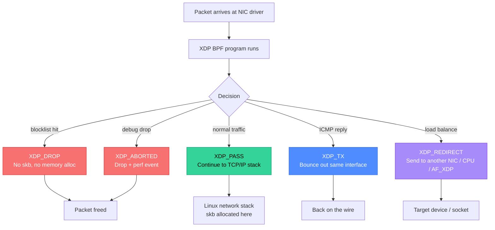
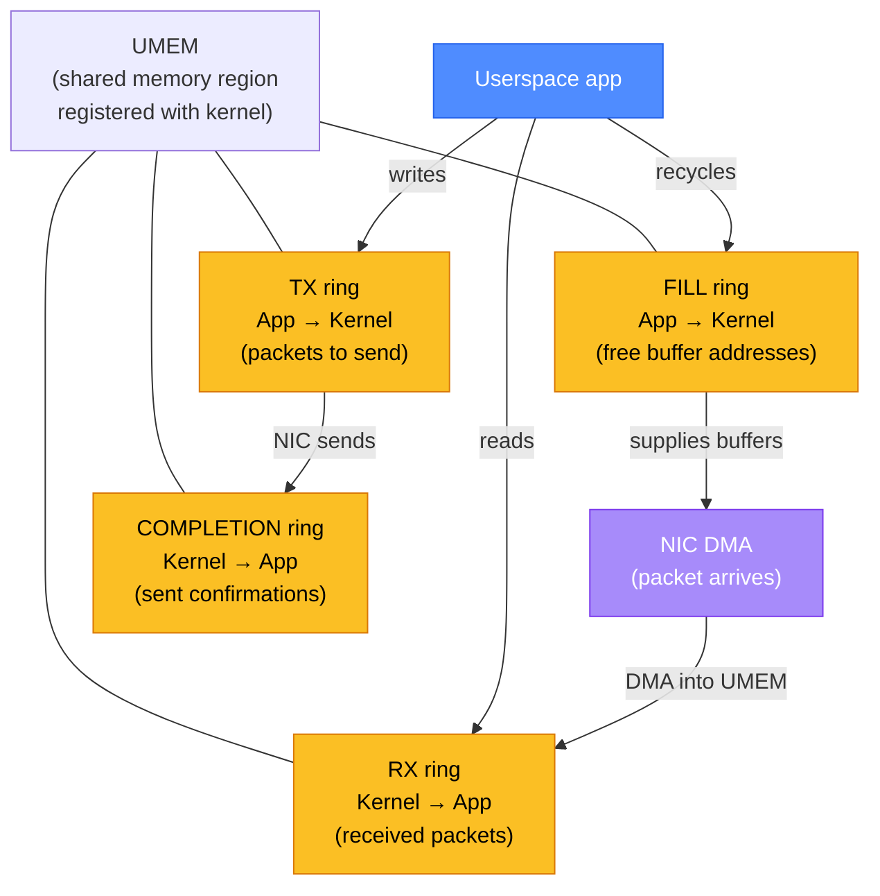

# XDP: eXpress Data Path

XDP runs BPF programs at the earliest point in the Linux network stack — before skb allocation, before the driver hands the packet to the kernel. That's what makes it fast enough to drop millions of packets per second on commodity hardware.

<div class="quiz-progress" data-quiz-progress>
  <span class="quiz-progress-label">0/0 checks</span>
  <span class="quiz-progress-bar"><span class="quiz-progress-fill"></span></span>
</div>

---

## 1. XDP Action Model

Every XDP program returns one of five actions. The action tells the driver what to do with the packet after the BPF program finishes.

| Action | Effect | Use case |
|--------|--------|----------|
| **XDP_DROP** | Drop at NIC, no skb allocated | DDoS mitigation, rate limiting |
| **XDP_ABORTED** | Drop + fire `xdp:xdp_exception` perf event | Drop with debug visibility |
| **XDP_PASS** | Continue up normal network stack | Allow packet through |
| **XDP_TX** | Bounce packet back out the same NIC | Reflect SYN cookies, ICMP replies |
| **XDP_REDIRECT** | Send to different NIC, CPU, or AF_XDP socket | Load balancing, packet steering |

`XDP_DROP` is silent — it's the fastest path. `XDP_ABORTED` does the same drop but also fires a perf event on the `xdp:xdp_exception` tracepoint, making it visible via `perf stat`. Use `XDP_ABORTED` during development when you need to confirm your drop logic is firing; switch to `XDP_DROP` in production.



---

## 2. XDP Hook Placement

XDP programs can be attached at three different layers of the driver stack:

| Mode | Attach point | Performance | Requires |
|------|-------------|-------------|---------|
| **Native (driver)** | NIC driver `ndo_bpf` hook | Fastest — no skb, runs in driver interrupt | Driver support (mlx5, i40e, ixgbe, bnxt, virtio_net) |
| **Generic (software)** | `netif_receive_skb()` in kernel | ~20% slower — skb already allocated | Any NIC, any driver |
| **HW Offload** | SmartNIC (e.g., Netronome Agilio) | Zero CPU — runs on NIC ASIC | SmartNIC hardware + dedicated driver |

**Checking which mode is active:**

```bash
# Load in native mode
ip link set dev eth0 xdp obj xdp_prog.o sec xdp

# Load in generic mode (fallback)
ip link set dev eth0 xdpgeneric obj xdp_prog.o sec xdp

# Check active mode
ip link show eth0
# eth0: <...> xdp/native ...   ← native mode
# eth0: <...> xdpgeneric ...   ← generic mode

# Remove XDP program
ip link set dev eth0 xdp off
```

Generic mode is useful for development on VMs (where NIC drivers don't expose native XDP hooks) and for testing programs before deploying to bare metal. The semantics are identical — only performance differs.

<div class="tab-group">
  <div class="tab-buttons">
    <button data-tab="generic" class="active">Generic XDP</button>
    <button data-tab="native">Native XDP</button>
    <button data-tab="offload">HW Offload</button>
  </div>
  <div class="tab-panels">
    <div class="tab-panel active" data-tab-panel="generic">
      <p><strong>Setup:</strong> Works on any NIC. Load with <code>xdpgeneric</code> flag. Works in VMs, containers, any kernel 4.12+.</p>
      <p><strong>Performance:</strong> ~5–10 Mpps on a 10G NIC. skb is allocated before the program runs, so the "zero-copy" advantage is partially lost.</p>
      <p><strong>When to use:</strong> Development and testing. CI pipelines. Environments where NIC drivers don't support native XDP. Features that need skb metadata not available at driver level.</p>
    </div>
    <div class="tab-panel" data-tab-panel="native">
      <p><strong>Setup:</strong> Requires NIC driver support. Major drivers: <code>mlx5</code> (Mellanox/NVIDIA), <code>i40e</code> (Intel X710), <code>ixgbe</code> (Intel 82599), <code>bnxt_en</code> (Broadcom), <code>virtio_net</code> (KVM guests). Load with <code>xdp</code> flag.</p>
      <p><strong>Performance:</strong> 20–100 Mpps. Runs before skb allocation. Packet memory is DMA-mapped from the NIC ring buffer directly.</p>
      <p><strong>When to use:</strong> Production DDoS mitigation. High-throughput load balancers. Any scenario where packet rate is the bottleneck.</p>
    </div>
    <div class="tab-panel" data-tab-panel="offload">
      <p><strong>Setup:</strong> Requires a SmartNIC with eBPF offload support (Netronome Agilio). Load with <code>xdpoffload</code> flag. Not all BPF features are supported on the NIC's ASIC.</p>
      <p><strong>Performance:</strong> Truly zero CPU utilization. Packet processing happens entirely on the NIC ASIC. Effective at line rate regardless of CPU load.</p>
      <p><strong>When to use:</strong> Only when CPU is the bottleneck AND you have the budget for SmartNICs. Very limited BPF feature set — no arbitrary maps, no helpers beyond basic I/O.</p>
    </div>
  </div>
</div>

---

## 3. Writing an XDP Program

An XDP program is a C function that receives a pointer to the raw packet memory and returns an action code.

**Minimal XDP program — drop packets from a specific IP:**

```c
#include <linux/bpf.h>
#include <linux/if_ether.h>
#include <linux/ip.h>
#include <bpf/bpf_helpers.h>
#include <bpf/bpf_endian.h>

SEC("xdp")
int xdp_drop_ip(struct xdp_md *ctx) {
    void *data     = (void *)(long)ctx->data;
    void *data_end = (void *)(long)ctx->data_end;

    /* Parse Ethernet header */
    struct ethhdr *eth = data;
    if ((void *)(eth + 1) > data_end)
        return XDP_PASS;

    if (bpf_ntohs(eth->h_proto) != ETH_P_IP)
        return XDP_PASS;

    /* Parse IPv4 header */
    struct iphdr *ip = (void *)(eth + 1);
    if ((void *)(ip + 1) > data_end)
        return XDP_PASS;

    /* Drop packets from 192.0.2.1 */
    if (ip->saddr == bpf_htonl(0xC0000201))
        return XDP_DROP;

    return XDP_PASS;
}

char _license[] SEC("license") = "GPL";
```

**Every bounds check is mandatory.** The verifier will reject the program if you access packet memory without first proving `ptr + size <= data_end`. This is not optional defensive coding — it's a correctness requirement enforced at load time.

**Compile and load:**

```bash
# Compile
clang -O2 -target bpf -c xdp_drop.c -o xdp_drop.o

# Load (native mode, falls back to generic if driver unsupported)
ip link set dev eth0 xdp obj xdp_drop.o sec xdp

# Verify
ip link show eth0 | grep xdp

# Unload
ip link set dev eth0 xdp off
```

**Using libbpf instead of iproute2:**

```c
/* userspace loader */
#include <bpf/libbpf.h>
#include <net/if.h>

int main() {
    struct bpf_object *obj = bpf_object__open("xdp_drop.o");
    bpf_object__load(obj);

    struct bpf_program *prog = bpf_object__find_program_by_name(obj, "xdp_drop_ip");
    int prog_fd = bpf_program__fd(prog);

    int ifindex = if_nametoindex("eth0");
    bpf_xdp_attach(ifindex, prog_fd, XDP_FLAGS_UPDATE_IF_NOEXIST, NULL);
}
```

---

## 4. BPF Maps in XDP

XDP programs communicate with each other and with userspace through BPF maps. Three map types are essential for XDP:

**LPM trie — IP prefix blocklist:**

```c
struct {
    __uint(type, BPF_MAP_TYPE_LPM_TRIE);
    __uint(max_entries, 65536);
    __uint(map_flags, BPF_F_NO_PREALLOC);
    __type(key, struct {
        __u32 prefixlen;
        __be32 addr;
    });
    __type(value, __u8);
} blocklist SEC(".maps");

/* In XDP program: */
struct { __u32 prefixlen; __be32 addr; } key = {
    .prefixlen = 32,
    .addr = ip->saddr,
};
if (bpf_map_lookup_elem(&blocklist, &key))
    return XDP_DROP;
```

**Per-CPU hash map — packet counters without locks:**

```c
struct {
    __uint(type, BPF_MAP_TYPE_PERCPU_HASH);
    __uint(max_entries, 65536);
    __type(key, __be32);   /* source IP */
    __type(value, __u64);  /* packet count */
} pkt_count SEC(".maps");

/* Increment counter for source IP: */
__u64 *cnt = bpf_map_lookup_elem(&pkt_count, &ip->saddr);
if (cnt) {
    (*cnt)++;
} else {
    __u64 one = 1;
    bpf_map_update_elem(&pkt_count, &ip->saddr, &one, BPF_NOEXIST);
}
```

Per-CPU maps avoid spinlocks by giving each CPU core its own copy of each value. Userspace must sum all per-CPU values to get the total.

**Ring buffer — send events to userspace:**

```c
struct event { __be32 saddr; __u16 dport; };

struct {
    __uint(type, BPF_MAP_TYPE_RINGBUF);
    __uint(max_entries, 1 << 24); /* 16 MB */
} events SEC(".maps");

/* Reserve space and submit: */
struct event *e = bpf_ringbuf_reserve(&events, sizeof(*e), 0);
if (e) {
    e->saddr = ip->saddr;
    e->dport = tcp->dest;
    bpf_ringbuf_submit(e, 0);
}
```

---

## 5. AF_XDP Sockets

AF_XDP (address family XDP) is a kernel bypass mechanism that lets an XDP program redirect packets directly to a userspace socket — without going through the normal network stack. No kernel module required.

**UMEM and four-ring design:**



**Setup overview:**

```c
/* 1. Allocate UMEM — shared between kernel and userspace */
struct xsk_umem_config cfg = { .fill_size = 4096, .comp_size = 4096,
                                .frame_size = 2048 };
xsk_umem__create(&umem, bufs, buf_size, &fq, &cq, &cfg);

/* 2. Create AF_XDP socket bound to queue 0 of eth0 */
struct xsk_socket_config xsk_cfg = { .rx_size = 4096, .tx_size = 4096,
                                      .libbpf_flags = XSK_LIBBPF_FLAGS__INHIBIT_PROG_LOAD };
xsk_socket__create(&xsk, "eth0", 0, umem, &rx, &tx, &xsk_cfg);

/* 3. XDP program redirects matching packets to this socket:
   return bpf_redirect_map(&xsks_map, ctx->rx_queue_index, XDP_PASS); */
```

**Limitations:** One AF_XDP socket per NIC queue. To handle all packets on a multi-queue NIC, you need one socket per queue. RSS (Receive-Side Scaling) hash can be configured to steer all traffic to queue 0 for single-socket scenarios.

**Use cases:** Custom packet processing (deep packet inspection, network monitoring), high-frequency trading (microsecond-scale timestamping), user-space load balancers as an alternative to DPDK without requiring hugepages or dedicated NIC drivers.

---

## 6. DDoS Mitigation Pattern

XDP's classic use case: drop malicious traffic at the NIC before it consumes any CPU or memory.

**Blocklist with LPM trie + per-source rate limiting:**

```c
/* Token bucket: {last_ts, tokens} per source IP */
struct bucket {
    __u64 last_ts;   /* nanoseconds */
    __u64 tokens;    /* current token count */
};

struct {
    __uint(type, BPF_MAP_TYPE_LRU_HASH);  /* LRU evicts old sources */
    __uint(max_entries, 1000000);
    __type(key, __be32);
    __type(value, struct bucket);
} rate_map SEC(".maps");

#define RATE_PPS    10000   /* 10k packets/sec per source */
#define BURST       5000    /* burst allowance */
#define NANOSEC_PER_SEC 1000000000ULL

SEC("xdp")
int xdp_ratelimit(struct xdp_md *ctx) {
    /* ... parse IP header, get ip->saddr ... */

    __u64 now = bpf_ktime_get_ns();
    struct bucket *b = bpf_map_lookup_elem(&rate_map, &ip->saddr);

    if (!b) {
        struct bucket new_b = { .last_ts = now, .tokens = BURST };
        bpf_map_update_elem(&rate_map, &ip->saddr, &new_b, BPF_NOEXIST);
        return XDP_PASS;
    }

    /* Refill tokens based on elapsed time */
    __u64 elapsed = now - b->last_ts;
    __u64 new_tokens = (elapsed * RATE_PPS) / NANOSEC_PER_SEC;
    b->tokens = b->tokens + new_tokens;
    if (b->tokens > BURST) b->tokens = BURST;
    b->last_ts = now;

    if (b->tokens == 0)
        return XDP_DROP;

    b->tokens--;
    return XDP_PASS;
}
```

**Reading stats from userspace:**

```c
/* Read per-CPU counters and sum them */
__u64 values[nr_cpus];
bpf_map_lookup_elem(map_fd, &src_ip, values);
__u64 total = 0;
for (int i = 0; i < nr_cpus; i++) total += values[i];
```

**Blocklist management** — populate the LPM trie from a threat feed:

```bash
# Add 203.0.113.0/24 to blocklist map (prefixlen + addr as 8-byte key)
bpftool map update id <map_id> key 24 0 0 0 203 0 113 0 value 01
```

---

## 7. xdp-tools Suite

The `xdp-tools` project provides a library and tools for building and debugging XDP programs.

```bash
# Install
apt install xdp-tools    # Debian/Ubuntu
dnf install xdp-tools    # Fedora/RHEL

# Or build from source
git clone https://github.com/xdp-project/xdp-tools
cd xdp-tools && ./configure && make
```

| Tool | Purpose | Example |
|------|---------|---------|
| **xdp-loader** | Load/unload XDP programs | `xdp-loader load eth0 prog.o` |
| **xdp-loader status** | Show attached XDP programs | `xdp-loader status eth0` |
| **xdp-dump** | tcpdump at XDP layer (before drop) | `xdp-dump -i eth0 -x` |
| **xdp-bench** | Benchmark NIC XDP throughput | `xdp-bench flood eth0 --mode native` |
| **xdpfw** | Firewall rule engine on top of XDP | `xdpfw -i eth0 -c rules.json` |

**xdp-dump** is particularly useful for debugging: it captures packets at the XDP hook point, including packets that would be dropped by an XDP program. Run `xdp-dump` on one terminal and your XDP program on another to verify drop logic:

```bash
# Capture packets including those dropped by XDP
xdp-dump -i eth0 --rx-capture entry,exit -w /tmp/capture.pcap
```

The `entry` capture point shows packets before the XDP program runs; `exit` shows the action taken. Compare to find if your drop rules are firing.

---

## 8. Troubleshooting

**Check if XDP is attached:**

```bash
ip link show | grep -E 'xdp|xdpgeneric|xdpoffload'
bpftool net list dev eth0
```

**List loaded programs:**

```bash
bpftool prog show
bpftool prog show name xdp_drop_ip   # by name
```

**Verify XDP program is triggering drops:**

```bash
# Watch interface drop counter (increases if XDP_DROP is firing)
watch -n1 'ip -s link show eth0 | grep -A2 RX'

# Or via ethtool (driver-level stats)
ethtool -S eth0 | grep xdp
# rx_xdp_drop: 12847
# rx_xdp_tx: 0
# rx_xdp_redirect: 0
```

**Debug print from XDP program:**

```c
/* In BPF program (development only — high overhead) */
bpf_trace_printk("dropped src=%pI4\n", sizeof("dropped src=%pI4\n"), &ip->saddr);
```

```bash
# Read trace output
cat /sys/kernel/debug/tracing/trace_pipe
```

**Common errors:**

| Error | Cause | Fix |
|-------|-------|-----|
| `XDP not supported on eth0` | Driver has no native XDP support | Use `xdpgeneric` flag |
| `libbpf: elf: failed to open...` | Compiled for wrong BPF target | Re-compile with `-target bpf` |
| `invalid access to packet` | Missing bounds check | Add `if ((void *)(hdr + 1) > data_end) return XDP_PASS` |
| `back-edge from insn X to Y` | Unbounded loop in program | Add explicit loop bound |
| Program loads but doesn't drop | Attached in wrong mode | Check `ip link show` for xdp vs xdpgeneric |

---

<div class="quiz-card"><p class="quiz-q">What is the difference between XDP_DROP and XDP_ABORTED?</p><button class="quiz-reveal">Reveal answer</button><div class="quiz-a" hidden>Both drop the packet, but XDP_ABORTED also fires a perf event on the <code>xdp:xdp_exception</code> tracepoint (visible via <code>perf stat -e xdp:xdp_exception</code>), making it observable without staring at interface counters. XDP_DROP is silent and marginally faster. Use XDP_ABORTED during development to confirm drop logic is firing; switch to XDP_DROP in production to avoid the perf event overhead.</div></div>

<div class="quiz-card"><p class="quiz-q">Why do per-CPU BPF maps matter for XDP packet counters?</p><button class="quiz-reveal">Reveal answer</button><div class="quiz-a" hidden>Each CPU core processes packets on its own NIC queue (with RSS enabled). If all cores updated a single hash map entry for a source IP, every update would require a spinlock — creating contention on a hot counter at line rate. Per-CPU maps (<code>BPF_MAP_TYPE_PERCPU_HASH</code>) give each core its own slot for the same key — no locking, no cache line bouncing, maximum throughput. Userspace reads all per-CPU values with <code>bpf_map_lookup_elem</code> and sums them to get the aggregate count.</div></div>

<div class="quiz-card"><p class="quiz-q">AF_XDP is often compared to DPDK. What does AF_XDP offer that DPDK doesn't?</p><button class="quiz-reveal">Reveal answer</button><div class="quiz-a" hidden>AF_XDP works without a kernel module — it uses the standard AF_XDP socket API and integrates with existing kernel tools (perf, bpftool, network namespaces, tc). DPDK requires hugepages configured at boot, a UIO or VFIO kernel driver, and takes the NIC away from the kernel entirely — you lose kernel networking while DPDK is running. AF_XDP trades some raw throughput (DPDK can reach 100+ Mpps vs AF_XDP's ~25 Mpps on typical hardware) for operability: you keep kernel access to the NIC and don't need to rewrite your whole network stack.</div></div>
