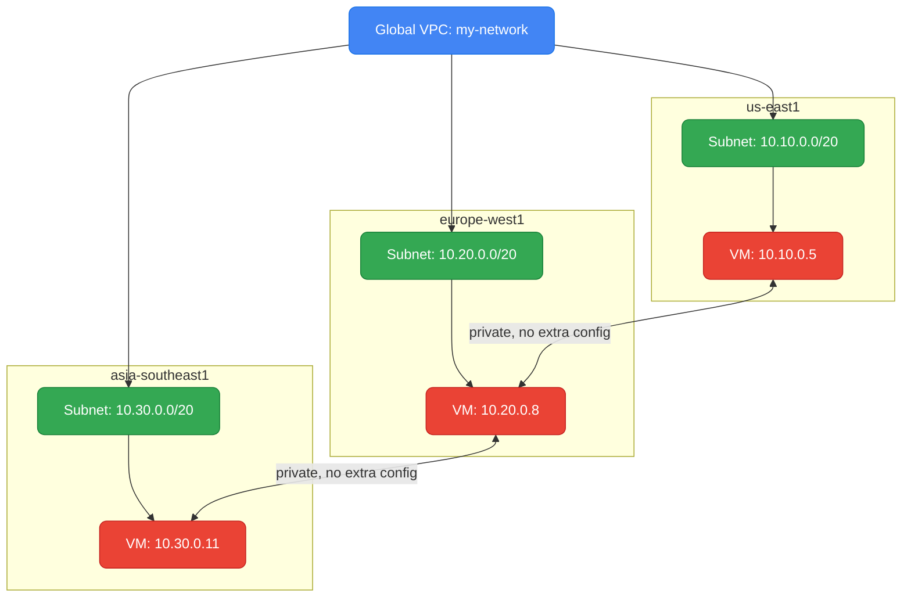
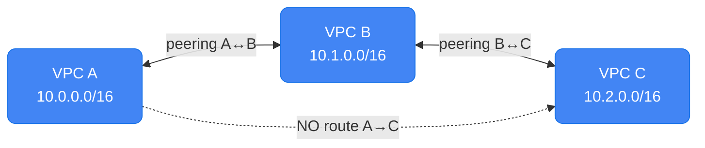
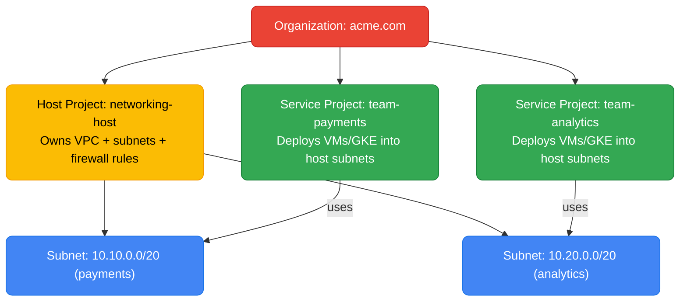
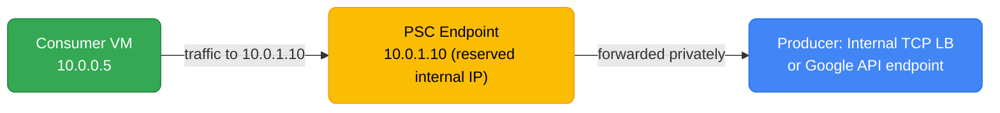
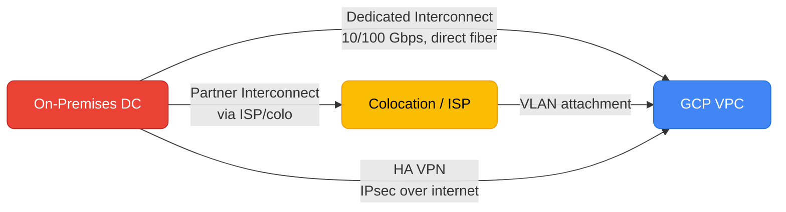

# GCP Networking

GCP's networking model differs fundamentally from AWS: a single VPC spans all regions, subnets are regional, and the control plane is global — understanding this shapes every architecture decision from hybrid connectivity to GKE pod networking.

<div class="quiz-progress" data-quiz-progress>
  <span class="quiz-progress-label">0/0 checks</span>
  <span class="quiz-progress-bar"><span class="quiz-progress-fill"></span></span>
</div>

---

## VPC Model — Global by Default

In GCP, a **VPC is a global resource**. A single VPC spans every region and zone automatically. This is the most important difference from AWS, where each VPC is tied to a single region and cross-region communication requires peering or Transit Gateway.



VMs in different regions communicate over GCP's private backbone — no VPN, no peering needed within the same VPC.

**Auto-mode vs custom-mode VPC:**

| | Auto-mode | Custom-mode |
|---|---|---|
| **Subnets** | Auto-created in every region (`10.128.0.0/9` range) | You define each subnet |
| **Flexibility** | Low — fixed ranges, hard to resize | High — full CIDR control |
| **Production use** | Dev/sandbox only | Required for production |
| **GKE pods** | Can conflict with pod CIDRs | Secondary ranges explicit |

Always use custom-mode in production. Auto-mode's `10.128.0.0/9` range overlaps with common on-prem address spaces.

**Firewall rules** are applied to the VPC globally (not per subnet). A rule with target tag `web-server` applies to every VM with that tag, in any region:

```bash
gcloud compute firewall-rules create allow-http \
  --network my-network \
  --direction INGRESS \
  --action ALLOW \
  --rules tcp:80,tcp:443 \
  --target-tags web-server \
  --source-ranges 0.0.0.0/0
```

---

## VPC Peering — Non-Transitive

**VPC Peering** connects two VPCs so their VMs can communicate using private IPs — without traffic leaving Google's network and without using external IPs.



**Peering is non-transitive.** If A peers with B, and B peers with C, A cannot reach C through B. You must create a direct peering between A and C.

**Requirements and limits:**
- CIDRs must not overlap between the two VPCs
- Maximum 25 peered networks per VPC (in practice, large orgs hit this quickly)
- No transitive routing, no shared firewall policies across peers
- Routes are exchanged automatically; custom routes can optionally be exported

```bash
# Create peering from A → B (must also run the reverse from B → A)
gcloud compute networks peerings create peer-a-to-b \
  --network vpc-a \
  --peer-network vpc-b \
  --peer-project project-b \
  --export-custom-routes \
  --import-custom-routes
```

**VPC Peering vs Shared VPC:** For intra-organization connectivity, prefer Shared VPC (subnets owned centrally) over peering. Peering is better for cross-organization or partner connectivity.

---

## Shared VPC — Centralized Subnet Management

**Shared VPC** (formerly XPN) lets a **host project** own the subnets and a **service project** deploy workloads into those subnets. Networking is centrally managed; application teams focus on compute.



**Setup:**

```bash
# 1. Enable host project
gcloud compute shared-vpc enable networking-host

# 2. Associate service project
gcloud compute shared-vpc associated-projects add team-payments \
  --host-project networking-host

# 3. Grant service project's service accounts permission to use subnets
gcloud projects add-iam-policy-binding networking-host \
  --member "serviceAccount:${SA_EMAIL}" \
  --role roles/compute.networkUser
```

**Shared VPC vs VPC Peering:**

| | Shared VPC | VPC Peering |
|---|---|---|
| **Subnet ownership** | Centralized in host project | Each VPC owns its own |
| **Firewall management** | Central (host project) | Per-VPC |
| **Transitive routing** | N/A — all in same VPC | Non-transitive |
| **Cross-org** | No — same organization | Yes |
| **Use case** | Enterprise multi-team | Partner/cross-org connectivity |

---

## Private Service Connect

**Private Service Connect (PSC)** provides private connectivity to a service (Google APIs, a GKE service, or a third-party SaaS) without VPC peering, SNAT, or public IPs. The consumer creates a Private Service Connect endpoint (an internal IP) and routes to it.



**Three PSC use cases:**

**1. Access Google APIs privately (no internet, no NAT):**
```bash
# Reserve an internal IP for googleapis.com
gcloud compute addresses create google-apis-psc \
  --region us-east1 \
  --subnet my-subnet \
  --purpose PRIVATE_SERVICE_CONNECT

# Create a forwarding rule targeting All Google APIs
gcloud compute forwarding-rules create psc-googleapis \
  --region us-east1 \
  --address google-apis-psc \
  --target-google-apis-bundle all-apis \
  --network my-network
```

**2. Access another project's Internal Load Balancer:**
The producer creates a `ServiceAttachment`; the consumer creates a forwarding rule pointing to it. No VPC peering needed — avoids the 25-peering limit and route conflicts.

**3. PSC vs VPC Peering for service access:**

| | PSC | VPC Peering |
|---|---|---|
| **CIDR conflicts** | Not a problem (endpoint is a single IP) | CIDRs must not overlap |
| **Peering limit** | No limit | 25 per VPC |
| **SNAT** | None — client IP preserved | None |
| **Direction** | Consumer → producer only | Bidirectional |
| **Cross-org** | Yes | Yes |

---

## Cloud Interconnect and Cloud VPN

For hybrid connectivity (on-prem ↔ GCP), two options:



| | Dedicated Interconnect | Partner Interconnect | HA VPN |
|---|---|---|---|
| **Bandwidth** | 10 Gbps or 100 Gbps per link | 50 Mbps – 10 Gbps | Up to ~3 Gbps |
| **SLA** | 99.99% (4 links) | 99.99% (via partner) | 99.99% (2 tunnels) |
| **Setup time** | Weeks (physical circuit) | Days (via ISP) | Minutes |
| **Cost** | High (port + egress) | Medium | Low (per-tunnel + egress) |
| **Use case** | High throughput, low latency | No colo presence | Quick setup, lower volume |

**HA VPN** (recommended over Classic VPN) requires two tunnels to two Cloud Routers — this achieves the 99.99% SLA:

```bash
# Create HA VPN gateway (GCP side)
gcloud compute vpn-gateways create ha-vpn-gw \
  --network my-network \
  --region us-east1

# Create Cloud Router for BGP
gcloud compute routers create cr-us-east1 \
  --network my-network \
  --region us-east1 \
  --asn 65001

# Create two VPN tunnels (one per interface)
gcloud compute vpn-tunnels create tunnel-0 \
  --peer-gcp-gateway on-prem-vpn-gw \
  --vpn-gateway ha-vpn-gw \
  --interface 0 \
  --ike-version 2 \
  --shared-secret "your-secret" \
  --router cr-us-east1 \
  --region us-east1
```

---

## Cloud NAT

**Cloud NAT** provides outbound internet access for VMs without external IPs. It is stateful (tracks connections) and scales automatically.

```bash
# Create a Cloud NAT config on a Cloud Router
gcloud compute routers nats create nat-config \
  --router cr-us-east1 \
  --region us-east1 \
  --nat-all-subnet-ip-ranges \
  --auto-allocate-nat-external-ips \
  --min-ports-per-vm 64 \
  --max-ports-per-vm 4096
```

**Port allocation:** Each VM gets a range of SNAT ports. If a VM opens more outbound connections than its port allocation, new connections fail (`RESOURCE_EXHAUSTED`). Increase `--min-ports-per-vm` for workloads making many concurrent outbound connections (e.g., crawlers, fan-out API callers).

**Cloud NAT logging:**
```bash
gcloud compute routers nats update nat-config \
  --router cr-us-east1 \
  --region us-east1 \
  --enable-logging \
  --log-filter ERRORS_ONLY   # ERRORS_ONLY or ALL
```

---

## Cloud DNS

**Cloud DNS** is GCP's managed DNS — both for internal (private zones) and public (registered domains) resolution.

**Private zones** — internal names resolved only within VPCs:
```bash
gcloud dns managed-zones create internal-zone \
  --dns-name internal.example.com. \
  --visibility private \
  --networks my-network

gcloud dns record-sets create db.internal.example.com. \
  --zone internal-zone \
  --type A \
  --ttl 300 \
  --rrdatas 10.10.0.50
```

**DNS peering** — share a private zone from one VPC to another:
```bash
gcloud dns managed-zones update internal-zone \
  --dns-peer-project peer-project \
  --dns-peer-network peer-network
```

**Forwarding zones** — forward DNS queries for on-prem domains to on-prem DNS servers:
```bash
gcloud dns managed-zones create onprem-zone \
  --dns-name corp.example.com. \
  --visibility private \
  --networks my-network \
  --forwarding-targets 192.168.1.53  # on-prem DNS server
```

**Inbound/outbound DNS policies** — for hybrid resolution:
- **Inbound**: creates a reserved IP in your VPC that on-prem resolvers can forward queries to (resolves GCP private zones from on-prem)
- **Outbound**: forces all DNS queries from VMs in the VPC through specific resolvers before falling back to Cloud DNS

---

## GKE Networking Specifics

**VPC-native clusters (alias IP)** — the GKE default and only supported mode. Each node gets a secondary IP range; pods receive IPs from that range. No routes needed — pod IPs are native VPC IPs.

```bash
gcloud container clusters create my-cluster \
  --network my-network \
  --subnetwork my-subnet \
  --cluster-secondary-range-name pods \       # secondary range for pods
  --services-secondary-range-name services \  # secondary range for services
  --enable-ip-alias \
  --region us-east1
```

**Secondary ranges** must be defined on the subnet before cluster creation:
```bash
gcloud compute networks subnets update my-subnet \
  --region us-east1 \
  --add-secondary-ranges pods=10.100.0.0/14,services=10.200.0.0/20
```

**Pod CIDR sizing rule:** `/14` gives 262,144 pod IPs. Each node gets a `/24` (256 pods). `/14` supports up to `262144 / 256 = 1024` nodes.

**Dataplane V2 (Cilium)** — GKE's default network policy engine since GKE 1.18:
```bash
gcloud container clusters create my-cluster \
  --enable-dataplane-v2   # enables Cilium for NetworkPolicy enforcement
```

Dataplane V2 enforces `NetworkPolicy` in eBPF (no iptables), with better performance at scale and policy observability via `kubectl exec` into `anetd` pods.

**Private GKE clusters** — nodes have no external IPs:
```bash
gcloud container clusters create my-cluster \
  --enable-private-nodes \
  --enable-private-endpoint \
  --master-ipv4-cidr 172.16.0.0/28

# Outbound internet access for nodes (to pull images) requires Cloud NAT
gcloud compute routers nats create gke-nat \
  --router cr-us-east1 \
  --region us-east1 \
  --nat-all-subnet-ip-ranges \
  --auto-allocate-nat-external-ips
```

<div class="quiz-card">
  <p class="quiz-q">Your GKE cluster has 500 nodes, each with a `/24` pod CIDR. You defined the pod secondary range as a `/22`. Why are you about to run out of nodes?</p>
  <button class="quiz-reveal">Reveal answer</button>
  <div class="quiz-a" hidden>A `/22` contains 1,024 IPs. Each node gets a `/24` (256 pod IPs), so a `/22` supports only `1024 / 256 = 4` nodes — not 500. You need at least a `/14` to support 1,024 nodes (262,144 IPs / 256 per node). Secondary ranges cannot be resized after the subnet is created; you'd need to create a new subnet with a larger secondary range and migrate the cluster or create a new one.</div>
</div>

<div class="quiz-card">
  <p class="quiz-q">Company A has VPC-A peered with VPC-B. VPC-B is peered with VPC-C. A VM in VPC-A needs to reach a VM in VPC-C. What must you do?</p>
  <button class="quiz-reveal">Reveal answer</button>
  <div class="quiz-a" hidden>Create a direct VPC peering between VPC-A and VPC-C. GCP VPC peering is non-transitive: A↔B and B↔C does not give A any route to C. VPC-B does not forward traffic between A and C. Alternatively, if these are projects within the same org, consider migrating to Shared VPC (host project owns all subnets) to eliminate the peering mesh problem entirely.</div>
</div>

<div class="quiz-card">
  <p class="quiz-q">A VM in a private GKE cluster (no external IP) needs to pull container images from Docker Hub. Cloud NAT is not configured. What happens and how do you fix it?</p>
  <button class="quiz-reveal">Reveal answer</button>
  <div class="quiz-a" hidden>The image pull fails — the VM has no external IP and no NAT, so it cannot reach Docker Hub (a public internet address). Fix: configure Cloud NAT on the Cloud Router attached to the cluster's region and subnet so nodes can make outbound internet connections for image pulls. Longer term, mirror images into Artifact Registry to avoid public internet dependency entirely (faster pulls, no rate limits, no NAT cost for image traffic).</div>
</div>

---

## GCP Networking Checklist

- [ ] VPC is custom-mode (not auto-mode) in production
- [ ] Subnets sized correctly with room for growth — avoid `/28` subnets for GKE nodes
- [ ] GKE secondary ranges sized for expected max node count (`/14` for up to 1024 nodes)
- [ ] Private GKE cluster with Cloud NAT configured for outbound traffic
- [ ] Dataplane V2 enabled for eBPF-based NetworkPolicy enforcement
- [ ] Firewall rules use network tags or service accounts (not IP ranges) for VM targeting
- [ ] Shared VPC used for multi-team environments (not VPC peering between internal projects)
- [ ] VPC Peering CIDRs verified non-overlapping before creation
- [ ] PSC endpoints created for Google API access (BigQuery, Cloud Storage) to avoid public IP dependency
- [ ] HA VPN deployed with 2 tunnels (not Classic VPN) for on-prem connectivity
- [ ] Dedicated Interconnect ordered for > 1 Gbps sustained on-prem bandwidth
- [ ] Cloud NAT port allocation tuned for high-connection workloads (`--min-ports-per-vm`)
- [ ] Cloud NAT logging enabled with `ERRORS_ONLY` to catch port exhaustion
- [ ] Private DNS zones created for internal service discovery
- [ ] Forwarding zones configured for on-prem DNS resolution
