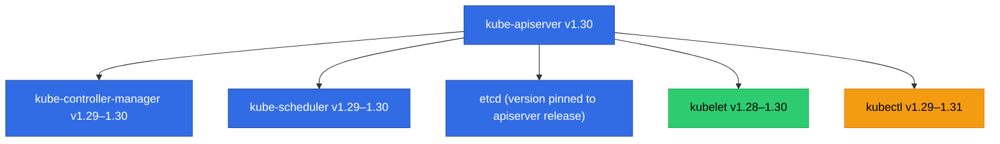
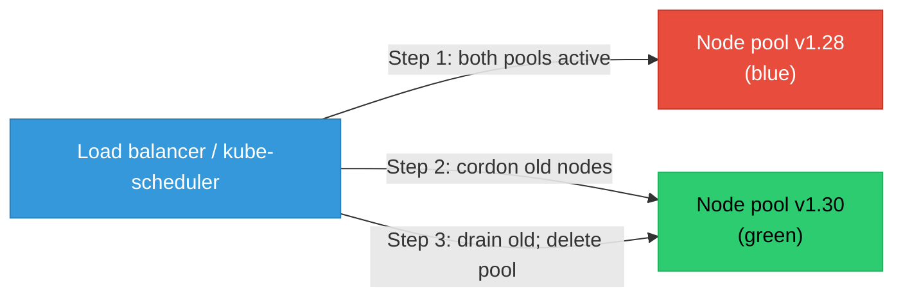

# Kubernetes Cluster Upgrades

Upgrading a Kubernetes cluster is a multi-phase operation that must preserve workload availability while moving control-plane and node components through compatible version windows.

<div class="quiz-progress" data-quiz-progress>
  <span class="quiz-progress-label">0/0 checks</span>
  <span class="quiz-progress-bar"><span class="quiz-progress-fill"></span></span>
</div>

---

## Version Skew Policy

Kubernetes enforces strict version compatibility rules between components. Violating skew causes API calls to fail silently or requests to be rejected.

| Component pair | Maximum skew |
|---|---|
| kube-apiserver | Must be upgraded first; can be at most 1 minor version ahead of kube-controller-manager and kube-scheduler |
| kubelet | Can be at most 2 minor versions behind kube-apiserver (e.g., API at 1.30, kubelet at 1.28) |
| kubectl | ±1 minor version of kube-apiserver |
| etcd | Must match the version supported by the kube-apiserver release |



**Why upgrade control plane first?** The API server must always be newer than or equal to other components. If you upgrade kubelet before the API server, the kubelet may use API features not yet served by the control plane, causing failed pod operations.

<div class="quiz-card">
  <p class="quiz-q">Your cluster is on v1.28. You want to reach v1.31. Can you jump directly from 1.28 to 1.31?</p>
  <button class="quiz-reveal">Reveal answer</button>
  <div class="quiz-a" hidden>No. Kubernetes only supports upgrading one minor version at a time. You must go 1.28 → 1.29 → 1.30 → 1.31. Skipping versions risks missing deprecation removals (e.g., an API group removed in 1.30 that you were still using) and violates the version skew policy during the intermediate state.</div>
</div>

---

## Pre-Upgrade Checklist

Run these before touching any component:

```bash
# Check current versions
kubectl version --short
kubectl get nodes -o wide

# Verify etcd health
kubectl -n kube-system exec etcd-<node> -- etcdctl endpoint health \
  --cacert /etc/kubernetes/pki/etcd/ca.crt \
  --cert /etc/kubernetes/pki/etcd/server.crt \
  --key /etc/kubernetes/pki/etcd/server.key

# Check for deprecated API usage in manifests
kubectl api-versions
# Use pluto (https://github.com/FairwindsOps/pluto) to scan manifests:
pluto detect-files -d /path/to/manifests --target-versions k8s=v1.30

# Snapshot etcd
ETCDCTL_API=3 etcdctl snapshot save /backup/etcd-pre-upgrade.db \
  --endpoints=https://127.0.0.1:2379 \
  --cacert=/etc/kubernetes/pki/etcd/ca.crt \
  --cert=/etc/kubernetes/pki/etcd/server.crt \
  --key=/etc/kubernetes/pki/etcd/server.key

# Verify PodDisruptionBudgets won't block drain
kubectl get pdb -A
```

Key checks:
- All nodes `Ready`, no node in `SchedulingDisabled`
- etcd cluster healthy with quorum (odd number of members)
- No PDBs with `maxUnavailable: 0` on critical workloads
- Deprecated API resources migrated to current versions
- etcd snapshot confirmed on external storage

---

## kubeadm Upgrade — Step by Step

<div class="stepper">
  <div class="stepper-panels">
    <div class="stepper-panel active">
      <strong>Step 1. Upgrade kubeadm on the first control-plane node.</strong>
      <p>kubeadm itself must be upgraded before it can upgrade the cluster components. Always match the target Kubernetes minor version.</p>

```bash
# On the first control-plane node
apt-mark unhold kubeadm
apt-get install -y kubeadm=1.30.0-1.1
apt-mark hold kubeadm

# Verify the new version
kubeadm version

# Preview what will change (dry run)
kubeadm upgrade plan
```
    </div>
    <div class="stepper-panel">
      <strong>Step 2. Apply the upgrade on the first control-plane node.</strong>
      <p>This upgrades kube-apiserver, kube-controller-manager, kube-scheduler, kube-proxy, CoreDNS, and etcd in one operation.</p>

```bash
kubeadm upgrade apply v1.30.0

# Expected output includes:
# [upgrade/successful] SUCCESS! Your cluster was upgraded to "v1.30.0".
# [upgrade/kubelet] Now that your control plane is upgraded, please proceed
# with upgrading your kubelets if you haven't already done so.
```
    </div>
    <div class="stepper-panel">
      <strong>Step 3. Drain and upgrade kubelet on the control-plane node.</strong>
      <p>kubelet is not managed by kubeadm upgrade apply — it must be upgraded separately on each node.</p>

```bash
# Drain the control-plane node (evicts non-daemonset pods)
kubectl drain <control-plane-node> --ignore-daemonsets --delete-emptydir-data

# Upgrade kubelet and kubectl
apt-mark unhold kubelet kubectl
apt-get install -y kubelet=1.30.0-1.1 kubectl=1.30.0-1.1
apt-mark hold kubelet kubectl

# Restart kubelet
systemctl daemon-reload
systemctl restart kubelet

# Uncordon the node
kubectl uncordon <control-plane-node>
```
    </div>
    <div class="stepper-panel">
      <strong>Step 4. Repeat on additional control-plane nodes.</strong>
      <p>For HA clusters with 3+ control-plane nodes, upgrade remaining control-plane nodes one at a time. Use <code>kubeadm upgrade node</code> (not <code>apply</code>) on secondary nodes.</p>

```bash
# On secondary control-plane nodes
apt-mark unhold kubeadm
apt-get install -y kubeadm=1.30.0-1.1
apt-mark hold kubeadm

kubeadm upgrade node

# Then drain, upgrade kubelet, uncordon — same as step 3
kubectl drain <node> --ignore-daemonsets --delete-emptydir-data
apt-get install -y kubelet=1.30.0-1.1 kubectl=1.30.0-1.1
systemctl daemon-reload && systemctl restart kubelet
kubectl uncordon <node>
```
    </div>
    <div class="stepper-panel">
      <strong>Step 5. Upgrade worker nodes — one at a time.</strong>
      <p>Workers do NOT run <code>kubeadm upgrade apply</code>. Only kubelet and kubeadm need updating. Drain first to safely evict workloads.</p>

```bash
# Drain the worker node
kubectl drain <worker-node> --ignore-daemonsets --delete-emptydir-data

# On the worker node itself:
apt-mark unhold kubeadm
apt-get install -y kubeadm=1.30.0-1.1
apt-mark hold kubeadm

kubeadm upgrade node  # updates kubelet config from control plane

apt-mark unhold kubelet kubectl
apt-get install -y kubelet=1.30.0-1.1 kubectl=1.30.0-1.1
apt-mark hold kubelet kubectl
systemctl daemon-reload && systemctl restart kubelet

# Back on control plane:
kubectl uncordon <worker-node>
```
    </div>
    <div class="stepper-panel">
      <strong>Step 6. Verify the upgrade.</strong>
      <p>All nodes should report the new version and be in <code>Ready</code> state.</p>

```bash
kubectl get nodes
# NAME            STATUS   ROLES           AGE   VERSION
# control-plane   Ready    control-plane   10d   v1.30.0
# worker-1        Ready    <none>          10d   v1.30.0
# worker-2        Ready    <none>          10d   v1.30.0

kubectl version --short
# Client Version: v1.30.0
# Server Version: v1.30.0
```
    </div>
    <div class="stepper-panel">
      <strong>Step 7. Update add-ons.</strong>
      <p>Add-ons like CNI plugins (Calico, Cilium), metrics-server, and ingress controllers have their own upgrade paths. Check compatibility with the new Kubernetes version.</p>

```bash
# Example: update Calico
kubectl apply -f https://raw.githubusercontent.com/projectcalico/calico/v3.27.0/manifests/calico.yaml

# Update metrics-server
helm upgrade metrics-server metrics-server/metrics-server --version 3.12.0

# Verify all system pods are Running
kubectl get pods -n kube-system
```
    </div>
    <div class="stepper-panel">
      <strong>Step 8. Post-upgrade validation.</strong>
      <p>Run a final health sweep across the cluster.</p>

```bash
# All nodes Ready
kubectl get nodes

# All system pods Running
kubectl get pods -n kube-system

# Check for any deprecation warnings in recent api-server audit logs
kubectl get events --field-selector type=Warning -A | grep deprecated

# Verify etcd is healthy post-upgrade
kubectl -n kube-system exec etcd-<node> -- etcdctl endpoint health \
  --cacert /etc/kubernetes/pki/etcd/ca.crt \
  --cert /etc/kubernetes/pki/etcd/server.crt \
  --key /etc/kubernetes/pki/etcd/server.key

# Run a smoke test: deploy and expose a test pod
kubectl run smoke-test --image=nginx:alpine --restart=Never
kubectl expose pod smoke-test --port=80 --type=ClusterIP
kubectl delete pod smoke-test
```
    </div>
  </div>
  <div class="stepper-controls">
    <button class="stepper-prev">← Prev</button>
    <span class="stepper-dots"></span>
    <span class="stepper-label"></span>
    <button class="stepper-next">Next →</button>
  </div>
</div>

---

## Managed Cluster Upgrades (EKS, GKE, AKS)

Managed Kubernetes services abstract control-plane upgrades but still require node upgrade planning.

### EKS

```bash
# Upgrade control plane via AWS CLI
aws eks update-cluster-version \
  --name my-cluster \
  --kubernetes-version 1.30

# Watch status
aws eks describe-update \
  --name my-cluster \
  --update-id <update-id>

# After control plane: upgrade node groups
aws eks update-nodegroup-version \
  --cluster-name my-cluster \
  --nodegroup-name my-nodegroup \
  --kubernetes-version 1.30
```

For EKS, upgrade **managed node groups** first; **self-managed** nodes follow the kubeadm worker upgrade pattern. Add-ons (VPC CNI, CoreDNS, kube-proxy) must be upgraded separately via `aws eks update-addon`.

### GKE

```bash
# Control plane (automatic in regular channels; manual for static channel)
gcloud container clusters upgrade my-cluster \
  --master \
  --cluster-version 1.30

# Node pool upgrade (surge upgrade: replaces nodes in batches)
gcloud container clusters upgrade my-cluster \
  --node-pool default-pool \
  --cluster-version 1.30
```

GKE **surge upgrades** bring up a spare node, drain and terminate the old one, repeat. Controlled by `--max-surge-upgrade` and `--max-unavailable-upgrade` flags.

<div class="quiz-card">
  <p class="quiz-q">In a kubeadm cluster, why must you run <code>kubeadm upgrade node</code> on each worker node even though the worker isn't upgrading any control-plane components?</p>
  <button class="quiz-reveal">Reveal answer</button>
  <div class="quiz-a" hidden><code>kubeadm upgrade node</code> on workers fetches the updated kubelet configuration from the control plane (the <code>kubelet-config</code> ConfigMap in <code>kube-system</code>). Each Kubernetes minor version may change kubelet feature gates, admission configuration, or static pod manifests. Without this step, the kubelet runs with stale configuration from the previous version, which can cause subtle behavior differences or rejected API calls.</div>
</div>

---

## Handling Deprecated API Removals

Each Kubernetes minor version removes API versions that were deprecated earlier. Common examples:

| Removed in | API | Replace with |
|---|---|---|
| v1.22 | `extensions/v1beta1` Ingress | `networking.k8s.io/v1` Ingress |
| v1.25 | `policy/v1beta1` PodSecurityPolicy | Pod Security Admission (built-in) |
| v1.26 | `autoscaling/v2beta2` HPA | `autoscaling/v2` HPA |
| v1.27 | `storage.k8s.io/v1beta1` CSIStorageCapacity | `storage.k8s.io/v1` |

**Detection workflow:**

```bash
# pluto scans Helm releases and live cluster resources
pluto detect-helm -owide --target-versions k8s=v1.30

# kubectl convert (requires kubectl-convert plugin)
kubectl convert -f old-ingress.yaml --output-version networking.k8s.io/v1

# Check what API groups are served now
kubectl api-resources --verbs=list -o wide
```

**Process:** scan for deprecated APIs *before* the upgrade → migrate manifests → redeploy → upgrade. Never migrate manifests after the API server stops serving the old version — `kubectl apply` will fail.

---

## Blue/Green and In-Place Upgrade Strategies

| Strategy | Mechanism | Risk | Cost |
|---|---|---|---|
| **In-place (kubeadm)** | Drain nodes one by one; upgrade kubelet | Node pool unavailable briefly | Low |
| **Blue/green node pool** | Bring up new pool at new version; migrate workloads; terminate old | Zero node-level downtime | Higher (double capacity briefly) |
| **Rolling (managed)** | Surge upgrade — new node per old node | Near-zero downtime | Moderate (1 extra node per pool) |

Blue/green is preferred when:
- Workloads use `emptyDir` volumes (drain loses data; blue/green lets the app start fresh on new nodes cleanly)
- Node OS kernel must also be upgraded
- Rollback must be instant (keep old pool alive, redirect traffic back)



<div class="quiz-card">
  <p class="quiz-q">You drain a worker node and some pods don't evict after 5 minutes. The drain command is still running. What is the most likely cause, and how do you unblock it?</p>
  <button class="quiz-reveal">Reveal answer</button>
  <div class="quiz-a" hidden>Most likely a PodDisruptionBudget (PDB) is blocking eviction. If a PDB has <code>minAvailable: 3</code> and only 3 replicas are running, evicting one would violate it. kubectl drain respects PDBs and waits. Solutions: (1) scale up the deployment to more replicas before draining so the PDB allows one eviction; (2) temporarily patch the PDB's minAvailable; (3) pass <code>--disable-eviction</code> to drain (uses DELETE instead of Eviction API, bypassing PDB — use only when you understand the risk). Never use --force without also understanding which pods will be lost permanently (orphaned DaemonSet pods, pods without controllers).</div>
</div>
