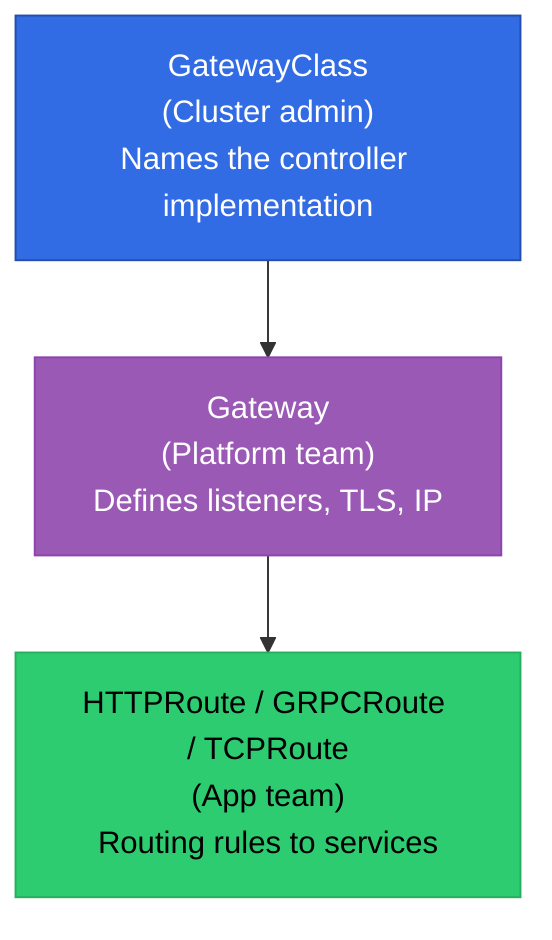
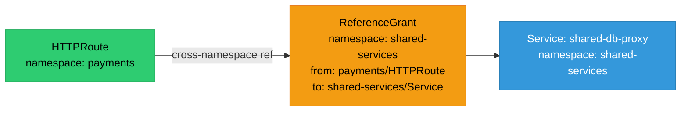

# Kubernetes Gateway API

Gateway API is the successor to Ingress — a role-oriented, expressive, extensible API for routing traffic into and within Kubernetes clusters.

<div class="quiz-progress" data-quiz-progress>
  <span class="quiz-progress-label">0/0 checks</span>
  <span class="quiz-progress-bar"><span class="quiz-progress-fill"></span></span>
</div>

---

## Why Gateway API Replaces Ingress

The original `Ingress` resource was designed as a minimal abstraction. It covers the 80% case (host + path routing to a service) but requires vendor-specific annotations for anything beyond that — TLS termination policies, header manipulation, traffic splitting, timeouts.

| Limitation | Ingress | Gateway API |
|---|---|---|
| Traffic splitting | Annotations only (vendor-specific) | `HTTPRoute` weights natively |
| Header manipulation | Annotations | `HTTPRoute` filters |
| Role separation | None — cluster admin owns everything | GatewayClass (infra) / Gateway (ops) / Route (dev) |
| TCP/UDP routing | Not supported | `TCPRoute`, `UDPRoute` |
| gRPC routing | Not supported | `GRPCRoute` |
| Multi-cluster | Not supported | Extensible via implementations |
| Portability | Annotations break across controllers | Standard API, portable across implementations |



**Role separation** is the key design win. The cluster administrator installs and configures the `GatewayClass` (which controller to use — Envoy Gateway, Cilium, nginx). The platform team creates `Gateway` objects (what ports and TLS to listen on). App teams create `HTTPRoute` objects (which path goes to which service) — without cluster-admin access.

<div class="quiz-card">
  <p class="quiz-q">An app team needs to add a new path <code>/api/v2</code> to their service. With Ingress, what access do they need? With Gateway API, what access do they need?</p>
  <button class="quiz-reveal">Reveal answer</button>
  <div class="quiz-a" hidden>With Ingress, the team typically needs permission to edit the Ingress object — which may be cluster-scoped or managed by a platform team, requiring a PR or ticket. With Gateway API, the app team creates or edits an <code>HTTPRoute</code> in their own namespace pointing to a shared <code>Gateway</code>. The Gateway accepts route attachments from allowed namespaces via <code>allowedRoutes</code>, so the app team self-serves without needing cluster-admin or cross-namespace access.</div>
</div>

---

## Core Resources

### GatewayClass

`GatewayClass` is a cluster-scoped resource naming the controller that handles `Gateway` objects using this class.

```yaml
apiVersion: gateway.networking.k8s.io/v1
kind: GatewayClass
metadata:
  name: envoy-gateway
spec:
  controllerName: gateway.envoyproxy.io/gatewayclass-controller
```

One GatewayClass per controller implementation. Multiple `Gateway` objects can reference the same GatewayClass.

### Gateway

`Gateway` declares which ports and protocols to listen on and which namespaces can attach routes.

```yaml
apiVersion: gateway.networking.k8s.io/v1
kind: Gateway
metadata:
  name: prod-gateway
  namespace: infra
spec:
  gatewayClassName: envoy-gateway
  listeners:
    - name: http
      protocol: HTTP
      port: 80
    - name: https
      protocol: HTTPS
      port: 443
      tls:
        mode: Terminate
        certificateRefs:
          - name: prod-tls-cert
            namespace: infra
      allowedRoutes:
        namespaces:
          from: Selector
          selector:
            matchLabels:
              gateway-access: "true"
```

`allowedRoutes.namespaces` controls which namespaces can attach `HTTPRoute` objects to this Gateway — the primary RBAC mechanism for multi-tenant clusters.

### HTTPRoute

`HTTPRoute` defines L7 routing rules. Each rule matches requests and forwards them to backend services.

```yaml
apiVersion: gateway.networking.k8s.io/v1
kind: HTTPRoute
metadata:
  name: payments-route
  namespace: payments
spec:
  parentRefs:
    - name: prod-gateway
      namespace: infra
  hostnames:
    - "payments.example.com"
  rules:
    - matches:
        - path:
            type: PathPrefix
            value: /api
      filters:
        - type: RequestHeaderModifier
          requestHeaderModifier:
            add:
              - name: X-Forwarded-App
                value: payments
      backendRefs:
        - name: payments-service
          port: 8080
          weight: 90
        - name: payments-service-canary
          port: 8080
          weight: 10
```

Key features shown: header injection via `filters`, and **traffic splitting** via `weight` on multiple `backendRefs` — both impossible without annotations in Ingress.

---

## Migration from Ingress

<div class="tab-group">
  <div class="tab-buttons">
    <button data-tab="ingress-yaml" class="active">Ingress (before)</button>
    <button data-tab="httproute-yaml">HTTPRoute (after)</button>
  </div>
  <div class="tab-panels">
    <div class="tab-panel active" data-tab-panel="ingress-yaml">

```yaml
apiVersion: networking.k8s.io/v1
kind: Ingress
metadata:
  name: payments-ingress
  namespace: payments
  annotations:
    nginx.ingress.kubernetes.io/rewrite-target: /
    nginx.ingress.kubernetes.io/proxy-connect-timeout: "30"
    nginx.ingress.kubernetes.io/canary: "true"
    nginx.ingress.kubernetes.io/canary-weight: "10"
spec:
  ingressClassName: nginx
  tls:
    - hosts:
        - payments.example.com
      secretName: payments-tls
  rules:
    - host: payments.example.com
      http:
        paths:
          - path: /api
            pathType: Prefix
            backend:
              service:
                name: payments-service
                port:
                  number: 8080
```

Problems: `canary-weight` is nginx-specific. A different controller (HAProxy, Traefik) ignores it silently. TLS secret must be in the same namespace as the Ingress.

    </div>
    <div class="tab-panel" data-tab-panel="httproute-yaml">

```yaml
# Gateway (created once by platform team)
apiVersion: gateway.networking.k8s.io/v1
kind: Gateway
metadata:
  name: prod-gateway
  namespace: infra
spec:
  gatewayClassName: envoy-gateway
  listeners:
    - name: https
      protocol: HTTPS
      port: 443
      tls:
        mode: Terminate
        certificateRefs:
          - name: payments-tls
            namespace: infra
      allowedRoutes:
        namespaces:
          from: Selector
          selector:
            matchLabels:
              gateway-access: "true"
---
# HTTPRoute (created by app team in their namespace)
apiVersion: gateway.networking.k8s.io/v1
kind: HTTPRoute
metadata:
  name: payments-route
  namespace: payments
spec:
  parentRefs:
    - name: prod-gateway
      namespace: infra
  hostnames:
    - "payments.example.com"
  rules:
    - matches:
        - path:
            type: PathPrefix
            value: /api
      backendRefs:
        - name: payments-service
          port: 8080
          weight: 90
        - name: payments-service-canary
          port: 8080
          weight: 10
```

Traffic splitting is a first-class field. The `Gateway` owns TLS in the `infra` namespace; the app team's `HTTPRoute` never needs to touch TLS secrets.

    </div>
  </div>
</div>

**Migration strategy:** run Ingress and HTTPRoute in parallel using a dual-stack controller, then shift traffic by updating DNS or load balancer weights. Most controllers (nginx, Cilium, Envoy Gateway) support both APIs simultaneously.

---

## Advanced Routing — Filters and Traffic Policies

`HTTPRoute` filters transform requests in-flight without sidecars or custom middleware.

### Request/response header manipulation

```yaml
rules:
  - filters:
      - type: RequestHeaderModifier
        requestHeaderModifier:
          add:
            - name: X-Request-Id
              value: "generated"   # implementation fills this
          remove:
            - X-Internal-Secret
      - type: ResponseHeaderModifier
        responseHeaderModifier:
          set:
            - name: Cache-Control
              value: "no-store"
    backendRefs:
      - name: api-service
        port: 8080
```

### URL rewrite

```yaml
rules:
  - matches:
      - path:
          type: PathPrefix
          value: /v1
    filters:
      - type: URLRewrite
        urlRewrite:
          path:
            type: ReplacePrefixMatch
            replacePrefixMatch: /api/v1
    backendRefs:
      - name: api-service
        port: 8080
```

### Request mirroring (shadow traffic)

```yaml
rules:
  - filters:
      - type: RequestMirror
        requestMirror:
          backendRef:
            name: api-service-shadow
            port: 8080
    backendRefs:
      - name: api-service
        port: 8080
```

Mirroring sends a copy of every request to the shadow backend. Responses from the mirror are discarded — useful for testing a new version against real traffic without user impact.

---

## ReferenceGrant — Cross-Namespace Security

By default, an `HTTPRoute` in namespace `payments` cannot reference a `Service` in namespace `shared-services`. `ReferenceGrant` explicitly allows this.

```yaml
# In the namespace that OWNS the target resource
apiVersion: gateway.networking.k8s.io/v1beta1
kind: ReferenceGrant
metadata:
  name: allow-payments-to-shared
  namespace: shared-services
spec:
  from:
    - group: gateway.networking.k8s.io
      kind: HTTPRoute
      namespace: payments
  to:
    - group: ""
      kind: Service
```

This also applies when an `HTTPRoute` references a `Gateway` in a different namespace. Without the `ReferenceGrant`, the cross-namespace reference is silently rejected — the route won't attach.



<div class="quiz-card">
  <p class="quiz-q">An <code>HTTPRoute</code> in namespace <code>frontend</code> tries to route to a <code>Service</code> in namespace <code>backend</code>. The route status shows <code>ResolvedRefs: False</code>. What is missing?</p>
  <button class="quiz-reveal">Reveal answer</button>
  <div class="quiz-a" hidden>A <code>ReferenceGrant</code> in the <code>backend</code> namespace is missing. The <code>ReferenceGrant</code> must live in the same namespace as the <em>target</em> resource (the Service) and explicitly list the source namespace (<code>frontend</code>) and the source resource kind (<code>HTTPRoute</code>). Without it, the Gateway controller rejects the cross-namespace reference for security reasons — one namespace cannot pull traffic through a service it doesn't own without that service's namespace granting permission.</div>
</div>

---

## Implementations

Gateway API is a spec; each controller implements it differently.

| Controller | Notes |
|---|---|
| **Envoy Gateway** | CNCF project; uses Envoy proxy; supports EnvoyPatchPolicy for raw Envoy config |
| **Cilium** | eBPF-native; no sidecar; lowest latency for Gateway API traffic |
| **nginx Gateway Fabric** | nginx-based; drop-in for teams already using nginx Ingress |
| **Istio** | Full service mesh; Gateway API is the recommended Istio ingress from v1.16+ |
| **Traefik** | Supports Gateway API alongside its own IngressRoute CRD |
| **HAProxy Ingress** | Gateway API support via separate controller mode |

Check feature conformance at the [Gateway API conformance status page](https://gateway-api.sigs.k8s.io/implementations/) — not all implementations support all route types (GRPCRoute, TCPRoute) or experimental features.

---

## Observability — Status and Conditions

Gateway API controllers report rich status on every object. Always check status when routes don't work.

```bash
# Check Gateway status — is it programmed and ready?
kubectl describe gateway prod-gateway -n infra
# Look for: conditions: Programmed: True, Accepted: True

# Check HTTPRoute status — is it attached to the Gateway?
kubectl describe httproute payments-route -n payments
# Look for:
#   parentRefs:
#     - name: prod-gateway
#       namespace: infra
#       conditions:
#         - type: Accepted
#           status: "True"
#         - type: ResolvedRefs
#           status: "True"
```

Common status conditions and their meanings:

| Condition | Meaning |
|---|---|
| `Accepted: False` | The Gateway or Route was rejected by the controller — check `reason` field |
| `ResolvedRefs: False` | A referenced Service, Secret, or ReferenceGrant is missing |
| `Programmed: False` | Gateway is accepted but the data plane hasn't been configured yet |
| `Conflicted: True` | Two routes claim the same hostname/path — one wins by precedence rules |

```bash
# Watch route conditions live
kubectl get httproute -n payments -w

# Get all routes attached to a Gateway
kubectl get httproutes -A -o json | \
  jq '.items[] | select(.spec.parentRefs[].name == "prod-gateway") | .metadata.name'
```
