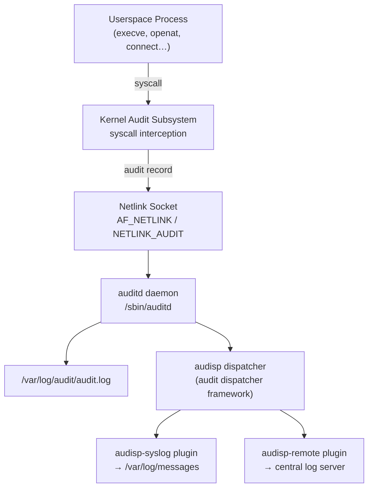

# Linux Auditing with auditd

The Linux Audit Framework captures security-relevant events at the kernel level — before any userspace logging daemon can suppress or reformat them. Unlike syslog, auditd intercepts syscalls directly via a netlink socket, so events are recorded even if the calling process is subsequently killed or if logging is disabled.

<div class="quiz-progress" data-quiz-progress>
  <span class="quiz-progress-label">0/0 checks</span>
  <span class="quiz-progress-bar"><span class="quiz-progress-fill"></span></span>
</div>

---

## 1. Architecture



**Three rule types:**

| Type | Keyword | Example |
|------|---------|---------|
| Syscall | `-a exit,always -S` | Capture `execve`, `openat`, `connect` |
| File/path | `-w /etc/passwd -p rwa` | Watch a file for read, write, attribute changes |
| Exclude | `-a exclude,always -F msgtype=CWD` | Drop noisy record types |

The kernel matches each syscall against the rule list in order. First matching rule wins (or the rule is always-exit for the whole syscall). Exclusion rules near the top prune noise before heavier rules fire.

---

## 2. Audit Rules

`auditctl` manages rules at runtime. Rule anatomy:

```
auditctl -a always,exit -F arch=b64 -S execve -F uid>=1000 -k exec_user
│         │─────────────│ │──────────│ │───────│ │──────────│ │─────────│
│         list,action   │ filter      syscall   filter        key (tag)
│
-a = append rule
```

**Common rules:**

```bash
# Track all command execution by non-root users
auditctl -a always,exit -F arch=b64 -S execve -F uid>=1000 -k exec_user
auditctl -a always,exit -F arch=b32 -S execve -F uid>=1000 -k exec_user

# Sensitive file reads
auditctl -w /etc/shadow   -p r   -k shadow_read
auditctl -w /etc/passwd   -p rwa -k passwd_watch
auditctl -w /etc/sudoers  -p rwa -k sudoers_watch
auditctl -w /etc/sudoers.d/ -p rwa -k sudoers_watch

# Privilege escalation (setuid/setgid syscalls)
auditctl -a always,exit -F arch=b64 -S setuid -S setgid -S setreuid -S setregid -k priv_esc
auditctl -a always,exit -F arch=b32 -S setuid -S setgid -S setreuid -S setregid -k priv_esc

# Outbound network connections from userspace
auditctl -a always,exit -F arch=b64 -S connect -k net_connect
auditctl -a always,exit -F arch=b32 -S connect -k net_connect

# Detect log tampering (writes to /var/log/)
auditctl -w /var/log/ -p wa -k log_tamper

# User account changes
auditctl -w /usr/sbin/useradd  -p x -k user_mgmt
auditctl -w /usr/sbin/usermod  -p x -k user_mgmt
auditctl -w /usr/sbin/userdel  -p x -k user_mgmt
```

**Flags reference:**

| Flag | Meaning |
|------|---------|
| `-a always,exit` | Append: record on syscall exit, always |
| `-F arch=b64` | 64-bit ABI (add b32 pair for 32-bit compat) |
| `-S execve` | Syscall name(s) to match |
| `-F uid>=1000` | Filter: only UID ≥ 1000 (non-system users) |
| `-w /path` | Watch: file or directory path |
| `-p rwa` | Permissions: read/write/attribute-change |
| `-k label` | Tag events with this key (searchable) |

<div class="quiz-card"><p class="quiz-q">You add `-a always,exit -F arch=b64 -S execve -k exec_audit` but 32-bit binaries on the system are not captured. Why?</p><button class="quiz-reveal">Reveal answer</button><div class="quiz-a" hidden>The rule targets only the 64-bit syscall ABI (`arch=b64`). 32-bit processes use a separate ABI (`arch=b32`) and require a matching rule with `-F arch=b32`. Both rules are always needed on x86_64 systems that can run 32-bit ELF binaries.</div></div>

---

## 3. Persistent Rules — /etc/audit/audit.rules

Runtime rules vanish on reboot. Persistent rules live in `/etc/audit/rules.d/` (one `.rules` file per logical group) and are merged by `augenrules`.

```bash
# /etc/audit/rules.d/30-exec.rules

# Delete existing rules first (placed at top of the merged set)
-D

# Set buffer size (events in kernel queue before auditd reads them)
-b 8192

# ── Exec tracking ──────────────────────────────────────────────────
-a always,exit -F arch=b64 -S execve -F uid>=1000 -k exec_user
-a always,exit -F arch=b32 -S execve -F uid>=1000 -k exec_user

# ── File watches ────────────────────────────────────────────────────
-w /etc/shadow    -p r    -k shadow_read
-w /etc/passwd    -p rwa  -k passwd_watch
-w /etc/sudoers   -p rwa  -k sudoers_watch
-w /etc/sudoers.d/ -p rwa -k sudoers_watch

# ── Privilege escalation ────────────────────────────────────────────
-a always,exit -F arch=b64 -S setuid -S setgid -k priv_esc
-a always,exit -F arch=b32 -S setuid -S setgid -k priv_esc

# ── Network ─────────────────────────────────────────────────────────
-a always,exit -F arch=b64 -S connect -k net_connect

# ── Log tamper detection ────────────────────────────────────────────
-w /var/log/ -p wa -k log_tamper

# ── User management ─────────────────────────────────────────────────
-w /usr/sbin/useradd -p x -k user_mgmt
-w /usr/sbin/usermod -p x -k user_mgmt
-w /usr/sbin/userdel -p x -k user_mgmt

# ── Immutable mode (PCI-DSS requirement) ────────────────────────────
# Rules cannot be changed until next reboot. Place LAST.
-e 2
```

**Apply and verify:**

```bash
augenrules --load          # merge rules.d/ into audit.rules and load
auditctl -l                # list currently active rules
auditctl -s                # show audit daemon status (enabled, backlog)
```

**Rule ordering matters:**

1. Exclusions (noise reduction) first — `-a exclude,always -F msgtype=CWD`
2. Specific watches next
3. Broad syscall catches after
4. `-e 2` (immutable) **last** — once set, no further rule changes until reboot

---

## 4. Searching Events — ausearch and aureport

`ausearch` and `aureport` read `/var/log/audit/audit.log` (and rotated archives).

**ausearch — event search:**

```bash
# All events tagged with a key, from today
ausearch -k exec_user -ts today

# Events for a specific UID (useful after incident)
ausearch -ua 1000

# Login events (recent = last 10 minutes)
ausearch -m USER_LOGIN -ts recent

# Failed access events (EACCES/EPERM)
ausearch -m AVC,SYSCALL -ts today | grep -E 'success=no|EACCES|EPERM'

# Events for a specific executable
ausearch -x /usr/bin/sudo -ts today

# Events in a time window
ausearch -ts 2024-01-15 09:00:00 -te 2024-01-15 09:30:00 -k priv_esc
```

**aureport — summary reports:**

```bash
aureport --summary               # overview: total events, logins, auth failures
aureport --login --failed        # failed login attempts
aureport --key --summary         # event count per rule key
aureport --syscall --summary     # syscall frequency
aureport --file                  # accessed files
aureport --user --failed         # failed events by user
aureport --start today --end now # restrict to time range
```

**Raw log format — what a record looks like:**

```
type=SYSCALL msg=audit(1716000000.123:456): arch=c000003e syscall=59 success=yes exit=0
  a0=7f1234 a1=7f5678 a2=7f9abc a3=0 items=2 ppid=12345 pid=12346
  auid=1000 uid=0 gid=0 euid=0 suid=0 fsuid=0 egid=0 sgid=0 fsgid=0
  tty=pts0 ses=1 comm="sudo" exe="/usr/bin/sudo" key="exec_user"
```

Key fields: `auid` = audit UID (who logged in originally, survives su/sudo), `uid` = effective UID, `key` = rule tag.

---

## 5. auditd.conf Tuning

`/etc/audit/auditd.conf` controls daemon behaviour:

```ini
# /etc/audit/auditd.conf (key settings)

# Kernel ring buffer → userspace queue depth
# Increase on high-event systems to prevent AUDIT_BACKLOG_WAIT_TIME drops
backlog_wait_time = 60000       # ms to wait before dropping (0 = drop immediately)

# Log file management
log_file = /var/log/audit/audit.log
max_log_file = 100              # MB per log file
num_logs = 10                   # number of rotated files to keep (10 × 100MB = 1GB)
max_log_file_action = rotate    # rotate | keep_logs | suspend | halt | syslog

# Disk space protection
space_left = 500                # MB; trigger action at this threshold
space_left_action = syslog      # email | syslog | exec | halt
admin_space_left = 50           # MB; critical threshold
admin_space_left_action = halt  # halt = stop all audited operations if disk full

# Flush strategy
flush = incremental_async        # incremental | data | sync (sync = fsync per event, slow)
freq = 50                        # flush every 50 events (for incremental)
```

**Disk full behaviour:** `admin_space_left_action = halt` stops all audited operations when disk fills — this is a security control (audit trail must not be interrupted), but it can cause a denial-of-service if log rotation is misconfigured. Set a cron alert at `space_left` before it hits `admin_space_left`.

---

## 6. PCI-DSS and SOC2 Required Events

| Requirement | Standard | Audit Rule |
|-------------|----------|------------|
| Log all logins | PCI 10.2.1 | `USER_LOGIN` events; `ausearch -m USER_LOGIN` |
| Log all admin actions | PCI 10.2.2 | `-k exec_user` + `-k priv_esc` |
| Log access to cardholder data | PCI 10.2.3 | `-w /path/to/data -p rwa -k card_data` |
| Log invalid access attempts | PCI 10.2.4 | `-a always,exit -F success=0 -S openat -k access_fail` |
| Include timestamp, user, event type | PCI 10.3 | auditd includes all: `msg=audit(timestamp)`, `auid`, `type` |
| Log account changes | PCI 10.2.5 | `-k user_mgmt` (useradd/usermod/userdel) |
| Log audit log changes | PCI 10.2.6 | `-w /var/log/audit/ -p wa -k log_tamper` |
| User provisioning | SOC2 CC6.1 | `-k user_mgmt` |
| Privileged access | SOC2 CC6.2 | `-k priv_esc` + `-a always,exit -S setuid` |
| System configuration changes | SOC2 CC7.2 | `-w /etc/ssh/sshd_config -p wa -k sshd_cfg` |

**PCI-DSS mandates immutable rules** (`-e 2` at end of rules file) so rules cannot be disabled while a cardholder data environment is running.

<div class="quiz-card"><p class="quiz-q">PCI-DSS 10.3 requires each audit record to contain: timestamp, user identity, event type, affected data, success/failure, and originating identity. Which auditd fields satisfy each?</p><button class="quiz-reveal">Reveal answer</button><div class="quiz-a" hidden>Timestamp → `msg=audit(unix_timestamp.ms:serial)`. User identity → `auid` (original login UID, survives sudo), `uid` (effective). Event type → `type=SYSCALL|USER_LOGIN|AVC`. Affected data → `name=` in PATH records or `exe=`. Success/failure → `success=yes|no` and `exit=` (errno). Originating identity → `tty=`, `ses=`, `ppid=`. auditd emits all of these without extra configuration.</div></div>

---

## 7. SIEM Integration

<div class="tab-group">
  <div class="tab-buttons">
    <button data-tab="filebeat" class="active">Filebeat → Elasticsearch</button>
    <button data-tab="loki">audisp → Loki</button>
  </div>
  <div class="tab-panels">
    <div class="tab-panel active" data-tab-panel="filebeat">
      <p>Filebeat ships with a built-in <code>auditd</code> module that parses the raw audit log format.</p>
      <pre><code># /etc/filebeat/modules.d/auditd.yml
- module: auditd
  log:
    enabled: true
    var.paths: ["/var/log/audit/audit.log*"]</code></pre>
      <p>Enable and reload:</p>
      <pre><code>filebeat modules enable auditd
filebeat setup --pipelines
systemctl restart filebeat</code></pre>
      <p>Index pattern: <code>filebeat-*</code>. Key fields after parsing:</p>
      <ul>
        <li><code>auditd.log.record_type</code> — SYSCALL, USER_LOGIN, AVC</li>
        <li><code>auditd.log.key</code> — your rule tag (exec_user, priv_esc)</li>
        <li><code>auditd.log.auid</code> — original audit UID</li>
        <li><code>auditd.log.exe</code> — executable path</li>
        <li><code>auditd.log.success</code> — yes/no</li>
      </ul>
      <p>Kibana dashboard: Filebeat includes a pre-built "Linux Audit" dashboard. Import via <code>filebeat setup --dashboards</code>.</p>
    </div>
    <div class="tab-panel" data-tab-panel="loki">
      <p>Use the <code>audisp-syslog</code> plugin to forward audit events to syslog, then Promtail scrapes syslog into Loki.</p>
      <p><strong>1. Configure audisp-syslog plugin</strong> (<code>/etc/audisp/plugins.d/syslog.conf</code>):</p>
      <pre><code>active = yes
direction = out
path = builtin_syslog
type = builtin
args = LOG_INFO
format = string</code></pre>
      <p><strong>2. Promtail scrape job</strong> (<code>/etc/promtail/config.yml</code>):</p>
      <pre><code>scrape_configs:
  - job_name: auditd
    static_configs:
      - targets: [localhost]
        labels:
          job: auditd
          host: __HOST__
          __path__: /var/log/messages
    pipeline_stages:
      - match:
          selector: '{job="auditd"}'
          stages:
            - regex:
                expression: 'audit\((?P<ts>[^)]+)\).*type=(?P<record_type>\S+).*key="(?P<key>[^"]+)"'
            - labels:
                record_type:
                key:</code></pre>
      <p><strong>3. LogQL queries in Grafana:</strong></p>
      <pre><code># Failed privilege escalation attempts
{job="auditd", key="priv_esc"} |= "success=no"

# All logins in the last hour
{job="auditd"} |~ "USER_LOGIN" | logfmt | line_format "{{.USER}} at {{.TS}}"

# Shadow file reads (incident investigation)
{job="auditd", key="shadow_read"} | json</code></pre>
    </div>
  </div>
</div>

---

## 8. CIS Benchmark Level 2 Audit Rules

CIS Benchmark for Linux includes a full audit rule set. Key groups:

```bash
# Time changes (detect clock manipulation — PCI 10.4)
-a always,exit -F arch=b64 -S adjtimex -S settimeofday -k time_change
-a always,exit -F arch=b32 -S adjtimex -S settimeofday -S stime -k time_change
-w /etc/localtime -p wa -k time_change

# Network configuration changes
-a always,exit -F arch=b64 -S sethostname -S setdomainname -k network_cfg
-w /etc/issue       -p wa -k network_cfg
-w /etc/issue.net   -p wa -k network_cfg
-w /etc/hosts       -p wa -k network_cfg
-w /etc/sysconfig/network -p wa -k network_cfg

# Mandatory access control (SELinux/AppArmor policy changes)
-w /etc/selinux/       -p wa -k mac_policy
-w /usr/share/selinux/ -p wa -k mac_policy

# Login/logout events (built-in kernel events — just verify these are captured)
-w /var/log/lastlog    -p wa -k logins
-w /var/run/faillock/  -p wa -k logins

# Sudoers changes
-w /etc/sudoers    -p wa -k sudoers_watch
-w /etc/sudoers.d/ -p wa -k sudoers_watch

# Verify CIS rules are loaded
auditctl -l | grep -E 'time_change|network_cfg|logins|sudoers'
```

**Verify compliance after loading:**

```bash
sudo auditctl -l                    # list all active rules
sudo auditctl -s                    # daemon status: enabled=2 means immutable
sudo aureport --summary             # sanity check: events are flowing
sudo ausearch -k time_change -ts today  # confirm time-change rules fire
```

<div class="quiz-card"><p class="quiz-q">After setting `-e 2` (immutable mode), an admin needs to add an urgent new audit rule during an incident. How?</p><button class="quiz-reveal">Reveal answer</button><div class="quiz-a" hidden>They can't — that is the point of immutable mode. `-e 2` prevents any rule changes until the next reboot. The only option is to reboot the system, which will reload rules from `/etc/audit/rules.d/` (where the new rule was added). For security-sensitive environments this is intentional: an attacker who gains root cannot disable auditing without a reboot, which generates its own audit event and is typically detected.</div></div>

---

## Quick Reference

```bash
# Install
apt install auditd audispd-plugins   # Debian/Ubuntu
yum install audit                    # RHEL/CentOS

# Service management
systemctl enable --now auditd
systemctl status auditd

# Add/remove rules at runtime (lost on reboot)
auditctl -a always,exit -F arch=b64 -S execve -k test
auditctl -D                          # delete all rules
auditctl -l                          # list rules
auditctl -s                          # status

# Persistent rules
vim /etc/audit/rules.d/50-custom.rules
augenrules --load                    # merge and load

# Search and report
ausearch -k <key> -ts today
ausearch -m USER_LOGIN -ts recent
aureport --summary
aureport --login --failed --summary
```
