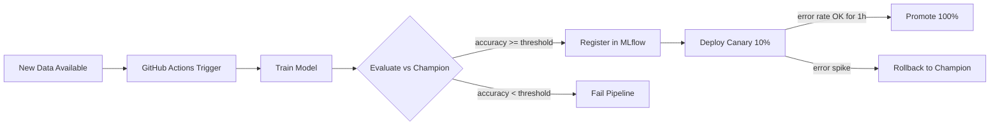

# CI/CD for ML Models

Where software CI/CD validates code correctness (tests pass/fail), ML model CI/CD validates *model quality* — accuracy above threshold, no performance regression vs the champion model, no data distribution shift in the inputs. The pipeline is triggered by new training data or a code change, and it ends only when a model is serving live traffic.

<div class="quiz-progress" data-quiz-progress>
  <span class="quiz-progress-label">0/0 checks</span>
  <span class="quiz-progress-bar"><span class="quiz-progress-fill"></span></span>
</div>

---

## Why ML CI/CD Is Different

Software CI is deterministic: the same code produces the same test results. ML CI is not.

- **Non-determinism**: random weight initialization, data shuffle order, and floating-point rounding mean two training runs with the same code can produce models with slightly different accuracy
- **Quality gates are thresholds**: instead of pass/fail, gates check `accuracy > 0.92` or `latency_p99 < 50ms`
- **Metrics drift independently of code**: a model deployed last month may degrade this month because the world changed, not because anyone pushed a commit
- **The "champion vs challenger" pattern**: the production model is the champion; a new candidate must beat it on a held-out eval set before replacing it
- **Silent failure risk**: deploying a worse model is worse than a deployment failure — degraded accuracy may go unnoticed for days while causing real harm

| Software CI | ML CI |
|---|---|
| Same code → same test result | Same code → slightly different accuracy |
| Pass/fail | Threshold gates (accuracy, latency, drift) |
| Regression = test failure | Regression = metric below champion |
| Deploy on green | Deploy after canary validation |

---

## The ML Deployment Pipeline



Key differences from a standard software deployment pipeline:

1. **Training is a step**, not a build artifact check — it produces a new artifact (weights) with unknown quality
2. **Evaluation is comparative** — not "does it work?" but "is it better than what's running?"
3. **Canary is mandatory** — a model that passes offline evaluation can still behave unexpectedly on live traffic distribution

---

## GitHub Actions Workflow

A complete `.github/workflows/model-train.yml`:

```yaml
name: Train and Deploy Model
on:
  push:
    paths: ['training/**', 'src/**']
  schedule:
    - cron: '0 2 * * *'  # nightly retrain on fresh data

jobs:
  train:
    runs-on: ubuntu-latest
    steps:
    - uses: actions/checkout@v4

    - name: Install deps
      run: pip install -r requirements.txt

    - name: Train
      run: python training/train.py --experiment $GITHUB_SHA
      env:
        MLFLOW_TRACKING_URI: ${{ secrets.MLFLOW_URI }}

    - name: Evaluate vs champion
      run: python training/evaluate.py --min-accuracy 0.92 --challenger $GITHUB_SHA
      # Fails the step (exit 1) if challenger loses to champion by > 2%

    - name: Register if passing
      if: success()
      run: python training/register.py --run-id $GITHUB_SHA --stage Staging

    - name: Notify on failure
      if: failure()
      uses: 8398a7/action-slack@v3
      with:
        status: failure
        text: "Model training pipeline failed for ${{ github.sha }}"
      env:
        SLACK_WEBHOOK_URL: ${{ secrets.SLACK_WEBHOOK }}
```

**`paths` trigger**: fires only when training code or source changes, not on doc/infra-only commits — saves GPU hours.

**`evaluate.py`** flow:
1. Fetch champion model version from MLflow registry (`get_model_version_by_alias("champion")`)
2. Load both champion and challenger onto eval dataset
3. Compute accuracy, precision, recall, F1, p99 latency
4. If challenger is worse than champion by more than tolerance → `sys.exit(1)` → GitHub step fails

---

## MLflow Model Registry

MLflow's registry is the gate between training and deployment.

```python
import mlflow
import mlflow.sklearn

# Log and register in one call
with mlflow.start_run() as run:
    mlflow.sklearn.log_model(
        model,
        artifact_path="model",
        registered_model_name="fraud_detector",
        signature=mlflow.models.infer_signature(X_train, y_pred),
    )
    mlflow.log_metrics({"accuracy": acc, "f1": f1, "latency_p99_ms": p99})
```

**Stage transitions**: `None → Staging → Production → Archived`

```python
client = mlflow.tracking.MlflowClient()

# Promote to staging after training
client.transition_model_version_stage("fraud_detector", version=8, stage="Staging")

# Promote to production after canary validation
client.transition_model_version_stage("fraud_detector", version=8, stage="Production")
```

**Version aliases** (MLflow 2.x — prefer over stage strings):

```python
# Stable name, survives version bumps
client.set_registered_model_alias("fraud_detector", "champion", version=7)
client.set_registered_model_alias("fraud_detector", "challenger", version=8)

# Load by alias — no hardcoded version number
model = mlflow.pyfunc.load_model("models:/fraud_detector@champion")
```

**Model signatures**: `mlflow.models.infer_signature(X_train, y_pred)` captures input shape and dtype. The serving endpoint enforces this — a type mismatch returns HTTP 400 before the model runs.

**`mlflow.evaluate()`**: runs a suite of built-in metrics automatically:

```python
result = mlflow.evaluate(
    model="runs:/abc123/model",
    data=eval_df,
    targets="label",
    model_type="classifier",
    evaluators=["default"],
)
# Logs: accuracy, f1, confusion_matrix artifact, feature_importance artifact
```

---

## Evaluation Gates

Gates run in `evaluate.py` before any registration. Fail any gate → fail the pipeline.

**Champion vs challenger accuracy**:

```python
champion = client.get_model_version_by_alias("fraud_detector", "champion")
champion_acc = float(client.get_run(champion.run_id).data.metrics["accuracy"])
challenger_acc = float(mlflow.get_run(challenger_run_id).data.metrics["accuracy"])

if challenger_acc < champion_acc - 0.02:  # allow 2% tolerance
    raise ValueError(
        f"Challenger {challenger_acc:.3f} worse than champion {champion_acc:.3f}"
    )
```

**Latency gate**:

```python
import time, numpy as np

latencies = []
for _ in range(1000):
    t0 = time.perf_counter()
    model.predict(sample_batch)
    latencies.append((time.perf_counter() - t0) * 1000)

p99_ms = np.percentile(latencies, 99)
if p99_ms > 50:
    raise ValueError(f"p99 latency {p99_ms:.1f}ms exceeds 50ms gate")
```

**Data drift gate** (using Evidently):

```python
from evidently.report import Report
from evidently.metric_preset import DataDriftPreset

report = Report(metrics=[DataDriftPreset()])
report.run(reference_data=training_df, current_data=recent_prod_df)

drift_summary = report.as_dict()["metrics"][0]["result"]
if drift_summary["dataset_drift"]:
    raise ValueError("Input distribution drift detected — model may underperform")
```

Gate ordering matters: run cheapest/fastest first (latency), most expensive last (drift check).

---

## Canary Deployment with KServe

KServe's `InferenceService` supports traffic splitting natively:

```yaml
apiVersion: serving.kserve.io/v1beta1
kind: InferenceService
metadata:
  name: fraud-detector
  namespace: ml
spec:
  predictor:
    canaryTrafficPercent: 10
    containers:
    - name: kserve-container
      image: gcr.io/myproject/fraud-detector:v8
      resources:
        requests:
          cpu: "1"
          memory: 2Gi
        limits:
          nvidia.com/gpu: "1"
```

KServe routes 10% of traffic to the challenger (v8) and 90% to the stable (v7) automatically.

**Monitor canary health** via Prometheus:

```promql
# Error rate per revision
rate(revision_request_count{response_code!~"2.."}[5m])
  / rate(revision_request_count[5m])

# p99 latency per revision  
histogram_quantile(0.99,
  rate(revision_request_latencies_bucket[5m])
)
```

**Promote** when error rate and latency are stable for 1 hour:

```bash
kubectl patch isvc fraud-detector \
  --type merge \
  -p '{"spec":{"predictor":{"canaryTrafficPercent": 100}}}'
```

**Rollback** immediately on error spike:

```bash
kubectl patch isvc fraud-detector \
  --type merge \
  -p '{"spec":{"predictor":{"canaryTrafficPercent": 0}}}'
```

---

## Model Artifact Storage

**MLflow artifact store** (default for metrics, small models):
- Configure S3/GCS backend in MLflow tracking server: `MLFLOW_ARTIFACT_URI=s3://bucket/mlflow`
- Artifacts stored per run: weights, preprocessor pickle, eval metrics JSON, confusion matrix PNG

**DVC for large model files** (>1GB):

```bash
# After training
dvc add models/fraud_detector_v8.pkl
git add models/fraud_detector_v8.pkl.dvc .gitignore
git commit -m "model: v8 weights"
dvc push  # sends to S3

# Reproduce any historical model
git checkout v7-tag
dvc pull  # fetches v7 weights
```

**Tagging every registered model** for auditability:

```python
client.set_model_version_tag("fraud_detector", version=8, key="git_sha", value=git_sha)
client.set_model_version_tag("fraud_detector", version=8, key="dataset_version", value="2024-Q4-v3")
client.set_model_version_tag("fraud_detector", version=8, key="training_date", value="2024-10-18")
```

<div class="tab-group">
  <div class="tab-buttons">
    <button data-tab="mlflow" class="active">MLflow Registry</button>
    <button data-tab="wandb">Weights &amp; Biases</button>
    <button data-tab="dvc">DVC</button>
  </div>
  <div class="tab-panels">
    <div class="tab-panel active" data-tab-panel="mlflow">
      <p><strong>Self-hosted or managed (Databricks)</strong>. Full experiment tracking + model registry in one tool. Tight sklearn/PyTorch/TensorFlow integration. Model signatures for schema enforcement. Stage-based promotion workflow. Best for teams already on Databricks or wanting a self-hosted stack.</p>
      <p><strong>Large file handling</strong>: stores model artifacts in S3/GCS, but the files themselves must fit in memory for logging — for very large models (&gt;10GB), combine with DVC or store weights separately and log only metadata.</p>
    </div>
    <div class="tab-panel" data-tab-panel="wandb">
      <p><strong>SaaS (with self-hosted option)</strong>. Superior experiment visualization, hyperparameter sweep tracking, and team collaboration features. Artifacts API for versioning datasets and models. Model registry with lineage tracking. Best for research teams and orgs where visualization and collaboration matter.</p>
      <p><strong>Large file handling</strong>: W&amp;B Artifacts deduplicate by hash and stream uploads — handles multi-GB model files well. Downside: data leaves your infrastructure unless using self-hosted.</p>
    </div>
    <div class="tab-panel" data-tab-panel="dvc">
      <p><strong>Self-hosted, git-native</strong>. Not a registry — it's version control for data and model files, backed by S3/GCS. Works alongside any experiment tracker. `.dvc` pointer files in git give exact reproducibility. No server required. Best for teams that want git-native workflows and don't need a UI registry.</p>
      <p><strong>Large file handling</strong>: purpose-built for this. Files stay on your remote (S3/GCS), only lightweight hashes go in git. `dvc pull` fetches only what changed.</p>
    </div>
  </div>
</div>

---

## Full Train-to-Production Workflow

<div class="stepper">
  <div class="stepper-panels">
    <div class="stepper-panel active">
      <strong>Step 1. Trigger</strong>
      <p>PR merge to <code>main</code> (training code changed) or nightly cron fires GitHub Actions. The <code>paths</code> filter ensures only training-relevant changes trigger GPU-expensive retraining.</p>
    </div>
    <div class="stepper-panel">
      <strong>Step 2. Train</strong>
      <p><code>python train.py --experiment $GITHUB_SHA</code> trains on the latest dataset. MLflow logs all metrics and artifacts under a run ID tied to the git SHA — every model is traceable to an exact commit.</p>
    </div>
    <div class="stepper-panel">
      <strong>Step 3. Evaluate</strong>
      <p><code>evaluate.py</code> loads both champion and challenger, runs both against the held-out eval set. Fails the pipeline step (exit 1) if challenger is worse by more than the tolerance. Drift gate also runs here.</p>
    </div>
    <div class="stepper-panel">
      <strong>Step 4. Register</strong>
      <p>Passing model registered in MLflow registry at <strong>Staging</strong>. Tags added: git_sha, dataset_version, training_date. Staging = "ready for human/automated review", not "in production".</p>
    </div>
    <div class="stepper-panel">
      <strong>Step 5. Canary Deploy</strong>
      <p><code>InferenceService</code> patched with <code>canaryTrafficPercent: 10</code>. Challenger serves 10% of live traffic. Stable (champion) serves remaining 90%. Both revisions emit metrics under separate labels.</p>
    </div>
    <div class="stepper-panel">
      <strong>Step 6. Monitor</strong>
      <p>Prometheus/Grafana dashboards track error rate and p99 latency per revision for 1 hour. Alertmanager fires if challenger error rate exceeds champion by threshold. Human or automated check reviews the canary window.</p>
    </div>
    <div class="stepper-panel">
      <strong>Step 7. Promote or Rollback</strong>
      <p>If metrics stable → <code>canaryTrafficPercent: 100</code>, update champion alias in MLflow, archive previous version. If error spike → <code>canaryTrafficPercent: 0</code> immediately, investigate, retrain with fix.</p>
    </div>
  </div>
  <div class="stepper-controls">
    <button class="stepper-prev">← Prev</button>
    <span class="stepper-dots"></span>
    <span class="stepper-label"></span>
    <button class="stepper-next">Next →</button>
  </div>
</div>

---

<div class="quiz-card">
  <p class="quiz-q">Software CI fails deterministically — the same test either passes or fails. Why can't ML model CI work the same way?</p>
  <button class="quiz-reveal">Reveal answer</button>
  <div class="quiz-a" hidden>
    ML training is non-deterministic. Random weight initialization, data shuffle order, and floating-point rounding mean two training runs with the same code can produce models with slightly different accuracy. So instead of pass/fail, ML CI uses threshold gates (accuracy &gt; 0.92, latency p99 &lt; 50ms) and champion-vs-challenger comparison — the question isn't "did this run?" but "is this model better than what's in production?"
  </div>
</div>

<div class="quiz-card">
  <p class="quiz-q">You register model v8 into the MLflow registry as Staging. What prevents it from automatically going to Production?</p>
  <button class="quiz-reveal">Reveal answer</button>
  <div class="quiz-a" hidden>
    MLflow stage transitions are manual by default — Staging means "ready for review", not "ready for production". You explicitly call <code>transition_model_version_stage("fraud_detector", 8, "Production")</code> after running canary validation. This gate is where evaluation results, canary metrics, and human approval (for regulated domains) are applied before traffic shifts.
  </div>
</div>

<div class="quiz-card">
  <p class="quiz-q">Your canary deployment shows the challenger model has 40% higher p99 latency than the champion, but equal accuracy. What do you do?</p>
  <button class="quiz-reveal">Reveal answer</button>
  <div class="quiz-a" hidden>
    Roll back: set <code>canaryTrafficPercent: 0</code> immediately. Accuracy parity doesn't justify 40% latency regression — for online inference, p99 latency directly affects user experience and SLOs. Investigate the challenger: check if it's a larger model, a slower preprocessing pipeline, or a different batch size. Fix and retrain before re-deploying. Add a latency gate to the evaluation step so this is caught in CI next time, before it ever reaches canary.
  </div>
</div>
