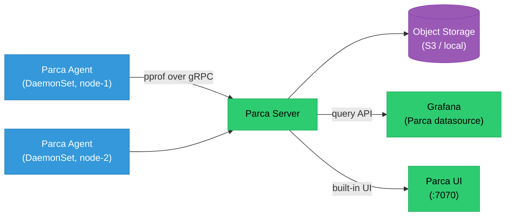

# Continuous Profiling

Continuous profiling captures CPU, memory, and goroutine/thread samples from running production processes at low overhead, all the time — unlike traditional profiling which you attach manually during incidents. The result is always-available flame graphs you can correlate with traces and metrics to answer "which function is consuming this CPU spike?"

<div class="quiz-progress" data-quiz-progress>
  <span class="quiz-progress-label">0/0 checks</span>
  <span class="quiz-progress-bar"><span class="quiz-progress-fill"></span></span>
</div>

---

## Why Continuous Profiling

| Signal | What it shows | What it misses |
|--------|--------------|----------------|
| **Metrics** | Request rate, error rate, latency percentiles | Which function inside the service is slow |
| **Traces** | Which services a request touched and how long each took | Which line of code inside a span is hot |
| **Logs** | Discrete events with context | Aggregate CPU/memory attribution |
| **Profiles** | CPU time per function, memory allocations per call site | Per-request detail (profiles aggregate across all requests) |

Profiles fill the gap metrics and traces leave: you know a service's p99 jumped to 800ms, and traces show the slow span is in the `processOrder` function — but you don't know which specific code path inside `processOrder` is consuming CPU. A flame graph tells you.

**Overhead**: eBPF-based profilers (Parca agent, Grafana Pyroscope agent) add < 1% CPU overhead by sampling at 19–100 Hz using kernel ring buffers rather than instrumenting every function call.

---

## Parca

Parca is a CNCF project for continuous profiling. It has two components: **Parca Agent** (runs on every node, collects profiles via eBPF) and **Parca Server** (stores profiles, serves the UI and API).



### Deploy Parca on Kubernetes

```bash
# Parca Server
kubectl apply -f https://github.com/parca-dev/parca/releases/latest/download/kubernetes-manifest.yaml

# Parca Agent (DaemonSet — needs privileged + hostPID)
kubectl apply -f https://github.com/parca-dev/parca-agent/releases/latest/download/kubernetes-manifest.yaml
```

The agent manifest includes a DaemonSet with `hostPID: true` and `privileged: true` (required for eBPF). It auto-discovers all processes running on the node via `/proc` and attaches eBPF programs to collect CPU profiles.

### Query the Parca UI

Open `http://parca-server:7070`:
- **Profile type**: select `process_cpu:cpu:nanoseconds:cpu:nanoseconds` (CPU), `memory:alloc_objects:count::` (allocations)
- **Label filter**: `{namespace="payments", pod=~"checkout-.*"}`
- **Time range**: last 30 minutes

The result is an interactive flame graph. Click any frame to drill into its children.

---

## Reading a Flame Graph

```
┌──────────────────────────────────────────────────────┐
│                    main.main                         │  ← root (bottom = start)
├──────────────────────────┬───────────────────────────┤
│      http.ListenAndServe  │    metrics.Collect        │  ← children (top = callee)
├──────────────────────────┤                           │
│  handler.processOrder    │                           │
├──────────┬───────────────┤                           │
│ db.Query │ json.Marshal  │                           │  ← HOT: wide box = more CPU time
└──────────┴───────────────┴───────────────────────────┘
```

**Reading rules:**
- **X-axis** = sampled CPU time (width ∝ CPU consumed). A wide box = more CPU time.
- **Y-axis** = call stack depth. Bottom is the root (e.g., `main`); top is the leaf (the actual work).
- **Widest leaf frames** are the hottest code paths — optimize these first.
- **Tall narrow stacks** indicate deep call chains with little time spent in any single frame.

A wide `db.Query` box directly means: "database queries are consuming X% of this service's CPU time." You can fix this by adding a cache, reducing query frequency, or optimizing the query.

---

## Pyroscope

Pyroscope (now part of Grafana) supports both **pull** (server scrapes pprof endpoint) and **push** (SDK sends profiles) models, and supports Go, Python, Java, Ruby, .NET, and Rust.

### Language SDK (push model)

```go
// Go — push profiles from inside the app
import "github.com/grafana/pyroscope-go"

func main() {
    pyroscope.Start(pyroscope.Config{
        ApplicationName: "checkout-service",
        ServerAddress:   "http://pyroscope:4040",
        Logger:          pyroscope.StandardLogger,
        ProfileTypes: []pyroscope.ProfileType{
            pyroscope.ProfileCPU,
            pyroscope.ProfileAllocObjects,
            pyroscope.ProfileAllocSpace,
            pyroscope.ProfileInuseObjects,
            pyroscope.ProfileInuseSpace,
        },
    })
    // ... rest of main
}
```

```python
# Python — push profiles
import pyroscope
pyroscope.configure(
    application_name="order-worker",
    server_address="http://pyroscope:4040",
    auth_token=os.environ.get("PYROSCOPE_AUTH_TOKEN", ""),
)
```

### Pull model (scrape pprof endpoint)

```yaml
# pyroscope scrape config — similar to Prometheus scrape_configs
scrape_configs:
  - job_name: payments
    scrape_interval: 15s
    static_configs:
      - targets: ["payments-service:6060"]
    profiling_config:
      pprof_config:
        memory:
          enabled: true
          path: /debug/pprof/heap
        cpu:
          enabled: true
          path: /debug/pprof/profile
          delta: true
```

Go services expose `net/http/pprof` automatically when you import it:
```go
import _ "net/http/pprof"  // registers /debug/pprof/* handlers
```

<div class="quiz-card">
  <p class="quiz-q">What is the difference between Pyroscope's pull model and push model, and when would you use each?</p>
  <button class="quiz-reveal">Reveal answer</button>
  <div class="quiz-a" hidden>Pull model: Pyroscope server periodically scrapes the app's pprof HTTP endpoint (e.g., `/debug/pprof/profile`). No SDK changes required — Go already exposes these endpoints. Downside: the app must be network-accessible from Pyroscope, and Go's pprof endpoint blocks for the duration of the CPU profile (default 30s). Push model: the app SDK runs a background goroutine that collects and sends profiles to the server on an interval. Requires adding the SDK import. Better for: services behind firewalls, non-Go languages (Python, Java), or when you want to avoid the pprof HTTP endpoint blocking. Push also lets you add custom labels (deployment ID, tenant ID) to profiles at the SDK level.</div>
</div>

---

## Correlating Profiles with Traces

The most powerful debugging workflow combines slow traces with flame graphs from the same time window.

**In Grafana Explore:**
1. Run a TraceQL query: `{ .service.name = "checkout" && duration > 1s }` → find a slow trace
2. Note the trace's start time and the pod label from the resource attributes
3. Switch to Pyroscope datasource → filter `{namespace="checkout", pod="checkout-7d9f8b-xk2p"}` → set time range to match the trace window
4. The flame graph shows CPU attribution during those slow seconds

**Automatic trace-profile correlation** (Pyroscope + Grafana Tempo):
Add span ID as a profile label in the SDK:
```go
// In your trace middleware, set profile labels matching the span
span := trace.SpanFromContext(ctx)
pyroscope.TagWrapper(ctx, pyroscope.Labels(
    "traceID", span.SpanContext().TraceID().String(),
    "spanID",  span.SpanContext().SpanID().String(),
), func(c context.Context) {
    actualWork(c)
})
```

Grafana's Explore Profiles view can then pivot from a trace span directly into the profile for that span.

---

## GCP Cloud Profiler

For GKE workloads, GCP Cloud Profiler is a managed alternative that requires no separate server — profiles are uploaded directly to Google Cloud.

```go
// Go — add profiler agent (no separate DaemonSet needed)
import "cloud.google.com/go/profiler"

func main() {
    if err := profiler.Start(profiler.Config{
        Service:        "checkout-service",
        ServiceVersion: os.Getenv("APP_VERSION"),
        ProjectID:      "my-gcp-project",   // auto-detected on GKE
    }); err != nil {
        log.Fatalf("profiler.Start: %v", err)
    }
    // ...
}
```

For containers that can't be modified, inject as an init container that installs the agent into a shared volume. The Profiler UI at `console.cloud.google.com/profiler` shows flame graphs filterable by time, version, and zone.

**Profiler type support by language:**
| Language | CPU | Heap | Contention | Threads |
|----------|-----|------|-----------|---------|
| Go | ✅ | ✅ | ✅ | ✅ |
| Java | ✅ | ✅ | ✅ | ✅ |
| Python | ✅ | — | — | — |
| Node.js | ✅ | ✅ | — | — |

<div class="quiz-card">
  <p class="quiz-q">Your Go service shows p99 latency of 800ms. Prometheus metrics show normal CPU utilization at 40%. Traces show the slow time is in a single `buildRecommendations` span. What does a heap profile (memory allocations) tell you that the CPU profile alone might miss?</p>
  <button class="quiz-reveal">Reveal answer</button>
  <div class="quiz-a" hidden>High allocation rate causes GC pressure — the garbage collector runs frequently to reclaim short-lived objects, causing stop-the-world (STW) pauses that show up as latency spikes but NOT as CPU utilization (GC CPU runs concurrently but STW pauses wall-clock time). A heap profile showing that `buildRecommendations` allocates millions of small objects per request points directly to a GC-driven latency problem. The fix is to reduce allocations: pre-allocate slices with `make([]T, 0, expectedLen)`, use sync.Pool for frequently allocated structs, or reduce the number of intermediate objects. CPU profiles won't show this because GC pause time is wall-clock time, not CPU cycles attributable to a single function.</div>
</div>
