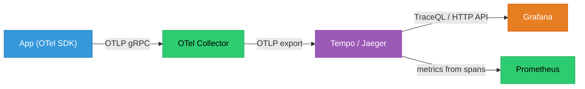
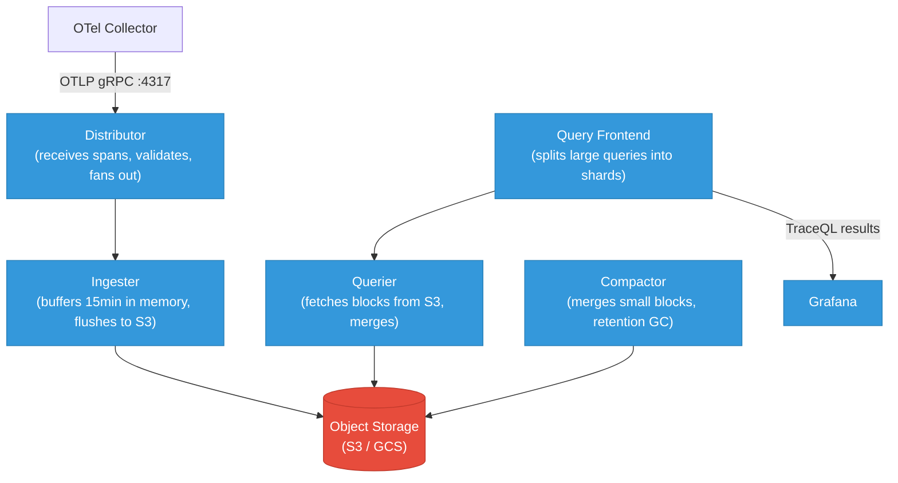

# Distributed Tracing Backends: Grafana Tempo and Jaeger

OpenTelemetry generates traces and the Collector forwards them — but you need a backend to store, index, and query them. This guide covers Grafana Tempo (object-storage-native, tightly Grafana-integrated) and Jaeger (the original open-source tracing backend), how to deploy each, and how to query across millions of traces without burning down your cloud bill.

<div class="quiz-progress" data-quiz-progress>
  <span class="quiz-progress-label">0/0 checks</span>
  <span class="quiz-progress-bar"><span class="quiz-progress-fill"></span></span>
</div>

---

## Why You Need a Backend

The OTel Collector can receive spans, batch them, and export them — but it has no persistence or query layer. Without a backend:
- Spans are lost on restart.
- You cannot search across traces by service, duration, or error.
- Trace context propagation works (distributed correlation), but you can't inspect historical traces.

A tracing backend stores spans, builds an index for search, and exposes a query API that Grafana or the Jaeger UI can call.



---

## Grafana Tempo Architecture

Tempo is designed around **object storage as the primary store** (S3, GCS, Azure Blob). There is no Elasticsearch, no Cassandra — spans are written as Parquet-formatted blocks to S3, and a small in-memory index enables trace lookup by ID.



**Component roles:**
| Component | Role |
|-----------|------|
| **Distributor** | Receives OTLP spans, validates, hashes by `traceID` to route to the right ingester |
| **Ingester** | Holds recent spans in memory (WAL-backed), flushes to object storage every ~15 min |
| **Querier** | Fetches block files from S3, executes TraceQL, merges shard results |
| **Query Frontend** | Splits large time-range queries across querier shards, caches query results |
| **Compactor** | Merges small blocks into larger ones, enforces retention by deleting expired blocks |

### Deployment — docker-compose (local dev)

```yaml
# docker-compose.yml
services:
  tempo:
    image: grafana/tempo:2.4.0
    command: ["-config.file=/etc/tempo.yaml"]
    volumes:
      - ./tempo.yaml:/etc/tempo.yaml
      - tempo-data:/var/tempo
    ports:
      - "4317:4317"   # OTLP gRPC
      - "3200:3200"   # Tempo HTTP / query API
  grafana:
    image: grafana/grafana:10.4.0
    environment:
      - GF_FEATURE_TOGGLES_ENABLE=traceqlEditor
    ports:
      - "3000:3000"
    volumes:
      - ./grafana-datasources.yaml:/etc/grafana/provisioning/datasources/datasources.yaml
volumes:
  tempo-data:
```

```yaml
# tempo.yaml
server:
  http_listen_port: 3200

distributor:
  receivers:
    otlp:
      protocols:
        grpc:
          endpoint: 0.0.0.0:4317

ingester:
  max_block_duration: 5m        # flush to storage after 5 min in dev

storage:
  trace:
    backend: local               # use s3 in production
    local:
      path: /var/tempo/blocks
    wal:
      path: /var/tempo/wal

compactor:
  compaction:
    block_retention: 48h

query_frontend:
  search:
    max_duration: 24h

```

### Deployment — Kubernetes (Helm)

```bash
helm repo add grafana https://grafana.github.io/helm-charts
helm install tempo grafana/tempo-distributed \
  --namespace monitoring --create-namespace \
  --set storage.trace.backend=s3 \
  --set storage.trace.s3.bucket=my-tempo-traces \
  --set storage.trace.s3.region=us-east-1
```

For monolithic (single binary) mode — suitable under 10K spans/sec:
```bash
helm install tempo grafana/tempo \
  --namespace monitoring \
  --set tempo.storage.trace.backend=s3 \
  --set tempo.storage.trace.s3.bucket=my-tempo-traces
```

<div class="quiz-card">
  <p class="quiz-q">Why does Tempo use object storage (S3/GCS) as its primary store instead of a database like Elasticsearch?</p>
  <button class="quiz-reveal">Reveal answer</button>
  <div class="quiz-a" hidden>Object storage is orders of magnitude cheaper per GB than Elasticsearch (which stores spans in inverted indexes that can be 3–10× the raw data size). Tempo's core insight is that most trace lookups are by trace ID (a point lookup), not by arbitrary field search. A small in-memory index mapping trace ID → block location is enough for that. Field-based search (TraceQL) works by scanning blocks in object storage — slower than ES, but acceptable for traces because you rarely need sub-second trace search latency. The result: months of trace retention at a fraction of the cost of an Elasticsearch cluster.</div>
</div>

---

## TraceQL

TraceQL is Tempo's query language. It looks like a pipeline: select spans matching a filter, then optionally aggregate.

```
# Select traces where the payments service had an error
{ .service.name = "payments" && status = error }

# Traces where any span took over 500ms
{ duration > 500ms }

# Traces where the db call to users-db took over 200ms
{ .service.name = "api" && .db.name = "users-db" && duration > 200ms }

# Count errors by service (aggregation)
{ status = error } | by(.service.name) | count()

# P99 latency per service
{ } | by(.service.name) | quantile_over_time(duration, 0.99)
```

**Key field namespaces:**
| Prefix | Example | Meaning |
|--------|---------|---------|
| `.` (no prefix) | `.http.status_code` | OTel span attribute |
| `resource.` | `resource.k8s.pod.name` | Resource attribute (set on SDK init) |
| `span.` | `span.db.statement` | Same as `.`, explicit form |
| (built-in) | `duration`, `status`, `name` | Span-level built-ins |

### Grafana Explore with TraceQL

In Grafana → Explore → Select Tempo datasource → switch to TraceQL tab:

```
{ .service.name = "checkout" && .http.status_code >= 500 }
```

Results show as a list of matching traces with duration, root span name, and service. Click any trace to open the waterfall view.

---

## Trace-to-Log Correlation

When Tempo finds a slow trace, you want to jump directly to the log lines that happened during that span's lifetime. This requires:

1. **Injecting `traceID` into log lines** (OTel SDK does this automatically for structured loggers):
```json
{"level":"error","traceID":"4bf92f3577b34da6","spanID":"00f067aa0ba902b7","msg":"db query timeout"}
```

2. **Loki `derived_fields` config** — tells Grafana to make `traceID` a clickable link:
```yaml
# grafana-datasources.yaml
datasources:
  - name: Loki
    type: loki
    url: http://loki:3100
    jsonData:
      derivedFields:
        - matcherRegex: '"traceID":"(\w+)"'
          name: TraceID
          url: '$${__value.raw}'
          datasourceUid: tempo   # UID of your Tempo datasource
```

With this config, any log line containing `"traceID":"..."` gets a **Tempo** button next to it in Grafana Explore. Clicking it opens the trace waterfall centered on that exact trace ID.

---

## Service Graph

Tempo can generate **service graph metrics** from span data — showing request rate, error rate, and p99 latency for each service-to-service call. These become Prometheus metrics you can alert on.

```yaml
# tempo.yaml — enable service graph processor
metrics_generator:
  registry:
    external_labels:
      cluster: prod
  storage:
    path: /var/tempo/generator/wal
  processors:
    - service-graphs
    - span-metrics

overrides:
  metrics_generator_processors: [service-graphs, span-metrics]
```

Configure Tempo as a Prometheus remote_write target:
```yaml
# prometheus.yml
remote_write:
  - url: http://tempo:3200/api/v1/push
```

This produces metrics like:
- `traces_service_graph_request_total{client="api",server="db"}` — request count
- `traces_service_graph_request_failed_total` — error count
- `traces_service_graph_request_server_seconds_bucket` — latency histogram

Grafana's **Service Graph** panel visualises these as a node-edge graph, colored by error rate.

---

## Jaeger

Jaeger is the original open-source distributed tracing backend from Uber (now CNCF graduated). It predates Tempo and OTel, but has native OTLP receiver support since v1.35.

### Architecture

<div class="tab-group">
  <div class="tab-buttons">
    <button data-tab="jaeger-aio" class="active">All-in-one (dev)</button>
    <button data-tab="jaeger-dist">Distributed (prod)</button>
  </div>
  <div class="tab-panels">
    <div class="tab-panel active" data-tab-panel="jaeger-aio">

**All-in-one**: single Docker image, in-memory storage — good for local development only. No persistence across restarts.

```yaml
services:
  jaeger:
    image: jaegertracing/all-in-one:1.55
    environment:
      - COLLECTOR_OTLP_ENABLED=true
    ports:
      - "4317:4317"    # OTLP gRPC
      - "16686:16686"  # Jaeger UI
      - "14268:14268"  # Jaeger HTTP
```

Send traces: configure OTel Collector to export OTLP to `jaeger:4317`.

    </div>
    <div class="tab-panel" data-tab-panel="jaeger-dist">

**Distributed with Elasticsearch backend**: production-grade, scalable.

```bash
helm repo add jaegertracing https://jaegertracing.github.io/helm-charts
helm install jaeger jaegertracing/jaeger \
  --namespace monitoring \
  --set provisionDataStore.cassandra=false \
  --set provisionDataStore.elasticsearch=true \
  --set elasticsearch.master.replicas=1 \
  --set elasticsearch.data.replicas=2 \
  --set collector.replicaCount=2 \
  --set query.replicaCount=2
```

Components: **Collector** (receives spans) → **Elasticsearch** (storage + index) → **Query** (serves Jaeger UI + API).

Cost note: Elasticsearch stores spans in an inverted index — expect 3–5× storage amplification vs raw span data. Cheaper alternatives: use Cassandra (wide-column, predictable cost at scale) or switch to Tempo.

    </div>
  </div>
</div>

### Jaeger UI Features

- **Trace timeline** — waterfall view with span children indented, colored by service
- **Trace comparison** — diff two traces side-by-side (e.g., fast request vs slow request)
- **Search** — filter by service, operation, tag values, min/max duration, time range
- **Dependencies graph** — calls graph built from sampled traces (similar to Tempo service graph)

---

## Tempo vs Jaeger — When to Choose Each

<div class="tab-group">
  <div class="tab-buttons">
    <button data-tab="choose-tempo" class="active">Choose Tempo</button>
    <button data-tab="choose-jaeger">Choose Jaeger</button>
  </div>
  <div class="tab-panels">
    <div class="tab-panel active" data-tab-panel="choose-tempo">

**Choose Tempo when:**
- You are already on the Grafana stack (Loki + Prometheus + Grafana) — native datasource integration, trace-to-log links work out of the box
- You need long retention (weeks/months) at low cost — object storage is 10–50× cheaper than Elasticsearch
- You want service graph metrics fed into Prometheus without extra components
- You are running in Kubernetes and want a horizontally scalable backend without managing ES
- TraceQL's pipeline query language fits your debugging workflow

    </div>
    <div class="tab-panel" data-tab-panel="choose-jaeger">

**Choose Jaeger when:**
- You need a standalone tracing UI independent of Grafana — Jaeger's UI is purpose-built for tracing (trace comparison, dependency graph)
- Your team is already on Elasticsearch and wants to reuse it for spans
- You prefer a more mature, battle-tested system (Jaeger predates Tempo by several years)
- You need Cassandra as the storage backend (Tempo does not support Cassandra)
- You want the Jaeger trace comparison feature (diff two traces) — Tempo/Grafana doesn't have a native equivalent

    </div>
  </div>
</div>

| | **Tempo** | **Jaeger** |
|--|-----------|------------|
| **Storage** | Object storage (S3/GCS) | Elasticsearch or Cassandra |
| **Storage cost** | Very low | Moderate to high (ES index overhead) |
| **Query language** | TraceQL | Tag-based search UI + Jaeger Query API |
| **Grafana integration** | Native datasource | Via Jaeger datasource plugin |
| **Trace-to-log** | Native via Loki derived fields | Manual configuration |
| **Service graph** | Built-in (metrics generator) | Built-in (dependency graph) |
| **Scalability** | Horizontally scalable (distributed mode) | Horizontally scalable (collector + ES) |
| **Maturity** | Newer (2020+) | Older, CNCF graduated |

<div class="quiz-card">
  <p class="quiz-q">A team stores 30 days of traces. With Jaeger/Elasticsearch the storage cost is $800/month. What would the same data cost in Tempo with S3?</p>
  <button class="quiz-reveal">Reveal answer</button>
  <div class="quiz-a" hidden>Roughly $40–80/month. S3 Standard costs ~$0.023/GB vs Elasticsearch at ~$0.10–0.30/GB (compute + EBS). Jaeger's ES also applies a 3–5× index amplification factor — 100 GB of raw spans becomes 300–500 GB in ES. Tempo stores the raw blocks in object storage with minimal overhead. At scale (TBs of traces), the cost difference is the primary reason teams migrate from Jaeger to Tempo. The tradeoff is that Tempo's TraceQL queries over object storage are slower than ES's inverted index for arbitrary field search.</div>
</div>

---

## OTel Collector → Backend Configuration

```yaml
# otel-collector-config.yaml
receivers:
  otlp:
    protocols:
      grpc:
        endpoint: 0.0.0.0:4317
      http:
        endpoint: 0.0.0.0:4318

processors:
  batch:
    timeout: 1s
    send_batch_size: 1024

exporters:
  otlp/tempo:
    endpoint: tempo:4317
    tls:
      insecure: true
  # OR for Jaeger:
  otlp/jaeger:
    endpoint: jaeger-collector:4317
    tls:
      insecure: true

service:
  pipelines:
    traces:
      receivers: [otlp]
      processors: [batch]
      exporters: [otlp/tempo]   # or otlp/jaeger
```

**Sampling at the Collector** — use tail-based sampling to keep only interesting traces (errors, slow requests) and drop the rest, reducing backend storage:

```yaml
processors:
  tail_sampling:
    decision_wait: 10s        # wait up to 10s for all spans before deciding
    policies:
      - name: keep-errors
        type: status_code
        status_code: {status_codes: [ERROR]}
      - name: keep-slow
        type: latency
        latency: {threshold_ms: 1000}
      - name: sample-rest
        type: probabilistic
        probabilistic: {sampling_percentage: 5}   # 5% of healthy/fast traces
```

<div class="quiz-card">
  <p class="quiz-q">What is tail-based sampling and why is it better than head-based sampling for capturing errors?</p>
  <button class="quiz-reveal">Reveal answer</button>
  <div class="quiz-a" hidden>Head-based sampling decides at the start of a request (at the first span) whether to record the trace — before knowing if an error will occur. This means errors can be dropped if unlucky. Tail-based sampling waits until all spans for a trace arrive (the "tail" of the request lifetime), then makes the keep/drop decision based on the complete trace — so you can guarantee that all error traces and all slow traces are kept, while still dropping 95%+ of successful, fast traces to reduce storage cost. The tradeoff is that the Collector must buffer spans in memory while waiting for the tail, requiring more memory than head-based approaches.</div>
</div>
