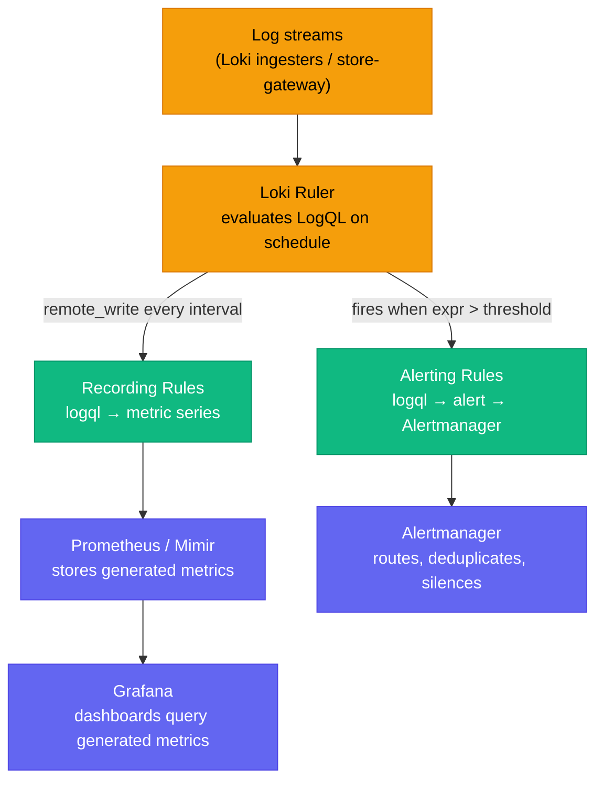

# Loki Ruler: Log-to-Metric Recording Rules and Log Alerts

Loki's ruler component mirrors Prometheus's ruler — it evaluates LogQL expressions on a schedule and produces two kinds of output: **recording rules** (convert log patterns into Prometheus metrics) and **alerting rules** (fire alerts directly from log data into Alertmanager). This fills the observability gap where you have rich log data in Loki but your alerting and SLO stack expects Prometheus metrics.

<div class="quiz-progress" data-quiz-progress>
  <span class="quiz-progress-label">0/0 checks</span>
  <span class="quiz-progress-bar"><span class="quiz-progress-fill"></span></span>
</div>

---

## Architecture



The ruler reads from the same log store as Loki's query-frontend. Rules files live in ruler storage (S3/GCS or filesystem). The ruler runs as a standalone component in microservices mode, or alongside Loki in monolithic mode.

---

## Loki Ruler Configuration

Add a `ruler` block to your `loki.yaml`. At minimum, configure storage (where rules files live), the Alertmanager URL, and optionally a `remote_write` target for recording rules:

```yaml
ruler:
  # Where Loki reads rules files from
  storage:
    type: s3
    s3:
      bucketnames: my-loki-rules
      region: us-east-1
      access_key_id: ${AWS_ACCESS_KEY_ID}
      secret_access_key: ${AWS_SECRET_ACCESS_KEY}

  # Local cache of rule files
  rule_path: /tmp/loki-rules

  # Alertmanager for alerting rules
  alertmanager_url: http://alertmanager:9093

  # Remote write for recording rules → Prometheus/Mimir
  remote_write:
    enabled: true
    client:
      url: http://mimir-distributor:9009/api/v1/push
      headers:
        X-Scope-OrgID: tenant1

  # Evaluate rules every 1 minute
  evaluation_interval: 1m

  # Poll storage for new/changed rules
  poll_interval: 1m

  # Enable WAL for ruler durability across restarts
  wal:
    enabled: true
    dir: /tmp/ruler-wal
```

**In microservices mode**, deploy a dedicated ruler component:

```yaml
# Helm values (grafana/loki chart)
ruler:
  enabled: true
  replicas: 2
  persistence:
    enabled: true
    size: 10Gi
```

---

## Recording Rules — Log to Metric

Recording rules run a LogQL metric query on a schedule and write the result as a time series to your Prometheus-compatible store. Use them to:

- Pre-compute expensive aggregations (no ad-hoc scan of billions of log lines)
- Feed SLO dashboards that expect `error_rate` as a metric, not a LogQL query
- Expose log-derived signals to existing Prometheus alerting pipelines

### Rule File Format

```yaml
# /rules/nginx-metrics.yaml
groups:
  - name: nginx_derived_metrics
    interval: 1m       # Override global evaluation_interval if needed
    rules:
      # HTTP 5xx rate from Nginx JSON access logs
      - record: job:nginx_http_5xx:rate5m
        expr: |
          sum by (job, namespace) (
            rate(
              {job="nginx", namespace=~"prod|staging"}
                | json
                | status >= 500
              [5m]
            )
          )

      # Total request rate per namespace
      - record: job:nginx_requests:rate5m
        expr: |
          sum by (job, namespace) (
            rate({job="nginx", namespace=~"prod|staging"} [5m])
          )

      # p99 latency from structured log field (requires unwrap)
      - record: job:nginx_latency_p99:5m
        expr: |
          quantile_over_time(0.99,
            {job="nginx"}
              | json
              | unwrap request_time [5m]
          ) by (job, namespace)
```

**Upload rules to Loki ruler:**

```bash
# Using lokitool (or mimirtool with loki backend)
lokitool rules push --address=http://loki:3100 \
  --id=tenant1 \
  /rules/nginx-metrics.yaml

# Verify
lokitool rules list --address=http://loki:3100 --id=tenant1
```

### `unwrap` for Numeric Fields

`rate()` in LogQL requires a numeric metric extracted from logs via `unwrap`. If your logs don't have a clean numeric field, fall back to `count_over_time`:

```logql
# Good: parse JSON, unwrap numeric latency field
rate({app="api"} | json | unwrap duration_ms [5m])

# Also good: count log lines matching a pattern
count_over_time({app="api"} |= `"level":"error"` [5m])

# Then rate() from count:
rate({app="api"} |= `"level":"error"` [5m])
```

<div class="quiz-card"><p class="quiz-q">You want a recording rule for p99 request latency, but your logs are plain text like <code>GET /api/users 200 145ms</code>. What LogQL construct extracts the numeric latency for use with <code>quantile_over_time</code>?</p><button class="quiz-reveal">Reveal answer</button><div class="quiz-a" hidden>Use a regexp parser to capture the number, then unwrap it: <code>| regexp "(?P&lt;latency_ms&gt;\d+)ms" | unwrap latency_ms</code>. Without unwrap, LogQL metric queries only count log lines — they can't aggregate numeric values inside them.</div></div>

---

## Alerting Rules — Alert Directly from Logs

Alerting rules evaluate a LogQL metric expression and fire when it exceeds a threshold, routing directly to Alertmanager. The syntax is identical to Prometheus alert rules.

```yaml
# /rules/payment-alerts.yaml
groups:
  - name: payment_log_alerts
    rules:
      # Alert when error rate exceeds 1 error/second for 2 minutes
      - alert: PaymentHighErrorRate
        expr: |
          sum(rate({app="payments", namespace="prod"} |= `"level":"error"` [5m])) > 1
        for: 2m
        labels:
          severity: critical
          team: payments
        annotations:
          summary: "High error rate in payments service"
          description: "Error rate {{ $value | humanize }}/s exceeds threshold of 1/s"
          runbook: "https://wiki.internal/runbooks/payments-errors"

      # Alert on shell execution in any production container (security)
      - alert: ShellExecInProduction
        expr: |
          count_over_time(
            {namespace="prod"} |= "execve" |= "/bin/sh" [5m]
          ) > 0
        for: 0m       # Fire immediately — no need to wait
        labels:
          severity: critical
          team: security
        annotations:
          summary: "Shell execution detected in production namespace"

      # Alert when a service goes completely silent (no logs for 5 min)
      - alert: ServiceLogSilence
        expr: |
          absent_over_time({app="payments", namespace="prod"} [5m])
        for: 5m
        labels:
          severity: warning
        annotations:
          summary: "payments service has produced no logs for 5 minutes"
```

**`for: 0m`** fires immediately when the condition is true — useful for security events. **`for: 2m`** requires the condition to hold for 2 minutes — filters transient spikes.

These alerts route through Alertmanager exactly like Prometheus alerts: same routing tree, same inhibition rules, same silences. Loki ruler and Prometheus alerts share the same Alertmanager instance.

<div class="quiz-card"><p class="quiz-q">Your Loki alerting rule has <code>for: 0m</code>. A single error log line arrives. Does the alert fire?</p><button class="quiz-reveal">Reveal answer</button><div class="quiz-a" hidden>Yes — <code>for: 0m</code> means "fire as soon as the expression is true", with no pending period. A single log line matching the filter makes the rate/count non-zero, and the alert fires on the next evaluation cycle (typically within 1 minute). Use <code>for: 2m</code> or higher for noisy conditions.</div></div>

---

## Common Rule Patterns

### HTTP 5xx Error Rate by Service

```yaml
- record: job:http_5xx_errors:rate5m
  expr: |
    sum by (app, namespace) (
      rate({namespace=~"prod|staging"}
        | json
        | status >= 500
      [5m])
    )
```

Then in Grafana: `job:http_5xx_errors:rate5m{namespace="prod"}` — no Loki query at dashboard load time.

### Error Rate Per Service (Unstructured Logs)

```yaml
- record: job:log_errors:rate5m
  expr: |
    sum by (app, namespace) (
      rate({namespace="prod"} |~ `(?i)(error|exception|fatal)` [5m])
    )
```

### Log Volume Spike (Cardinality Explosion Early Warning)

```yaml
- alert: LogVolumeSpike
  expr: |
    sum by (app) (
      rate({namespace="prod"} [5m])
    ) > 10000
  for: 3m
  labels:
    severity: warning
  annotations:
    summary: "{{ $labels.app }} is logging > 10k lines/sec — possible runaway logger"
```

### SLO Error Budget Burn from Logs

```yaml
# First, define the error rate and total rate as recording rules
- record: job:api_errors:rate5m
  expr: sum(rate({app="api"} | json | status >= 500 [5m])) by (app)

- record: job:api_requests:rate5m
  expr: sum(rate({app="api"} | json [5m])) by (app)

# Then alert when error ratio burns budget too fast
- alert: APIErrorBudgetBurn
  expr: |
    (job:api_errors:rate5m / job:api_requests:rate5m) > 0.01
  for: 5m
  labels:
    severity: page
```

---

## Loki Ruler vs Prometheus Ruler

| | Loki Ruler | Prometheus Ruler |
|--|------------|-----------------|
| **Source data** | Log streams (Loki store) | Metric time series (Prometheus TSDB) |
| **Query language** | LogQL metric queries | PromQL |
| **Rule file format** | Identical YAML format | Identical YAML format |
| **Recording rule output** | Metric → remote_write to Mimir/Prometheus | Metric → local Prometheus TSDB |
| **Alerting output** | Alerts → Alertmanager | Alerts → Alertmanager |
| **Typical use case** | Derive metrics from log patterns, SLO from log data | Aggregate/downsample existing metrics |
| **Evaluation target** | Ruler queries ingesters or store-gateway | Ruler queries local Prometheus store |

Both ruler implementations use the same `.yaml` rule file structure and route to the same Alertmanager — teams manage both rule sets with the same tooling (mimirtool, lokitool, or Terraform Loki provider).

---

## Gotchas

**Ruler requires separate storage.** The ruler stores rule files in its own object store bucket — it cannot reuse Loki's ingester or chunk store. Always configure `ruler.storage` explicitly. In production, use S3/GCS; filesystem storage works only for single-node Loki and loses rules on pod restart.

**`rate()` needs `unwrap`.** The LogQL `rate()` function requires a numeric metric extracted with `unwrap`. If you use `rate({app="foo"} [5m])` without `unwrap`, Loki treats it as a count of matching log lines — same as `count_over_time`. To aggregate numeric values, parse them first (`| json | unwrap field_name`).

**Avoid high-cardinality recording rules.** A recording rule that groups by `pod`, `container`, and `trace_id` will emit thousands of series per evaluation cycle. Keep `by ()` clauses to 2-3 low-cardinality labels (app, namespace, status_class). High-cardinality outputs bloat Prometheus and slow down queries.

**Ruler evaluates in the ruler component, not query-frontend.** The ruler has direct access to ingesters (for recent data) and store-gateway (for older data). If your ruler is deployed separately and can't reach ingesters, rules that need the last 5 minutes of data will fail silently. Verify with `lokitool rules eval` before deploying.

**Multi-tenancy.** If Loki runs in multi-tenant mode, rules must be pushed per tenant (`--id=<tenant>`) and the ruler evaluates rules in the context of that tenant's data. A rule in tenant A cannot query tenant B's logs.

<div class="quiz-card"><p class="quiz-q">You have a Loki recording rule that groups by <code>(pod, container, request_id)</code>. After deploying it, Prometheus ingestion slows and cardinality alerts fire. What went wrong and how do you fix it?</p><button class="quiz-reveal">Reveal answer</button><div class="quiz-a" hidden>The <code>request_id</code> label has unbounded cardinality — every unique request ID creates a new time series. A rule emitting thousands of series per evaluation cycle overloads Prometheus. Fix: remove high-cardinality labels from the <code>by()</code> clause. Keep only low-cardinality labels like <code>(app, namespace, status_class)</code>. The recording rule should aggregate, not enumerate individual requests.</div></div>
