# Network Performance Tuning

Linux kernel TCP defaults were tuned for 1990s modem speeds. On modern 10 GbE / 25 GbE links they leave most bandwidth on the table. This guide covers the four levers — TCP buffers, congestion control, NIC ring buffers, and interrupt affinity — and how to measure before and after each change.

<div class="quiz-progress" data-quiz-progress>
  <span class="quiz-progress-label">0/0 checks</span>
  <span class="quiz-progress-bar"><span class="quiz-progress-fill"></span></span>
</div>

---

## Packet RX Path — Where Each Lever Applies

```mermaid
graph LR
    NIC["NIC Hardware<br>10/25/100 GbE"]
    RING["NIC Ring Buffer<br>ethtool -G rx 4096<br>(circular DMA queue)"]
    IRQ["CPU Interrupt<br>IRQ affinity / RSS<br>distributes to cores"]
    SOFTIRQ["SoftIRQ / NAPI<br>kernel packet processing<br>GRO/LRO offload"]
    SKBUF["Socket Buffer<br>tcp_rmem / SO_RCVBUF<br>(per-socket queue)"]
    APP["Application<br>recv() / read()"]

    NIC -->|"DMA write"| RING
    RING -->|"HW interrupt"| IRQ
    IRQ --> SOFTIRQ
    SOFTIRQ -->|"skb enqueue"| SKBUF
    SKBUF -->|"syscall"| APP

    style RING fill:#fee2e2,stroke:#dc2626
    style IRQ fill:#fef3c7,stroke:#d97706
    style SOFTIRQ fill:#dbeafe,stroke:#2563eb
    style SKBUF fill:#dcfce7,stroke:#16a34a
```



Drops can happen at **ring buffer** (NIC full, packet discarded by hardware), at **softirq** (CPU can't keep up), or at **socket buffer** (app is slow to read). Tuning the wrong layer fixes nothing.

---

## TCP Buffer Sizing

The single highest-impact tuning. Default kernel buffers (212 KB) cap throughput on any link with latency > ~0.17 ms at 10 Gbps.

**Bandwidth-Delay Product (BDP) — the right buffer size:**

```
optimal buffer = bandwidth × RTT
10 Gbps link, 1 ms RTT → 10×10⁹/8 × 0.001 = 1.25 MB per socket
10 Gbps link, 5 ms RTT → 6.25 MB per socket
```

**Sysctl knobs:**

| Parameter | Default | Production value | Meaning |
|-----------|---------|-----------------|---------|
| `net.core.rmem_max` | 212992 | 134217728 (128 MB) | Max socket receive buffer (ceiling for SO_RCVBUF) |
| `net.core.wmem_max` | 212992 | 134217728 (128 MB) | Max socket send buffer (ceiling for SO_SNDBUF) |
| `net.core.rmem_default` | 212992 | 8388608 (8 MB) | Default receive buffer for new sockets |
| `net.core.wmem_default` | 212992 | 8388608 (8 MB) | Default send buffer for new sockets |
| `net.ipv4.tcp_rmem` | 4096 87380 6291456 | 4096 87380 134217728 | TCP min/default/max receive buffer |
| `net.ipv4.tcp_wmem` | 4096 16384 4194304 | 4096 65536 134217728 | TCP min/default/max send buffer |
| `net.ipv4.tcp_mem` | auto | auto | Kernel total TCP memory (leave auto) |

**Apply:**

```bash
# /etc/sysctl.d/10-network-tuning.conf
net.core.rmem_max = 134217728
net.core.wmem_max = 134217728
net.core.rmem_default = 8388608
net.core.wmem_default = 8388608
net.ipv4.tcp_rmem = 4096 87380 134217728
net.ipv4.tcp_wmem = 4096 65536 134217728
```

```bash
sysctl -p /etc/sysctl.d/10-network-tuning.conf   # apply without reboot
```

**Per-socket override:** applications can call `setsockopt(fd, SOL_SOCKET, SO_RCVBUF, &size, sizeof(size))` — but this is capped at `rmem_max / 2`. Setting `rmem_max = 128 MB` allows apps to request up to 64 MB buffers.

`net.ipv4.tcp_window_scaling = 1` (default on) allows the TCP window to exceed 65535 bytes — required for BDP > 64 KB. Do not disable.

<div class="quiz-card"><p class="quiz-q">A 10 GbE link with 2 ms RTT is saturating at ~800 Mbps despite no packet loss. What's the likely bottleneck and what single sysctl fixes it?</p><button class="quiz-reveal">Reveal answer</button><div class="quiz-a" hidden>The TCP receive window is too small. BDP = 10 Gbps × 0.002 s = 2.5 MB. The default tcp_rmem max is 6 MB, but on many distributions the effective value after autoscaling caps lower. Set `net.ipv4.tcp_rmem = 4096 87380 134217728` (and `net.core.rmem_max = 134217728` so the ceiling is high enough). With auto-tuning enabled, the kernel then allocates up to BDP per connection.</div></div>

---

## BBR vs CUBIC Congestion Control

Congestion control decides how fast TCP sends data and how it reacts to network signals.

| | CUBIC (default) | BBR |
|---|---|---|
| **Signal used** | Packet loss | Bandwidth + RTT model |
| **Reaction to loss** | Cut window in half | Probe bandwidth independently |
| **Shallow-buffer links** | Buffers fill before loss → high latency | Probes bandwidth without filling buffers |
| **High-latency WAN** | Slow to recover from loss events | Reaches full bandwidth faster |
| **Fairness** | Fair with other CUBIC flows | May be unfair to CUBIC on shared links |
| **Best for** | LAN, datacenter east-west | WAN, cross-DC, internet-facing |

**Enable BBR:**

```bash
# Check available algorithms
sysctl net.ipv4.tcp_available_congestion_control
# → net.ipv4.tcp_available_congestion_control = reno cubic bbr

# Enable BBR (requires kernel ≥ 4.9)
net.ipv4.tcp_congestion_control = bbr
net.core.default_qdisc = fq          # FQ qdisc needed for BBR pacing
```

```bash
# Verify on a running connection
ss -tin dst <server-ip> | grep cc
# → cubic    ← before
# → bbr      ← after
```

Google uses BBR for all its public-facing services. The gain over CUBIC is most visible on links with > 10 ms RTT or where intermediate buffers are shallow (causing CUBIC's loss signals to fire early).

---

## NIC Ring Buffer Tuning

The NIC ring buffer is a circular DMA queue shared between the NIC hardware and the kernel. When it fills, the NIC silently drops incoming packets — before any kernel counter increments.

**Check current ring size:**

```bash
ethtool -g eth0
# Ring parameters for eth0:
# Pre-set maximums:
# RX:     4096    TX:     4096
# Current hardware settings:
# RX:     256     TX:     256    ← too small for 10 GbE burst
```

**Increase ring buffers:**

```bash
ethtool -G eth0 rx 4096 tx 4096
```

```bash
# Persistent (NetworkManager / udev rule)
# /etc/udev/rules.d/99-nic-ring.rules
ACTION=="add", SUBSYSTEM=="net", KERNEL=="eth0", \
  RUN+="/usr/sbin/ethtool -G eth0 rx 4096 tx 4096"
```

**Detect ring drops before tuning:**

```bash
ethtool -S eth0 | grep -i drop       # NIC-level drop counters
cat /proc/net/dev | grep eth0         # rx drop column
```

**Offload features:**

```bash
ethtool -k eth0                      # show current offload state
ethtool -K eth0 gro on tso on lro off
# GRO (Generic Receive Offload): coalesce small packets in kernel → fewer interrupts
# TSO (TCP Segmentation Offload): NIC splits large writes → fewer CPU cycles
# LRO (Large Receive Offload): hardware coalesce — disable; breaks routing/bridging
```

<div class="quiz-card"><p class="quiz-q">A server receives a burst of 10 GbE traffic for 50 ms. `ethtool -S eth0 | grep rx_dropped` shows 50,000 drops, but `netstat -s | grep retransmit` shows almost nothing. Where did the packets drop and why didn't TCP retransmit?</p><button class="quiz-reveal">Reveal answer</button><div class="quiz-a" hidden>Packets dropped in the NIC ring buffer, before the kernel received them. TCP retransmit counters only increment when the kernel's TCP stack detects loss (via ACK gaps or timeouts). Ring buffer drops are invisible to TCP — the kernel never saw the packets, so it cannot retransmit them. The sender's TCP will eventually time out or detect loss via SACK gaps, but the initial signal comes from the sender side, not from `netstat -s` on the receiving host. Fix: `ethtool -G eth0 rx 4096`.</div></div>

---

## Multi-Core NIC Packet Distribution

A single NIC queue creates a bottleneck: one CPU handles all RX interrupts. On 10+ GbE, that CPU saturates at ~2–3 Gbps.

**RSS — Receive Side Scaling (hardware):**

```bash
ethtool -l eth0
# Current hardware settings:
# Combined: 4     ← 4 hardware queues

ethtool -L eth0 combined 8    # use 8 queues (up to NIC maximum)
```

RSS hashes the 4-tuple (src IP, dst IP, src port, dst port) to distribute flows across queues. Each queue gets its own interrupt, handled by a separate CPU.

**RPS — Receive Packet Steering (software RSS):**

For NICs with only one hardware queue, RPS routes packets to multiple CPUs in software:

```bash
# Enable all CPUs for eth0 rx queue 0
echo f > /sys/class/net/eth0/queues/rx-0/rps_cpus
# 'f' = bitmask 0b1111 = CPUs 0,1,2,3

# Set RPS flow table size (per queue)
echo 32768 > /sys/class/net/eth0/queues/rx-0/rps_flow_cnt
```

**RFS — Receive Flow Steering:**

Routes packets to the CPU currently running the receiving application, improving cache locality:

```bash
# Global flow table
echo 32768 > /proc/sys/net/core/rfs_entries

# Per-queue flow count (should sum to rfs_entries)
echo 32768 > /sys/class/net/eth0/queues/rx-0/rps_flow_cnt
```

RFS requires RSS or RPS to be enabled first. Effective for latency-sensitive apps (databases, gRPC services) where cache misses between NIC interrupt and app CPU are expensive.

---

## IRQ Affinity

By default, `irqbalance` dynamically moves NIC interrupts across CPUs. For maximum throughput, pin NIC interrupts manually:

```bash
# Find NIC interrupt numbers
cat /proc/interrupts | grep eth0
#  56:  12345  PCI-MSI  eth0-rx-0
#  57:  23456  PCI-MSI  eth0-rx-1
#  58:  34567  PCI-MSI  eth0-tx-0

# Pin eth0-rx-0 to CPU 0 (smp_affinity is a CPU bitmask)
echo 01 > /proc/irq/56/smp_affinity   # CPU 0
echo 02 > /proc/irq/57/smp_affinity   # CPU 1
echo 04 > /proc/irq/58/smp_affinity   # CPU 2

# Stop irqbalance from overriding manual settings
systemctl stop irqbalance
```

**NUMA-aware pinning:** On multi-socket servers, pin NIC interrupts to the NUMA node closest to the NIC's PCIe slot:

```bash
# Find NIC's NUMA node
cat /sys/class/net/eth0/device/numa_node     # e.g., 1

# List CPUs on NUMA node 1
lscpu | grep -A5 NUMA
# NUMA node1 CPU(s): 16-31

# Pin interrupts to CPUs 16-31
echo ffff0000 > /proc/irq/56/smp_affinity   # CPUs 16-31 bitmask
```

Cross-NUMA memory access costs ~60–100 ns extra per packet — at 10 Gbps line rate, that's measurable.

---

## MTU and Jumbo Frames

| Setting | Use case |
|---------|---------|
| MTU 1500 (default) | Internet traffic, mixed environments |
| MTU 9000 (jumbo) | Datacenter storage (NFS, iSCSI, Ceph), high-throughput east-west |

```bash
# Check current MTU
ip link show eth0 | grep mtu

# Set jumbo frames (all devices on the path must support it)
ip link set eth0 mtu 9000

# Persistent (via /etc/network/interfaces or systemd-networkd)
# systemd: /etc/systemd/network/10-eth0.network
[Link]
MTUBytes=9000
```

**PMTUD (Path MTU Discovery):** TCP sends packets with the IP DF (Don't Fragment) bit set and relies on receiving ICMP "Fragmentation Needed" messages when a hop can't forward the full-size packet. Firewalls that block ICMP cause **black-hole connections** — sessions hang silently after the initial handshake.

```bash
# Test PMTUD
ping -M do -s 8972 <host>    # DF bit set, 8972 bytes payload + 28 header = 9000
# FRAG_NEEDED error → jumbo not supported on path

# NFS: override at mount level regardless of MTU
mount -o rsize=1048576,wsize=1048576 server:/export /mnt
```

---

## Benchmarking

Always measure before and after each change. One iperf3 run = one data point; take 3.

```bash
# Server (listen)
iperf3 -s

# Client — 8 parallel TCP streams, 30 s, with JSON output
iperf3 -c <server> -P 8 -t 30 -J | jq '.end.sum_received.bits_per_second / 1e9'

# Expected throughput
# Untuned (default buffers): 2–4 Gbps on a 10 GbE link with 5 ms RTT
# Tuned (128 MB buffers + BBR): 9.3–9.8 Gbps

# UDP loss test (saturate link, measure drops)
iperf3 -c <server> -u -b 10G -t 10
```

**Verify socket buffers in use:**

```bash
ss -tm dst <server-ip>
# rcv_space:87380  snd_wscale:7
# → snd_wscale > 7 means window scaling active; rcv_space should approach tcp_rmem max

ss -s                           # aggregate socket stats
netstat -s | grep -i retran     # retransmit rate (should be < 0.01% on LAN)
```

**Drop accounting:**

```bash
# Ring drops (NIC level)
ethtool -S eth0 | grep -i drop

# Kernel socket drops (socket buffer overflow)
netstat -su | grep errors
cat /proc/net/snmp | grep Udp   # UDP recv buffer overflow

# TCP retransmits
ss -s | grep retrans
```

---

## Complete Production sysctl

```bash
# /etc/sysctl.d/10-network-tuning.conf

# ── TCP buffers (BDP-sized for 10GbE @ 5ms RTT) ──────────────────
net.core.rmem_max = 134217728
net.core.wmem_max = 134217728
net.core.rmem_default = 8388608
net.core.wmem_default = 8388608
net.ipv4.tcp_rmem = 4096 87380 134217728
net.ipv4.tcp_wmem = 4096 65536 134217728

# ── Congestion control ────────────────────────────────────────────
net.ipv4.tcp_congestion_control = bbr
net.core.default_qdisc = fq

# ── TCP connection handling ───────────────────────────────────────
net.core.somaxconn = 65535               # listen backlog
net.ipv4.tcp_max_syn_backlog = 65535     # SYN queue depth
net.ipv4.tcp_fin_timeout = 30            # FIN_WAIT_2 → CLOSED (default 60s)
net.ipv4.tcp_tw_reuse = 1               # reuse TIME_WAIT sockets for outbound

# ── General networking ────────────────────────────────────────────
net.core.netdev_max_backlog = 65536      # kernel input queue depth
net.ipv4.tcp_window_scaling = 1          # must be on for large buffers
net.ipv4.tcp_timestamps = 1             # needed for PAWS / RTT measurement

# Apply
# sysctl -p /etc/sysctl.d/10-network-tuning.conf
```

<div class="quiz-card"><p class="quiz-q">You enable BBR and set `net.core.default_qdisc = fq`. A colleague asks why the qdisc change is required. What's the answer?</p><button class="quiz-reveal">Reveal answer</button><div class="quiz-a" hidden>BBR controls the congestion window but relies on accurate pacing — it wants to spread packets evenly over time rather than bursting them. The `fq` (Fair Queue) qdisc implements per-flow pacing in the kernel, enforcing the rate that BBR requests. Without `fq`, packets burst out at line rate regardless of BBR's pacing signal, defeating the model-based probing that makes BBR work. The default `pfifo_fast` qdisc has no pacing.</div></div>
