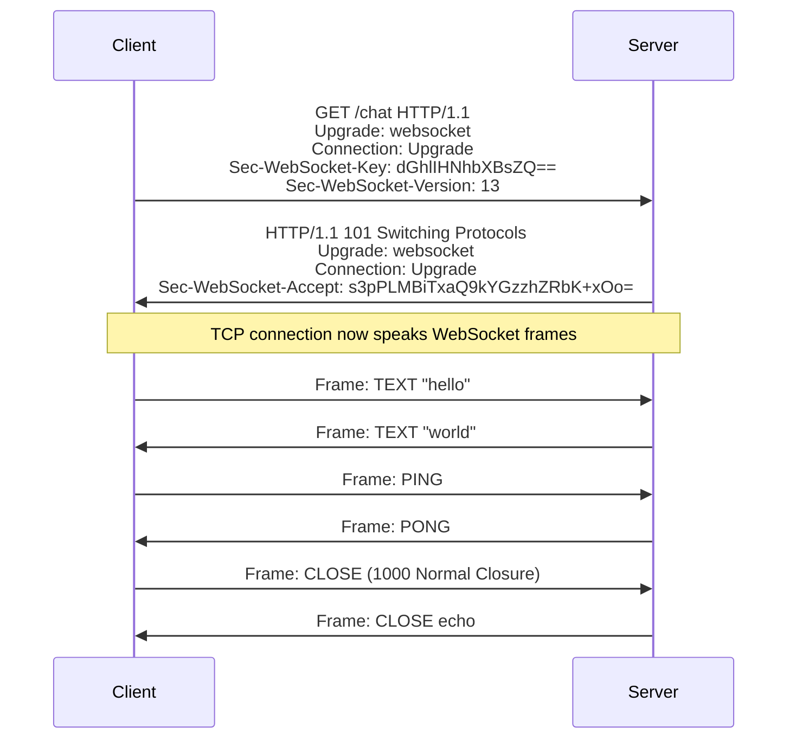
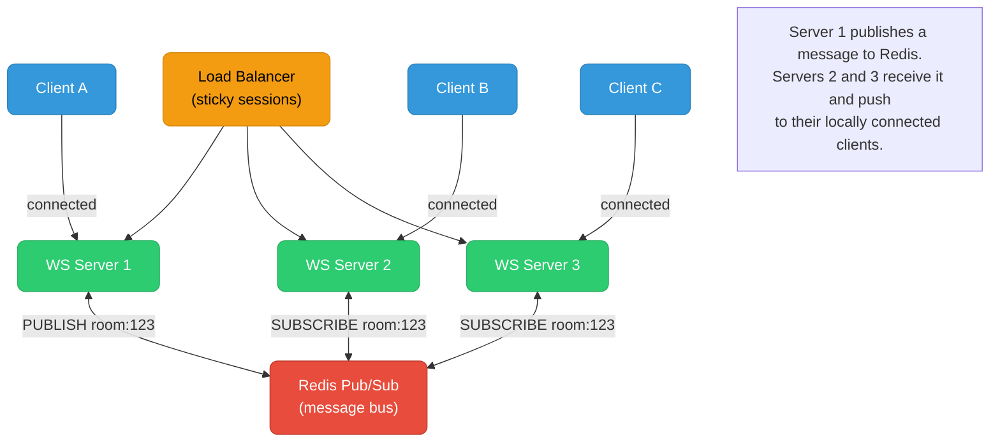

# WebSocket Internals

WebSocket is a full-duplex protocol that turns an HTTP connection into a persistent, bidirectional channel — understanding its framing, keepalive mechanics, and load-balancer constraints is essential for operating real-time systems at scale.

<div class="quiz-progress" data-quiz-progress>
  <span class="quiz-progress-label">0/0 checks</span>
  <span class="quiz-progress-bar"><span class="quiz-progress-fill"></span></span>
</div>

---

## Upgrade Handshake

WebSocket starts life as an HTTP/1.1 request. The client sends an `Upgrade` header; the server responds with `101 Switching Protocols`. After that, the connection is no longer HTTP — it speaks the WebSocket framing protocol.



**Key/Accept derivation** — the server proves it understood the WebSocket handshake by computing:

```
Sec-WebSocket-Accept = base64(SHA1(Sec-WebSocket-Key + "258EAFA5-E914-47DA-95CA-C5AB0DC85B11"))
```

The magic GUID is a constant defined in RFC 6455. If the server returns the wrong `Accept`, the browser rejects the connection.

**What does NOT happen during the upgrade:**
- No new TLS negotiation — the existing TLS session (for `wss://`) is reused.
- No new TCP connection — the existing TCP socket is promoted.
- No HTTP/2 multiplexing — HTTP/1.1 only (HTTP/2 WebSocket via RFC 8441 is a separate mechanism, covered below).

---

## Frame Format

Every WebSocket message is transmitted as one or more frames. The frame header is compact: 2 bytes minimum, up to 14 bytes with extended length and masking key.

```
 0                   1                   2                   3
 0 1 2 3 4 5 6 7 8 9 0 1 2 3 4 5 6 7 8 9 0 1 2 3 4 5 6 7 8 9 0 1
+-+-+-+-+-------+-+-------------+-------------------------------+
|F|R|R|R| opcode|M| Payload len |    Extended payload length    |
|I|S|S|S|  (4)  |A|     (7)    |             (16/64)           |
|N|V|V|V|       |S|             |                               |
| |1|2|3|       |K|             |                               |
+-+-+-+-+-------+-+-------------+-------------------------------+
|     Extended payload length continued, if payload len == 127  |
+---------------------------------------------------------------+
|                     Masking-key (32 bits, if MASK set)        |
+---------------------------------------------------------------+
|                   Payload data                                |
+---------------------------------------------------------------+
```

| Field | Size | Notes |
|---|---|---|
| FIN | 1 bit | 1 = final fragment of a message; 0 = more fragments follow |
| RSV1-3 | 3 bits | Reserved for extensions (e.g., permessage-deflate uses RSV1) |
| Opcode | 4 bits | 0x1 = text, 0x2 = binary, 0x8 = close, 0x9 = ping, 0xA = pong |
| MASK | 1 bit | 1 = payload is XOR-masked; **required for client→server** |
| Payload len | 7 bits | < 126: length itself; 126: next 2 bytes are length; 127: next 8 bytes |
| Masking key | 32 bits | Present only if MASK=1; 4 random bytes |

**Masking is mandatory client→server, forbidden server→client.** Each payload byte is XORed with `masking_key[i % 4]`. This prevents cache-poisoning attacks on intermediaries that might misinterpret WebSocket frames as HTTP requests.

**Fragmentation** — a single logical message can span multiple frames. The first frame has FIN=0; intermediate frames have opcode=0x0 (continuation) and FIN=0; the final frame has FIN=1. Control frames (ping, pong, close) must not be fragmented.

---

## Ping/Pong Keepalives

The browser does not send WebSocket pings — only the server does. If neither side sends data, NAT gateways and load balancers will kill idle TCP connections (typically after 60–300s depending on the infrastructure).

**Server-side keepalive pattern:**

```javascript
// Node.js / ws library example
const WebSocket = require('ws');
const wss = new WebSocket.Server({ port: 8080 });

wss.on('connection', (ws) => {
  ws.isAlive = true;

  ws.on('pong', () => { ws.isAlive = true; });  // reset on pong receipt

  const interval = setInterval(() => {
    if (!ws.isAlive) {
      ws.terminate();   // no pong received → dead connection
      return clearInterval(interval);
    }
    ws.isAlive = false;
    ws.ping();          // send ping; wait for pong
  }, 30_000);           // every 30 seconds

  ws.on('close', () => clearInterval(interval));
});
```

**Why `ws.terminate()` not `ws.close()`?** `ws.close()` sends a CLOSE frame and waits for the echo — which will never come if the connection is truly dead. `ws.terminate()` destroys the underlying TCP socket immediately.

**ALB idle timeout** — AWS ALB default idle timeout is 60s. WebSocket connections must send a frame (ping or data) within that window or the ALB closes the connection from the load balancer side. Set the ALB idle timeout to match or exceed your ping interval:

```bash
aws elbv2 modify-load-balancer-attributes \
  --load-balancer-arn arn:aws:elasticloadbalancing:... \
  --attributes Key=idle_timeout.timeout_seconds,Value=3600
```

---

## Backpressure

WebSocket has no built-in flow control — unlike HTTP/2 which has per-stream windows. A fast sender can overwhelm a slow consumer.

**Server-side: `bufferedAmount`** — the browser's `WebSocket.bufferedAmount` property reports how many bytes are queued in the send buffer but not yet transmitted. Use it to throttle:

```javascript
// Client: don't enqueue more than 64 KB
function sendIfReady(ws, data) {
  if (ws.bufferedAmount < 65536) {
    ws.send(data);
  } else {
    // back off; retry after a tick
    setTimeout(() => sendIfReady(ws, data), 10);
  }
}
```

**Server-side: per-socket write buffer** — in Node.js, `socket.writableHighWaterMark` (default 16 KB) is the backpressure signal. The `ws` library emits a `drain` event when the buffer clears:

```javascript
const canSend = ws.send(data, (err) => { /* called when flushed */ });
if (!canSend) {
  ws.once('drain', () => resumeSending());
}
```

**Slow consumer mitigation patterns:**
1. **Drop on overflow** — for real-time data (stock ticks, game state), drop stale frames instead of queuing them.
2. **Message coalescing** — aggregate multiple updates into one frame before sending.
3. **Per-client send queue with depth limit** — evict oldest messages when the queue exceeds a threshold.

---

## Load Balancer Sticky Sessions

WebSocket connections are stateful: the server holds connection state (authenticated user, subscriptions, in-flight messages) in process memory. A reconnect to a different backend loses that state.

**Why round-robin fails** — if the client's CLOSE + reconnect routes to a different backend, the new server has no record of the session.

**ALB sticky sessions** — configure a target group attribute:

```bash
aws elbv2 modify-target-group-attributes \
  --target-group-arn arn:aws:elasticloadbalancing:... \
  --attributes Key=stickiness.enabled,Value=true \
               Key=stickiness.type,Value=lb_cookie \
               Key=stickiness.lb_cookie.duration_seconds,Value=86400
```

The ALB sets an `AWSALB` cookie on the first response; subsequent requests with that cookie are routed to the same target.

**nginx `ip_hash`** — routes all requests from the same client IP to the same upstream:

```nginx
upstream websocket_backends {
  ip_hash;
  server backend1:8080;
  server backend2:8080;
  server backend3:8080;
}
```

Limitation: NAT means many clients share one IP, overloading that backend.

**Envoy consistent hashing** — hash on a cookie or header value for more even distribution:

```yaml
load_assignment:
  cluster_name: websocket_cluster
route_config:
  virtual_hosts:
  - routes:
    - route:
        cluster: websocket_cluster
        hash_policy:
        - cookie:
            name: session_id
            ttl: 86400s
```

**nginx `proxy_read_timeout`** — must be set longer than your keepalive interval, otherwise nginx will close the proxied connection after the timeout:

```nginx
location /ws {
  proxy_pass http://websocket_backends;
  proxy_http_version 1.1;
  proxy_set_header Upgrade $http_upgrade;
  proxy_set_header Connection "Upgrade";
  proxy_read_timeout 3600s;   # must exceed keepalive ping interval
  proxy_send_timeout 3600s;
}
```

---

## Scaling WebSocket Servers

The fundamental problem: client A is connected to server 1, client B to server 2. When server 1 wants to push a message to client B, it cannot — client B's socket lives in server 2's process.



**Redis Pub/Sub fan-out** — each server subscribes to channels for its connected clients' rooms/topics. When a message arrives for room X, the server that receives it publishes to Redis channel `room:X`; all other servers subscribed to that channel receive it and forward to their local clients.

```javascript
// Socket.IO with Redis adapter (handles this automatically)
const { createAdapter } = require('@socket.io/redis-adapter');
const { createClient } = require('redis');

const pubClient = createClient({ url: 'redis://localhost:6379' });
const subClient = pubClient.duplicate();

await Promise.all([pubClient.connect(), subClient.connect()]);
io.adapter(createAdapter(pubClient, subClient));
// Now io.to('room:123').emit('msg', data) works across servers
```

**Connection limits per server** — each WebSocket connection uses a file descriptor. The default Linux limit is 1024. Raise it:

```bash
# /etc/security/limits.conf
*  soft  nofile  100000
*  hard  nofile  100000

# Verify
ulimit -n
# 100000
```

Kernel accept queue (`net.core.somaxconn`) limits concurrent TCP handshakes in progress:

```bash
sysctl -w net.core.somaxconn=65535
sysctl -w net.ipv4.tcp_max_syn_backlog=65535
```

---

## WebSocket over HTTP/2

RFC 8441 defines WebSocket bootstrapping over HTTP/2 using the `CONNECT` method. Instead of `Upgrade`, the client sends `CONNECT` with `:protocol: websocket` in the request pseudo-headers. This lets multiple WebSocket connections share a single TCP connection (each as its own HTTP/2 stream).

```
:method = CONNECT
:scheme = https
:path = /chat
:authority = example.com
:protocol = websocket
```

**Benefit:** eliminates the TCP connection-per-WebSocket overhead at scale. With 10K clients, HTTP/2 WebSocket can multiplex many connections over far fewer TCP sockets.

**Support status:** Chrome, Firefox, and Safari support RFC 8441. Node.js does not natively support HTTP/2 WebSocket — use a proxy (nginx 1.25.1+, Envoy) that terminates HTTP/2 and forwards as HTTP/1.1 WebSocket to the backend.

---

<div class="quiz-card">
  <p class="quiz-q">A client connects to your WebSocket server. After 45 seconds of silence, the load balancer closes the connection with a TCP RST. Your ping interval is 60 seconds. What is the fix, and does it require a code change?</p>
  <button class="quiz-reveal">Reveal answer</button>
  <div class="quiz-a" hidden>The ALB idle timeout (default 60s) is firing before your ping interval (60s). The fix is two-pronged: (1) set the ALB idle timeout to something larger than 60s (e.g., 3600s) so the keepalive pings have time to arrive; (2) reduce the server-side ping interval below the ALB timeout — e.g., 30s pings with a 3600s ALB timeout. Both changes are required. Reducing only the ping interval to 55s would still race with the 60s ALB timeout under latency. ALB idle timeout is a configuration change, not a code change; the ping interval is a code change.</div>
</div>

<div class="quiz-card">
  <p class="quiz-q">You have 3 WebSocket servers behind a load balancer. Client A (on server 1) sends a message to room "game-42". Client B (on server 2) is in the same room. Without Redis, does client B receive the message? With Redis Pub/Sub, how does it reach client B?</p>
  <button class="quiz-reveal">Reveal answer</button>
  <div class="quiz-a" hidden>Without Redis: no. Server 1 has client A's socket; server 2 has client B's socket. Server 1 has no way to reach client B. The message is lost. With Redis Pub/Sub: server 1 publishes the message to the Redis channel "room:game-42". Server 2 is subscribed to that channel (it has a client in that room). Redis delivers the message to server 2, which then pushes it over client B's local WebSocket socket. Server 3 also receives the Redis message but has no client in that room, so it discards it. The key insight: Redis is the cross-server message bus; each server only delivers to its locally connected clients.</div>
</div>
