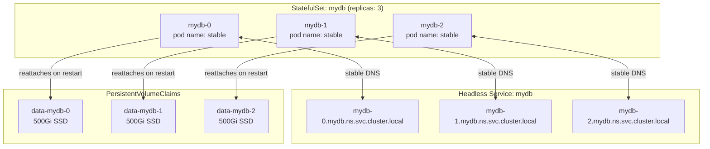

# StatefulSet Patterns for Databases on Kubernetes

A `StatefulSet` is Kubernetes's answer to "I need my pods to have stable identities." Unlike a `Deployment`, where pods are interchangeable replicas named `app-7d4f9b-xkz2p`, a StatefulSet gives each pod a permanent ordinal name (`kafka-0`, `kafka-1`, `kafka-2`) that survives restarts, and binds each pod to its own PVC for the life of the StatefulSet. These three guarantees — stable name, stable DNS, stable storage — are what make databases work on Kubernetes.

<div class="quiz-progress" data-quiz-progress>
  <span class="quiz-progress-label">0/0 checks</span>
  <span class="quiz-progress-bar"><span class="quiz-progress-fill"></span></span>
</div>

---

## The Three Guarantees



When `mydb-1`'s pod dies — node failure, OOMKill, rolling update — Kubernetes creates a new pod named exactly `mydb-1`, schedules it to a node that can mount `data-mydb-1`, and the database restarts with its data intact. No other workload type provides all three guarantees together.

---

## Headless Service

The `clusterIP: None` annotation makes Kubernetes create individual A records for each pod instead of a single round-robin VIP:

```yaml
apiVersion: v1
kind: Service
metadata:
  name: mydb
  namespace: default
spec:
  clusterIP: None          # This is the headless flag
  selector:
    app: mydb
  ports:
  - name: db
    port: 5432
    targetPort: 5432
```

With this service, the DNS lookup for `mydb.default.svc.cluster.local` returns **all pod IPs** (A records), and `mydb-2.mydb.default.svc.cluster.local` resolves to **that specific pod's IP**. This is how databases do seed discovery:

| Database | Headless DNS usage |
|----------|--------------------|
| MongoDB | `rs.initiate({ members: [{_id:0,host:"mongo-0.mongo:27017"},...] })` |
| Cassandra | `seeds: "cassandra-0.cassandra,cassandra-1.cassandra"` in cassandra.yaml |
| Kafka | `zookeeper.connect=zk-0.zk:2181,zk-1.zk:2181,zk-2.zk:2181` |
| etcd | `--initial-cluster=etcd-0=http://etcd-0.etcd:2380,...` |

A **regular ClusterIP service** routes requests to any pod — useless for reaching a specific replica. Use a separate ClusterIP service for client read traffic, and the headless service for intra-cluster peer communication.

<div class="quiz-card"><p class="quiz-q">Your MongoDB init script needs to connect to mongo-0 specifically (to run rs.initiate()). You have both a headless service "mongo" and a ClusterIP service "mongo-svc". Which hostname do you use?</p><button class="quiz-reveal">Reveal answer</button><div class="quiz-a" hidden>Use the headless service: <code>mongo-0.mongo.&lt;namespace&gt;.svc.cluster.local</code>. The headless service creates per-pod DNS records. The ClusterIP service routes to a random ready pod — which might not be mongo-0 — and you'd fail to run rs.initiate() on a non-primary.</div></div>

---

## PVC Lifecycle

`volumeClaimTemplates` in the StatefulSet spec creates one PVC per pod per template, named `<template-name>-<pod-name>`:

```yaml
spec:
  volumeClaimTemplates:
  - metadata:
      name: data
    spec:
      accessModes: ["ReadWriteOnce"]
      storageClassName: premium-ssd
      resources:
        requests:
          storage: 500Gi
```

This creates `data-mydb-0`, `data-mydb-1`, `data-mydb-2`. **PVCs are not deleted when the pod is deleted.** The pod can be evicted, crash-looped, or replaced — the PVC stays. When the new pod starts, Kubernetes binds the same PVC back. This is the behavior you want for databases.

**Retention policy** (Kubernetes 1.27+): control what happens to PVCs when the StatefulSet itself is deleted or scaled down:

```yaml
spec:
  persistentVolumeClaimRetentionPolicy:
    whenDeleted: Retain    # PVCs survive StatefulSet deletion (default)
    whenScaled: Delete     # PVCs for removed replicas are deleted on scale-down
```

Use `whenScaled: Retain` (the other default) when you want to manually inspect data before deletion. Use `whenScaled: Delete` when scaling-down a Kafka cluster — you've already rebalanced partitions off the broker, so the PVC is safe to remove.

**Expanding a PVC**: increase `storage` in `volumeClaimTemplates` does NOT resize existing PVCs (the template is immutable for existing pods). To expand:

```bash
# Resize each PVC individually (StorageClass must have allowVolumeExpansion: true)
kubectl patch pvc data-mydb-0 -p '{"spec":{"resources":{"requests":{"storage":"1Ti"}}}}'
kubectl patch pvc data-mydb-1 -p '{"spec":{"resources":{"requests":{"storage":"1Ti"}}}}'
kubectl patch pvc data-mydb-2 -p '{"spec":{"resources":{"requests":{"storage":"1Ti"}}}}'

# Restart each pod to trigger filesystem resize (if not auto-triggered)
kubectl rollout restart statefulset/mydb
```

---

## Init Containers for Bootstrap

Init containers solve the "I need to know who I am before I can start" problem that databases face:

**Pattern 1 — Cassandra seed wait**: Poll DNS until seed nodes are resolvable before starting the main container:

```yaml
initContainers:
- name: wait-for-seeds
  image: busybox:1.36
  command:
  - sh
  - -c
  - |
    until nslookup cassandra-0.cassandra.$(cat /var/run/secrets/kubernetes.io/serviceaccount/namespace).svc.cluster.local; do
      echo "waiting for cassandra-0..."; sleep 2
    done
```

**Pattern 2 — etcd cluster join**: Generate the `--initial-cluster` flag dynamically from DNS:

```yaml
initContainers:
- name: gen-etcd-config
  image: busybox:1.36
  command:
  - sh
  - -c
  - |
    PEERS=""
    for i in 0 1 2; do
      PEERS="${PEERS}${PEERS:+,}etcd-${i}=http://etcd-${i}.etcd:2380"
    done
    echo "--initial-cluster=${PEERS}" > /config/peers.txt
  volumeMounts:
  - name: config
    mountPath: /config
```

**Pattern 3 — MongoDB keyfile**: Generate a shared authentication secret from a K8s Secret:

```yaml
initContainers:
- name: copy-keyfile
  image: busybox:1.36
  command: ["sh", "-c", "cp /secret/keyfile /data/keyfile && chmod 400 /data/keyfile && chown 999:999 /data/keyfile"]
  volumeMounts:
  - name: keyfile-secret
    mountPath: /secret
    readOnly: true
  - name: data
    mountPath: /data
```

---

## PodDisruptionBudget

PDBs prevent node drains from disrupting quorum. For a 3-node database cluster:

```yaml
apiVersion: policy/v1
kind: PodDisruptionBudget
metadata:
  name: mydb-pdb
spec:
  maxUnavailable: 1
  selector:
    matchLabels:
      app: mydb
```

**`maxUnavailable: 1`**: At most 1 pod can be unavailable at a time. A `kubectl drain` on a node will block until the evicted pod is rescheduled and healthy before evicting the next.

**`maxUnavailable: 0`**: Blocks all voluntary disruptions. No drain can proceed. Use only if you're doing manual quorum management and want to explicitly release the PDB before each step.

**`minAvailable: 2`** (equivalent to `maxUnavailable: 1` for 3 replicas): Sometimes clearer — "I always need 2 members available." Preferred over `maxUnavailable` when replica count changes, because `minAvailable: 2` stays correct while `maxUnavailable: 1` would need re-evaluation.

PDBs only block **voluntary** disruptions (drains, maintenance). A node crashing takes the pod without asking Kubernetes permission.

---

## Graceful Shutdown

The default SIGTERM-to-kill sequence is too fast for databases. Tune it:

```yaml
spec:
  template:
    spec:
      terminationGracePeriodSeconds: 120   # Give 2 minutes before SIGKILL

      containers:
      - name: kafka
        lifecycle:
          preStop:
            exec:
              command:
              - sh
              - -c
              - |
                # Hand off partition leadership before SIGTERM
                /opt/kafka/bin/kafka-leader-election.sh \
                  --bootstrap-server localhost:9092 \
                  --election-type PREFERRED \
                  --all-topic-partitions
                sleep 10  # Let the controller process the election
```

**How it works**: Kubernetes sends `preStop`, waits for it to complete, then sends SIGTERM. After `terminationGracePeriodSeconds` from the start of `preStop`, it sends SIGKILL regardless.

**`podManagementPolicy`**: Controls pod start/stop ordering during scale operations:

```yaml
spec:
  podManagementPolicy: OrderedReady  # default: 0 before 1 before 2
  # or
  podManagementPolicy: Parallel      # all pods start/stop simultaneously
```

Use `OrderedReady` for databases (default) — ordinal-0 must be `Running` before ordinal-1 starts. This lets ordinal-0 bootstrap the cluster (MongoDB primary, etcd leader) before peers join. Use `Parallel` for stateless workloads that happen to be in a StatefulSet.

---

## Scaling StatefulSets

**Scale up**: New pods get the next ordinal. `kafka-3` is added after `kafka-2`. The new pod mounts a new PVC (`data-kafka-3`) and joins the cluster.

```bash
kubectl scale statefulset kafka --replicas=4
# kafka-3 starts, gets a fresh PVC, connects to ZooKeeper/KRaft and joins as a broker
```

**Scale down**: Pods are removed highest-ordinal-first. `kafka-3` is removed before `kafka-2`. **You must rebalance data first** — Kafka does not automatically move partitions off a broker being removed:

```bash
# 1. Reassign partitions off kafka-3 before scaling down
kafka-reassign-partitions.sh --bootstrap-server kafka-0.kafka:9092 \
  --reassignment-json-file remove-broker-3.json --execute

# 2. Wait for reassignment to complete
kafka-reassign-partitions.sh --bootstrap-server kafka-0.kafka:9092 \
  --reassignment-json-file remove-broker-3.json --verify

# 3. Only now safe to scale down
kubectl scale statefulset kafka --replicas=3
```

For databases with automatic rebalancing (Elasticsearch, MongoDB), scale down triggers cluster-level rebalancing automatically — but still wait for it to complete before going further.

---

## Anti-Affinity for High Availability

Without anti-affinity, the scheduler might place all 3 replicas on the same node — a single node failure takes down the entire cluster:

```yaml
spec:
  template:
    spec:
      affinity:
        podAntiAffinity:
          # Hard: refuse to schedule if this node already has a mydb pod
          requiredDuringSchedulingIgnoredDuringExecution:
          - labelSelector:
              matchLabels:
                app: mydb
            topologyKey: kubernetes.io/hostname

          # Soft: prefer different availability zones (if hard constraint met)
          preferredDuringSchedulingIgnoredDuringExecution:
          - weight: 100
            podAffinityTerm:
              labelSelector:
                matchLabels:
                  app: mydb
              topologyKey: topology.kubernetes.io/zone
```

**Hard vs Soft anti-affinity tradeoff**:

- **`requiredDuring...`** (hard): a pod stays `Pending` forever if no eligible node exists. In a 3-node cluster trying to place 3 replicas with this rule, if you only have 2 nodes, the 3rd pod is permanently `Pending`. Use when you absolutely cannot tolerate two replicas on the same node.
- **`preferredDuring...`** (soft): the scheduler tries to spread but will co-locate if necessary. Safer for small clusters, but means HA is best-effort.

---

## StatefulSet vs Deployment vs DaemonSet

<div class="tab-group">
  <div class="tab-buttons">
    <button data-tab="sts" class="active">StatefulSet</button>
    <button data-tab="deploy">Deployment</button>
    <button data-tab="ds">DaemonSet</button>
  </div>
  <div class="tab-panels">
    <div class="tab-panel active" data-tab-panel="sts">
      <p><strong>Use for:</strong> Databases, message brokers, distributed coordination systems — anything that needs stable identity or persistent per-instance storage.</p>
      <p><strong>Pod naming:</strong> <code>mydb-0</code>, <code>mydb-1</code>, <code>mydb-2</code> — stable ordinal identity.</p>
      <p><strong>Storage:</strong> <code>volumeClaimTemplates</code> — one PVC per pod, survives pod deletion.</p>
      <p><strong>Scale order:</strong> 0 → 1 → 2 on up; 2 → 1 → 0 on down (with OrderedReady).</p>
      <p><strong>Rolling update:</strong> Reverse ordinal order, one pod at a time, waits for ready.</p>
      <p><strong>Examples:</strong> PostgreSQL, MongoDB, Kafka, Elasticsearch, etcd, Redis Cluster, ZooKeeper.</p>
    </div>
    <div class="tab-panel" data-tab-panel="deploy">
      <p><strong>Use for:</strong> Stateless services — web servers, API servers, workers, microservices.</p>
      <p><strong>Pod naming:</strong> <code>app-7d4f9b-xkz2p</code> — random hash suffix, no identity.</p>
      <p><strong>Storage:</strong> Shared volumes only (ReadWriteMany), or no persistent storage. All pods share the same PVC — unsuitable for databases.</p>
      <p><strong>Scale order:</strong> Any order; all new pods start simultaneously.</p>
      <p><strong>Rolling update:</strong> New ReplicaSet created; pods replaced in batches.</p>
      <p><strong>Examples:</strong> nginx, REST APIs, gRPC services, batch workers, Prometheus.</p>
    </div>
    <div class="tab-panel" data-tab-panel="ds">
      <p><strong>Use for:</strong> Node-level agents that must run on every (or specific) node.</p>
      <p><strong>Pod naming:</strong> <code>fluentbit-node1</code> — one pod per node, tied to that node.</p>
      <p><strong>Storage:</strong> Typically hostPath mounts to read node-level files (logs, /proc, /sys).</p>
      <p><strong>Scale:</strong> Automatically matches node count; no manual replica count.</p>
      <p><strong>Examples:</strong> Fluent Bit, Prometheus node-exporter, Calico, Cilium, Falco agent.</p>
    </div>
  </div>
</div>

---

## Rewriting volumeClaimTemplates (StatefulSet Recreation)

`volumeClaimTemplates` is immutable — you cannot change storage size, storage class, or access mode via `kubectl edit` or `kubectl apply`. Changing these requires recreating the StatefulSet. The safe procedure preserves the existing PVCs:

<div class="stepper">
  <div class="stepper-panels">
    <div class="stepper-panel active">
      <strong>Step 1. Export the current StatefulSet manifest.</strong>
      <p><code>kubectl get sts mydb -o yaml > mydb-sts.yaml</code>. Edit the volumeClaimTemplates section in the file to reflect the new spec (e.g., larger storage, different storageClassName).</p>
    </div>
    <div class="stepper-panel">
      <strong>Step 2. Delete the StatefulSet without deleting pods.</strong>
      <p><code>kubectl delete sts mydb --cascade=orphan</code>. The <code>--cascade=orphan</code> flag removes the StatefulSet controller object but leaves all pods and PVCs running. Clients can continue to connect.</p>
    </div>
    <div class="stepper-panel">
      <strong>Step 3. Manually resize the existing PVCs.</strong>
      <p>For each PVC: <code>kubectl patch pvc data-mydb-0 -p '{"spec":{"resources":{"requests":{"storage":"1Ti"}}}}'</code>. Wait for the <code>FileSystemResizePending</code> condition to clear on each PVC (happens when the pod using it restarts).</p>
    </div>
    <div class="stepper-panel">
      <strong>Step 4. Apply the updated StatefulSet manifest.</strong>
      <p><code>kubectl apply -f mydb-sts.yaml</code>. The new StatefulSet adopts the orphaned pods — no pod restarts occur at this step. The <code>volumeClaimTemplates</code> in the new manifest must match the existing PVC specs exactly (the already-patched size).</p>
    </div>
    <div class="stepper-panel">
      <strong>Step 5. Trigger a rolling restart to resize filesystems.</strong>
      <p><code>kubectl rollout restart statefulset/mydb</code>. Each pod restart triggers the OS-level filesystem resize to fill the expanded PVC. Monitor: <code>kubectl rollout status statefulset/mydb</code>.</p>
    </div>
  </div>
  <div class="stepper-controls">
    <button class="stepper-prev">← Prev</button>
    <span class="stepper-dots"></span>
    <span class="stepper-label"></span>
    <button class="stepper-next">Next →</button>
  </div>
</div>

<div class="quiz-card"><p class="quiz-q">You delete a StatefulSet with <code>kubectl delete sts mydb</code> (no flags). What happens to the pods and PVCs?</p><button class="quiz-reveal">Reveal answer</button><div class="quiz-a" hidden>By default (cascade=background), Kubernetes deletes the StatefulSet and then garbage-collects the pods. The PVCs survive — they're not owned by the StatefulSet controller and are not deleted. When you recreate the StatefulSet, the new pods reattach to the existing PVCs and find their data intact. Use <code>--cascade=orphan</code> only when you want the pods to keep running during the StatefulSet transition.</div></div>

<div class="quiz-card"><p class="quiz-q">A PodDisruptionBudget with <code>maxUnavailable: 0</code> is set on your 3-node database. An SRE tries to drain a node with <code>kubectl drain</code>. What happens?</p><button class="quiz-reveal">Reveal answer</button><div class="quiz-a" hidden>The drain blocks indefinitely. <code>maxUnavailable: 0</code> means zero pods can be voluntarily evicted — the PDB refuses all drain requests. To proceed, the SRE must either temporarily delete the PDB (<code>kubectl delete pdb mydb-pdb</code>), change it to <code>maxUnavailable: 1</code>, or use <code>kubectl drain --disable-eviction</code> (bypasses PDB, use only in emergencies).</div></div>
