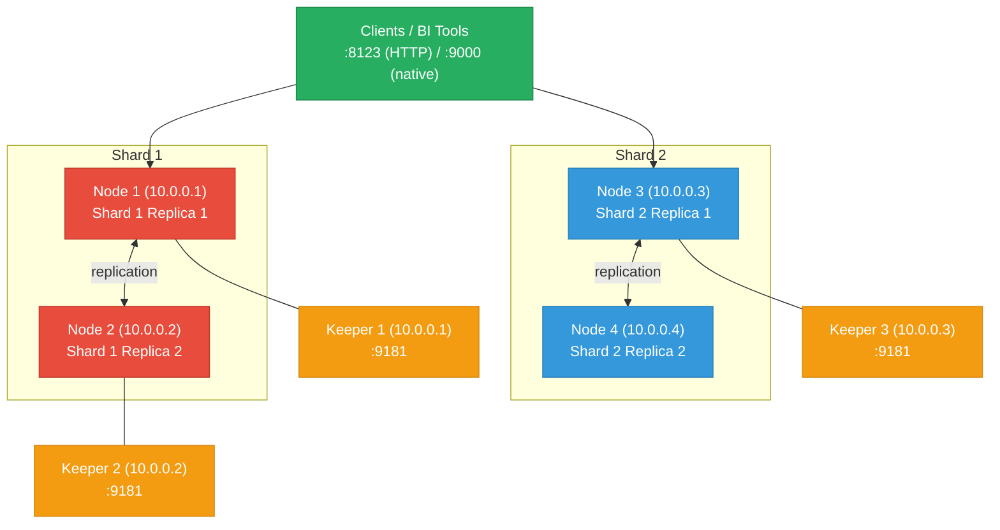

# ClickHouse — VM Cluster Setup

Two-shard, two-replica ClickHouse cluster on bare-metal VMs: ClickHouse Keeper for coordination, ReplicatedMergeTree table engine, distributed tables, tiered storage, and backup strategies using both native backup and `clickhouse-backup`.

<div class="quiz-progress" data-quiz-progress>
  <span class="quiz-progress-label">0/0 checks</span>
  <span class="quiz-progress-bar"><span class="quiz-progress-fill"></span></span>
</div>

---

## Cluster Architecture



**ClickHouse Keeper vs ZooKeeper:** ClickHouse Keeper is a built-in ZooKeeper-compatible coordination service included in ClickHouse binaries. For new deployments, prefer Keeper — it eliminates the separate ZooKeeper process, is written in C++ (lower latency), and supports the same protocol. ZooKeeper remains supported for existing setups.

---

## 1. Prerequisites

Ubuntu 22.04 / RHEL 9 on all nodes. ClickHouse ships its own dependencies — no Java or separate runtime required.

```bash
# OS tuning — apply on all nodes
cat > /etc/sysctl.d/99-clickhouse.conf <<'EOF'
vm.swappiness=1
net.core.rmem_max=134217728
net.core.wmem_max=134217728
net.ipv4.tcp_rmem=4096 87380 134217728
net.ipv4.tcp_wmem=4096 65536 134217728
fs.file-max=1000000
EOF
sysctl --system

# File limits
cat >> /etc/security/limits.conf <<'EOF'
clickhouse  soft  nofile  1000000
clickhouse  hard  nofile  1000000
EOF

# Disable transparent huge pages (THP causes latency spikes)
echo never > /sys/kernel/mm/transparent_hugepage/enabled
echo never > /sys/kernel/mm/transparent_hugepage/defrag
cat >> /etc/rc.local <<'EOF'
echo never > /sys/kernel/mm/transparent_hugepage/enabled
echo never > /sys/kernel/mm/transparent_hugepage/defrag
EOF
```

**Disable transparent huge pages:** THP coalesces 4 KB pages into 2 MB pages in the background. This background compaction causes latency spikes (measured in tens of milliseconds) when ClickHouse is under query load. ClickHouse manages its own memory layout and does not benefit from THP.

Install ClickHouse on all nodes:

<div class="tab-group">
  <div class="tab-buttons">
    <button data-tab="ch-ubuntu" class="active">Ubuntu / Debian</button>
    <button data-tab="ch-rhel">RHEL / Rocky</button>
  </div>
  <div class="tab-panels">
    <div class="tab-panel active" data-tab-panel="ch-ubuntu">

```bash
apt-get install -y apt-transport-https ca-certificates curl gnupg
curl -fsSL 'https://packages.clickhouse.com/rpm/lts/repodata/repomd.xml.key' | gpg --dearmor -o /usr/share/keyrings/clickhouse-keyring.gpg
echo "deb [signed-by=/usr/share/keyrings/clickhouse-keyring.gpg arch=amd64,arm64] https://packages.clickhouse.com/deb lts main" > /etc/apt/sources.list.d/clickhouse.list
apt-get update
apt-get install -y clickhouse-server clickhouse-client
systemctl enable clickhouse-server
```

    </div>
    <div class="tab-panel" data-tab-panel="ch-rhel">

```bash
yum install -y yum-utils
yum-config-manager --add-repo https://packages.clickhouse.com/rpm/clickhouse.repo
yum install -y clickhouse-server clickhouse-client
systemctl enable clickhouse-server
```

    </div>
  </div>
</div>

---

## 2. Firewall Rules

ClickHouse uses ports 8123 (HTTP), 9000 (native TCP), 9009 (interserver replication), and 9181 (Keeper).

<div class="tab-group">
  <div class="tab-buttons">
    <button data-tab="fw-ufw" class="active">ufw</button>
    <button data-tab="fw-firewalld">firewalld</button>
    <button data-tab="fw-iptables">iptables</button>
  </div>
  <div class="tab-panels">
    <div class="tab-panel active" data-tab-panel="fw-ufw">

```bash
# On every node — allow all cluster nodes
for PEER in 10.0.0.1 10.0.0.2 10.0.0.3 10.0.0.4; do
  ufw allow from $PEER to any port 8123 proto tcp comment "CH HTTP"
  ufw allow from $PEER to any port 9000 proto tcp comment "CH native"
  ufw allow from $PEER to any port 9009 proto tcp comment "CH interserver"
  ufw allow from $PEER to any port 9181 proto tcp comment "CH Keeper"
  ufw allow from $PEER to any port 9234 proto tcp comment "CH Keeper raft"
done
# Clients on HTTP/native
ufw allow from 10.0.1.0/24 to any port 8123 proto tcp comment "CH clients HTTP"
ufw allow from 10.0.1.0/24 to any port 9000 proto tcp comment "CH clients native"
ufw reload
```

    </div>
    <div class="tab-panel" data-tab-panel="fw-firewalld">

```bash
for PEER in 10.0.0.1/32 10.0.0.2/32 10.0.0.3/32 10.0.0.4/32; do
  for PORT in 8123 9000 9009 9181 9234; do
    firewall-cmd --permanent --add-rich-rule="rule family=ipv4 source address=$PEER port protocol=tcp port=$PORT accept"
  done
done
firewall-cmd --reload
```

    </div>
    <div class="tab-panel" data-tab-panel="fw-iptables">

```bash
for PEER in 10.0.0.1 10.0.0.2 10.0.0.3 10.0.0.4; do
  for PORT in 8123 9000 9009 9181 9234; do
    iptables -A INPUT -s $PEER/32 -p tcp --dport $PORT -j ACCEPT
  done
done
iptables-save > /etc/iptables/rules.v4
```

    </div>
  </div>
</div>

```bash
# Verify before starting services
nc -zv 10.0.0.2 9000   # native port reachable from node-1
```

---

## 3. Directory Layout

```
/etc/clickhouse-server/
  ├── config.xml              ← main server config
  ├── users.xml               ← user/role definitions
  └── config.d/               ← override snippets (preferred over editing config.xml)
      ├── cluster.xml         ← shard/replica topology
      ├── keeper.xml          ← ClickHouse Keeper settings
      └── storage.xml         ← tiered storage policies

/var/lib/clickhouse/
  ├── data/                   ← table data (MergeTree parts)
  ├── metadata/               ← table DDL metadata
  ├── store/                  ← atomic table storage (CH 22.x+)
  └── keeper/                 ← Keeper state (if co-located)

/var/log/clickhouse-server/   ← query logs, error logs
```

**Use `config.d/` for overrides:** Never edit `config.xml` or `users.xml` directly — package upgrades overwrite them. Drop XML snippets into `config.d/` and `users.d/` instead; ClickHouse merges them at startup and on `SYSTEM RELOAD CONFIG`.

---

## 4. Cluster Configuration

`/etc/clickhouse-server/config.d/cluster.xml` — same on all nodes:

```xml
<clickhouse>
  <remote_servers>
    <prod_cluster>
      <shard>
        <weight>1</weight>
        <internal_replication>true</internal_replication>
        <replica>
          <host>10.0.0.1</host>
          <port>9000</port>
        </replica>
        <replica>
          <host>10.0.0.2</host>
          <port>9000</port>
        </replica>
      </shard>
      <shard>
        <weight>1</weight>
        <internal_replication>true</internal_replication>
        <replica>
          <host>10.0.0.3</host>
          <port>9000</port>
        </replica>
        <replica>
          <host>10.0.0.4</host>
          <port>9000</port>
        </replica>
      </shard>
    </prod_cluster>
  </remote_servers>

  <!-- ZooKeeper/Keeper connection for ReplicatedMergeTree -->
  <zookeeper>
    <node>
      <host>10.0.0.1</host>
      <port>9181</port>
    </node>
    <node>
      <host>10.0.0.2</host>
      <port>9181</port>
    </node>
    <node>
      <host>10.0.0.3</host>
      <port>9181</port>
    </node>
  </zookeeper>

  <!-- Per-node macros — change per node -->
  <macros>
    <cluster>prod_cluster</cluster>
    <shard>01</shard>     <!-- 01 on nodes 1-2, 02 on nodes 3-4 -->
    <replica>01</replica> <!-- 01 on nodes 1,3; 02 on nodes 2,4 -->
  </macros>
</clickhouse>
```

**Macros are per-node:** The `<macros>` block in `cluster.xml` must differ per node — `{shard}` and `{replica}` are substituted into `ReplicatedMergeTree` paths. Copy the config, edit macros before starting ClickHouse on each node.

---

## 5. ClickHouse Keeper Setup

`/etc/clickhouse-server/config.d/keeper.xml` — run Keeper on nodes 1, 2, 3 (3-node quorum):

```xml
<clickhouse>
  <keeper_server>
    <tcp_port>9181</tcp_port>
    <server_id>1</server_id>  <!-- 1 on node-1, 2 on node-2, 3 on node-3 -->
    <log_storage_path>/var/lib/clickhouse/keeper/log</log_storage_path>
    <snapshot_storage_path>/var/lib/clickhouse/keeper/snapshots</snapshot_storage_path>

    <coordination_settings>
      <operation_timeout_ms>10000</operation_timeout_ms>
      <session_timeout_ms>30000</session_timeout_ms>
      <raft_logs_level>warning</raft_logs_level>
    </coordination_settings>

    <raft_configuration>
      <server>
        <id>1</id>
        <hostname>10.0.0.1</hostname>
        <port>9234</port>
      </server>
      <server>
        <id>2</id>
        <hostname>10.0.0.2</hostname>
        <port>9234</port>
      </server>
      <server>
        <id>3</id>
        <hostname>10.0.0.3</hostname>
        <port>9234</port>
      </server>
    </raft_configuration>
  </keeper_server>
</clickhouse>
```

---

## 6. ReplicatedMergeTree Tables

Create replicated and distributed tables:

```sql
-- Connect to any node as default user
clickhouse-client --host 10.0.0.1

-- Create ReplicatedMergeTree on EACH replica (run on all 4 nodes)
-- {shard} and {replica} macros resolve per-node automatically
CREATE TABLE events_local ON CLUSTER prod_cluster (
    event_date  Date,
    event_time  DateTime,
    user_id     UInt64,
    event_type  LowCardinality(String),
    payload     String
)
ENGINE = ReplicatedMergeTree(
    '/clickhouse/tables/{shard}/events',  -- ZooKeeper path (shard-unique)
    '{replica}'                            -- replica name (replica-unique)
)
PARTITION BY toYYYYMM(event_date)
ORDER BY (event_type, user_id, event_time)
SETTINGS index_granularity = 8192;

-- Create Distributed table (query router — lives on all nodes)
CREATE TABLE events ON CLUSTER prod_cluster
AS events_local
ENGINE = Distributed(prod_cluster, default, events_local, rand());
```

**Write to Distributed, read from Distributed:** Inserts into `events` (Distributed) fan out to shards automatically. Reads from `events` query all shards and merge results. Writing to `events_local` directly bypasses sharding — do this only for direct replica management.

---

## 7. Tiered Storage

Store hot data on NVMe, cold data on HDD or object storage:

`/etc/clickhouse-server/config.d/storage.xml`:

```xml
<clickhouse>
  <storage_configuration>
    <disks>
      <hot_disk>
        <type>local</type>
        <path>/data/clickhouse-hot/</path>
      </hot_disk>
      <cold_disk>
        <type>local</type>
        <path>/data/clickhouse-cold/</path>
      </cold_disk>
      <!-- Optional: S3 object storage -->
      <s3_disk>
        <type>s3</type>
        <endpoint>https://s3.amazonaws.com/my-ch-bucket/data/</endpoint>
        <access_key_id>AKID...</access_key_id>
        <secret_access_key>SECRET...</secret_access_key>
      </s3_disk>
    </disks>

    <policies>
      <tiered>
        <volumes>
          <hot>
            <disk>hot_disk</disk>
            <max_data_part_size_bytes>10737418240</max_data_part_size_bytes> <!-- 10 GB -->
          </hot>
          <cold>
            <disk>cold_disk</disk>
          </cold>
        </volumes>
        <move_factor>0.2</move_factor>
      </tiered>
    </policies>
  </storage_configuration>
</clickhouse>
```

Apply to a table:

```sql
ALTER TABLE events_local ON CLUSTER prod_cluster
  MODIFY SETTING storage_policy = 'tiered';
```

---

## 8. Backup

<div class="tab-group">
  <div class="tab-buttons">
    <button data-tab="bk-native" class="active">Native BACKUP</button>
    <button data-tab="bk-tool">clickhouse-backup</button>
  </div>
  <div class="tab-panels">
    <div class="tab-panel active" data-tab-panel="bk-native">

ClickHouse 22.4+ includes native `BACKUP TO` / `RESTORE FROM`:

```sql
-- Backup all tables to S3
BACKUP DATABASE default TO S3('https://s3.amazonaws.com/my-ch-backups/backup-2024-01-01/', 'AKID', 'SECRET');

-- Backup specific table
BACKUP TABLE default.events_local TO S3('https://s3.amazonaws.com/my-ch-backups/events-2024-01-01/', 'AKID', 'SECRET');

-- Restore
RESTORE DATABASE default FROM S3('https://s3.amazonaws.com/my-ch-backups/backup-2024-01-01/', 'AKID', 'SECRET');
```

Run BACKUP on each replica independently — replicas have the same data but backups are not coordinated across nodes automatically.

    </div>
    <div class="tab-panel" data-tab-panel="bk-tool">

`clickhouse-backup` is a popular open-source tool with incremental support and cloud storage integration:

```bash
# Install
wget https://github.com/Altinity/clickhouse-backup/releases/latest/download/clickhouse-backup-linux-amd64.tar.gz
tar -xzf clickhouse-backup-linux-amd64.tar.gz -C /usr/local/bin/

# Configure /etc/clickhouse-backup/config.yml
cat > /etc/clickhouse-backup/config.yml <<'EOF'
general:
  remote_storage: s3
  backups_to_keep_local: 3
  backups_to_keep_remote: 14
clickhouse:
  host: localhost
  port: 9000
  username: default
  password: ""
s3:
  bucket: my-ch-backups
  region: us-east-1
  access_key: AKID
  secret_key: SECRET
  path: clickhouse/
  compression_level: 1
EOF

# Create and upload backup
clickhouse-backup create my-backup-$(date +%F)
clickhouse-backup upload my-backup-$(date +%F)

# List remote backups
clickhouse-backup list remote

# Restore
clickhouse-backup download my-backup-2024-01-01
clickhouse-backup restore my-backup-2024-01-01
```

    </div>
  </div>
</div>

---

## 9. Monitoring

Key system tables and queries for operational monitoring:

```sql
-- Active queries
SELECT query_id, user, elapsed, read_rows, query
FROM system.processes
ORDER BY elapsed DESC;

-- Replication lag per table
SELECT database, table, is_leader, absolute_delay, total_replicas, active_replicas
FROM system.replicas
WHERE absolute_delay > 100
ORDER BY absolute_delay DESC;

-- Recent errors
SELECT event_time, logger_name, message
FROM system.text_log
WHERE level IN ('Error', 'Fatal')
  AND event_time > now() - INTERVAL 1 HOUR
ORDER BY event_time DESC
LIMIT 50;

-- Disk usage per table
SELECT database, table, formatReadableSize(sum(bytes_on_disk)) AS size
FROM system.parts
WHERE active = 1
GROUP BY database, table
ORDER BY sum(bytes_on_disk) DESC;
```

Key metrics to alert on:

| Metric | Source | Alert |
|--------|--------|-------|
| Replication lag | `system.replicas.absolute_delay` | > 300 seconds |
| ZooKeeper errors | `system.events WHERE event='ZooKeeperUserExceptions'` | > 0 |
| Merge mutations stuck | `system.mutations WHERE is_done=0` | count growing |
| Failed inserts | `system.metrics WHERE metric='FailedInsertQuery'` | > 0 |

---

## 10. Setup Checklist

- [ ] THP (transparent huge pages) disabled on all nodes
- [ ] `vm.swappiness=1` applied
- [ ] Open file limit set to 1,000,000 for `clickhouse` user
- [ ] Dedicated disk mounted for hot data (`/data/clickhouse-hot/`)
- [ ] ClickHouse installed via official Altinity or ClickHouse APT/YUM repo
- [ ] Firewall rules open: 8123, 9000, 9009, 9181, 9234 between all nodes
- [ ] `config.d/cluster.xml` deployed with correct shard/replica topology
- [ ] `config.d/keeper.xml` deployed on Keeper nodes (nodes 1–3)
- [ ] `<macros>` block set correctly per-node (`{shard}` and `{replica}` differ)
- [ ] ClickHouse started on all nodes; Keeper quorum formed
- [ ] Keeper quorum verified: `echo ruok | nc localhost 9181` returns `imok`
- [ ] `events_local` ReplicatedMergeTree created on all 4 nodes via `ON CLUSTER`
- [ ] `events` Distributed table created on all nodes via `ON CLUSTER`
- [ ] Replication working: insert via Distributed, verify on replica via local table
- [ ] `system.replicas` shows `is_leader` true on one replica per shard
- [ ] `absolute_delay = 0` for all replicas in `system.replicas`
- [ ] Tiered storage policy configured (hot/cold disks or S3 cold tier)
- [ ] Backup strategy configured: native BACKUP or clickhouse-backup
- [ ] Test backup created and restore verified in staging
- [ ] Monitoring query for replication lag set up in alerting system
- [ ] `system.text_log` error rate alert configured

---

<div class="quiz-card">
  <p class="quiz-q">A ClickHouse replica is showing `absolute_delay = 450` seconds in `system.replicas`. What does this mean, and what are the two most common causes?</p>
  <button class="quiz-reveal">Reveal answer</button>
  <div class="quiz-a" hidden>`absolute_delay = 450` means this replica is 450 seconds behind the leader — it has not yet applied mutations or parts that were committed 7.5 minutes ago. This is dangerous for reads: queries against this replica return stale data. The two most common causes: (1) Keeper/ZooKeeper connectivity issues — the replica cannot fetch replication queue entries; check `system.zookeeper` and Keeper logs. (2) I/O saturation on the replica disk — merges and replication writes compete; the replica falls behind under write load. Fix: check `system.merges` for long-running merges, add more disk bandwidth, or reduce `background_pool_size` to free I/O for replication.</div>
</div>

<div class="quiz-card">
  <p class="quiz-q">You run `INSERT INTO events VALUES (...)` (the Distributed table). How does ClickHouse decide which shard receives the row, and what happens if that shard's leader is temporarily unavailable?</p>
  <button class="quiz-reveal">Reveal answer</button>
  <div class="quiz-a" hidden>The Distributed engine uses the sharding expression — in this setup, `rand()` — to pick a shard for each inserted row. With `rand()`, rows are distributed randomly across shards on each insert. If the selected shard's node is unavailable, ClickHouse buffers the insert in a local spool directory (`/var/lib/clickhouse/data/default/events/`) and retries asynchronously. This is the Distributed table's async insert mode — the INSERT returns success to the client immediately, but data delivery to the shard is deferred. Configure `distributed_directory_monitor_sleep_time_ms` and `max_spool_size` to control retry behavior and prevent unbounded spool growth during extended outages.</div>
</div>
