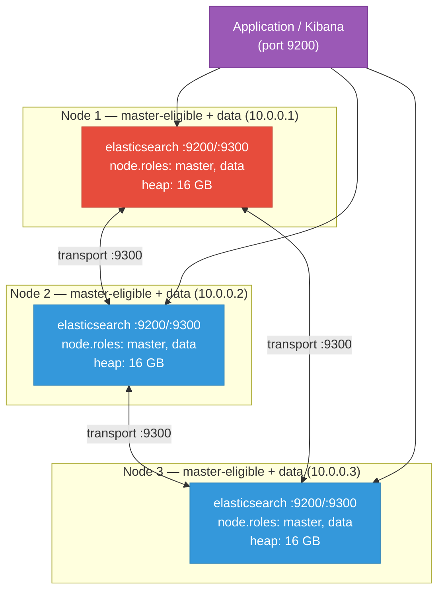

# Elasticsearch — VM Cluster Setup

Three-node Elasticsearch cluster on bare-metal VMs: node roles, heap sizing, shard strategy, Index Lifecycle Management, snapshot repository, and Prometheus monitoring via the JVM exporter.

<div class="quiz-progress" data-quiz-progress>
  <span class="quiz-progress-label">0/0 checks</span>
  <span class="quiz-progress-bar"><span class="quiz-progress-fill"></span></span>
</div>

---

## Cluster Architecture



**Combined master+data nodes on small clusters:** Three master-eligible nodes guarantee quorum (2 of 3) on node loss. Co-locating data roles avoids needing dedicated master nodes on small clusters. For clusters > 10 nodes or > 500 GB data, dedicate 3 master-only nodes (no data role) to protect cluster state management from data-node I/O load.

---

## 1. Prerequisites

Ubuntu 22.04 / RHEL 9 on all three nodes. Elasticsearch requires Java 17 (bundled in the package).

```bash
# Disable swap — Elasticsearch treats any swap as a fatal config error
swapoff -a
sed -i '/ swap / s/^/#/' /etc/fstab   # persist across reboots

# OS tuning
cat > /etc/sysctl.d/99-elasticsearch.conf <<'EOF'
vm.swappiness=1
vm.max_map_count=262144      # required by Elasticsearch; default 65530 causes bootstrap check failure
fs.file-max=1000000
net.core.somaxconn=65535
EOF
sysctl --system

# File and process limits
cat >> /etc/security/limits.conf <<'EOF'
elasticsearch  soft  nofile  1000000
elasticsearch  hard  nofile  1000000
elasticsearch  soft  nproc   4096
elasticsearch  hard  nproc   4096
EOF
```

**`vm.max_map_count` is mandatory:** Elasticsearch uses memory-mapped files for Lucene indexes. The OS default of 65,530 virtual memory areas is far too low. Elasticsearch performs a bootstrap check and refuses to start if this is below 262,144. Set it before installing.

Install Elasticsearch on all three nodes:

<div class="tab-group">
  <div class="tab-buttons">
    <button data-tab="es-ubuntu" class="active">Ubuntu / Debian</button>
    <button data-tab="es-rhel">RHEL / Rocky</button>
  </div>
  <div class="tab-panels">
    <div class="tab-panel active" data-tab-panel="es-ubuntu">

```bash
wget -qO - https://artifacts.elastic.co/GPG-KEY-elasticsearch | gpg --dearmor -o /usr/share/keyrings/elasticsearch-keyring.gpg
echo "deb [signed-by=/usr/share/keyrings/elasticsearch-keyring.gpg] https://artifacts.elastic.co/packages/8.x/apt stable main" \
  > /etc/apt/sources.list.d/elastic-8.x.list
apt-get update
apt-get install -y elasticsearch
systemctl enable elasticsearch
```

    </div>
    <div class="tab-panel" data-tab-panel="es-rhel">

```bash
rpm --import https://artifacts.elastic.co/GPG-KEY-elasticsearch
cat > /etc/yum.repos.d/elasticsearch.repo <<'EOF'
[elasticsearch]
name=Elasticsearch repository for 8.x packages
baseurl=https://artifacts.elastic.co/packages/8.x/yum
gpgcheck=1
gpgkey=https://artifacts.elastic.co/GPG-KEY-elasticsearch
enabled=1
autorefresh=1
type=rpm-md
EOF
yum install -y elasticsearch
systemctl enable elasticsearch
```

    </div>
  </div>
</div>

---

## 2. Firewall Rules

Nodes communicate on port 9300 (transport). Clients use port 9200 (HTTP).

<div class="tab-group">
  <div class="tab-buttons">
    <button data-tab="fw-ufw" class="active">ufw</button>
    <button data-tab="fw-firewalld">firewalld</button>
    <button data-tab="fw-iptables">iptables</button>
  </div>
  <div class="tab-panels">
    <div class="tab-panel active" data-tab-panel="fw-ufw">

```bash
# On every node — allow peer nodes on transport and HTTP
for PEER in 10.0.0.1 10.0.0.2 10.0.0.3; do
  ufw allow from $PEER to any port 9200 proto tcp comment "ES HTTP"
  ufw allow from $PEER to any port 9300 proto tcp comment "ES transport"
done
# Allow application servers on HTTP only (restrict IPs in production)
ufw allow from 10.0.1.0/24 to any port 9200 proto tcp comment "ES clients"
ufw reload
```

    </div>
    <div class="tab-panel" data-tab-panel="fw-firewalld">

```bash
for PEER in 10.0.0.1/32 10.0.0.2/32 10.0.0.3/32; do
  for PORT in 9200 9300; do
    firewall-cmd --permanent --add-rich-rule="rule family=ipv4 source address=$PEER port protocol=tcp port=$PORT accept"
  done
done
firewall-cmd --reload
```

    </div>
    <div class="tab-panel" data-tab-panel="fw-iptables">

```bash
for PEER in 10.0.0.1 10.0.0.2 10.0.0.3; do
  iptables -A INPUT -s $PEER/32 -p tcp --dport 9200 -j ACCEPT
  iptables -A INPUT -s $PEER/32 -p tcp --dport 9300 -j ACCEPT
done
iptables-save > /etc/iptables/rules.v4
```

    </div>
  </div>
</div>

```bash
# Verify connectivity before starting Elasticsearch
nc -zv 10.0.0.2 9300   # from node-1; expect: Connection succeeded
```

---

## 3. Directory Layout

```
/etc/elasticsearch/
  ├── elasticsearch.yml       ← cluster/node configuration
  ├── jvm.options             ← heap size, GC flags
  └── jvm.options.d/          ← override files (heap.options)

/var/lib/elasticsearch/       ← data directory (elasticsearch:elasticsearch 750)
/var/log/elasticsearch/       ← log files
/var/log/elasticsearch/gc.log ← GC log (rotate via jvm.options)
```

**Data directory on a dedicated disk:** Mount a dedicated disk at `/var/lib/elasticsearch`. Lucene segment merges are I/O-intensive; sharing a disk with the OS or logs causes unpredictable latency spikes.

```bash
# Example: mount dedicated disk
mkfs.ext4 /dev/sdb
echo '/dev/sdb /var/lib/elasticsearch ext4 defaults,noatime 0 2' >> /etc/fstab
mount -a
chown -R elasticsearch:elasticsearch /var/lib/elasticsearch
```

---

## 4. Cluster Configuration

`/etc/elasticsearch/elasticsearch.yml` — set per node, changing only `node.name` and `network.host`:

```yaml
cluster.name: prod-search

# --- Node identity (change per node) ---
node.name: es-node-1              # es-node-1, es-node-2, es-node-3
node.roles: [master, data]        # all nodes are master-eligible + data

# --- Networking ---
network.host: 10.0.0.1            # this node's IP (change per node)
http.port: 9200
transport.port: 9300

# --- Discovery (same on all nodes) ---
discovery.seed_hosts:
  - 10.0.0.1
  - 10.0.0.2
  - 10.0.0.3
cluster.initial_master_nodes:
  - es-node-1
  - es-node-2
  - es-node-3

# --- Security (production requires TLS) ---
xpack.security.enabled: true
xpack.security.transport.ssl.enabled: true
xpack.security.transport.ssl.verification_mode: certificate
xpack.security.transport.ssl.keystore.path: elastic-certificates.p12
xpack.security.transport.ssl.truststore.path: elastic-certificates.p12

# --- Data path ---
path.data: /var/lib/elasticsearch
path.logs: /var/log/elasticsearch

# --- Performance ---
indices.memory.index_buffer_size: 30%
```

**`cluster.initial_master_nodes` is one-time:** This setting is used only for the very first cluster bootstrap. Remove it from config after the cluster has formed — leaving it in can cause split-brain on restart. Document this in your runbook.

---

## 5. JVM Heap Sizing

Create `/etc/elasticsearch/jvm.options.d/heap.options` (overrides defaults cleanly):

```bash
# 50% of RAM, max 31 GB (never exceed 32 GB — pointer compression breaks above ~32 GB heap)
# For 32 GB RAM nodes:
cat > /etc/elasticsearch/jvm.options.d/heap.options <<'EOF'
-Xms16g
-Xmx16g
EOF
```

**The 32 GB JVM ceiling:** Java uses compressed ordinary object pointers (CompressedOops) when heap ≤ ~32 GB, halving memory references for objects. Above 32 GB, CompressedOops is disabled and object overhead increases — effective usable memory for the same heap size drops. Setting heap to 31 GB leaves room for OS page cache and avoids the CompressedOops cliff. Elasticsearch's official documentation mandates `Xms = Xmx` and heap ≤ 50% of RAM.

---

## 6. Node Startup and Cluster Bootstrap

<div class="stepper">
  <div class="stepper-panels">
    <div class="stepper-panel active">

**Step 1. Generate TLS certificates (node 1 only)**

```bash
# On node-1 only
/usr/share/elasticsearch/bin/elasticsearch-certutil ca --out /etc/elasticsearch/elastic-ca.p12 --pass ""
/usr/share/elasticsearch/bin/elasticsearch-certutil cert \
  --ca /etc/elasticsearch/elastic-ca.p12 --ca-pass "" \
  --out /etc/elasticsearch/elastic-certificates.p12 --pass ""

# Copy certificates to nodes 2 and 3
scp /etc/elasticsearch/elastic-certificates.p12 root@10.0.0.2:/etc/elasticsearch/
scp /etc/elasticsearch/elastic-certificates.p12 root@10.0.0.3:/etc/elasticsearch/
chown elasticsearch:elasticsearch /etc/elasticsearch/elastic-certificates.p12
chmod 660 /etc/elasticsearch/elastic-certificates.p12
```

    </div>
    <div class="stepper-panel">

**Step 2. Start Elasticsearch on all 3 nodes**

```bash
systemctl start elasticsearch
journalctl -u elasticsearch -f
# Watch for: "elected-as-master" on one node, "master node changed" on others
```

    </div>
    <div class="stepper-panel">

**Step 3. Set elastic user password**

```bash
# On any one node (once cluster is green)
/usr/share/elasticsearch/bin/elasticsearch-setup-passwords auto
# Save the generated passwords; elastic user is the superuser
```

    </div>
    <div class="stepper-panel">

**Step 4. Verify cluster health**

```bash
curl -u elastic:PASSWORD https://10.0.0.1:9200/_cluster/health?pretty -k
# "status": "green" — all shards assigned
# "number_of_nodes": 3
# "active_primary_shards": X, "active_shards": X
```

    </div>
    <div class="stepper-panel">

**Step 5. Remove `cluster.initial_master_nodes` from config**

Edit `/etc/elasticsearch/elasticsearch.yml` on all 3 nodes and remove the `cluster.initial_master_nodes` block. Reload (not restart) is not possible for this setting — note it in your runbook but leave for the next planned maintenance restart.

    </div>
  </div>
  <div class="stepper-controls">
    <button class="stepper-prev">← Prev</button>
    <span class="stepper-dots"></span>
    <span class="stepper-label"></span>
    <button class="stepper-next">Next →</button>
  </div>
</div>

---

## 7. Shard Strategy

Shard sizing rules of thumb:

| Metric | Guideline |
|--------|-----------|
| Shard size | 10–50 GB per shard (aim for 30 GB) |
| Shards per node | Keep total shards/node < 1000 (ES 8.x default limit) |
| Primary shards | Set at index creation; cannot change without reindex |
| Replica shards | Can change at any time: `PUT /my-index/_settings {"number_of_replicas": 1}` |

```bash
# Create an index with explicit shard settings
curl -u elastic:PASSWORD -X PUT https://10.0.0.1:9200/logs-2024-01 -k \
  -H 'Content-Type: application/json' -d '{
    "settings": {
      "number_of_shards": 3,
      "number_of_replicas": 1,
      "index.routing.allocation.total_shards_per_node": 2
    }
  }'
```

**Over-sharding is the #1 Elasticsearch performance mistake.** Each shard is a Lucene index with its own file handles, memory overhead, and merge threads. A 100 GB index with 100 shards (1 GB each) performs worse than one with 3 shards (33 GB each). Start with fewer shards; you can always split or reindex later.

---

## 8. Index Lifecycle Management (ILM)

ILM automates hot → warm → cold → delete transitions:

```bash
# Create ILM policy
curl -u elastic:PASSWORD -X PUT https://10.0.0.1:9200/_ilm/policy/logs-policy -k \
  -H 'Content-Type: application/json' -d '{
    "policy": {
      "phases": {
        "hot": {
          "min_age": "0ms",
          "actions": {
            "rollover": {"max_size": "50gb", "max_age": "1d"},
            "set_priority": {"priority": 100}
          }
        },
        "warm": {
          "min_age": "7d",
          "actions": {
            "shrink": {"number_of_shards": 1},
            "forcemerge": {"max_num_segments": 1},
            "set_priority": {"priority": 50}
          }
        },
        "cold": {
          "min_age": "30d",
          "actions": {
            "freeze": {},
            "set_priority": {"priority": 0}
          }
        },
        "delete": {"min_age": "90d", "actions": {"delete": {}}}
      }
    }
  }'
```

---

## 9. Snapshot Repository

Configure S3-compatible snapshot storage (works with AWS S3, GCS via plugin, or MinIO):

```bash
# Install S3 repository plugin
/usr/share/elasticsearch/bin/elasticsearch-plugin install repository-s3

# Add credentials to keystore (on all nodes)
/usr/share/elasticsearch/bin/elasticsearch-keystore add s3.client.default.access_key
/usr/share/elasticsearch/bin/elasticsearch-keystore add s3.client.default.secret_key

# Register the repository
curl -u elastic:PASSWORD -X PUT https://10.0.0.1:9200/_snapshot/my-s3-repo -k \
  -H 'Content-Type: application/json' -d '{
    "type": "s3",
    "settings": {
      "bucket": "my-es-snapshots",
      "region": "us-east-1",
      "compress": true
    }
  }'

# Take a manual snapshot
curl -u elastic:PASSWORD -X PUT https://10.0.0.1:9200/_snapshot/my-s3-repo/snapshot-$(date +%F) -k \
  -H 'Content-Type: application/json' -d '{"indices": "*", "include_global_state": true}'

# List snapshots
curl -u elastic:PASSWORD https://10.0.0.1:9200/_snapshot/my-s3-repo/_all?pretty -k
```

---

## 10. Setup Checklist

- [ ] Swap disabled (`swapoff -a` and commented out in `/etc/fstab`)
- [ ] `vm.max_map_count=262144` set in sysctl (Elasticsearch bootstrap check)
- [ ] `vm.swappiness=1` applied
- [ ] Open file limit set to 1,000,000 for `elasticsearch` user
- [ ] Dedicated disk mounted at `/var/lib/elasticsearch`
- [ ] Elasticsearch installed via official Elastic APT/YUM repo
- [ ] Firewall rules open: 9200 and 9300 between all cluster nodes
- [ ] TLS certificates generated and distributed to all nodes
- [ ] `elasticsearch.yml` configured per-node: `node.name`, `network.host`
- [ ] `discovery.seed_hosts` lists all 3 node IPs
- [ ] `cluster.initial_master_nodes` lists all 3 node names
- [ ] JVM heap set to 50% of RAM, max 31 GB (`Xms = Xmx`)
- [ ] Elasticsearch started on all 3 nodes; cluster is `green`
- [ ] `elastic` user password set via `elasticsearch-setup-passwords`
- [ ] `cluster.initial_master_nodes` removed from config after bootstrap
- [ ] Cluster health returns `green` with `number_of_nodes: 3`
- [ ] ILM policy created for log index lifecycle management
- [ ] S3 snapshot repository registered and test snapshot taken
- [ ] Shards per node count under 1000 (current: use `_cat/shards?v`)
- [ ] Prometheus JVM metrics scrape configured (port 9200 `/_prometheus/metrics` via plugin or exporter)

---

<div class="quiz-card">
  <p class="quiz-q">Elasticsearch cluster health is `yellow`. `_cluster/health` shows `active_shards: 10` and `unassigned_shards: 5`. What is the most likely cause, and how do you diagnose it?</p>
  <button class="quiz-reveal">Reveal answer</button>
  <div class="quiz-a" hidden>Yellow means all primary shards are assigned but some replica shards are not. With `unassigned_shards: 5` on a 3-node cluster, the likely cause is that replica shards cannot be placed because there aren't enough nodes (a replica cannot be on the same node as its primary by default). Diagnose with `GET /_cluster/allocation/explain` — it returns the exact reason for the first unassigned shard. Common causes: not enough nodes for the configured `number_of_replicas`, disk watermark exceeded (ES won't assign shards when disk > 85% full by default), or shard allocation filtering rules.</div>
</div>

<div class="quiz-card">
  <p class="quiz-q">You set the JVM heap to 40 GB on a node with 64 GB RAM. What are the two specific problems this causes?</p>
  <button class="quiz-reveal">Reveal answer</button>
  <div class="quiz-a" hidden>(1) CompressedOops disabled: Above ~32 GB heap, the JVM disables compressed object pointers. Object references double in size from 4 to 8 bytes, increasing overhead for every object in memory — Elasticsearch's internal data structures bloat, and effective heap capacity for useful data is lower than a 31 GB heap with CompressedOops enabled. (2) Insufficient page cache: With 40 GB heap on a 64 GB node, only 24 GB remains for OS page cache. Elasticsearch's read performance depends on the page cache serving Lucene segment reads without disk I/O. Starving the page cache forces every read to hit disk, which increases query latency dramatically. The correct setting for a 64 GB node is 31 GB heap (`-Xms31g -Xmx31g`).</div>
</div>
