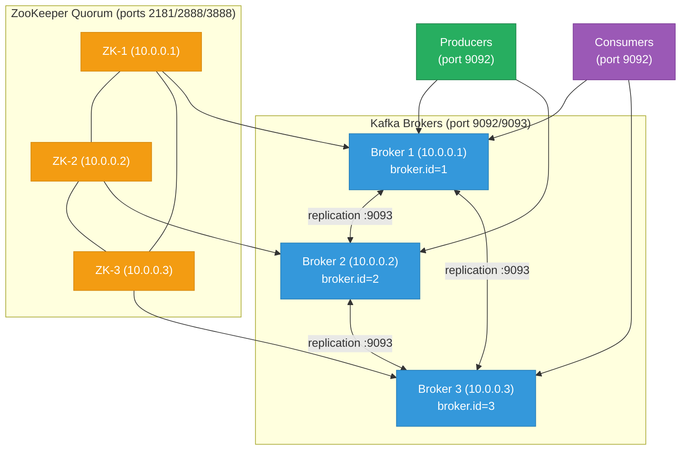

# Apache Kafka — VM Cluster Setup

Three-broker Kafka cluster on bare-metal VMs: ZooKeeper quorum, broker configuration, topic management, producer/consumer tuning, JVM G1GC, JMX Prometheus monitoring, and MirrorMaker 2 for cross-datacenter replication.

<div class="quiz-progress" data-quiz-progress>
  <span class="quiz-progress-label">0/0 checks</span>
  <span class="quiz-progress-bar"><span class="quiz-progress-fill"></span></span>
</div>

---

## Cluster Architecture



**Why co-locate ZooKeeper with brokers on small clusters:** For a 3-node cluster, running ZooKeeper on the same VMs avoids needing 3 additional hosts. Ensure ZooKeeper data is on a separate disk from Kafka log data to prevent I/O contention. For clusters > 10 brokers, dedicated ZooKeeper hosts are recommended.

**KRaft note:** Kafka 3.3+ supports KRaft mode (ZooKeeper-less). For new clusters on Kafka ≥ 3.6, prefer KRaft — it eliminates the ZooKeeper dependency and reduces operational complexity. This guide covers both modes.

---

## 1. Prerequisites

Ubuntu 22.04 / Debian 12 on all three VMs. Java 17 (LTS) is required.

```bash
# Install Java 17 (all brokers)
apt-get update
apt-get install -y openjdk-17-jdk-headless

# Verify
java -version
# openjdk 17.x.x

# Create kafka user (no login shell)
useradd -r -s /sbin/nologin kafka

# Download Kafka (adjust version as needed)
KAFKA_VERSION=3.7.0
SCALA_VERSION=2.13
wget https://downloads.apache.org/kafka/${KAFKA_VERSION}/kafka_${SCALA_VERSION}-${KAFKA_VERSION}.tgz
tar -xzf kafka_${SCALA_VERSION}-${KAFKA_VERSION}.tgz -C /opt/
ln -s /opt/kafka_${SCALA_VERSION}-${KAFKA_VERSION} /opt/kafka
chown -R kafka:kafka /opt/kafka

# Create data directories (use a dedicated disk for kafka-logs)
mkdir -p /data/kafka-logs /data/zookeeper
chown -R kafka:kafka /data/kafka-logs /data/zookeeper
```

OS tuning — apply on all nodes before starting any services:

```bash
# /etc/sysctl.d/99-kafka.conf
cat > /etc/sysctl.d/99-kafka.conf <<'EOF'
# Kafka relies heavily on the OS page cache for throughput
vm.swappiness = 1
net.core.rmem_max = 134217728
net.core.wmem_max = 134217728
net.ipv4.tcp_rmem = 4096 65536 134217728
net.ipv4.tcp_wmem = 4096 65536 134217728
net.ipv4.tcp_slow_start_after_idle = 0
fs.file-max = 1000000
EOF
sysctl --system

# Increase open file limits
cat >> /etc/security/limits.conf <<'EOF'
kafka  soft  nofile  1000000
kafka  hard  nofile  1000000
EOF
```

**Page cache is Kafka's buffer:** Kafka producers write to the OS page cache; the OS flushes to disk asynchronously. Consumers read from the page cache if the data is recent (zero-copy path via `sendfile()`). `vm.swappiness=1` avoids evicting the page cache to swap, which would collapse throughput.

---

## 2. Firewall Rules

Open ports between all cluster nodes. Clients only need port 9092.

<div class="tab-group">
  <div class="tab-buttons">
    <button data-tab="fw-ufw" class="active">ufw</button>
    <button data-tab="fw-firewalld">firewalld</button>
    <button data-tab="fw-iptables">iptables</button>
  </div>
  <div class="tab-panels">
    <div class="tab-panel active" data-tab-panel="fw-ufw">

```bash
# On every broker — allow all 3 nodes to reach ZK and broker ports
for PEER in 10.0.0.1 10.0.0.2 10.0.0.3; do
  ufw allow from $PEER to any port 9092 proto tcp comment "Kafka client"
  ufw allow from $PEER to any port 9093 proto tcp comment "Kafka replication"
  ufw allow from $PEER to any port 2181 proto tcp comment "ZooKeeper client"
  ufw allow from $PEER to any port 2888 proto tcp comment "ZooKeeper follower"
  ufw allow from $PEER to any port 3888 proto tcp comment "ZooKeeper election"
done
ufw reload
```

    </div>
    <div class="tab-panel" data-tab-panel="fw-firewalld">

```bash
# On every broker
for PEER in 10.0.0.1/32 10.0.0.2/32 10.0.0.3/32; do
  for PORT in 9092 9093 2181 2888 3888; do
    firewall-cmd --permanent --add-rich-rule="rule family=ipv4 source address=$PEER port protocol=tcp port=$PORT accept"
  done
done
firewall-cmd --reload
```

    </div>
    <div class="tab-panel" data-tab-panel="fw-iptables">

```bash
# On every broker
for PEER in 10.0.0.1 10.0.0.2 10.0.0.3; do
  for PORT in 9092 9093 2181 2888 3888; do
    iptables -A INPUT -s $PEER/32 -p tcp --dport $PORT -j ACCEPT
  done
done
iptables-save > /etc/iptables/rules.v4
```

    </div>
  </div>
</div>

**Connection check — verify before continuing:**

```bash
# From broker-2: check ZooKeeper on broker-1
nc -zv 10.0.0.1 2181
# From broker-2: check Kafka listener on broker-1
nc -zv 10.0.0.1 9092
```

---

## 3. ZooKeeper Configuration

Each ZK node needs its own `myid` file and a shared `zoo.cfg`:

```bash
# On broker-1: myid = 1
echo 1 > /data/zookeeper/myid
# On broker-2: myid = 2
echo 2 > /data/zookeeper/myid
# On broker-3: myid = 3
echo 3 > /data/zookeeper/myid
```

`/opt/kafka/config/zookeeper.properties` (same file on all nodes):

```properties
tickTime=2000
initLimit=10
syncLimit=5
dataDir=/data/zookeeper
clientPort=2181
maxClientCnxns=0
autopurge.snapRetainCount=3
autopurge.purgeInterval=24

# Quorum peers
server.1=10.0.0.1:2888:3888
server.2=10.0.0.2:2888:3888
server.3=10.0.0.3:2888:3888
```

Systemd unit for ZooKeeper (`/etc/systemd/system/zookeeper.service`):

```ini
[Unit]
Description=Apache ZooKeeper
After=network.target

[Service]
Type=simple
User=kafka
ExecStart=/opt/kafka/bin/zookeeper-server-start.sh /opt/kafka/config/zookeeper.properties
ExecStop=/opt/kafka/bin/zookeeper-server-stop.sh
Restart=on-failure
RestartSec=10
LimitNOFILE=1000000

[Install]
WantedBy=multi-user.target
```

```bash
systemctl daemon-reload
systemctl enable --now zookeeper

# Verify quorum formed (on any node)
echo ruok | nc localhost 2181   # should return: imok
echo mntr | nc localhost 2181 | grep zk_server_state
# Should show: leader on one node, follower on the others
```

---

## 4. Broker Configuration

`/opt/kafka/config/server.properties` — key settings per broker:

```properties
# --- Identity (change per broker) ---
broker.id=1                             # 1, 2, 3 on respective nodes
advertised.listeners=PLAINTEXT://10.0.0.1:9092   # this broker's IP

# --- Listeners ---
listeners=PLAINTEXT://:9092,REPLICATION://:9093
listener.security.protocol.map=PLAINTEXT:PLAINTEXT,REPLICATION:PLAINTEXT
inter.broker.listener.name=REPLICATION

# --- ZooKeeper ---
zookeeper.connect=10.0.0.1:2181,10.0.0.2:2181,10.0.0.3:2181
zookeeper.connection.timeout.ms=18000

# --- Log storage ---
log.dirs=/data/kafka-logs
num.recovery.threads.per.data.dir=4

# --- Replication defaults ---
default.replication.factor=3
min.insync.replicas=2
offsets.topic.replication.factor=3
transaction.state.log.replication.factor=3
transaction.state.log.min.isr=2

# --- Log retention ---
log.retention.hours=168          # 7 days
log.segment.bytes=1073741824     # 1 GB per segment
log.retention.check.interval.ms=300000

# --- Performance ---
num.network.threads=8
num.io.threads=16
socket.send.buffer.bytes=102400
socket.receive.buffer.bytes=102400
socket.request.max.bytes=104857600
```

Systemd unit for Kafka broker (`/etc/systemd/system/kafka.service`):

```ini
[Unit]
Description=Apache Kafka Broker
After=zookeeper.service

[Service]
Type=simple
User=kafka
Environment="KAFKA_HEAP_OPTS=-Xms6g -Xmx6g"
Environment="KAFKA_JVM_PERFORMANCE_OPTS=-server -XX:+UseG1GC -XX:MaxGCPauseMillis=20 -XX:InitiatingHeapOccupancyPercent=35"
ExecStart=/opt/kafka/bin/kafka-server-start.sh /opt/kafka/config/server.properties
ExecStop=/opt/kafka/bin/kafka-server-stop.sh
Restart=on-failure
RestartSec=10
LimitNOFILE=1000000

[Install]
WantedBy=multi-user.target
```

```bash
systemctl daemon-reload
systemctl enable --now kafka

# Verify all 3 brokers registered with ZooKeeper
/opt/kafka/bin/kafka-broker-api-versions.sh --bootstrap-server 10.0.0.1:9092 | grep "id:"
# Should show brokers 1, 2, 3
```

**JVM heap sizing rule:** Set `Xms = Xmx` to avoid heap resize pauses. For a broker with 32 GB RAM: use 6–8 GB for heap, leave the rest for the OS page cache. The page cache is more valuable than a large heap for Kafka throughput.

---

## 5. KRaft Mode (Alternative — Kafka 3.3+)

KRaft replaces ZooKeeper with a built-in Raft consensus layer. Simpler to operate; no ZK processes to manage.

```bash
# Generate a cluster UUID (once, shared across all nodes)
CLUSTER_UUID=$(/opt/kafka/bin/kafka-storage.sh random-uuid)
echo "Cluster UUID: $CLUSTER_UUID"

# Format storage on each node (same UUID, different node ID)
/opt/kafka/bin/kafka-storage.sh format \
  -t "$CLUSTER_UUID" \
  -c /opt/kafka/config/kraft/server.properties
```

`/opt/kafka/config/kraft/server.properties` (per-node, change `node.id`):

```properties
process.roles=broker,controller
node.id=1                          # 1, 2, 3 per node
controller.quorum.voters=1@10.0.0.1:9093,2@10.0.0.2:9093,3@10.0.0.3:9093

listeners=PLAINTEXT://:9092,CONTROLLER://:9093
advertised.listeners=PLAINTEXT://10.0.0.1:9092
inter.broker.listener.name=PLAINTEXT
controller.listener.names=CONTROLLER

log.dirs=/data/kafka-logs
```

---

## 6. Topic Management

```bash
# Create a topic: 12 partitions, replication factor 3
/opt/kafka/bin/kafka-topics.sh --bootstrap-server 10.0.0.1:9092 \
  --create --topic events \
  --partitions 12 \
  --replication-factor 3 \
  --config retention.ms=604800000 \
  --config min.insync.replicas=2

# List topics
/opt/kafka/bin/kafka-topics.sh --bootstrap-server 10.0.0.1:9092 --list

# Describe topic (shows partition leaders and ISR)
/opt/kafka/bin/kafka-topics.sh --bootstrap-server 10.0.0.1:9092 \
  --describe --topic events

# Alter retention
/opt/kafka/bin/kafka-configs.sh --bootstrap-server 10.0.0.1:9092 \
  --entity-type topics --entity-name events \
  --alter --add-config retention.ms=86400000
```

**Partition count planning:** Partitions = max parallelism for consumers in the same group. Rule of thumb: partitions = target consumer count × 2. More partitions increase end-to-end latency slightly (more leader election work) and use more file descriptors (each partition = 1 file per segment). Don't over-partition; 12–100 partitions per topic covers most use cases.

---

## 7. Producer / Consumer Tuning

Key producer configs for throughput vs. latency tradeoff:

```properties
# High-throughput producer
acks=all                         # wait for all ISR replicas (durability)
retries=2147483647
enable.idempotence=true
max.in.flight.requests.per.connection=5
batch.size=65536                 # 64 KB batches
linger.ms=5                     # wait up to 5ms to fill batch
compression.type=lz4             # fast compression, reduces network
buffer.memory=67108864           # 64 MB client buffer
```

Consumer configs:

```properties
# Balanced consumer
group.id=my-consumer-group
auto.offset.reset=earliest
enable.auto.commit=false         # manual commit for exactly-once semantics
max.poll.records=500
fetch.min.bytes=1048576          # 1 MB minimum fetch (reduces round-trips)
fetch.max.wait.ms=500
```

---

## 8. JMX Prometheus Monitoring

Enable JMX export and scrape with Prometheus:

```bash
# Download JMX Prometheus Java Agent
wget https://repo1.maven.org/maven2/io/prometheus/jmx/jmx_prometheus_javaagent/0.20.0/jmx_prometheus_javaagent-0.20.0.jar \
  -O /opt/kafka/libs/jmx_prometheus_javaagent.jar

# Kafka JMX config (/opt/kafka/config/kafka-jmx.yml)
cat > /opt/kafka/config/kafka-jmx.yml <<'EOF'
lowercaseOutputName: true
rules:
  - pattern: kafka.server<type=BrokerTopicMetrics, name=(.+), topic=(.+)><>OneMinuteRate
    name: kafka_server_broker_topic_metrics_$1_rate
    labels:
      topic: "$2"
  - pattern: kafka.server<type=ReplicaManager, name=(.+)><>Value
    name: kafka_server_replica_manager_$1
  - pattern: kafka.controller<type=KafkaController, name=(.+)><>Value
    name: kafka_controller_$1
EOF
```

Update Kafka systemd to include the agent:

```ini
Environment="KAFKA_OPTS=-javaagent:/opt/kafka/libs/jmx_prometheus_javaagent.jar=7071:/opt/kafka/config/kafka-jmx.yml"
```

Key metrics to alert on:

| Metric | Alert threshold |
|--------|----------------|
| `kafka_server_replica_manager_UnderReplicatedPartitions` | > 0 for 5 min |
| `kafka_controller_ActiveControllerCount` | != 1 |
| `kafka_server_broker_topic_metrics_MessagesIn_rate` | sudden drop |
| `kafka_server_replica_manager_IsrShrinksPerSec` | > 0 |

---

## 9. MirrorMaker 2 — Cross-Datacenter Replication

MirrorMaker 2 (MM2) replicates topics between clusters for disaster recovery:

```properties
# /opt/kafka/config/mm2.properties
clusters=primary, dr

primary.bootstrap.servers=10.0.0.1:9092,10.0.0.2:9092,10.0.0.3:9092
dr.bootstrap.servers=10.1.0.1:9092,10.1.0.2:9092,10.1.0.3:9092

primary->dr.enabled=true
primary->dr.topics=.*           # replicate all topics
primary->dr.groups=.*           # replicate all consumer groups

replication.factor=3
sync.group.offsets.enabled=true  # sync consumer group offsets
emit.heartbeats.enabled=true
```

```bash
# Start MM2 as a Connect cluster
/opt/kafka/bin/connect-mirror-maker.sh /opt/kafka/config/mm2.properties
```

Replicated topics appear in DR with prefix `primary.events` (the source cluster alias is prepended). Consumer group offsets are translated and synced so a DR failover requires only pointing consumers at the DR bootstrap servers.

---

## 10. Broker Startup Sequence

<div class="stepper">
  <div class="stepper-panels">
    <div class="stepper-panel active">

**Step 1. Start ZooKeeper on all 3 nodes**

Start ZooKeeper simultaneously on all nodes. ZooKeeper cannot form a quorum until a majority (2 of 3) are up. Verify with `echo ruok | nc localhost 2181` on each.

    </div>
    <div class="stepper-panel">

**Step 2. Verify ZooKeeper quorum**

```bash
echo mntr | nc localhost 2181 | grep zk_server_state
```
One node should report `leader`, two should report `follower`. If all three show `leader` or errors, check `myid` files and `server.X` lines in `zoo.cfg`.

    </div>
    <div class="stepper-panel">

**Step 3. Start Kafka brokers**

Start Kafka on all 3 nodes. Brokers register with ZooKeeper and elect a controller (one broker becomes cluster controller).

```bash
systemctl start kafka
journalctl -u kafka -f   # watch logs; look for "started (kafka.server.KafkaServer)"
```

    </div>
    <div class="stepper-panel">

**Step 4. Verify broker registration**

```bash
/opt/kafka/bin/kafka-broker-api-versions.sh \
  --bootstrap-server 10.0.0.1:9092 | grep "id:"
# Expected: id: 1, id: 2, id: 3
```

    </div>
    <div class="stepper-panel">

**Step 5. Create a test topic and verify replication**

```bash
/opt/kafka/bin/kafka-topics.sh --bootstrap-server 10.0.0.1:9092 \
  --create --topic smoke-test --partitions 3 --replication-factor 3

/opt/kafka/bin/kafka-topics.sh --bootstrap-server 10.0.0.1:9092 \
  --describe --topic smoke-test
# ISR should show [1,2,3] for all partitions
```

    </div>
  </div>
  <div class="stepper-controls">
    <button class="stepper-prev">← Prev</button>
    <span class="stepper-dots"></span>
    <span class="stepper-label"></span>
    <button class="stepper-next">Next →</button>
  </div>
</div>

---

## 11. Setup Checklist

- [ ] Java 17 installed and verified on all 3 nodes
- [ ] `kafka` OS user created (no login shell)
- [ ] Kafka downloaded and extracted to `/opt/kafka`
- [ ] Dedicated disk mounted for `/data/kafka-logs`
- [ ] `/data/zookeeper` on separate disk from Kafka logs
- [ ] OS sysctl tuning applied (`vm.swappiness=1`, TCP buffer sizes)
- [ ] Open file limit set to 1,000,000 for `kafka` user
- [ ] Firewall rules open: 9092, 9093, 2181, 2888, 3888 between all nodes
- [ ] `myid` file written correctly on each ZK node (1, 2, 3)
- [ ] `zoo.cfg` lists all 3 `server.X=` entries with correct IPs
- [ ] ZooKeeper quorum verified (`echo ruok | nc localhost 2181`)
- [ ] `server.properties` has correct `broker.id` per node
- [ ] `advertised.listeners` set to this node's routable IP
- [ ] `default.replication.factor=3` and `min.insync.replicas=2` set
- [ ] Kafka broker registered in ZooKeeper (broker-api-versions check)
- [ ] Test topic created with RF=3 and ISR=[1,2,3] on all partitions
- [ ] JMX Prometheus agent configured and scraping on port 7071
- [ ] `UnderReplicatedPartitions` alert configured in Prometheus
- [ ] `ActiveControllerCount != 1` alert configured
- [ ] MirrorMaker 2 configured for DR cluster (if applicable)

---

<div class="quiz-card">
  <p class="quiz-q">A Kafka broker is restarted. After it comes back up, some partitions show ISR=[1,3] instead of ISR=[1,2,3] (broker 2 just restarted). Producers configured with `acks=all` are failing with `NotEnoughReplicas`. What is happening and how do you fix it?</p>
  <button class="quiz-reveal">Reveal answer</button>
  <div class="quiz-a" hidden>The restarting broker (2) needs time to catch up on the partitions it leads or follows — it must replicate all missed messages before it re-joins the ISR. Meanwhile, `min.insync.replicas=2` requires at least 2 in-sync replicas for `acks=all` writes. With ISR=[1,3] (size 2), writes should still succeed if both 1 and 3 are in ISR. If ISR=[1] only, writes block until another replica catches up. The fix: wait for broker 2 to finish log recovery and rejoin ISR (monitor `kafka_server_replica_manager_UnderReplicatedPartitions`). Do not lower `min.insync.replicas` in production as a quick fix — that trades durability for availability permanently.</div>
</div>

<div class="quiz-card">
  <p class="quiz-q">You have a Kafka topic with 3 partitions and 5 consumers in the same consumer group. How many consumers are actively consuming, and why?</p>
  <button class="quiz-reveal">Reveal answer</button>
  <div class="quiz-a" hidden>Only 3 consumers are active — one per partition. In Kafka, each partition is assigned to exactly one consumer within a consumer group at any time. The remaining 2 consumers are idle (they joined the group but have no partition assignment). This is a waste. The fix is to increase the partition count to match or exceed the consumer count. Alternatively, use separate consumer groups for different processing workloads — groups are independent and each group gets its own full copy of the partition assignment.</div>
</div>
