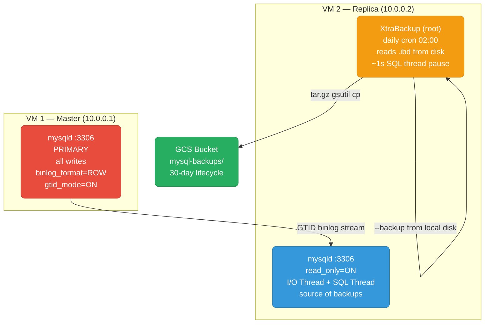

# MySQL Master/Replica — VM Cluster Setup

Two VMs: one **Master** (all writes) and one **Replica** (hot-standby + backup source). This guide walks every step from bare OS to a production-ready GTID-replicated cluster with XtraBackup daily backups — firewall rules, `my.cnf`, replication bootstrap, hot backup, restore runbook, GCS upload, and Prometheus monitoring.

<div class="quiz-progress" data-quiz-progress>
  <span class="quiz-progress-label">0/0 checks</span>
  <span class="quiz-progress-bar"><span class="quiz-progress-fill"></span></span>
</div>

---

## Cluster Architecture



**Why backup from replica, not master:** XtraBackup reads `.ibd` files directly from disk — it's sequential I/O-heavy. Running it on the replica keeps that load off the master write path. The replica's datadir is structurally identical to master's (GTID replication applies the same transactions in the same order). Master writes are never blocked — `--safe-slave-backup` pauses the replica SQL thread for ~1 second only; the I/O thread keeps running.

---

## 1. Prerequisites

On both VMs (Ubuntu 22.04 / Debian 12; adjust for RHEL/Rocky):

```bash
# Add Percona repository
wget https://repo.percona.com/apt/percona-release_latest.generic_all.deb
dpkg -i percona-release_latest.generic_all.deb
percona-release setup pdps-8.0
apt-get update

# Install MySQL 8.0
apt-get install -y percona-server-8.0
systemctl enable --now mysql
```

On the **replica VM only** — install XtraBackup:

```bash
# CRITICAL: XtraBackup minor version must match MySQL minor version
# MySQL 8.0.46 → use percona-xtrabackup-80 >= 8.0.36
apt-get install -y percona-xtrabackup-80

# Verify
xtrabackup --version
# xtrabackup version 8.0.36 ...

# Pin to prevent accidental upgrade drift
apt-mark hold percona-xtrabackup-80
```

**Version pinning rule:** XtraBackup 8.0.X must back up MySQL 8.0.X (same minor family). A major InnoDB on-disk format change between minor versions can produce a silently corrupt backup that fails only at restore time. `--no-server-version-check` suppresses the version gate — it is an emergency escape hatch, never a routine flag.

| MySQL version | Required XtraBackup package |
|---------------|----------------------------|
| 8.0.x | `percona-xtrabackup-80` (≥ same minor) |
| 8.4.x | `percona-xtrabackup-84` |
| 9.x   | `percona-xtrabackup-90` |

---

## 2. Firewall Rules

Open port 3306 between master and replica. No external exposure.

<div class="tab-group">
  <div class="tab-buttons">
    <button data-tab="fw-ufw" class="active">ufw</button>
    <button data-tab="fw-firewalld">firewalld</button>
    <button data-tab="fw-iptables">iptables</button>
  </div>
  <div class="tab-panels">
    <div class="tab-panel active" data-tab-panel="fw-ufw">

```bash
# On Master — allow replica to connect
ufw allow from 10.0.0.2 to any port 3306 proto tcp comment "MySQL replica"
ufw reload

# On Replica — allow master to connect
ufw allow from 10.0.0.1 to any port 3306 proto tcp comment "MySQL master"
ufw reload
```

    </div>
    <div class="tab-panel" data-tab-panel="fw-firewalld">

```bash
# On Master
firewall-cmd --permanent --add-rich-rule='rule family="ipv4" source address="10.0.0.2/32" port protocol="tcp" port="3306" accept'
firewall-cmd --reload

# On Replica
firewall-cmd --permanent --add-rich-rule='rule family="ipv4" source address="10.0.0.1/32" port protocol="tcp" port="3306" accept'
firewall-cmd --reload
```

    </div>
    <div class="tab-panel" data-tab-panel="fw-iptables">

```bash
# On Master
iptables -A INPUT -s 10.0.0.2/32 -p tcp --dport 3306 -j ACCEPT
iptables-save > /etc/iptables/rules.v4

# On Replica
iptables -A INPUT -s 10.0.0.1/32 -p tcp --dport 3306 -j ACCEPT
iptables-save > /etc/iptables/rules.v4
```

    </div>
  </div>
</div>

**Connection check — before you continue:**

```bash
# From replica: must succeed before touching any config
nc -zv 10.0.0.1 3306
# → Connection to 10.0.0.1 3306 port [tcp/mysql] succeeded!
```

A firewall problem looks identical to a config bug and wastes hours. Always verify with `nc -zv` first.

---

## 3. Directory Layout

```
/var/lib/mysql/              ← MySQL datadir (mysql:mysql, drwx------ 700)
  ├── #innodb_redo/          ← InnoDB redo log dir (drwx------ 700, mysql:mysql)
  ├── ibdata1                ← system tablespace
  ├── mysql.ibd              ← mysql schema tablespace
  └── <database>/            ← per-database .ibd files

/backup/                     ← XtraBackup output (root:root, mode 700)
  └── mysql-backup-TIMESTAMP.tar.gz

/var/log/mysql/              ← MySQL error log
/var/log/mysql-backup.log    ← XtraBackup cron log
```

**Critical — `#innodb_redo/` is mode 700:** MySQL 8.0 creates this directory with `drwx------` owned by the `mysql` OS user. Only the owner or root can enter it. XtraBackup tails this directory during `--backup` to capture in-flight changes. **XtraBackup must run as root** — root bypasses DAC (Discretionary Access Control) on Linux and can read any directory regardless of mode bits. A non-root invocation fails with `OS error 13 (EACCES)`.

```bash
# Create backup dir on replica
mkdir -p /backup
chmod 700 /backup
# XtraBackup will run as root and write here
```

---

## 4. Master Setup — my.cnf

Create `/etc/mysql/conf.d/replication.cnf` on the **master VM**:

```ini
[mysqld]
# Identity
server-id                  = 1
bind-address               = 0.0.0.0

# Binary Log
log-bin                    = mysql-bin
binlog_format              = ROW
binlog_expire_logs_seconds = 604800   # 7-day retention

# GTID
gtid_mode                  = ON
enforce_gtid_consistency   = ON

# Durability (full sync — production default)
innodb_flush_log_at_trx_commit = 1
sync_binlog                = 1

# Performance
innodb_buffer_pool_size    = 4G       # ~70-80% of RAM
```

```bash
systemctl restart mysql
systemctl status mysql
```

Create the replication user (run on master):

```sql
CREATE USER 'replicator'@'10.0.0.2' IDENTIFIED BY '<strong-password>';
GRANT REPLICATION SLAVE ON *.* TO 'replicator'@'10.0.0.2';
FLUSH PRIVILEGES;

-- Verify GTID is active
SHOW VARIABLES LIKE 'gtid_mode';
-- +---------------+-------+
-- | Variable_name | Value |
-- +---------------+-------+
-- | gtid_mode     | ON    |
```

---

## 5. Replica Setup — my.cnf

Create `/etc/mysql/conf.d/replication.cnf` on the **replica VM**:

```ini
[mysqld]
# Identity
server-id                  = 2
bind-address               = 0.0.0.0

# Read-only (replication thread bypasses this)
read_only                  = ON
super_read_only            = ON

# Relay Log
relay-log                  = relay-bin
relay_log_purge            = ON

# Binary Log — required for --slave-info in XtraBackup
log-bin                    = mysql-bin
binlog_format              = ROW

# GTID
gtid_mode                  = ON
enforce_gtid_consistency   = ON

# Performance (relax durability on replica — 1s window acceptable)
innodb_flush_log_at_trx_commit = 2
innodb_buffer_pool_size    = 4G
```

Bootstrap replication (run on replica after seeding the datadir from master):

```sql
-- After initial datadir copy via XtraBackup --backup from master (first-time setup):
CHANGE REPLICATION SOURCE TO
  SOURCE_HOST          = '10.0.0.1',
  SOURCE_PORT          = 3306,
  SOURCE_USER          = 'replicator',
  SOURCE_PASSWORD      = '<strong-password>',
  SOURCE_AUTO_POSITION = 1;    -- GTID: no file+offset needed

START REPLICA;
```

Verification:

```sql
SHOW REPLICA STATUS\G

-- Required green lines:
-- Replica_IO_Running:     Yes   ✓
-- Replica_SQL_Running:    Yes   ✓
-- Seconds_Behind_Source:  0     ✓  (may be non-zero briefly during catch-up)
-- Last_IO_Error:                ✓  (empty)
-- Last_SQL_Error:               ✓  (empty)
-- Auto_Position:          1     ✓  (GTID mode confirmed)
```

<div class="quiz-card">
  <p class="quiz-q">The replica's SQL thread is running but <code>Seconds_Behind_Source</code> keeps climbing. The I/O thread is fine. What is the most likely cause?</p>
  <button class="quiz-reveal">Reveal answer</button>
  <div class="quiz-a" hidden>The SQL thread is applying relay log events more slowly than the I/O thread receives them. Common causes: the replica's <code>innodb_buffer_pool_size</code> is too small (cache misses on every apply), the replica is under CPU or I/O pressure from application read traffic, or a single large transaction (a bulk UPDATE or ALTER TABLE) is being replayed serially and holding the SQL thread for minutes. Check <code>SHOW PROCESSLIST</code> on the replica for the SQL thread's current state.</div>
</div>

---

## 6. XtraBackup — Hot Backup

Full backup command — run on the **replica VM as root**:

```bash
TIMESTAMP=$(date +%Y%m%d_%H%M%S)
BACKUP_DIR="/backup/${TIMESTAMP}"

xtrabackup \
  --backup \
  --datadir=/var/lib/mysql \          # read replica datadir directly from disk
  --target-dir="${BACKUP_DIR}" \
  --host=127.0.0.1 \                  # TCP to local MySQL for metadata only
  --port=3306 \
  --user=root \
  --password="${MYSQL_ROOT_PASSWORD}" \
  --slave-info \                       # write GTID position to xtrabackup_slave_info
  --safe-slave-backup                  # ~1s SQL thread pause for a clean GTID stamp
```

What happens step by step:

<div class="stepper">
  <div class="stepper-panels">
    <div class="stepper-panel active">
      <strong>1. Cron fires at 02:00.</strong> XtraBackup starts on the replica VM as root. Master is untouched.
    </div>
    <div class="stepper-panel">
      <strong>2. InnoDB .ibd files copied from disk.</strong> XtraBackup reads <code>.ibd</code> files directly — not via MySQL's buffer pool. It simultaneously tails <code>#innodb_redo/</code> to capture every change made while copying. MySQL keeps serving reads and the I/O thread keeps streaming from master.
    </div>
    <div class="stepper-panel">
      <strong>3. ~1s SQL thread pause.</strong> <code>--safe-slave-backup</code> stops the replica SQL thread briefly. The I/O thread <strong>keeps running</strong> — no gap in the relay log. Master writes are never affected.
    </div>
    <div class="stepper-panel">
      <strong>4. GTID position stamped.</strong> XtraBackup reads the current GTID set and writes it to <code>xtrabackup_slave_info</code>. This is the anchor for any future restore. SQL thread resumes.
    </div>
    <div class="stepper-panel">
      <strong>5. <code>--prepare</code> — apply redo log.</strong> The raw backup has InnoDB pages copied at different LSNs — it is not restorable as-is. <code>--prepare</code> replays the captured redo log (like crash recovery) to bring all pages to the same LSN. <strong>This step is mandatory before archiving.</strong>
    </div>
    <div class="stepper-panel">
      <strong>6. Archive to tar.gz.</strong> The prepared directory is compressed. The raw dir is removed. Archive contains <code>xtrabackup_slave_info</code> + all data files — everything needed for a full restore.
    </div>
  </div>
  <div class="stepper-controls">
    <button class="stepper-prev">← Prev</button>
    <span class="stepper-dots"></span>
    <span class="stepper-label"></span>
    <button class="stepper-next">Next →</button>
  </div>
</div>

Prepare step (run immediately after `--backup`):

```bash
# Step 5 — mandatory before archiving or restoring
xtrabackup --prepare --target-dir="${BACKUP_DIR}"
# Look for:  [Note] completed OK!
```

What `xtrabackup_slave_info` contains (the GTID anchor):

```sql
-- /backup/20261013_020000/xtrabackup_slave_info
SET GLOBAL gtid_purged='2cb72875-c6ff-11f1-b144-32898eb9db14:1-9847,
                        96a4392c-c6ff-11f1-9034-322fe87d1f59:1-5';
CHANGE MASTER TO MASTER_AUTO_POSITION=1;
-- "backup covers transactions :1-9847; master at :9921 → gap is :9848-9921"
```

<div class="quiz-card">
  <p class="quiz-q">XtraBackup's <code>--backup</code> completed OK, but you skipped <code>--prepare</code>. A disk fails a week later and you need to restore from this archive. What happens?</p>
  <button class="quiz-reveal">Reveal answer</button>
  <div class="quiz-a" hidden>The restore will appear to succeed (files are copied), but MySQL will fail to start or crash immediately after. A raw backup has InnoDB pages copied at different points in time — each page has its own LSN and they are mutually inconsistent. <code>--prepare</code> runs crash recovery against the captured redo log to bring every page to the same consistent LSN. Without it, InnoDB's startup check detects the LSN mismatch and refuses to open the datadir. Always run <code>--prepare</code> before archiving.</div>
</div>

---

## 7. Archive & Upload

```bash
ARCHIVE="/backup/mysql-backup-${TIMESTAMP}.tar.gz"
GCS_BUCKET="${GCS_BUCKET:-gs://your-org-artifacts/mysql-backups}"

# Compress the prepared backup dir
tar -czf "${ARCHIVE}" -C /backup "${TIMESTAMP}"

# Remove the uncompressed dir (archive contains everything needed)
rm -rf "${BACKUP_DIR}"

# Upload to GCS — auth via Workload Identity Federation (no key files)
gsutil cp "${ARCHIVE}" "${GCS_BUCKET}/"

# Remove local archive after confirmed upload
rm -f "${ARCHIVE}"
```

**Workload Identity Federation:** the replica VM's service account needs `storage.objects.create` on the GCS bucket. Credentials are obtained automatically from the GCE metadata server — no JSON key file needed or desired.

30-day retention lifecycle (`lifecycle.json`):

```json
{
  "lifecycle": {
    "rule": [{
      "action": { "type": "Delete" },
      "condition": { "age": 30 }
    }]
  }
}
```

```bash
gsutil lifecycle set lifecycle.json gs://your-org-artifacts/mysql-backups
```

---

## 8. Cron Setup

`/etc/cron.d/mysql-backup`:

```
# Daily MySQL XtraBackup at 02:00
0 2 * * * root /usr/local/bin/mysql-backup.sh >> /var/log/mysql-backup.log 2>&1
```

`/usr/local/bin/mysql-backup.sh`:

```bash
#!/bin/bash
set -euo pipefail

TIMESTAMP=$(date +%Y%m%d_%H%M%S)
BACKUP_DIR="/backup/${TIMESTAMP}"
ARCHIVE="/backup/mysql-backup-${TIMESTAMP}.tar.gz"
GCS_BUCKET="${GCS_BUCKET:-gs://your-org-artifacts/mysql-backups}"

echo "[$(date)] Starting backup ${TIMESTAMP}"

xtrabackup --backup \
  --datadir=/var/lib/mysql \
  --target-dir="${BACKUP_DIR}" \
  --host=127.0.0.1 --port=3306 \
  --user=root --password="${MYSQL_ROOT_PASSWORD}" \
  --slave-info --safe-slave-backup

echo "[$(date)] Preparing..."
xtrabackup --prepare --target-dir="${BACKUP_DIR}"

echo "[$(date)] Archiving..."
tar -czf "${ARCHIVE}" -C /backup "${TIMESTAMP}"
rm -rf "${BACKUP_DIR}"

echo "[$(date)] Uploading to GCS..."
gsutil cp "${ARCHIVE}" "${GCS_BUCKET}/"
rm -f "${ARCHIVE}"

echo "[$(date)] Backup complete: mysql-backup-${TIMESTAMP}.tar.gz"
```

```bash
chmod +x /usr/local/bin/mysql-backup.sh

# Test run before enabling cron
/usr/local/bin/mysql-backup.sh
```

Log rotation `/etc/logrotate.d/mysql-backup`:

```
/var/log/mysql-backup.log {
    daily
    rotate 14
    compress
    missingok
    notifempty
}
```

---

## 9. Restore Runbook

Used when the replica is lost or a point-in-time restore to a clean host is needed.

<div class="stepper">
  <div class="stepper-panels">
    <div class="stepper-panel active">
      <strong>1. Download the archive from GCS.</strong>
      <br><code>gsutil cp gs://your-org-artifacts/mysql-backups/mysql-backup-TIMESTAMP.tar.gz /tmp/</code>
    </div>
    <div class="stepper-panel">
      <strong>2. Extract.</strong>
<pre><code>mkdir -p /tmp/xb-restore
tar -xzf /tmp/mysql-backup-TIMESTAMP.tar.gz -C /tmp/xb-restore/
# The extracted dir was already --prepared before archiving.
# Do NOT run --prepare again.</code></pre>
    </div>
    <div class="stepper-panel">
      <strong>3. Read the GTID position</strong> before touching any datadir.
<pre><code>cat /tmp/xb-restore/TIMESTAMP/xtrabackup_slave_info
# SET GLOBAL gtid_purged='master-uuid:1-9847,...';
# This is the gap: :9848 onward must come from master's binlog.</code></pre>
    </div>
    <div class="stepper-panel">
      <strong>4. Stop MySQL and clear the target datadir.</strong>
<pre><code>systemctl stop mysql
rm -rf /var/lib/mysql/*   # must be empty for --copy-back</code></pre>
    </div>
    <div class="stepper-panel">
      <strong>5. Copy back.</strong>
<pre><code>xtrabackup --copy-back \
  --datadir=/var/lib/mysql \
  --target-dir=/tmp/xb-restore/TIMESTAMP
# [Note] completed OK!</code></pre>
    </div>
    <div class="stepper-panel">
      <strong>6. Fix ownership.</strong> XtraBackup ran as root; MySQL runs as the <code>mysql</code> OS user (uid 999 on Debian, uid 27 on RHEL/Rocky).
      <br><code>chown -R mysql:mysql /var/lib/mysql</code>
    </div>
    <div class="stepper-panel">
      <strong>7. Start MySQL.</strong>
<pre><code>systemctl start mysql
systemctl status mysql   # active (running)</code></pre>
      MySQL reads <code>mysql.gtid_executed</code> from the restored <code>mysql.ibd</code> and knows exactly which transactions it has.
    </div>
    <div class="stepper-panel">
      <strong>8. Wire replication</strong> (if restoring as a new replica).
<pre><code>RESET REPLICA ALL;   -- clears stale relay log state from restored backup

CHANGE REPLICATION SOURCE TO
  SOURCE_HOST          = '10.0.0.1',
  SOURCE_PORT          = 3306,
  SOURCE_USER          = 'replicator',
  SOURCE_PASSWORD      = '&lt;strong-password&gt;',
  SOURCE_AUTO_POSITION = 1;

START REPLICA;

-- MySQL requests only :9848 onward from master.
-- Wait ~30s for catch-up:
SHOW REPLICA STATUS\G
-- Replica_IO_Running:    Yes ✓
-- Replica_SQL_Running:   Yes ✓
-- Seconds_Behind_Source: 0   ✓</code></pre>
    </div>
  </div>
  <div class="stepper-controls">
    <button class="stepper-prev">← Prev</button>
    <span class="stepper-dots"></span>
    <span class="stepper-label"></span>
    <button class="stepper-next">Next →</button>
  </div>
</div>

<div class="quiz-card">
  <p class="quiz-q">You restored from a backup taken at 02:00. The master is now at GTID <code>:1-9921</code>; the backup captured <code>:1-9847</code>. After <code>SOURCE_AUTO_POSITION=1; START REPLICA</code>, how does the replica know exactly what to ask for?</p>
  <button class="quiz-reveal">Reveal answer</button>
  <div class="quiz-a" hidden><code>SOURCE_AUTO_POSITION=1</code> activates GTID auto-positioning. The replica sends its entire <code>gtid_executed</code> set (recovered from the backup's <code>mysql.gtid_executed</code> table inside <code>mysql.ibd</code>) to the master. The master diffs the sets and streams only the missing transactions — <code>:9848</code> through <code>:9921</code> in this case. No manual file+offset arithmetic. The gap is closed automatically.</div>
</div>

---

## 10. Permissions Gotchas

### `#innodb_redo` is mode 700

MySQL 8.0 creates `/var/lib/mysql/#innodb_redo/` with `drwx------` (mode 700) owned by the `mysql` OS user. XtraBackup must enter this directory to tail the redo log. **Root bypasses DAC on Linux** — uid 0 can enter any directory regardless of mode bits. Therefore:

**On a VM (production):** xtrabackup runs directly on the host as root. No issue.

**In Docker / dev:** The `percona/percona-xtrabackup:8.0` image runs as a non-root, non-mysql user by default. It hits `OS error 13 (EACCES)` on `#innodb_redo/`. Fix:

```yaml
# docker-compose.yml (dev only)
xtrabackup:
  image: percona/percona-xtrabackup:8.0
  user: "0"                        # root — needed to read #innodb_redo (mode 700)
  volumes:
    - replica-data:/var/lib/mysql  # no :ro — macOS VirtioFS bug below
    - ./backup:/backup
```

**macOS Docker Desktop extra trap:** Docker Desktop 4.x+ uses VirtioFS for named volumes. With `:ro` on the datadir mount, VirtioFS causes EACCES on mode-700 directories even for root inside the container. Remove `:ro` from the datadir mount — XtraBackup does not write to the datadir during `--backup`, so this is safe.

### Version pinning

```bash
# Check running versions
mysql -e "SELECT VERSION();"
xtrabackup --version

# They must be in the same major.minor family.
# Pin to prevent drift:
apt-mark hold percona-xtrabackup-80
```

<div class="quiz-card">
  <p class="quiz-q">Your XtraBackup is version 8.0.35 and MySQL is 8.0.46. Backup runs with <code>--no-server-version-check</code>. Is this safe to leave in production?</p>
  <button class="quiz-reveal">Reveal answer</button>
  <div class="quiz-a" hidden>No. <code>--no-server-version-check</code> suppresses the version gate — it does not fix the underlying incompatibility. InnoDB's on-disk format can change between minor versions. If a format change occurred between 8.0.35 and 8.0.46, the backup may appear to succeed but produce an inconsistent result that fails only at restore time — exactly when you need it most. Upgrade XtraBackup to match MySQL's minor version and remove the flag.</div>
</div>

---

## 11. Monitoring

Key Prometheus alert rules (via `mysqld_exporter`):

```yaml
groups:
  - name: mysql-replication
    rules:
      - alert: MySQLReplicationLag
        expr: mysql_slave_status_seconds_behind_master > 30
        for: 5m
        labels:
          severity: warning
        annotations:
          summary: "Replica lag {{ $value }}s on {{ $labels.instance }}"

      - alert: MySQLReplicationNotRunning
        expr: >
          mysql_slave_status_slave_io_running == 0
          OR mysql_slave_status_slave_sql_running == 0
        for: 1m
        labels:
          severity: critical
        annotations:
          summary: "Replication thread stopped on {{ $labels.instance }}"

  - name: mysql-backup
    rules:
      - alert: MySQLBackupStale
        # Push a timestamp metric from backup.sh via pushgateway or custom exporter
        expr: time() - mysql_backup_last_success_timestamp_seconds > 90000
        for: 5m
        labels:
          severity: warning
        annotations:
          summary: "MySQL backup stale on {{ $labels.instance }} (>25h)"
```

Manual checks:

```sql
-- Replication health
SHOW REPLICA STATUS\G

-- InnoDB buffer pool hit rate (alert if < 95%)
SELECT
  (1 - SUM(IF(variable_name = 'Innodb_buffer_pool_reads', variable_value, 0)) /
       SUM(IF(variable_name = 'Innodb_buffer_pool_read_requests', variable_value, 0))) * 100
  AS hit_rate_pct
FROM information_schema.global_status
WHERE variable_name IN ('Innodb_buffer_pool_reads', 'Innodb_buffer_pool_read_requests');

-- Long-running queries (potential replication lag cause)
SELECT id, user, host, db, time, state, LEFT(info, 80) AS query
FROM information_schema.processlist
WHERE command != 'Sleep' AND time > 30
ORDER BY time DESC;
```

---

## 12. Setup Checklist

- [ ] Percona repository added on both VMs
- [ ] MySQL 8.0 installed and running (`systemctl status mysql`) on both VMs
- [ ] XtraBackup installed on replica VM (version matches MySQL minor)
- [ ] `apt-mark hold percona-xtrabackup-80` set to prevent upgrade drift
- [ ] Firewall rules set: port 3306 open between VMs; verified with `nc -zv`
- [ ] `/backup` directory created on replica, mode 700, root-owned
- [ ] Master `my.cnf`: `server-id=1`, `binlog_format=ROW`, `gtid_mode=ON`, `enforce_gtid_consistency=ON`, `log-bin` present
- [ ] Replica `my.cnf`: `server-id=2`, `read_only=ON`, `log-bin` present (required for `--slave-info`), `gtid_mode=ON`
- [ ] `replicator` user created on master with `GRANT REPLICATION SLAVE`
- [ ] Replication bootstrapped: `CHANGE REPLICATION SOURCE TO SOURCE_AUTO_POSITION=1; START REPLICA;`
- [ ] `SHOW REPLICA STATUS\G` green: `Replica_IO_Running: Yes`, `Replica_SQL_Running: Yes`, `Seconds_Behind_Source: 0`
- [ ] Manual backup test: `xtrabackup --backup` + `--prepare` → both `completed OK!`
- [ ] `xtrabackup_slave_info` verified in backup dir (GTID captured)
- [ ] Archive created and GCS upload verified
- [ ] Cron job installed: `0 2 * * * root /usr/local/bin/mysql-backup.sh`
- [ ] Restore drill: `--copy-back` → `chown` → `START REPLICA` → row count matches
- [ ] Prometheus alerts wired: replication lag, I/O+SQL thread stopped, backup staleness
