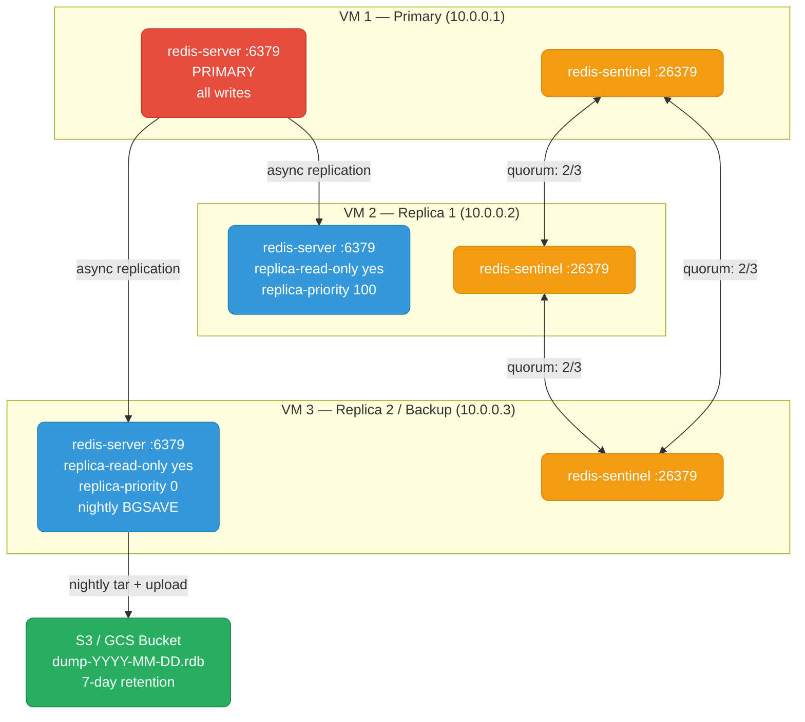

# Redis Sentinel Cluster & Backup on VMs

Production runbook: Redis primary with two replicas, three Sentinel processes for automatic failover, RDB/AOF backup via replica BGSAVE, and Prometheus monitoring — all on bare VMs.

<div class="quiz-progress" data-quiz-progress>
  <span class="quiz-progress-label">0/0 checks</span>
  <span class="quiz-progress-bar"><span class="quiz-progress-fill"></span></span>
</div>

---

## Cluster Architecture



**Why backup from a replica, not the primary:** `BGSAVE` forks the redis-server process. On a large dataset this doubles virtual memory usage momentarily and can cause a latency spike on the forked node. Running it on a dedicated replica (with `replica-priority 0` so it's never promoted) keeps that I/O off the primary write path. The replica's dataset is identical — replication applies the same commands in the same order.

---

## 1. Prerequisites

Three VMs (Ubuntu 22.04 or RHEL 9), each running one `redis-server` and one `redis-sentinel` process.

```bash
# Ubuntu 22.04
sudo apt install -y redis-server
sudo systemctl enable redis-server redis-sentinel

# RHEL 9 / Rocky Linux
sudo dnf install -y redis
sudo systemctl enable redis redis-sentinel
```

**Version:** use Redis 7.x. Redis 7.2+ has Sentinel improvements around dual-channel replication and improved failover messaging. Never mix major versions (6.x and 7.x) in the same cluster.

```bash
redis-server --version
# Redis server v=7.2.x ...
```

---

## 2. Firewall Rules

Open between **all three VMs** in both directions.

<div class="tab-group">
<div class="tab-buttons">
  <button data-tab="ufw" class="active">Ubuntu/ufw</button>
  <button data-tab="firewalld">RHEL/firewalld</button>
  <button data-tab="iptables">iptables</button>
</div>
<div class="tab-panels">
<div data-tab-content="ufw">

```bash
# Run on all 3 VMs — substitute actual peer IPs
PEER1="10.0.0.1"
PEER2="10.0.0.2"
PEER3="10.0.0.3"

for IP in $PEER1 $PEER2 $PEER3; do
  sudo ufw allow from "$IP" to any port 6379 proto tcp   # Redis
  sudo ufw allow from "$IP" to any port 26379 proto tcp  # Sentinel
done
sudo ufw reload
```

</div>
<div data-tab-content="firewalld">

```bash
# Run on all 3 VMs
for IP in 10.0.0.1 10.0.0.2 10.0.0.3; do
  sudo firewall-cmd --permanent --add-rich-rule="rule family=ipv4 source address=$IP port port=6379 protocol=tcp accept"
  sudo firewall-cmd --permanent --add-rich-rule="rule family=ipv4 source address=$IP port port=26379 protocol=tcp accept"
done
sudo firewall-cmd --reload
```

</div>
<div data-tab-content="iptables">

```bash
# Run on all 3 VMs
for IP in 10.0.0.1 10.0.0.2 10.0.0.3; do
  sudo iptables -A INPUT -s "$IP" -p tcp --dport 6379 -j ACCEPT
  sudo iptables -A INPUT -s "$IP" -p tcp --dport 26379 -j ACCEPT
done
sudo iptables-save | sudo tee /etc/iptables/rules.v4
```

</div>
</div>
</div>

Verify connectivity from each VM:

```bash
# From VM 2 and VM 3 — confirm primary is reachable
nc -zv 10.0.0.1 6379
nc -zv 10.0.0.1 26379
```

---

## 3. Primary Configuration — redis.conf

Edit `/etc/redis/redis.conf` (Ubuntu) or `/etc/redis.conf` (RHEL) on VM 1:

```conf
# Network
bind 0.0.0.0
port 6379
protected-mode no

# Auth — set on ALL nodes; primary needs masterauth for when it becomes a replica after failover
requirepass "strong-password"
masterauth "strong-password"

# Persistence — combined RDB + AOF for best durability
save 3600 1
save 300 100
save 60 10000
dbfilename dump.rdb
dir /var/lib/redis/

appendonly yes
appendfilename "appendonly.aof"
appendfsync everysec
auto-aof-rewrite-percentage 100
auto-aof-rewrite-min-size 64mb
aof-use-rdb-preamble yes        # hybrid AOF: RDB header + incremental AOF tail

# Replication
repl-backlog-size 64mb          # in-memory backlog; lets replicas reconnect without full resync
repl-diskless-sync no           # write RDB to disk before sending to replica (safer)
replica-lazy-flush no

# Logging
loglevel notice
logfile /var/log/redis/redis-server.log
```

Apply:

```bash
sudo systemctl restart redis-server
sudo redis-cli -a "strong-password" ping
# PONG
```

---

## 4. Replica Setup

On VM 2 and VM 3, the config is identical to the primary with two additions. Edit `/etc/redis/redis.conf`:

```conf
# Same as primary config above, plus:
replicaof 10.0.0.1 6379
replica-read-only yes

# replica-priority: lower = higher promotion preference; 0 = never promote
# VM 2 (hot standby): priority 100 (default)
replica-priority 100

# VM 3 (dedicated backup replica): never promote
# replica-priority 0
```

```bash
sudo systemctl restart redis-server
```

Verify replication from the primary:

```bash
redis-cli -a "strong-password" info replication
# role:master
# connected_slaves:2
# slave0:ip=10.0.0.2,port=6379,state=online,offset=...,lag=0
# slave1:ip=10.0.0.3,port=6379,state=online,offset=...,lag=0
```

<div class="quiz-card">
<p class="quiz-q"><code>replica-priority 0</code> is set on VM 3. The primary goes down. Will Sentinel ever promote this replica to primary?</p>
<button class="quiz-reveal">Reveal</button>
<div class="quiz-a" hidden>No. <code>replica-priority 0</code> is a permanent signal to Sentinel that this node should never become primary. Sentinel skips it entirely during election, regardless of how healthy or up-to-date it is. Use <code>priority 0</code> for dedicated backup replicas, cross-DC laggards, or analytics nodes where promotion would be wrong. VM 2 (priority 100) is elected instead.</div>
</div>

---

## 5. Sentinel Configuration

Each VM runs a `redis-sentinel` process alongside `redis-server`. Create `/etc/redis/sentinel.conf` on all three VMs (content is identical — Sentinel discovers peers automatically):

```conf
port 26379
daemonize yes
logfile /var/log/redis/sentinel.log
dir /tmp

# Name the primary and set quorum (2 out of 3 must agree it's down)
sentinel monitor mymaster 10.0.0.1 6379 2

sentinel auth-pass mymaster "strong-password"

# Primary must be unreachable for 10 consecutive seconds before failover
sentinel down-after-milliseconds mymaster 10000

# Failover must complete within 3 minutes
sentinel failover-timeout mymaster 180000

# After promoting a new primary, sync replicas one at a time (reduces load spike)
sentinel parallel-syncs mymaster 1
```

Start and verify:

```bash
# Start Sentinel
sudo redis-sentinel /etc/redis/sentinel.conf
# or via systemd:
sudo systemctl start redis-sentinel

# Check state from any VM
redis-cli -p 26379 sentinel masters
# Should show: name=mymaster, status=ok, slaves=2, sentinels=3
```

---

## 6. Backup — BGSAVE on the Dedicated Replica

Run all backup operations on VM 3 (`replica-priority 0`). Never run BGSAVE on the primary.

### Manual backup

```bash
# Trigger background save
redis-cli -h 10.0.0.3 -a "strong-password" BGSAVE

# Poll until complete
watch -n2 "redis-cli -h 10.0.0.3 -a 'strong-password' info persistence | grep rdb_bgsave_in_progress"
# rdb_bgsave_in_progress:0  → done

# Unix timestamp of last successful save
redis-cli -h 10.0.0.3 -a "strong-password" LASTSAVE
```

### Backup script

```bash
#!/bin/bash
# /usr/local/bin/redis-backup.sh
set -euo pipefail

REDIS_CLI="redis-cli -a strong-password"
BACKUP_DIR="/var/lib/redis/backups"
S3_BUCKET="s3://my-redis-backups"
DATE=$(date +%Y-%m-%d-%H%M)

mkdir -p "$BACKUP_DIR"

# Trigger BGSAVE and wait
$REDIS_CLI BGSAVE
until [ "$($REDIS_CLI info persistence | grep rdb_bgsave_in_progress | tr -d '\r' | cut -d: -f2)" = "0" ]; do
    sleep 2
done

# Snapshot dump.rdb (and AOF if present)
cp /var/lib/redis/dump.rdb "$BACKUP_DIR/dump-$DATE.rdb"
[ -f /var/lib/redis/appendonly.aof ] && \
    cp /var/lib/redis/appendonly.aof "$BACKUP_DIR/appendonly-$DATE.aof"

# Upload RDB to S3
aws s3 cp "$BACKUP_DIR/dump-$DATE.rdb" "$S3_BUCKET/rdb/dump-$DATE.rdb"

# Prune local copies older than 7 days
find "$BACKUP_DIR" -name "*.rdb" -o -name "*.aof" | xargs -d'\n' find -mtime +7 -delete 2>/dev/null || true

echo "Backup complete: dump-$DATE.rdb"
```

```bash
# /etc/cron.d/redis-backup
0 2 * * * redis /usr/local/bin/redis-backup.sh >> /var/log/redis/backup.log 2>&1
```

```bash
chmod +x /usr/local/bin/redis-backup.sh
# Test manually before activating cron
/usr/local/bin/redis-backup.sh
```

---

## 7. Restore from RDB

<div class="stepper">
<div class="stepper-panels">

<div class="stepper-panel">
<strong>Step 1. Download the backup</strong>
<p>Pull the latest RDB from S3 to the replacement VM.</p>
<pre><code>aws s3 cp s3://my-redis-backups/rdb/dump-2026-10-14-0200.rdb /tmp/dump.rdb</code></pre>
</div>

<div class="stepper-panel">
<strong>Step 2. Stop Redis</strong>
<p>Ensure no writes happen while you replace the data file.</p>
<pre><code>sudo systemctl stop redis-server</code></pre>
</div>

<div class="stepper-panel">
<strong>Step 3. Replace dump.rdb</strong>
<p>Copy the backup into Redis's data directory and fix ownership.</p>
<pre><code>sudo cp /tmp/dump.rdb /var/lib/redis/dump.rdb
sudo chown redis:redis /var/lib/redis/dump.rdb</code></pre>
</div>

<div class="stepper-panel">
<strong>Step 4. Handle AOF (if enabled)</strong>
<p>If <code>appendonly yes</code> is set, Redis prefers AOF over RDB on startup. Temporarily disable it so the RDB loads instead.</p>
<pre><code># If no valid AOF exists, disable before starting:
sed -i 's/^appendonly yes/appendonly no/' /etc/redis/redis.conf
# Re-enable after verifying data loaded correctly:
# sed -i 's/^appendonly no/appendonly yes/' /etc/redis/redis.conf</code></pre>
</div>

<div class="stepper-panel">
<strong>Step 5. Start Redis and verify</strong>
<p>Redis loads <code>dump.rdb</code> automatically on startup. Confirm your data is present.</p>
<pre><code>sudo systemctl start redis-server

# Confirm data count
redis-cli -a "strong-password" dbsize

# Spot-check keys
redis-cli -a "strong-password" scan 0 count 20</code></pre>
</div>

</div>
<div class="stepper-controls">
  <button class="stepper-prev">← Prev</button>
  <button class="stepper-next">Next →</button>
</div>
</div>

<div class="quiz-card">
<p class="quiz-q"><code>appendfsync always</code> is set on your Redis primary. Write latency is high. Is this expected?</p>
<button class="quiz-reveal">Reveal</button>
<div class="quiz-a" hidden>Yes. <code>appendfsync always</code> calls <code>fsync()</code> after every single write command — every SET, HSET, LPUSH blocks until the disk confirms the write. This gives the strongest durability guarantee (at most one command lost on crash) but at severe latency cost, especially on spinning disks or high-write workloads. The production default is <code>everysec</code>: one <code>fsync()</code> per second, trading at most one second of data on a crash for dramatically lower write latency. Use <code>always</code> only when every individual write must be durable (e.g. a financial ledger where Redis is the source of truth).</div>
</div>

---

## 8. Monitoring (Prometheus)

Install `redis_exporter` on each VM:

```bash
# Download from https://github.com/oliver006/redis_exporter/releases
EXPORTER_VER="1.66.0"
wget "https://github.com/oliver006/redis_exporter/releases/download/v${EXPORTER_VER}/redis_exporter-v${EXPORTER_VER}.linux-amd64.tar.gz"
tar xzf redis_exporter-*.tar.gz
sudo mv redis_exporter /usr/local/bin/

# Run (systemd unit recommended for production)
redis_exporter \
  --redis.addr=redis://localhost:6379 \
  --redis.password="strong-password" \
  --web.listen-address=":9121"
```

Alert rules:

```yaml
groups:
  - name: redis
    rules:
      - alert: RedisReplicationLagHigh
        # Replica offset more than 1 MB behind primary
        expr: |
          (redis_master_repl_offset{job="redis"} - on(instance) redis_slave_repl_offset{job="redis"}) > 1048576
        for: 2m
        annotations:
          summary: "Redis replica {{ $labels.instance }} is falling behind"

      - alert: RedisNoReplicasConnected
        expr: redis_connected_slaves{job="redis",role="master"} == 0
        for: 5m
        annotations:
          summary: "Redis master {{ $labels.instance }} has no connected replicas"

      - alert: RedisBackupStale
        # dump.rdb not written in more than 25 hours
        expr: time() - redis_rdb_last_save_timestamp_seconds{job="redis"} > 90000
        for: 10m
        annotations:
          summary: "Redis backup on {{ $labels.instance }} is stale"

      - alert: RedisMemoryHigh
        expr: redis_memory_used_bytes{job="redis"} / redis_config_maxmemory{job="redis"} > 0.8
        for: 5m
        annotations:
          summary: "Redis memory above 80% on {{ $labels.instance }}"
```

Manual health checks:

```bash
# Replication state
redis-cli -a "strong-password" info replication

# Persistence state (last save, AOF status)
redis-cli -a "strong-password" info persistence

# Memory usage
redis-cli -a "strong-password" info memory

# Sentinel view of the cluster
redis-cli -p 26379 sentinel masters
redis-cli -p 26379 sentinel slaves mymaster
```

---

## 9. Setup Checklist

- [ ] Redis 7.x installed on all 3 VMs (`redis-server --version`)
- [ ] `requirepass` and `masterauth` set to the same value on all nodes
- [ ] Primary: RDB save schedules configured, AOF enabled, `appendfsync everysec`
- [ ] VM 2 replica: `replicaof 10.0.0.1 6379`, `replica-read-only yes`, `replica-priority 100`
- [ ] VM 3 replica: `replicaof 10.0.0.1 6379`, `replica-read-only yes`, `replica-priority 0`
- [ ] Firewall: ports 6379 and 26379 open between all 3 VMs in both directions
- [ ] `redis-cli info replication` on primary shows `connected_slaves:2`
- [ ] Sentinel config on all 3 VMs: `quorum 2`, `down-after-milliseconds 10000`
- [ ] `redis-sentinel /etc/redis/sentinel.conf` running on all 3 VMs
- [ ] `redis-cli -p 26379 sentinel masters` shows `status=ok, sentinels=3`
- [ ] `/usr/local/bin/redis-backup.sh` tested manually — dump.rdb appeared in `$BACKUP_DIR`
- [ ] S3 upload verified: `aws s3 ls s3://my-redis-backups/rdb/`
- [ ] Cron job active in `/etc/cron.d/redis-backup`
- [ ] Restore from RDB tested on a shadow VM (`dbsize` matches original)
- [ ] `redis_exporter` running on all 3 VMs, scraped by Prometheus
