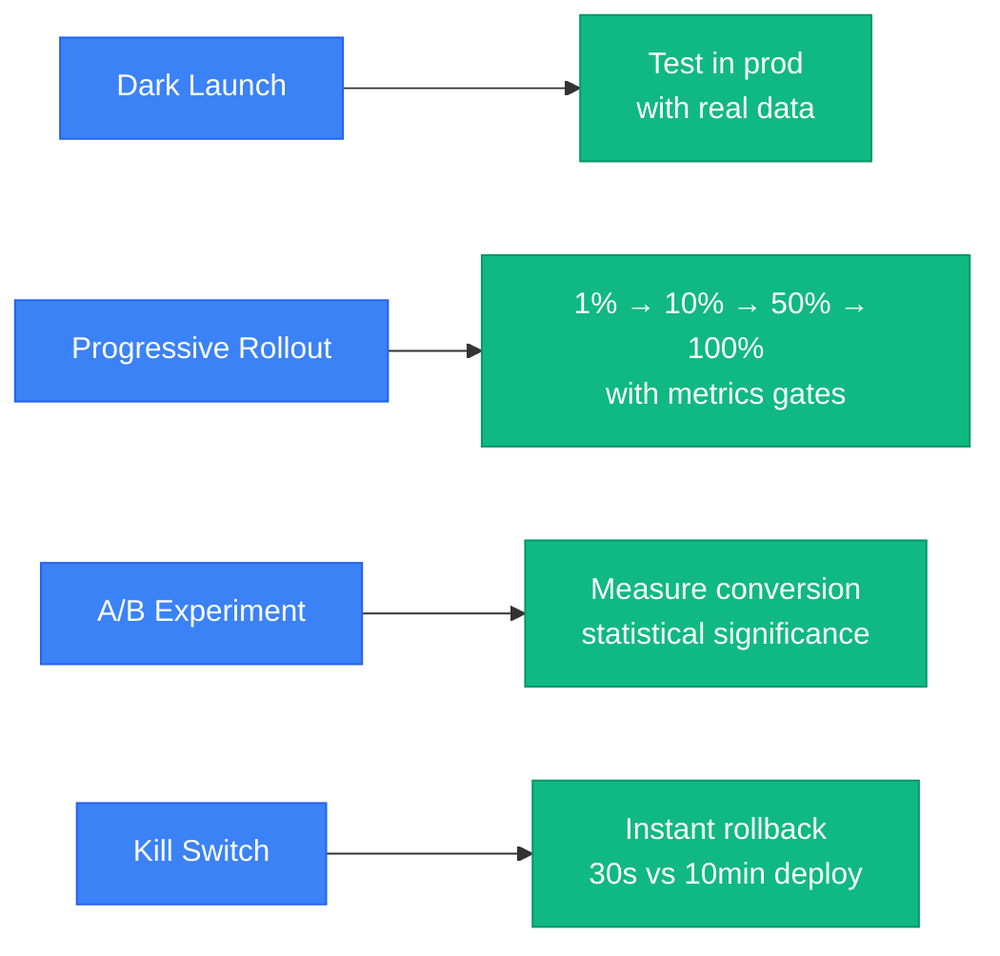
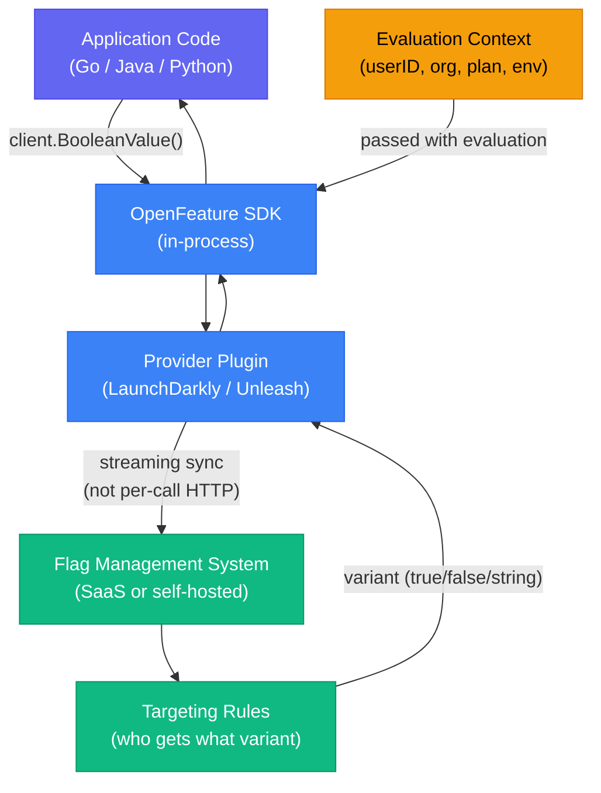

# Feature Flags

Feature flags decouple deploy from release. Code ships to production disabled; a flag enables it for specific users — without another deploy. This gives you the ability to test in production, do canary rollouts, run experiments, and have an instant kill switch for incidents.

<div class="quiz-progress" data-quiz-progress>
  <span class="quiz-progress-label">0/0 checks</span>
  <span class="quiz-progress-bar"><span class="quiz-progress-fill"></span></span>
</div>

---

## 1. Why Feature Flags

The four use cases that justify the operational overhead:



| Use case | How it works | Why it beats alternatives |
|----------|-------------|--------------------------|
| **Dark launch** | Ship code enabled only for internal users (employee IDs, beta list) | Real production load; no staging environment needed |
| **Progressive rollout** | Incrementally expand the user cohort; watch error rate / p99 at each step | Controlled blast radius; automatic rollback if metrics degrade |
| **A/B experiment** | Randomly split users; measure business metric (conversion, retention) | Statistically valid; no separate experiment infrastructure |
| **Kill switch** | Flag default = new behavior; flip to old behavior on incident | 30-second rollback vs 10-minute redeploy + propagation |

**What flags are NOT:** Feature flags are not a deployment mechanism. You still deploy code — you just enable it separately. Flags age poorly; treat them as temporary until cleaned up.

---

## 2. OpenFeature Spec

OpenFeature is the CNCF standard for feature flag SDKs. It defines a vendor-neutral interface so you can switch providers without changing application code.

```go
// Any provider — LaunchDarkly, Unleash, OpenFeature Server, in-memory mock
import "github.com/open-feature/go-sdk/pkg/openfeature"

// Wire in your provider once at startup
openfeature.SetProvider(launchdarkly.NewProvider(ldClient))

// Evaluate flags anywhere — same API regardless of backend
client := openfeature.NewClient("my-service")
enabled, _ := client.BooleanValue(
    ctx,
    "new-checkout-flow",        // flag key
    false,                       // default value
    openfeature.NewEvaluationContext(
        "user-123",              // targeting key
        map[string]interface{}{
            "plan":  "enterprise",
            "beta":  true,
        },
    ),
)
```

**Evaluation context** — the attributes passed to the provider's targeting rules. Every flag evaluation carries context; the flag system uses it to decide which variant to return.

**Flag types:** `boolean` (on/off), `string` (A/B/C variants), `number` (rate limit value, batch size), `object` (complex config as JSON).

**Why OpenFeature matters:** If you hardcode LaunchDarkly's SDK and later switch to Unleash (self-hosted for compliance), you rewrite every evaluation call. With OpenFeature, you swap the provider registration — one line.

---

## 3. Architecture



**Critical detail:** The SDK holds a local in-memory copy of all flags, synced via a persistent streaming connection to the backend. A `BooleanValue()` call is an in-memory lookup — p99 < 1ms. There is no HTTP call per flag evaluation.

---

## 4. LaunchDarkly

LaunchDarkly is the dominant SaaS flag management system.

**Go SDK setup:**

```go
import ld "github.com/launchdarkly/go-server-sdk/v6"

config := ld.Config{}
client, err := ld.MakeCustomClient(
    "sdk-your-key",
    config,
    5*time.Second,   // max wait for initial flag sync
)
defer client.Close()

// Boolean flag with targeting context
ctx := ldcontext.NewBuilder("user-123").
    SetString("plan", "enterprise").
    SetBool("beta", true).
    Build()

enabled, _ := client.BoolVariation("new-checkout-flow", ctx, false)
```

**Targeting rules (evaluated top-down, first match wins):**

```
Rule 1: if user.email ends with @company.com → TRUE
Rule 2: if user.plan == "enterprise" → TRUE
Rule 3: percentage rollout: 10% of remaining users → TRUE
Default: FALSE
```

**Experimentation:** Define a metric (click event, conversion, revenue). Assign users randomly to control/treatment. LaunchDarkly computes statistical significance and warns when results are conclusive. Requires LaunchDarkly Experimentation add-on.

**Audit log:** Every flag change records who changed it, when, and what the previous/new value was. Essential for incident postmortems ("who enabled the bad flag?").

<div class="quiz-card"><p class="quiz-q">The LaunchDarkly SDK initializes with a 5-second timeout. The flag management backend is unreachable at startup. What happens to flag evaluations?</p><button class="quiz-reveal">Reveal answer</button><div class="quiz-a" hidden>After the timeout, the SDK falls back to the default values you pass in each evaluation call (the third argument). It does not crash or block — the application starts normally, every flag returns its default. The SDK retries the backend connection in the background; when connectivity restores, flags sync and evaluations reflect real values. Always set meaningful defaults that represent the safe/old behavior.</div></div>

---

## 5. Unleash (Self-Hosted)

Unleash is the leading open-source alternative. You run it yourself.

```bash
# Helm install
helm repo add unleash https://docs.getunleash.io/helm-charts
helm install unleash unleash/unleash \
  --set postgresql.enabled=true \
  --set unleash.auth.adminPassword=changeme
```

Unleash UI runs on port 4242. Requires PostgreSQL for persistence.

**Activation strategies** — how Unleash decides who gets the flag:

| Strategy | How it works |
|----------|-------------|
| `default` | Everyone gets it (100%) |
| `userWithId` | Allowlist of specific user IDs |
| `gradualRollout` | Percentage based on `userId` hash — deterministic: same user always gets same result |
| `remoteAddress` | IP or CIDR allowlist |
| Custom strategy | Plugin in Node.js — implement `isEnabled(params, context)` |

**Variants** — multi-variate flags returning a named value with an optional payload:

```go
variant := client.GetVariant("button-color", ctx)
// variant.Name = "blue" | "green" | "red"
// variant.Payload.Value = `{"hex": "#3b82f6"}`
```

Useful for UI experiments where you want more than on/off.

**Unleash Edge** — a local caching proxy (Go binary) that sits between your services and the Unleash server. Services talk to Edge (same datacenter, sub-millisecond), Edge handles fanout to Unleash. Eliminates the backend as a latency/availability concern for flag evaluations.

```bash
# Edge runs as a sidecar or regional deployment
unleash-edge start --upstream-url https://unleash.internal:4242 \
  --port 3063
```

---

## 6. Progressive Rollout Pattern

<div class="stepper">
  <div class="stepper-panels">
    <div class="stepper-panel active">
      <strong>Step 1. 1% rollout — canary.</strong>
      <p>Enable the flag for 1% of users. Monitor for 30 minutes: error rate, p99 latency, business metric (conversion). If any metric degrades by more than 10% relative, roll back immediately (flip flag off).</p>
    </div>
    <div class="stepper-panel">
      <strong>Step 2. 10% rollout — wider validation.</strong>
      <p>Expand to 10%. Monitor for 2 hours. At this sample size you have enough traffic to detect regressions in most services. The flag system keeps the same users in the cohort (consistent hash) — no A/B contamination.</p>
    </div>
    <div class="stepper-panel">
      <strong>Step 3. 50% rollout — confirm metrics.</strong>
      <p>Expand to 50%. Monitor for 24 hours. Check business metrics (not just technical ones): checkout conversion, session length, revenue per user. A 50/50 split gives statistical power for A/B conclusions.</p>
    </div>
    <div class="stepper-panel">
      <strong>Step 4. 100% rollout → schedule flag removal.</strong>
      <p>Enable for everyone. Immediately create a ticket to remove the flag from code in the next sprint. A flag at 100% that stays in code indefinitely is technical debt — it adds a branch that can never be false in production, but still needs to be maintained.</p>
    </div>
  </div>
  <div class="stepper-controls">
    <button class="stepper-prev">← Prev</button>
    <span class="stepper-dots"></span>
    <span class="stepper-label"></span>
    <button class="stepper-next">Next →</button>
  </div>
</div>

---

## 7. Kill Switch Pattern

The kill switch is the inverse of a progressive rollout: you write the code assuming the new path is the default, and the flag reverts to old behavior.

```go
// Code the flag as "new behavior is default"
if client.BoolVariation("use-new-payment-processor", ctx, true) {
    return newPaymentProcessor.Charge(amount)
}
// Kill switch: flag OFF → old processor
return legacyPaymentProcessor.Charge(amount)
```

**On incident:**
1. Ops person opens flag dashboard (30 seconds).
2. Flips flag to `false` (or uses emergency override CLI).
3. All SDK instances pick up the change within 1–5 seconds (streaming update).
4. Traffic routes to old behavior — no deploy needed.

**Compare to deploy-based rollback:** A deploy takes 5–15 minutes (image build optional if already done) + propagation time. A flag flip takes 30 seconds. For P0 incidents, this difference matters.

**Delete the flag** within two sprints. Keeping a kill switch "just in case" indefinitely is dangerous: the old code path rots, engineers forget what it does, and one day someone flips it by accident.

---

## 8. Flag Hygiene and Technical Debt

Flags accumulate. More than ~50 active flags in a codebase makes the system unmaintainable.

**TTL discipline:**
- Every flag created gets an expiry date in the flag system.
- A linked ticket is created in the sprint backlog for the week of expiry.
- Expired flags trigger an alert in the flag dashboard.

**Testing flags — both states must pass CI:**

```bash
# Test with new behavior
FEATURE_NEW_CHECKOUT=true go test ./...

# Test with old behavior (the else branch)
FEATURE_NEW_CHECKOUT=false go test ./...
```

If you only test one state, you'll break the other when you refactor.

**Avoid flag nesting:**

```go
// BAD — 4 code paths to test, combinatorial explosion
if flagA {
    if flagB {
        // path 1
    } else {
        // path 2
    }
} else {
    if flagB {
        // path 3
    } else {
        // path 4
    }
}

// GOOD — one flag per decision
if flagA { useNewAuth() }
if flagB { useNewBilling() }
```

**Monthly flag cleanup sprint:** Dedicate 20% of one sprint per month to removing flags at 100% that have been stable for more than two sprints. Measure flag count as a hygiene metric.

<div class="quiz-card"><p class="quiz-q">A flag has been at 100% rollout for 6 months. The team argues it should stay "just in case." What's the correct response, and why?</p><button class="quiz-reveal">Reveal answer</button><div class="quiz-a" hidden>Remove the flag and the old code path. A flag at 100% for 6 months provides no safety benefit — the old code path hasn't been exercised in production for months and has likely diverged from the current system's assumptions. Keeping it creates false confidence and real risk: someone flips it accidentally during an incident, the untested path activates, and you have a second incident. The correct kill switch for a stable feature is deleting the flag, not keeping it around.</div></div>

---

## 9. LaunchDarkly vs Unleash

<div class="tab-group">
  <div class="tab-buttons">
    <button data-tab="ld" class="active">LaunchDarkly</button>
    <button data-tab="unleash">Unleash</button>
  </div>
  <div class="tab-panels">
    <div class="tab-panel active" data-tab-panel="ld">
      <p><strong>Type:</strong> SaaS — Anthropic manages the infrastructure.</p>
      <p><strong>Experimentation:</strong> Built-in A/B testing with statistical significance engine.</p>
      <p><strong>Compliance:</strong> SOC 2 Type II, ISO 27001; data stays in LaunchDarkly's cloud (US or EU regions).</p>
      <p><strong>Cost:</strong> Per-seat SaaS pricing; scales to high flag count easily but can get expensive at large team sizes.</p>
      <p><strong>Integrations:</strong> Datadog, PagerDuty, Slack, Jira, GitHub — extensive ecosystem.</p>
      <p><strong>When to choose:</strong> Fast-moving startup; experimentation is a core competency; team prefers managed infrastructure; compliance is less restrictive about third-party data processors.</p>
    </div>
    <div class="tab-panel" data-tab-panel="unleash">
      <p><strong>Type:</strong> Open source — you self-host on Kubernetes or managed Postgres.</p>
      <p><strong>Experimentation:</strong> Variants + metrics, but no built-in statistical significance engine.</p>
      <p><strong>Data residency:</strong> Flags and evaluation context never leave your infrastructure — required for banking, healthcare, government.</p>
      <p><strong>Cost:</strong> Free (Enterprise plan for RBAC + SSO); pay for your own Kubernetes nodes and Postgres.</p>
      <p><strong>Unleash Edge:</strong> Local caching proxy eliminates backend as a latency concern.</p>
      <p><strong>When to choose:</strong> Regulated industry; strong data residency requirements; large engineering org where per-seat SaaS becomes expensive; team has Kubernetes expertise to operate it.</p>
    </div>
  </div>
</div>

| Dimension | LaunchDarkly | Unleash |
|-----------|-------------|---------|
| Hosting | SaaS | Self-hosted (K8s + Postgres) |
| Experimentation | Built-in, statistical | Manual (variants only) |
| Data residency | US / EU regions | Full control |
| Cost model | Per seat | Infrastructure cost |
| RBAC / SSO | Included | Enterprise plan |
| Audit log | Full | Full |
| OpenFeature support | Provider available | Provider available |
