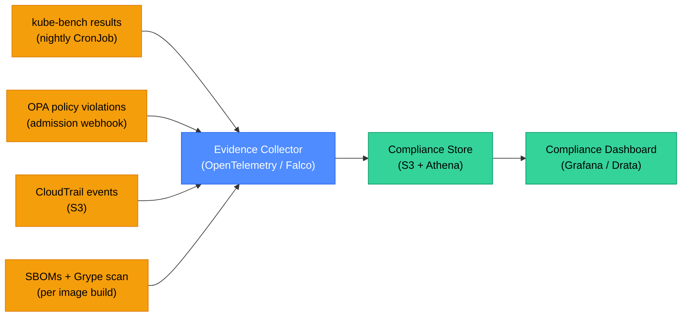

# Compliance Automation: Policy as Code, Auditing, and Continuous Controls

Manual compliance is a snapshot — an auditor visits, checks a sample, leaves, and the posture drifts until the next audit. Compliance automation turns controls into code: policies are enforced continuously in CI/CD pipelines, infrastructure state is checked against benchmarks on every change, and evidence is collected automatically rather than assembled by hand before each audit. This page covers OPA/conftest for policy gates, CIS benchmark enforcement, SBOM generation, and building an audit trail that satisfies SOC 2 and PCI-DSS reviewers.

<div class="quiz-progress" data-quiz-progress>
  <span class="quiz-progress-label">0/0 checks</span>
  <span class="quiz-progress-bar"><span class="quiz-progress-fill"></span></span>
</div>

---

## 1. Policy as Code: OPA and Rego

**Open Policy Agent (OPA)** is a general-purpose policy engine. Policies are written in **Rego** — a declarative language — and evaluated against JSON input. OPA integrates anywhere: Kubernetes admission, Terraform plan, API gateway, CI pipeline.

**Core concepts:**

| Concept | Description |
|---------|------------|
| **Policy** | Rego rules that return allow/deny or structured data |
| **Input** | The JSON document being evaluated (K8s resource, TF plan, HTTP request) |
| **Data** | External context the policy can reference (allowlists, org settings) |
| **Decision** | The policy's output — a boolean, list, or structured object |

**A Rego policy blocking containers running as root:**

```rego
package kubernetes.admission

import future.keywords.if
import future.keywords.every

deny[msg] if {
    input.request.kind.kind == "Pod"
    container := input.request.object.spec.containers[_]
    not container.securityContext.runAsNonRoot
    msg := sprintf("Container '%v' must set runAsNonRoot: true", [container.name])
}

deny[msg] if {
    input.request.kind.kind == "Pod"
    container := input.request.object.spec.containers[_]
    container.securityContext.runAsUser == 0
    msg := sprintf("Container '%v' must not run as UID 0", [container.name])
}
```

**Testing the policy:**

```bash
# Unit test with opa test
cat > policy_test.rego << 'EOF'
package kubernetes.admission

test_deny_root_container {
    count(deny) > 0 with input as {
        "request": {
            "kind": {"kind": "Pod"},
            "object": {
                "spec": {
                    "containers": [{"name": "app", "securityContext": {"runAsUser": 0}}]
                }
            }
        }
    }
}
EOF

opa test . -v
```

---

## 2. Conftest: Policy Gates in CI

**Conftest** runs OPA policies against structured files — Kubernetes manifests, Terraform plans, Dockerfiles, Helm charts — in a CI pipeline. It is the glue between OPA policies and your existing pipeline.

```bash
# Install
brew install conftest

# Test Kubernetes manifests against policies in ./policy/
conftest test deployment.yaml --policy ./policy/

# Test Terraform plan
terraform show -json plan.out | conftest test -

# Test multiple files with namespace
conftest test *.yaml --policy ./policy/ --namespace kubernetes.admission
```

**CI integration (GitHub Actions):**

```yaml
name: Policy Gate
on: [pull_request]

jobs:
  policy-check:
    runs-on: ubuntu-latest
    steps:
      - uses: actions/checkout@v4

      - name: Install conftest
        run: |
          curl -Lo conftest.tar.gz \
            https://github.com/open-policy-agent/conftest/releases/download/v0.46.0/conftest_0.46.0_Linux_x86_64.tar.gz
          tar xzf conftest.tar.gz && sudo mv conftest /usr/local/bin/

      - name: Lint Kubernetes manifests
        run: conftest test k8s/ --policy policy/ --all-namespaces

      - name: Validate Terraform plan
        run: |
          cd terraform/
          terraform init -backend=false
          terraform plan -out=plan.out
          terraform show -json plan.out | conftest test - --policy ../policy/terraform/
```

A failed policy check blocks the PR — no exceptions without a policy change that goes through code review.

<div class="quiz-card">
  <p class="quiz-q">A developer argues that running OPA in Kubernetes admission control is enough — conftest in CI is redundant. What's the case for keeping both?</p>
  <button class="quiz-reveal">Reveal answer</button>
  <div class="quiz-a" hidden>Defense in depth and developer experience. Admission control catches violations at deploy time, but only after the image is built, pushed, and the deployment command is run — feedback is slow and blocks a release. Conftest in CI catches violations in the PR, before code is merged, when the fix cost is lowest. Additionally, admission control only covers Kubernetes resources; conftest can validate Terraform plans, Dockerfiles, Helm values, and any other structured config. Finally, if someone bypasses CI (direct kubectl apply), admission control is the last line of defense. Both layers together mean violations are caught early and also never reach the cluster.</div>
</div>

---

## 3. CIS Benchmark Enforcement with kube-bench

**kube-bench** runs the CIS Kubernetes Benchmark — a set of security configuration checks — against a running cluster. It checks API server flags, kubelet configuration, etcd settings, RBAC posture, and pod security.

**Run as a Job in the cluster:**

```yaml
apiVersion: batch/v1
kind: Job
metadata:
  name: kube-bench
  namespace: security
spec:
  template:
    spec:
      hostPID: true
      containers:
        - name: kube-bench
          image: aquasec/kube-bench:v0.7.3
          command: ["kube-bench", "--json"]
          volumeMounts:
            - name: var-lib-kubelet
              mountPath: /var/lib/kubelet
              readOnly: true
            - name: etc-kubernetes
              mountPath: /etc/kubernetes
              readOnly: true
      restartPolicy: Never
      volumes:
        - name: var-lib-kubelet
          hostPath:
            path: /var/lib/kubelet
        - name: etc-kubernetes
          hostPath:
            path: /etc/kubernetes
```

```bash
# Get results
kubectl logs job/kube-bench -n security | jq '.Controls[].tests[].results[] | select(.status == "FAIL")'
```

**Common CIS findings and fixes:**

| Check | Failing state | Fix |
|-------|--------------|-----|
| 1.2.1 | `--anonymous-auth=true` on API server | Set `--anonymous-auth=false` |
| 1.2.6 | No `--audit-log-path` set | Enable audit logging |
| 4.2.1 | `--anonymous-auth=true` on kubelet | Set in kubelet config: `anonymous: enabled: false` |
| 5.1.3 | Wildcard verbs in ClusterRoleBindings | Replace `*` verbs with explicit list |
| 5.2.2 | Privileged containers allowed | Enforce Pod Security Standard: restricted |

**Schedule kube-bench as a CronJob for continuous compliance:**

```yaml
apiVersion: batch/v1
kind: CronJob
metadata:
  name: kube-bench-nightly
  namespace: security
spec:
  schedule: "0 2 * * *"    # 2am daily
  jobTemplate:
    spec:
      template:
        spec:
          hostPID: true
          serviceAccountName: kube-bench
          containers:
            - name: kube-bench
              image: aquasec/kube-bench:v0.7.3
              command: ["kube-bench", "--json", "--outputfile", "/output/results.json"]
```

---

## 4. SBOM: Software Bill of Materials

A **Software Bill of Materials (SBOM)** is a machine-readable inventory of every dependency in a software artifact — package names, versions, licenses, and their relationships. SBOMs are mandated by US Executive Order 14028 for federal software and increasingly required by enterprise buyers.

**Formats:**
- **SPDX** (Linux Foundation) — ISO/IEC 5962:2021 standard
- **CycloneDX** (OWASP) — richer vulnerability data linkage

**Generate an SBOM with Syft:**

```bash
# Install syft
curl -sSfL https://raw.githubusercontent.com/anchore/syft/main/install.sh | sh -s -- -b /usr/local/bin

# Generate SBOM for a container image
syft ghcr.io/acme/payments-service:v1.2.3 -o spdx-json > payments-sbom.spdx.json

# Generate for a directory
syft dir:./payments-service -o cyclonedx-json > sbom.cdx.json
```

**Scan SBOM for vulnerabilities with Grype:**

```bash
# Install grype
curl -sSfL https://raw.githubusercontent.com/anchore/grype/main/install.sh | sh -s -- -b /usr/local/bin

# Scan using pre-generated SBOM
grype sbom:payments-sbom.spdx.json --fail-on high
```

**Attest the SBOM to the image with cosign:**

```bash
# Attach SBOM as attestation (signed with keyless OIDC)
cosign attest \
  --predicate payments-sbom.spdx.json \
  --type spdxjson \
  ghcr.io/acme/payments-service:v1.2.3

# Verify attestation
cosign verify-attestation \
  --type spdxjson \
  --certificate-identity-regexp '.*github.*' \
  --certificate-oidc-issuer https://token.actions.githubusercontent.com \
  ghcr.io/acme/payments-service:v1.2.3
```

<div class="quiz-card">
  <p class="quiz-q">A critical CVE is disclosed in a popular HTTP library. Without SBOMs, how would your security team identify which services are affected? How does an SBOM change that process?</p>
  <button class="quiz-reveal">Reveal answer</button>
  <div class="quiz-a" hidden>Without SBOMs, the process is manual and slow: grep every repo's dependency files (package.json, go.sum, requirements.txt), hope they're up to date, compile a list by hand. For 50 services this takes days. With SBOMs, you query your SBOM store: `grype sbom:*.spdx.json --only-fixed | grep CVE-XXXX-YYYY` across all service SBOMs, and get the affected list in seconds. Tools like DependencyTrack ingest SBOMs and automatically alert when a new CVE matches a component in any of your SBOMs. Time-to-impact-assessment drops from days to minutes. This is the core value proposition: SBOMs turn reactive vulnerability response into a query.</div>
</div>

---

## 5. Audit Logging and Evidence Collection

Compliance frameworks (SOC 2, PCI-DSS, ISO 27001) require demonstrating that controls were in place over a time period — not just at the audit date. This means continuous evidence collection.

<div class="tab-group">
  <div class="tab-buttons">
    <button data-tab="audit-k8s" class="active">Kubernetes audit logs</button>
    <button data-tab="audit-cloud">Cloud audit trails</button>
    <button data-tab="audit-app">Application audit events</button>
  </div>
  <div class="tab-panels">
    <div class="tab-panel active" data-tab-panel="audit-k8s">

**Kubernetes API Server audit log** records every API call with the actor, resource, verb, and response.

Audit policy (stored in `/etc/kubernetes/audit-policy.yaml`):

```yaml
apiVersion: audit.k8s.io/v1
kind: Policy
rules:
  # Log all writes at RequestResponse level
  - level: RequestResponse
    verbs: ["create", "update", "patch", "delete"]
    resources:
      - group: ""
        resources: ["secrets", "configmaps", "serviceaccounts"]
      - group: "rbac.authorization.k8s.io"
        resources: ["rolebindings", "clusterrolebindings"]

  # Log all pod exec (privileged debugging) at Request level
  - level: Request
    resources:
      - group: ""
        resources: ["pods/exec", "pods/portforward"]

  # Omit noisy read-only health checks
  - level: None
    users: ["system:kube-proxy"]
    verbs: ["get", "watch", "list"]
```

Ship audit logs to a SIEM (Splunk, Elastic, Datadog) and set up alerts for:
- RBAC binding changes (`rolebindings` modified outside IaC)
- Secret access from unexpected ServiceAccounts
- `pods/exec` into production namespaces outside an approved change window

    </div>
    <div class="tab-panel" data-tab-panel="audit-cloud">

**AWS CloudTrail** records every API call to AWS services. For compliance:

```bash
# Enable CloudTrail for all regions (required for PCI-DSS)
aws cloudtrail create-trail \
  --name org-audit-trail \
  --s3-bucket-name acme-cloudtrail-logs \
  --is-multi-region-trail \
  --enable-log-file-validation    # detect log tampering via hash chain

# Verify trail is logging
aws cloudtrail get-trail-status --name org-audit-trail

# Query with CloudTrail Lake (Athena-based)
aws cloudtrail start-query \
  --query-statement "SELECT eventName, userIdentity.arn, eventTime
    FROM <event-data-store-arn>
    WHERE eventName = 'DeleteBucket'
    AND eventTime > '2025-01-01'
    ORDER BY eventTime DESC"
```

Key CloudTrail alerts for compliance:
- Root account login (PCI-DSS requirement 8.6)
- IAM policy changes outside approved IAC pipeline
- S3 bucket ACL set to public
- Security group rules opened to 0.0.0.0/0

    </div>
    <div class="tab-panel" data-tab-panel="audit-app">

**Application-level audit events** capture business actions that infrastructure logs miss: who approved a refund, who exported user data, who disabled an account.

Standard audit event structure:

```json
{
  "event_id": "01HQXX2K3M5VABC123",
  "timestamp": "2025-02-15T14:32:11Z",
  "actor": {
    "id": "user_01HQXX",
    "email": "alice@acme.io",
    "ip": "203.0.113.42",
    "session_id": "sess_xyz"
  },
  "action": "payment.refund.approved",
  "resource": {
    "type": "payment",
    "id": "pay_9876",
    "amount_cents": 4999
  },
  "outcome": "success",
  "metadata": {
    "reason": "customer_request",
    "ticket_id": "SUPPORT-1234"
  }
}
```

Emit these to an append-only store (Kafka → S3 with object lock, or a write-once audit DB). Never allow DELETE on audit records.

    </div>
  </div>
</div>

---

## 6. Continuous Compliance Dashboard

Manual point-in-time audits can be replaced with a continuous compliance pipeline that collects evidence automatically.



**Tools for automated compliance evidence:**
- **Drata / Vanta / Secureframe** — SaaS that integrates with GitHub, AWS, GCP, Okta and auto-collects SOC 2 evidence
- **OpenSCAP** — open-source CIS benchmark scanner for Linux hosts
- **Falco** — runtime threat detection; emits structured events that can feed a SIEM
- **Steampipe** — SQL queries against cloud APIs for compliance checks

```sql
-- Steampipe: Find AWS S3 buckets with public access
SELECT name, region, bucket_policy_is_public
FROM aws_s3_bucket
WHERE bucket_policy_is_public = true
   OR block_public_acls = false;
```

<div class="quiz-card">
  <p class="quiz-q">A SOC 2 Type II audit requires evidence that access reviews were performed quarterly over the past 12 months. What is the minimum automated system needed to produce this evidence without manual assembly?</p>
  <button class="quiz-reveal">Reveal answer</button>
  <div class="quiz-a" hidden>You need three things: (1) a scheduled access review workflow — a CronJob or Lambda that runs quarterly, queries all IAM roles/groups/K8s RoleBindings, and emails/Slacks each team's manager with their members list and a confirmation form; (2) a response log — an append-only store (S3 with object lock, or a Notion/Jira workflow) that records who confirmed, who was removed, and the date; (3) an evidence exporter — a script that, given a date range, queries the log and produces a CSV or PDF showing "Q1 2025: 47 users reviewed, 3 removed, confirmed by manager X on date Y." Auditors need to see that reviews happened and that the results were acted on — automated tooling like Drata or Vanta wraps this into a single interface, but the core data must come from your actual IAM system.</div>
</div>

---

## 7. Compliance Frameworks Cheat Sheet

| Requirement | SOC 2 | PCI-DSS | ISO 27001 | Implementation |
|-------------|-------|---------|-----------|----------------|
| MFA for all access | CC6.1 | 8.4 | A.9.4 | Okta + TOTP; enforce via IAP |
| Encryption at rest | CC6.7 | 3.5 | A.10.1 | AWS KMS, LUKS, Vault |
| Encryption in transit | CC6.7 | 4.2 | A.10.1 | TLS 1.2+ everywhere; mTLS internal |
| Audit logging | CC7.2 | 10.2 | A.12.4 | CloudTrail + K8s audit + app events |
| Vulnerability scanning | CC7.1 | 6.3 | A.12.6 | Trivy in CI, Grype on SBOMs |
| Access reviews | CC6.2 | 7.2 | A.9.2 | Quarterly automated review workflow |
| Change management | CC8.1 | 6.5 | A.12.1 | GitOps: all changes via PR with approval |
| Incident response | CC7.3 | 12.10 | A.16.1 | PagerDuty runbooks, 72hr notification SLA |

The key insight: each framework requirement maps to a concrete technical control. Implement the control once, collect evidence automatically, and map it to all applicable frameworks — rather than building separate compliance programs per framework.
