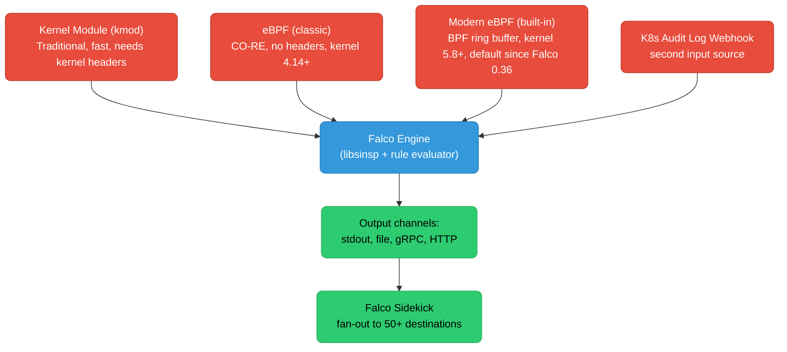
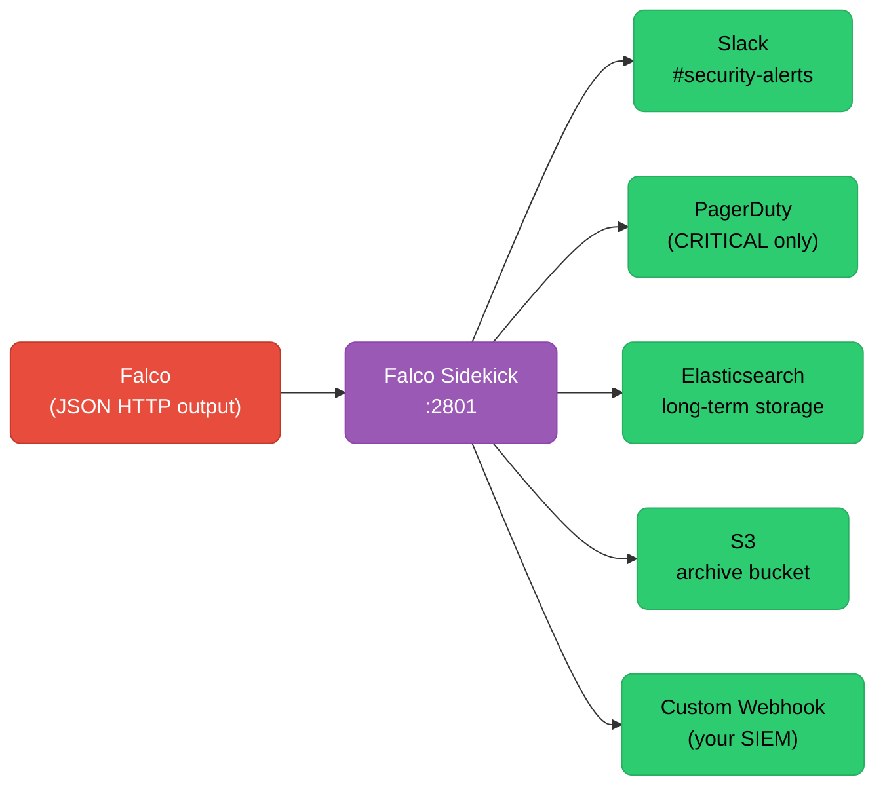

# Falco: Custom Rules and Sidekick Alerting

Runtime security is the last line of defense: it catches what static analysis, admission controllers, and image scanning all miss — attacker behavior that only becomes visible when a process is actually running. Falco watches every syscall your containers make and every Kubernetes audit event your API server emits, matching them against a rule engine in real time. This page covers writing custom Falco rules, consuming Kubernetes audit logs as a second input source, and routing alerts through Falco Sidekick to Slack, PagerDuty, and Elasticsearch.

<div class="quiz-progress" data-quiz-progress>
  <span class="quiz-progress-label">0/0 checks</span>
  <span class="quiz-progress-bar"><span class="quiz-progress-fill"></span></span>
</div>

---

## 1. Falco Architecture

Falco has three interchangeable kernel-level drivers — choose the one that fits your environment — feeding a userspace rule engine that evaluates events against YAML rule files and emits structured alerts.



**Kernel drivers compared:**

| Driver | Kernel req | Pros | Cons |
|--------|-----------|------|------|
| Kernel module | Any, but needs matching headers | Lowest overhead | Requires recompile per kernel; breaks on update |
| eBPF (classic) | 4.14+ | CO-RE: one binary, no recompile | Higher overhead than kmod |
| Modern eBPF | 5.8+ (BPF ring buffer) | Built into Falco binary, no sidecar | Requires newer kernel |

Install with modern eBPF (default since 0.36):

```bash
helm repo add falcosecurity https://falcosecurity.github.io/charts
helm install falco falcosecurity/falco \
  --namespace falco --create-namespace \
  --set driver.kind=modern_ebpf \
  --set falcosidekick.enabled=true \
  --set falcosidekick.config.slack.webhookurl="https://hooks.slack.com/..."
```

---

## 2. Rule Anatomy

Every Falco rule is a YAML document with four required fields and several optional ones.

```yaml
- rule: Shell Spawned in Container
  desc: A shell was started inside a container
  condition: >
    container.id != host
    and proc.name in (bash, sh, zsh, fish, dash)
    and evt.type = execve
    and evt.dir = <
  output: >
    Shell spawned in container
    (user=%user.name container=%container.name
     image=%container.image.repository:%container.image.tag
     shell=%proc.name parent=%proc.pname cmdline=%proc.cmdline)
  priority: WARNING
  tags: [container, shell, mitre_execution]
```

**Field reference:**

| Field | Purpose |
|-------|---------|
| `condition` | Filter expression using libsinsp fields; must evaluate true to fire |
| `output` | Message template; `%field.name` expands at match time |
| `priority` | `DEBUG`, `INFORMATIONAL`, `NOTICE`, `WARNING`, `ERROR`, `CRITICAL`, `ALERT`, `EMERGENCY` |
| `tags` | Free-form; MITRE ATT&CK tags (`mitre_execution`, `mitre_discovery`, …) enable framework mapping |

**Useful condition fields:**

| Field | What it gives you |
|-------|-----------------|
| `evt.type` | Syscall name: `execve`, `open`, `connect`, `ptrace`, … |
| `evt.dir` | `<` (syscall entry) or `>` (syscall exit) |
| `proc.name` | Executable basename |
| `proc.cmdline` | Full command line |
| `proc.pname` | Parent process name |
| `fd.name` | File descriptor name (path for file ops, IP:port for network) |
| `fd.sip`, `fd.dip` | Source / destination IP |
| `fd.sport`, `fd.dport` | Source / destination port |
| `container.id` | Container ID; `host` when not in a container |
| `container.name`, `container.image.repository` | Container metadata |
| `k8s.pod.name`, `k8s.ns.name` | Pod and namespace (requires metadata enrichment) |
| `user.name`, `user.uid` | Process user |

---

## 3. Writing Custom Rules

### Detect outbound connections to non-RFC1918 IPs

```yaml
- macro: rfc1918
  condition: >
    fd.sip in (10.0.0.0/8, 172.16.0.0/12, 192.168.0.0/16)
    or fd.dip in (10.0.0.0/8, 172.16.0.0/12, 192.168.0.0/16)

- macro: allowed_outbound_containers
  condition: >
    container.name in (curl-job, integration-tests)

- rule: Unexpected Outbound Connection from Container
  desc: Container made an outbound TCP connection to a public IP
  condition: >
    outbound
    and container.id != host
    and not rfc1918
    and not allowed_outbound_containers
  output: >
    Outbound connection to public IP
    (container=%container.name image=%container.image.repository
     dst=%fd.dip:%fd.dport cmdline=%proc.cmdline)
  priority: WARNING
  tags: [network, container, mitre_exfiltration]
```

### Detect /etc/shadow read

```yaml
- rule: Read Sensitive File Untrusted
  desc: An untrusted process read /etc/shadow or /etc/passwd
  condition: >
    open_read
    and fd.name in (/etc/shadow, /etc/gshadow, /etc/master.passwd)
    and not proc.name in (passwd, chpasswd, shadow, useradd, usermod)
    and container.id != host
  output: >
    Sensitive file read
    (user=%user.name proc=%proc.name file=%fd.name
     container=%container.name image=%container.image.repository)
  priority: ERROR
  tags: [filesystem, mitre_credential_access]
```

### Exception lists with `not in`

```yaml
- list: trusted_shells
  items: [bash, sh]

- list: trusted_container_images
  items: [my-org/debug-tools, bitnami/kubectl]

- rule: Shell Spawned in Container
  desc: A shell was started inside a container — exceptions for debug images
  condition: >
    container.id != host
    and proc.name in (bash, sh, zsh, fish, dash)
    and evt.type = execve
    and evt.dir = <
    and not proc.name in (trusted_shells)
    and not container.image.repository in (trusted_container_images)
  output: >
    Shell spawned (user=%user.name container=%container.name
     shell=%proc.name image=%container.image.repository cmdline=%proc.cmdline)
  priority: WARNING
```

### Overriding built-in rules with exceptions (Falco 0.28+)

```yaml
- rule: Write below etc
  exceptions:
    - name: proc_writer
      fields: [proc.name, fd.directory]
      comps: [in, =]
      values:
        - [my-config-agent, /etc/myapp]
```

---

## 4. Macros and Lists

Macros and lists are reusable YAML fragments — they reduce duplication and let you maintain allow-lists in one place.

```yaml
# Reusable condition fragment
- macro: outbound
  condition: >
    evt.type in (sendto, sendmsg, connect)
    and evt.dir = <
    and fd.typechar = 4   # IPv4 socket

- macro: open_read
  condition: >
    (evt.type in (open, openat, openat2)
    and evt.dir = <
    and fd.typechar in (f, o)
    and (evt.arg.flags contains O_RDONLY or not evt.arg.flags contains O_WRONLY))

# Reusable value list
- list: shell_binaries
  items: [ash, bash, csh, ksh, sh, tcsh, zsh, fish]

- list: known_sa_token_readers
  items: [curl, wget, python3, node]
```

**Shipping rules to nodes:** Two patterns:

<div class="tab-group">
  <div class="tab-buttons">
    <button data-tab="configmap" class="active">ConfigMap</button>
    <button data-tab="falcoctl">falcoctl artifact pull</button>
  </div>
  <div class="tab-panels">
    <div class="tab-panel active" data-tab-panel="configmap">

```yaml
# Helm values.yaml — embed rules directly
falco:
  rules_file:
    - /etc/falco/falco_rules.yaml
    - /etc/falco/falco_rules.local.yaml

customRules:
  my-rules.yaml: |-
    - rule: Shell Spawned in Container
      ...
```

ConfigMap is mounted into the falco pod at `/etc/falco/`. Changing the ConfigMap triggers a SIGHUP reload without pod restart (Falco 0.36+).

    </div>
    <div class="tab-panel" data-tab-panel="falcoctl">

```bash
# Push rules OCI artifact to a registry
falcoctl artifact push \
  ghcr.io/my-org/falco-rules:1.0.0 \
  --type rulesfile \
  --name my-rules \
  my-custom-rules.yaml

# Pull at startup via Helm values
falcoctl:
  artifact:
    follow:
      enabled: true
    refs:
      - ghcr.io/my-org/falco-rules:1.0.0
```

`falcoctl` watches the OCI tag and hot-reloads rules when a new version is pushed — no ConfigMap update needed.

    </div>
  </div>
</div>

---

## 5. Kubernetes Audit Log Rules

The Kubernetes API server can forward audit events to Falco as a second input source, giving visibility into control-plane actions that syscall monitoring cannot see.

**Enable audit webhook in kube-apiserver:**

```yaml
# /etc/kubernetes/audit-policy.yaml
apiVersion: audit.k8s.io/v1
kind: Policy
rules:
  - level: RequestResponse
    resources:
      - group: ""
        resources: ["secrets", "configmaps"]
  - level: Metadata
    resources:
      - group: ""
        resources: ["pods", "pods/exec"]
  - level: None
    userGroups: ["system:authenticated"]
    nonResourceURLs: ["/healthz*", "/readyz*"]
```

```bash
# kube-apiserver flags
--audit-webhook-config-file=/etc/kubernetes/webhook-audit.yaml
--audit-policy-file=/etc/kubernetes/audit-policy.yaml
```

**Webhook config** points to Falco's `k8s_audit` plugin endpoint (port 9765 by default).

**Audit-source rules:**

```yaml
- rule: K8s Secret Get or List
  desc: A non-system user read a secret via the API
  condition: >
    ka.verb in (get, list, watch)
    and ka.target.resource = secrets
    and not ka.user.name startswith "system:"
  output: >
    Secret accessed (user=%ka.user.name verb=%ka.verb
     secret=%ka.target.name ns=%ka.target.namespace
     sourceip=%ka.source.ip)
  priority: WARNING
  source: k8s_audit
  tags: [k8s, mitre_credential_access]

- rule: Pod Exec
  desc: kubectl exec was used to get a shell in a running pod
  condition: >
    ka.verb = create
    and ka.target.subresource = exec
    and not ka.user.name startswith "system:"
  output: >
    kubectl exec into pod
    (user=%ka.user.name pod=%ka.target.name ns=%ka.target.namespace
     command=%ka.uri.param[command])
  priority: WARNING
  source: k8s_audit

- rule: ClusterRoleBinding Created
  desc: A new ClusterRoleBinding was created — potential privilege escalation
  condition: >
    ka.verb = create
    and ka.target.resource = clusterrolebindings
    and not ka.user.name startswith "system:"
  output: >
    ClusterRoleBinding created
    (user=%ka.user.name binding=%ka.target.name
     role=%ka.req.binding.role)
  priority: ERROR
  source: k8s_audit
  tags: [k8s, mitre_privilege_escalation]
```

---

## 6. Falco Sidekick

Falco emits alerts to stdout, a file, or a gRPC stream. Sidekick sits between Falco and the rest of your alerting infrastructure, fanning out to 50+ destinations with filtering and formatting.



**Helm values for common destinations:**

```yaml
falcosidekick:
  enabled: true
  config:
    slack:
      webhookurl: "https://hooks.slack.com/services/T.../B.../..."
      minimumpriority: warning      # WARNING and above go to Slack
      messageformat: |
        *Alert:* {{ .Rule }} | *Priority:* {{ .Priority }}
        *Container:* {{ index .OutputFields "container.name" }}
        *Image:* {{ index .OutputFields "container.image.repository" }}

    pagerduty:
      routingkey: "abc123..."
      minimumpriority: critical     # only CRITICAL+ pages on-call

    elasticsearch:
      hostport: http://elasticsearch:9200
      index: falco-alerts
      minimumpriority: debug        # store everything for audit

    aws:
      s3:
        bucket: my-falco-archive
        prefix: falco/
        minimumpriority: warning
```

**Sidekick UI** — optional web dashboard showing alert rate, rule hit frequency, destination health:

```bash
helm install falco falcosecurity/falco \
  --set falcosidekick.enabled=true \
  --set falcosidekick.webui.enabled=true
# Sidekick UI available at port 2802
```

**Custom output format** (Go template, available fields: `.Rule`, `.Priority`, `.Time`, `.Source`, `.OutputFields`):

```yaml
messageformat: |
  :rotating_light: *{{ .Priority }}* | {{ .Rule }}
  Pod: `{{ index .OutputFields "k8s.pod.name" }}`
  Namespace: `{{ index .OutputFields "k8s.ns.name" }}`
  Image: `{{ index .OutputFields "container.image.repository" }}`
  Cmdline: `{{ index .OutputFields "proc.cmdline" }}`
```

---

## 7. Falco vs Tetragon

Both tools provide runtime security but at different abstraction levels and with different policy models.

| Dimension | Falco | Tetragon |
|-----------|-------|---------|
| **Input sources** | Syscalls + K8s audit log | Syscalls only (eBPF kernel probes) |
| **Rule language** | YAML + libsinsp field expressions | Go-based TracingPolicy CRDs (YAML) |
| **Enforcement** | Detect and alert only | Detect, alert, **AND kill/signal** the process |
| **K8s awareness** | Via metadata enrichment | Native (CRD, namespace/pod labels in policy) |
| **MITRE mapping** | Built-in tag support | Via Tetragon's MITRE-annotated example policies |
| **Audit log** | Yes (webhook plugin) | No |
| **Overhead** | Low (ring buffer, modern eBPF) | Slightly higher (per-syscall eBPF programs) |
| **When to choose** | Alert-only, broad coverage, K8s audit | Need to kill a process on detection; eBPF-native shop |

**Tetragon TracingPolicy example** (kill process on `/etc/shadow` read):

```yaml
apiVersion: cilium.io/v1alpha1
kind: TracingPolicy
metadata:
  name: block-shadow-read
spec:
  kprobes:
    - call: security_file_open
      syscall: false
      args:
        - index: 0
          type: file
      selectors:
        - matchArgs:
            - index: 0
              operator: Postfix
              values: ["/etc/shadow"]
          matchActions:
            - action: Sigkill   # SIGKILL the offending process
```

Falco would only alert; Tetragon can terminate the process immediately. Use both in environments with high assurance requirements — Falco for breadth and audit-log visibility, Tetragon for targeted enforcement on the most critical rules.

<div class="quiz-card">
  <p class="quiz-q">A Falco rule has `condition: container.id != host and proc.name = bash and evt.type = execve`. A developer runs `kubectl exec -it mypod -- bash`. Does Falco fire, and what fields would you add to reduce false positives from legitimate debugging sessions?</p>
  <button class="quiz-reveal">Reveal answer</button>
  <div class="quiz-a" hidden>Yes, Falco fires — `kubectl exec` spawns bash inside the container, which is exactly what the rule matches. To reduce false positives from legitimate debugging: (1) Add a list of trusted images (`not container.image.repository in (debug-tools, my-org/kubectl-debug)`) so dedicated debug images are excluded. (2) Filter by namespace (`not k8s.ns.name in (dev, debug)`) to allow exec in non-production namespaces. (3) Add an exception for specific users (`not ka.user.name in (sre-team)`), but this requires the K8s audit log source since syscall rules don't see the API caller. The cleanest approach is combining both sources: syscall rule fires broadly, and a K8s audit rule with a user allowlist suppresses it for approved actors.</div>
</div>

<div class="quiz-card">
  <p class="quiz-q">Your Falco Sidekick is configured with `minimumpriority: warning` for Slack and `minimumpriority: critical` for PagerDuty. A rule fires at `ERROR` priority. Which destinations receive the alert?</p>
  <button class="quiz-reveal">Reveal answer</button>
  <div class="quiz-a" hidden>Both Slack and Elasticsearch (if configured without a minimum priority filter), but NOT PagerDuty. Falco priority levels in ascending order: DEBUG < INFORMATIONAL < NOTICE < WARNING < ERROR < CRITICAL < ALERT < EMERGENCY. `minimumpriority: warning` means WARNING and above — ERROR qualifies. `minimumpriority: critical` means CRITICAL and above — ERROR does not qualify. So Slack gets the alert, PagerDuty does not. To page on ERROR as well, lower PagerDuty's `minimumpriority` to `error`.</div>
</div>

<div class="quiz-card">
  <p class="quiz-q">What is the difference between Falco's kernel module driver and the modern eBPF driver, and why does the modern eBPF driver not require recompilation per kernel version?</p>
  <button class="quiz-reveal">Reveal answer</button>
  <div class="quiz-a" hidden>The kernel module (kmod) is compiled as a `.ko` file that links against kernel headers specific to one kernel version. When the node kernel is upgraded, the module breaks and must be recompiled against the new headers — a pain on managed node groups where kernels update automatically. The modern eBPF driver uses BPF CO-RE (Compile Once, Run Everywhere): it embeds BTF (BPF Type Format) metadata and uses the kernel's own BTF to resolve field offsets at load time, not at compile time. One pre-compiled eBPF binary works across any kernel version that exposes BTF (5.8+). Additionally, the modern eBPF driver uses the BPF ring buffer (vs. the older perf event array), reducing data loss under high event rates. The tradeoff: requires kernel 5.8+, whereas the kernel module can target much older kernels.</div>
</div>

---

## 8. Setup Checklist

- [ ] Driver selected: modern eBPF (kernel ≥ 5.8), classic eBPF, or kmod
- [ ] Falco deployed as DaemonSet (one pod per node — must be on every node)
- [ ] Default ruleset version pinned in Helm values (`falco.rules_file`)
- [ ] Custom rules loaded via ConfigMap or falcoctl OCI artifact
- [ ] K8s audit webhook configured in kube-apiserver if audit-log rules are needed
- [ ] Audit policy covers: `secrets` (RequestResponse), `pods/exec` (RequestResponse), `clusterrolebindings` (RequestResponse)
- [ ] Falco Sidekick enabled; `minimumpriority` set per destination
- [ ] Slack destination verified: test alert received (`falcosidekick-ui` → send test)
- [ ] PagerDuty destination set to `critical` or `alert` only (avoid alert fatigue)
- [ ] Elasticsearch / S3 destination set to `debug` or `notice` for full audit trail
- [ ] `falcoctl` artifact follow enabled for automatic rule updates
- [ ] Exception lists reviewed: allowed shells, debug images, privileged namespaces
- [ ] MITRE tags added to all custom rules for framework mapping
- [ ] Sidekick UI deployed and accessible to security team
- [ ] Resource limits set on Falco DaemonSet pods (recommended: 200m CPU, 512Mi memory)
- [ ] Falco health check verified: `kubectl logs -l app=falco -n falco | grep "Falco initialized"`
- [ ] Alert volume baseline established: rule hit rate per hour in normal operation
- [ ] Runbook linked from each CRITICAL rule's `desc` field
- [ ] Tetragon TracingPolicies added for highest-risk rules that require enforcement (not just alerting)
- [ ] Upgrade path documented: driver recompilation or BTF availability per node image
