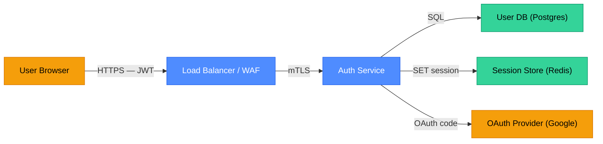
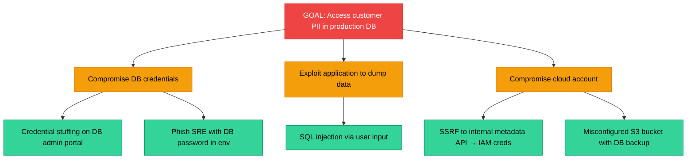

# Threat Modeling: STRIDE, Attack Trees, and Secure Design Reviews

Threat modeling is the practice of systematically identifying what can go wrong in a system before building it — or before attackers find it first. Done early, it costs a fraction of a post-incident remediation; done well, it shapes architecture decisions rather than patching them. This page covers the STRIDE framework, attack trees, data flow diagrams, and how to run a threat modeling session that produces actionable mitigations.

<div class="quiz-progress" data-quiz-progress>
  <span class="quiz-progress-label">0/0 checks</span>
  <span class="quiz-progress-bar"><span class="quiz-progress-fill"></span></span>
</div>

---

## 1. Why Threat Model?

Security defects found in design cost 10–100× less to fix than those found in production. Threat modeling is the systematic process of asking "what could go wrong?" at design time, then answering with mitigations baked into the architecture.

The four core questions (Adam Shostack's framing):
1. **What are we building?** — system diagram, data flows, trust boundaries
2. **What can go wrong?** — threat enumeration (STRIDE, attack trees)
3. **What are we going to do about it?** — mitigations: controls, redesigns, accepted risks
4. **Did we do a good job?** — review completeness, residual risk

Threat modeling is not a one-time activity. It should happen at design (major new features), sprint (small changes crossing trust boundaries), and post-incident (retroactively validate model coverage).

---

## 2. Data Flow Diagrams (DFDs)

Before enumerating threats, you need a model of the system. A Data Flow Diagram (DFD) is the standard input to threat modeling.

DFD element types:

| Symbol | Element | Threat focus |
|--------|---------|--------------|
| Rectangle | **External Entity** — users, third-party services | Spoofing, input validation |
| Circle/oval | **Process** — code that transforms data | Tampering, logic bugs |
| Open rectangle | **Data Store** — databases, files, queues | Information disclosure, tampering |
| Arrow | **Data Flow** — bytes moving between elements | Interception, injection |
| Dashed line | **Trust Boundary** — privilege change crossing | All STRIDE categories |



Every arrow crossing a trust boundary (dashed line in the diagram) is a potential threat entry point. These are where STRIDE analysis focuses.

<div class="quiz-card">
  <p class="quiz-q">In a DFD, what does a trust boundary represent, and why is it the most important element for threat enumeration?</p>
  <button class="quiz-reveal">Reveal answer</button>
  <div class="quiz-a" hidden>A trust boundary marks a transition between privilege levels or security domains — for example, the edge between a public network and an internal service, or between a user process and a privileged system call. It is the most important element because every data flow crossing a boundary is a potential attack surface: an adversary on the less-trusted side can attempt to spoof identity, inject malicious data, or escalate privileges to the more-trusted side. If you only have time to threat-model part of a system, focus on trust boundary crossings.</div>
</div>

---

## 3. STRIDE Threat Categories

STRIDE is a mnemonic covering the six primary threat categories. Each maps to a violated security property.

| Threat | Property violated | Classic example |
|--------|------------------|-----------------|
| **S**poofing | Authentication | Forging a JWT, ARP spoofing |
| **T**ampering | Integrity | SQL injection, MITM data modification |
| **R**epudiation | Non-repudiation | No audit logs, log tampering |
| **I**nformation Disclosure | Confidentiality | Verbose error messages, unencrypted storage |
| **D**enial of Service | Availability | Unbounded request rate, resource exhaustion |
| **E**levation of Privilege | Authorization | SSRF to metadata API, container escape |

**STRIDE per element:** Apply each threat category to each DFD element type:

| DFD Element | S | T | R | I | D | E |
|-------------|---|---|---|---|---|---|
| External Entity | ✓ | | ✓ | | | |
| Process | ✓ | ✓ | ✓ | ✓ | ✓ | ✓ |
| Data Store | | ✓ | ✓ | ✓ | ✓ | |
| Data Flow | ✓ | ✓ | | ✓ | ✓ | |

This matrix tells you which threats to ask about for each element type — not all six apply equally to all elements.

### STRIDE examples for a payment API

```
[S] Attacker forges user_id in JWT to access another user's payment history
    → Mitigation: verify JWT signature, validate sub claim matches authenticated user

[T] Attacker modifies amount field in transit from mobile app to API
    → Mitigation: TLS everywhere; server-side amount validation; sign payment intent

[R] Merchant disputes a charge; no audit log of who triggered the refund
    → Mitigation: append-only audit log with actor, timestamp, resource, action

[I] Database error leaks SQL schema in API response body
    → Mitigation: generic error messages to clients; detailed errors only in internal logs

[D] Attacker floods POST /payments with 10k req/s; database connection pool exhausted
    → Mitigation: rate limiting per user_id; circuit breaker; connection pool limits

[E] SSRF: attacker calls POST /payments?callback=http://169.254.169.254/latest/meta-data/
    → Mitigation: validate and allowlist callback URLs; block internal IP ranges
```

<div class="quiz-card">
  <p class="quiz-q">A microservice stores user preferences in a Redis cache. Which STRIDE categories most directly apply to the Redis data store element, and give one concrete threat for each?</p>
  <button class="quiz-reveal">Reveal answer</button>
  <div class="quiz-a" hidden>Per the STRIDE-per-element matrix, Data Stores face Tampering, Repudiation, Information Disclosure, and DoS — not Spoofing or Elevation of Privilege directly. Concrete examples: (T) An unauthenticated Redis instance (no AUTH) lets any internal service overwrite preference keys; (R) No Redis command audit log means a preference change can't be traced to a specific service; (I) Redis stores unencrypted PII (email, locale) readable by any process with network access; (D) A single slow consumer saturates Redis memory, evicting keys for all other services. Mitigations: AUTH + TLS, ACL users per service, key expiry, and memory limits with eviction policies.</div>
</div>

---

## 4. Attack Trees

Attack trees model threats hierarchically: the root is the attacker's goal, internal nodes are sub-goals, and leaves are specific attack primitives. They complement STRIDE — STRIDE enumerates threat categories; attack trees model how those categories chain into realistic attack paths.



**Using attack trees for prioritization:** assign probability and impact to each leaf, then bubble up the highest-risk paths. This lets you defend the most likely attack chains first rather than treating all threats equally.

---

## 5. Running a Threat Modeling Session

A practical format for a 2-hour threat modeling session with 3–5 people (engineer, security, PM):

<div class="stepper">
  <div class="stepper-panels">
    <div class="stepper-panel active">

### Step 1 — Scope and DFD (30 min)

Draw the system on a whiteboard or Miro. Start with external entities (users, third parties), then draw data flows. Mark every trust boundary. The diagram is done when everyone in the room agrees it matches the real system.

Questions to ask:
- Where does data enter the system? (all entry points)
- Where is sensitive data stored?
- What services talk to each other? Over what protocol?
- Which processes run with elevated privilege?

    </div>
    <div class="stepper-panel">

### Step 2 — Enumerate threats with STRIDE (45 min)

Walk each trust boundary crossing and each data store. For each, mechanically apply the STRIDE categories. Don't filter yet — write every threat on a sticky note or in a shared doc.

Use prompts:
- "An attacker who can reach this boundary could..."
- "If this store was exfiltrated, what would be exposed?"
- "What happens if this process receives malicious input?"

    </div>
    <div class="stepper-panel">

### Step 3 — Rank and mitigate (30 min)

Score each threat: **Likelihood × Impact**. Use DREAD or a simple High/Medium/Low. Assign a mitigation to every High and every threat with no existing control:

| Threat | Likelihood | Impact | Priority | Mitigation |
|--------|-----------|--------|----------|------------|
| JWT forgery via weak secret | Low | Critical | High | Use RS256, rotate keys |
| Verbose DB error in response | Medium | Medium | Medium | Generic error handler |
| Redis AUTH disabled | High | High | Critical | Enable AUTH + TLS |

    </div>
    <div class="stepper-panel">

### Step 4 — Document residual risk (15 min)

Not every threat gets mitigated in the current sprint. Document accepted risks explicitly:

```yaml
# threat-model.yaml
accepted_risks:
  - id: TM-004
    threat: "Attacker can enumerate user IDs via sequential /user/{id} API"
    reason: "Low sensitivity endpoint; rate-limited; no PII exposed"
    reviewed_by: security-team
    reviewed_date: 2025-01-15
    review_interval: 6months
```

Accepted risks must be re-reviewed periodically — risk posture changes as the system and threat landscape evolve.

    </div>
  </div>
  <div class="stepper-controls">
    <button class="stepper-prev">← Prev</button>
    <span class="stepper-dots"></span>
    <span class="stepper-label"></span>
    <button class="stepper-next">Next →</button>
  </div>
</div>

---

## 6. Tooling

| Tool | Type | Best for |
|------|------|----------|
| **OWASP Threat Dragon** | Open-source, web/desktop | DFD drawing + STRIDE annotation |
| **Microsoft Threat Modeling Tool** | Free, Windows | DFDs with auto-STRIDE suggestions |
| **IriusRisk** | Commercial | Enterprise, integrates with Jira |
| **Miro / Lucidchart** | Diagramming | Collaborative remote sessions |
| **Threagile** | YAML-driven, open-source | Code-as-threat-model, CI integration |

**Threagile** is particularly useful for DevOps environments — the threat model is a YAML file checked into git, reviewed in PRs, and auto-analyzed by a CLI that generates a risk report.

```yaml
# threagile.yaml excerpt
technical_assets:
  payment-api:
    id: payment-api
    type: process
    technology: web-service-rest
    trust_boundary_id: internal-backend
    data_assets_processed:
      - payment-data
      - pii
    communication_links:
      to-db:
        target: payments-db
        protocol: postgresql/tls
        authentication: credentials
```

```bash
# Run in CI:
threagile analyze-model --model threagile.yaml --report-format json
```

---

## 7. Integrating Threat Modeling into SDLC

Threat modeling works best when it is a team habit, not a security-team gate.

<div class="tab-group">
  <div class="tab-buttons">
    <button data-tab="tm-design" class="active">Design phase</button>
    <button data-tab="tm-sprint">Sprint level</button>
    <button data-tab="tm-post">Post-incident</button>
  </div>
  <div class="tab-panels">
    <div class="tab-panel active" data-tab-panel="tm-design">

**Major new features or systems:**
- Full DFD with all trust boundaries
- Complete STRIDE enumeration
- 2-hour session with security team present
- Output: threat-model doc in git, tickets for High mitigations
- Trigger: architecture review for any feature touching auth, payments, or PII

    </div>
    <div class="tab-panel" data-tab-panel="tm-sprint">

**Small changes crossing trust boundaries:**
- Lightweight: "does this PR add a new data flow or trust boundary crossing?"
- If yes: 30-min async review using the existing DFD
- Output: PR comment documenting any new threats and mitigations
- Trigger: PR template checklist item: "Does this change cross a trust boundary?"

    </div>
    <div class="tab-panel" data-tab-panel="tm-post">

**After a security incident:**
- Map the actual attack path onto the existing threat model
- Check: was this threat documented? Was the mitigation implemented?
- Update the model with newly discovered threats and blind spots
- Output: updated threat model + retrospective on why coverage missed this

    </div>
  </div>
</div>

<div class="quiz-card">
  <p class="quiz-q">A team ships a new payment webhook endpoint that calls an external URL provided by merchants. The threat model was not updated. What STRIDE threat did they miss, and what is the mitigation?</p>
  <button class="quiz-reveal">Reveal answer</button>
  <div class="quiz-a" hidden>Elevation of Privilege via SSRF (Server-Side Request Forgery). By calling a merchant-controlled URL from the server, an attacker can point the webhook at internal services — `http://169.254.169.254/` (cloud metadata), `http://kubernetes.default/api/`, or internal databases. The server then makes requests with its own identity (cloud IAM role, Kubernetes ServiceAccount), potentially leaking credentials or triggering privileged actions. Mitigations: validate merchant-provided URLs against an allowlist of HTTPS-only external domains; block RFC 1918, loopback, and link-local address ranges; use a dedicated outbound proxy that enforces egress policy; and run the webhook caller in a restricted network namespace with no internal route.</div>
</div>
