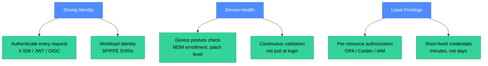
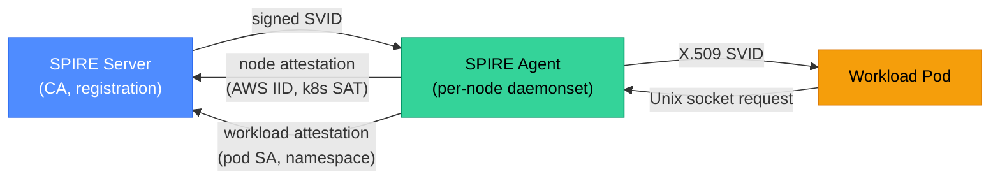
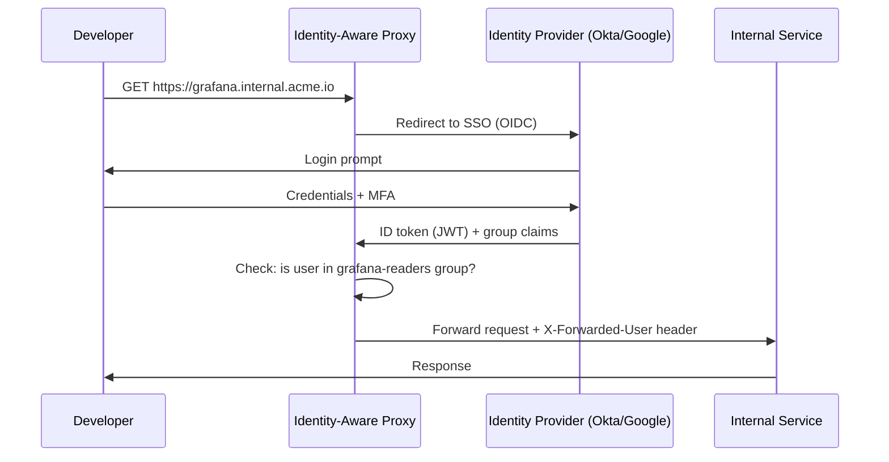

# Zero Trust Architecture: Never Trust, Always Verify

Traditional perimeter security assumes everything inside the network is safe — a model that fails the moment an attacker phishes one employee or compromises a single internal service. Zero Trust replaces that assumption with "never trust, always verify": every request is authenticated, authorized, and encrypted regardless of where it originates. This page covers the core principles, SPIFFE/SPIRE workload identity, mTLS enforcement with Istio, and practical rollout strategies.

<div class="quiz-progress" data-quiz-progress>
  <span class="quiz-progress-label">0/0 checks</span>
  <span class="quiz-progress-bar"><span class="quiz-progress-fill"></span></span>
</div>

---

## 1. Core Principles

Zero Trust is a security model, not a product. The NIST SP 800-207 definition rests on seven tenets:

| Tenet | What it means |
|-------|--------------|
| All data sources and services are resources | Even internal DBs, queues, and K8s pods are treated as untrusted resources |
| All communication is secured regardless of location | TLS on every hop, including east-west cluster traffic |
| Access to individual resources is granted per-session | No standing access; session-scoped tokens only |
| Access is determined by dynamic policy | Identity + device health + behavior → real-time decision |
| All assets are monitored and measured | No assumed good state; continuous telemetry |
| Authentication and authorization are strictly enforced | Strong identity (X.509, JWT) on every call |
| The enterprise collects data to improve security posture | Audit logs, anomaly detection, policy refinement |

**The three pillars in practice:**



---

## 2. SPIFFE and SPIRE: Workload Identity

In a microservices environment, services must prove their identity to each other. IP-based identity fails in dynamic environments where pods come and go. **SPIFFE** (Secure Production Identity Framework For Everyone) provides a standard for workload identity.

**Key concepts:**

| Term | Definition |
|------|-----------|
| **SPIFFE ID** | A URI identifying a workload: `spiffe://trust-domain/path/to/workload` |
| **SVID** | SPIFFE Verifiable Identity Document — an X.509 cert or JWT carrying the SPIFFE ID |
| **Trust domain** | The root of identity; maps to an org or cluster: `spiffe://prod.acme.io` |
| **SPIRE** | The reference implementation of SPIFFE: a server + agent architecture |
| **Attestation** | How SPIRE proves a workload is what it claims — node attestation + workload attestation |

**SPIRE architecture:**



**Workload registration entry:**

```yaml
# Register payments-service in SPIRE
spire-server entry create \
  -spiffeID spiffe://prod.acme.io/payments-service \
  -parentID spiffe://prod.acme.io/k8s-node \
  -selector k8s:ns:payments \
  -selector k8s:sa:payments-service \
  -ttl 3600
```

The SPIRE agent on the node validates the pod's Kubernetes ServiceAccount token and namespace, then issues a short-lived X.509 SVID. The pod uses this cert for mTLS — it never handles a long-lived password or API key.

<div class="quiz-card">
  <p class="quiz-q">A SPIFFE SVID has a TTL of 1 hour. What happens when it expires, and why is a short TTL desirable in Zero Trust?</p>
  <button class="quiz-reveal">Reveal answer</button>
  <div class="quiz-a" hidden>The SPIRE agent automatically rotates SVIDs before expiry — workloads receive updated certs via the Workload API socket without restarting. Short TTLs are desirable because they limit the blast radius of credential compromise: a stolen cert is only useful for at most 1 hour, versus a stolen API key that might be valid for months. In Zero Trust, short-lived credentials combined with continuous re-attestation mean that even if a cert leaks, the attacker's window is extremely narrow. This is the "never trust, always verify" principle applied to credential lifetime.</div>
</div>

---

## 3. mTLS with Istio

Mutual TLS (mTLS) means both the client and server authenticate each other with X.509 certificates — not just the server (as in standard HTTPS). In a service mesh, this is enforced transparently at the sidecar layer.

**Istio mTLS modes:**

| Mode | Behavior | Use case |
|------|---------|---------|
| `PERMISSIVE` | Accepts both plaintext and mTLS | Migration period — don't break existing clients |
| `STRICT` | Rejects all plaintext; mTLS required | Production target state |

**Enforcing STRICT mTLS namespace-wide:**

```yaml
apiVersion: security.istio.io/v1beta1
kind: PeerAuthentication
metadata:
  name: default
  namespace: payments
spec:
  mtls:
    mode: STRICT
```

**Requiring mTLS for outbound connections:**

```yaml
apiVersion: networking.istio.io/v1beta1
kind: DestinationRule
metadata:
  name: payments-db
  namespace: payments
spec:
  host: payments-db.payments.svc.cluster.local
  trafficPolicy:
    tls:
      mode: ISTIO_MUTUAL
```

**Zero Trust authorization policy (allow only payments-service to call payments-db):**

```yaml
apiVersion: security.istio.io/v1beta1
kind: AuthorizationPolicy
metadata:
  name: payments-db-authz
  namespace: payments
spec:
  selector:
    matchLabels:
      app: payments-db
  action: ALLOW
  rules:
    - from:
        - source:
            principals:
              - "cluster.local/ns/payments/sa/payments-service"
      to:
        - operation:
            ports: ["5432"]
```

This policy enforces: only the `payments-service` ServiceAccount (verified via SVID) can reach the database port. All other sources — including other pods in the same namespace — are denied.

<div class="quiz-card">
  <p class="quiz-q">Istio's PeerAuthentication is set to STRICT for the payments namespace, but a legacy internal tool that uses plaintext HTTP still needs to call the payments API. What is the migration approach?</p>
  <button class="quiz-reveal">Reveal answer</button>
  <div class="quiz-a" hidden>Use a port-level override to allow PERMISSIVE for the specific port the legacy tool uses, while keeping STRICT on all other ports. This lets you migrate incrementally: the legacy tool gets a grace period, while all new services are required to use mTLS. Set a deadline for the legacy tool to add mTLS (inject a sidecar or use SPIRE + a TLS wrapper). Monitor with `istioctl proxy-config listener` to confirm which connections are still plaintext. Never leave PERMISSIVE permanently — the mode creates a gap in Zero Trust enforcement that attackers can exploit.</div>
</div>

---

## 4. Network Micro-Segmentation

Zero Trust applies to networks too. Rather than relying on VLAN-based segmentation, micro-segmentation uses software-defined policy to control which workloads can communicate.

<div class="tab-group">
  <div class="tab-buttons">
    <button data-tab="seg-k8s" class="active">Kubernetes NetworkPolicy</button>
    <button data-tab="seg-istio">Istio AuthorizationPolicy</button>
    <button data-tab="seg-cilium">Cilium (eBPF)</button>
  </div>
  <div class="tab-panels">
    <div class="tab-panel active" data-tab-panel="seg-k8s">

**Kubernetes NetworkPolicy** operates at L3/L4 (IP + port). Default-deny all ingress:

```yaml
apiVersion: networking.k8s.io/v1
kind: NetworkPolicy
metadata:
  name: default-deny-ingress
  namespace: payments
spec:
  podSelector: {}      # applies to all pods in namespace
  policyTypes:
    - Ingress
```

Then explicitly allow only the frontend → API path:

```yaml
apiVersion: networking.k8s.io/v1
kind: NetworkPolicy
metadata:
  name: allow-frontend-to-api
  namespace: payments
spec:
  podSelector:
    matchLabels:
      app: payments-api
  ingress:
    - from:
        - namespaceSelector:
            matchLabels:
              name: frontend
          podSelector:
            matchLabels:
              app: frontend
      ports:
        - port: 8080
```

Limitation: NetworkPolicy cannot inspect TLS SNI or HTTP headers — it's IP/port only.

    </div>
    <div class="tab-panel" data-tab-panel="seg-istio">

**Istio AuthorizationPolicy** operates at L7 (HTTP methods, paths, JWT claims). Allows enforcement like "only GET /public is allowed without authentication":

```yaml
apiVersion: security.istio.io/v1beta1
kind: AuthorizationPolicy
metadata:
  name: payments-api-authz
  namespace: payments
spec:
  selector:
    matchLabels:
      app: payments-api
  action: ALLOW
  rules:
    - from:
        - source:
            requestPrincipals: ["*"]   # any valid JWT
      to:
        - operation:
            methods: ["GET", "POST"]
            paths: ["/api/v1/*"]
    - from:
        - source:
            notNamespaces: ["kube-system"]
      to:
        - operation:
            paths: ["/healthz"]
```

Combined with NetworkPolicy (L4) + AuthorizationPolicy (L7) = defense in depth.

    </div>
    <div class="tab-panel" data-tab-panel="seg-cilium">

**Cilium** uses eBPF for high-performance L3–L7 policy with DNS-aware rules:

```yaml
apiVersion: cilium.io/v2
kind: CiliumNetworkPolicy
metadata:
  name: payments-egress
  namespace: payments
spec:
  endpointSelector:
    matchLabels:
      app: payments-api
  egress:
    - toEndpoints:
        - matchLabels:
            app: payments-db
      toPorts:
        - ports:
            - port: "5432"
              protocol: TCP
    - toFQDNs:
        - matchName: "stripe.com"
      toPorts:
        - ports:
            - port: "443"
```

DNS-aware egress (toFQDNs) blocks all external calls except `stripe.com:443`, enforced at the eBPF level without a proxy.

    </div>
  </div>
</div>

---

## 5. Identity-Aware Proxy (IAP) for Human Access

For human users accessing internal services, Zero Trust replaces VPN with an Identity-Aware Proxy. The IAP sits in front of internal services and enforces authentication + authorization on every request.



**Popular IAP implementations:**
- **Google BeyondCorp Enterprise** (fully managed)
- **Pomerium** (open-source, self-hosted)
- **Teleport** (SSH + Kubernetes + databases)
- **Cloudflare Access** (SaaS, any internal origin)

The IAP enforces: no request reaches the internal service without a valid session. VPN is not required — developers access internal tools from any network, and device posture (MDM enrollment, disk encryption) is checked at the IAP layer.

---

## 6. Zero Trust Rollout Strategy

Zero Trust is a journey, not a switch. A typical 3-phase rollout:

<div class="stepper">
  <div class="stepper-panels">
    <div class="stepper-panel active">

### Phase 1 — Visibility (Month 1–2)

Before enforcing policy, understand what is talking to what.

- Deploy Istio in PERMISSIVE mode (no plaintext blocked)
- Enable access logging on all sidecars
- Map actual service-to-service communication (use Kiali or Hubble)
- Identify services using plaintext or shared secrets
- Output: communication matrix; list of non-compliant services

    </div>
    <div class="stepper-panel">

### Phase 2 — Workload Identity (Month 2–4)

Replace shared secrets with SPIFFE/SPIRE or Istio-native certs.

- Deploy SPIRE (or rely on Istio's built-in CA for in-cluster mTLS)
- Register workload entries per service
- Migrate service-to-service auth from API keys to mTLS
- Enable STRICT PeerAuthentication namespace by namespace, starting with non-critical namespaces
- Replace VPN with IAP for human access to internal tools

    </div>
    <div class="stepper-panel">

### Phase 3 — Policy Enforcement (Month 4–6)

Add fine-grained authorization on top of identity.

- Deploy Kubernetes NetworkPolicy (default-deny per namespace)
- Add Istio AuthorizationPolicy per service (allow-list by principal + path)
- Enable OPA/Gatekeeper to gate infra changes against policy
- Set up continuous compliance scanning (Trivy, kube-bench)
- Run quarterly access reviews: remove standing permissions

    </div>
  </div>
  <div class="stepper-controls">
    <button class="stepper-prev">← Prev</button>
    <span class="stepper-dots"></span>
    <span class="stepper-label"></span>
    <button class="stepper-next">Next →</button>
  </div>
</div>

<div class="quiz-card">
  <p class="quiz-q">An organization moves all internal tools behind an Identity-Aware Proxy and decommissions VPN. A developer argues this is less secure because "VPN encrypted the whole tunnel." Why is IAP + Zero Trust actually stronger?</p>
  <button class="quiz-reveal">Reveal answer</button>
  <div class="quiz-a" hidden>VPN creates a trusted network segment — once connected, a user can reach any internal service without further authentication. A single compromised VPN credential gives lateral movement across the entire internal network. IAP enforces per-request authentication and authorization: each internal service requires a valid session with the right group membership, checked on every request. A compromised credential only gives access to services that user is explicitly authorized for — not everything internal. Additionally, IAP integrates device posture checks (MDM, patch level) that VPN typically lacks, and produces per-request audit logs rather than just connection logs. Zero Trust has a smaller blast radius per credential compromise.</div>
</div>
