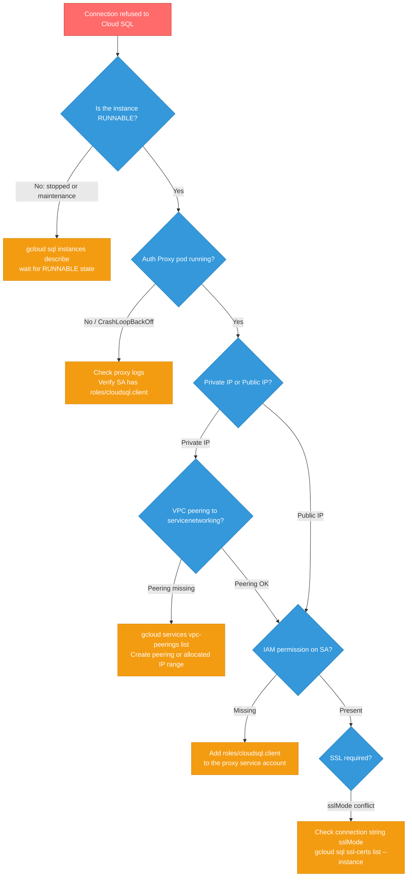
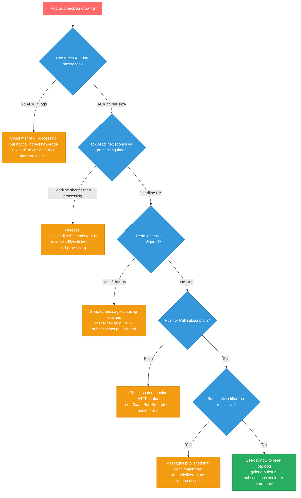
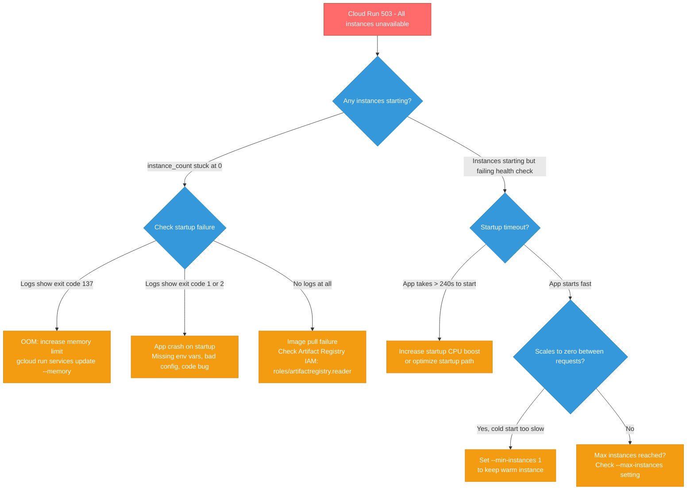
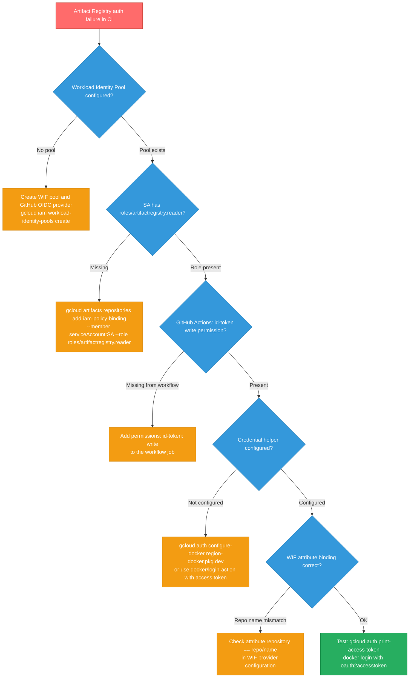
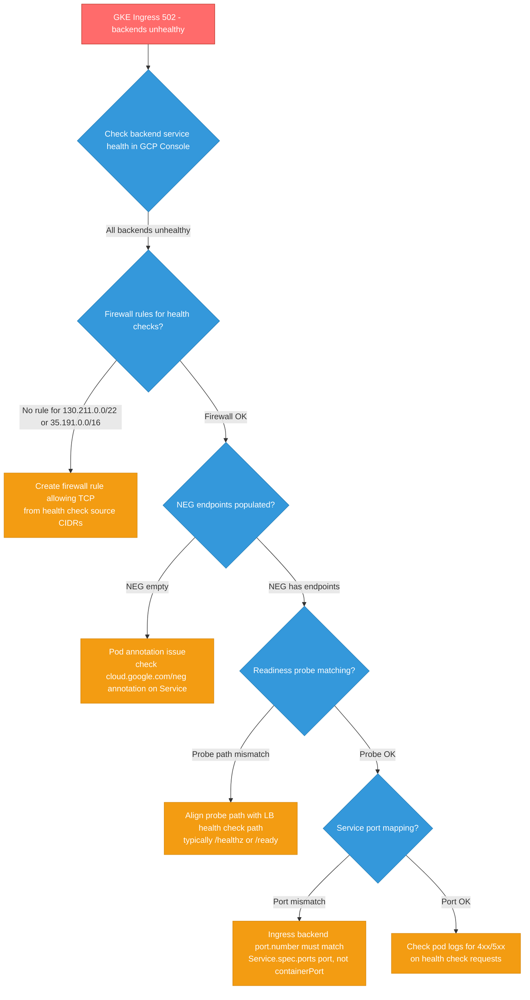
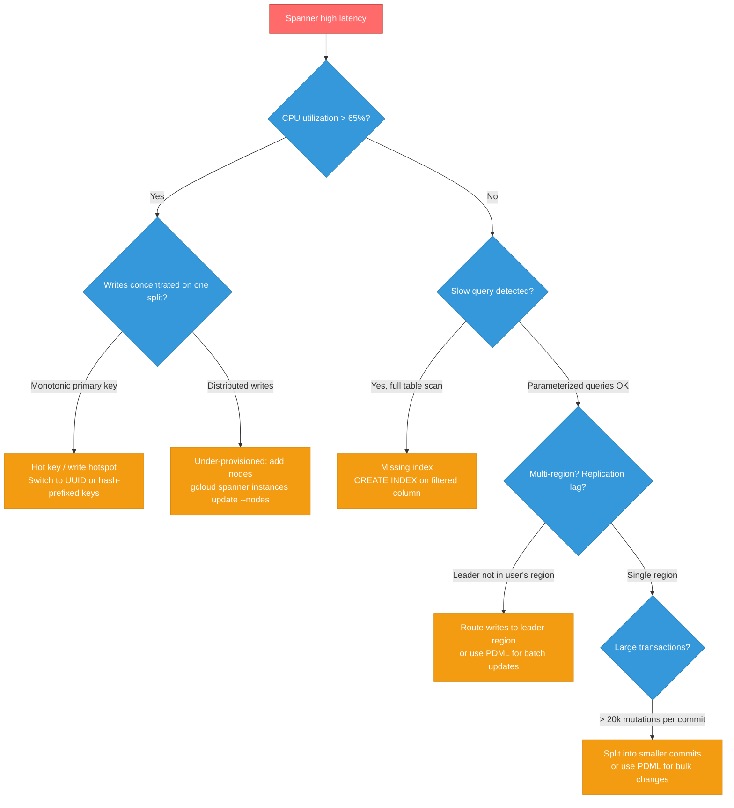

# GCP Incident Scenarios

GCP-specific debugging playbooks — the same format as `aws-scenarios.md` but tuned for GKE, Cloud SQL, Pub/Sub, Cloud Run, Artifact Registry, and Spanner.

<div class="quiz-progress" data-quiz-progress>
  <span class="quiz-progress-label">0/0 checks</span>
  <span class="quiz-progress-bar"><span class="quiz-progress-fill"></span></span>
</div>

---

## 1. GKE Node NotReady

**Symptoms:** `kubectl get nodes` shows a node in `NotReady` state; pods on that node are stuck in `Terminating` or `Unknown`.

```mermaid
flowchart TD
    A[kubectl get nodes → NotReady] --> B{Check node conditions}
    B -->|DiskPressure| C[/var/log full or containerd data dir full]
    B -->|MemoryPressure| D[OOM: system daemon or pod]
    B -->|PIDPressure| E[Too many processes / fork bomb]
    B -->|No pressure flags| F{Is kubelet running?}
    F -->|No| G[systemctl start kubelet\ncheck journalctl -u kubelet]
    F -->|Yes, but node still NotReady| H{Is containerd running?}
    H -->|No| I[systemctl start containerd\ndf -h /var/lib/containerd]
    H -->|Yes| J{OOM kill recently?}
    J -->|dmesg shows OOM| K[Increase node memory or\nlimit offending workload]
    J -->|No OOM| L[Node manually cordoned?\ncheck kubectl describe node]
    L --> M[kubectl uncordon node-name]

    classDef bad fill:#ff6b6b,stroke:#c0392b,color:#fff
    classDef warn fill:#f39c12,stroke:#d68910,color:#fff
    classDef good fill:#27ae60,stroke:#1e8449,color:#fff
    classDef check fill:#3498db,stroke:#2980b9,color:#fff

    class A bad
    class B,F,H,J,L check
    class C,D,E,G,I,K warn
    class M good
```

<div class="stepper">
  <div class="stepper-panels">
    <div class="stepper-panel active">
      <strong>Step 1. Describe the node.</strong>
      <p>Run <code>kubectl describe node &lt;name&gt;</code> and scan the <strong>Conditions</strong> section for <code>DiskPressure</code>, <code>MemoryPressure</code>, or <code>PIDPressure = True</code>. Check <strong>Taints</strong> (a node may have been manually cordoned) and the <strong>Events</strong> block at the bottom for the most recent error.</p>
    </div>
    <div class="stepper-panel">
      <strong>Step 2. SSH into the node.</strong>
      <p>Use <code>gcloud compute ssh &lt;node-name&gt; --zone &lt;zone&gt;</code>. All further investigation happens on the node itself. GKE node names in the output of <code>kubectl get nodes</code> map directly to GCE instance names.</p>
    </div>
    <div class="stepper-panel">
      <strong>Step 3. Check kubelet.</strong>
      <p>Run <code>systemctl status kubelet</code>. If it's <code>inactive (dead)</code> or <code>failed</code>, read the logs: <code>journalctl -u kubelet --since "10 minutes ago"</code>. Common causes: kubelet can't reach the API server, or a TLS cert has expired.</p>
    </div>
    <div class="stepper-panel">
      <strong>Step 4. Check containerd.</strong>
      <p>Run <code>systemctl status containerd</code>. If disk pressure is flagged, check: <code>df -h /var/lib/containerd</code>. GKE nodes accumulate image layers and log files in <code>/var/log/pods/</code>. A full disk stops containerd from pulling images or creating new containers.</p>
    </div>
    <div class="stepper-panel">
      <strong>Step 5. Check for OOM kills.</strong>
      <p>Run <code>dmesg | grep -i 'out of memory'</code>. If the kernel OOM killer fired, it logs the process name and PID. Also check: <code>journalctl -k --since "30 minutes ago"</code> for kernel ring buffer messages from before the node went NotReady.</p>
    </div>
    <div class="stepper-panel">
      <strong>Step 6. Remediate.</strong>
      <p>If the node is unhealthy and in a managed node pool, drain it and delete it — GKE will recreate it automatically:</p>
      <pre><code>kubectl drain &lt;name&gt; --ignore-daemonsets --delete-emptydir-data
kubectl delete node &lt;name&gt;</code></pre>
      <p>GKE auto-repair will provision a fresh node. If the pool has auto-repair disabled, enable it in the GCP Console or via <code>gcloud container node-pools update</code>.</p>
    </div>
  </div>
  <div class="stepper-controls">
    <button class="stepper-prev">← Prev</button>
    <span class="stepper-dots"></span>
    <span class="stepper-label"></span>
    <button class="stepper-next">Next →</button>
  </div>
</div>

**Commands**

```bash
# Cluster-side
kubectl get nodes
kubectl describe node <node-name>
kubectl drain <node-name> --ignore-daemonsets --delete-emptydir-data
kubectl delete node <node-name>

# On the node (gcloud compute ssh first)
systemctl status kubelet
journalctl -u kubelet --since "10 minutes ago"
systemctl status containerd
df -h /var/lib/containerd
df -h /var/log
dmesg | grep -i 'out of memory'
journalctl -k --since "30 minutes ago"
```

**Common causes:** disk pressure from log accumulation (`/var/log/pods/` fills), containerd GC not running, Spot (preemptible) VM interrupted mid-workload, OOM kill from a system daemon (not a pod) that takes down kubelet with it.

---

## 2. Cloud SQL Connection Refused

**Symptoms:** App pods cannot connect to Cloud SQL; error is "connection refused", "dial tcp: connect: connection refused", or "SSL handshake timeout".



<div class="stepper">
  <div class="stepper-panels">
    <div class="stepper-panel active">
      <strong>Step 1. Verify instance state.</strong>
      <p>Run <code>gcloud sql instances describe &lt;instance&gt;</code> and confirm <code>state: RUNNABLE</code>. If the instance is in a maintenance window or was manually stopped, it's unavailable. Check <code>gcloud sql operations list --instance=&lt;name&gt;</code> for in-progress operations.</p>
    </div>
    <div class="stepper-panel">
      <strong>Step 2. Check the Auth Proxy.</strong>
      <p>The Cloud SQL Auth Proxy is the standard connection method on GKE. Verify the pod is running: <code>kubectl get pods -l app=cloud-sql-proxy</code>. Read its logs: <code>kubectl logs -l app=cloud-sql-proxy --tail=50</code>. A "Permission denied" in proxy logs means the service account lacks <code>roles/cloudsql.client</code>.</p>
    </div>
    <div class="stepper-panel">
      <strong>Step 3. Verify IAM.</strong>
      <p>The Kubernetes service account (or its Workload Identity–mapped GCP service account) needs <code>roles/cloudsql.client</code> at the project level. Check:<br><code>gcloud projects get-iam-policy &lt;project&gt; --flatten="bindings[].members" --format='table(bindings.role,bindings.members)' | grep cloudsql</code></p>
    </div>
    <div class="stepper-panel">
      <strong>Step 4. Check VPC networking (Private IP).</strong>
      <p>If using private IP, Cloud SQL connects over VPC peering to the <code>servicenetworking.googleapis.com</code> network. Verify: <code>gcloud services vpc-peerings list --network=&lt;vpc-name&gt;</code>. If peering is missing or the allocated IP range is too small, private IP connections fail silently.</p>
    </div>
    <div class="stepper-panel">
      <strong>Step 5. Check SSL configuration.</strong>
      <p>Cloud SQL newer instances require SSL by default. Check your connection string for <code>sslmode=disable</code> (will fail) or <code>sslmode=require</code>. List client certs: <code>gcloud sql ssl-certs list --instance=&lt;name&gt;</code>. Client cert expiry (not server cert) causes SSL handshake failures.</p>
    </div>
  </div>
  <div class="stepper-controls">
    <button class="stepper-prev">← Prev</button>
    <span class="stepper-dots"></span>
    <span class="stepper-label"></span>
    <button class="stepper-next">Next →</button>
  </div>
</div>

**Commands**

```bash
gcloud sql instances describe <instance>
gcloud sql operations list --instance=<instance> --limit=5

kubectl get pods -l app=cloud-sql-proxy
kubectl logs -l app=cloud-sql-proxy --tail=50

gcloud projects get-iam-policy <project> \
  --flatten="bindings[].members" \
  --format='table(bindings.role,bindings.members)' | grep cloudsql

gcloud services vpc-peerings list --network=<vpc-name>

gcloud sql ssl-certs list --instance=<instance>
```

**Common causes:** Auth Proxy service account missing `roles/cloudsql.client`, private IP allocated range exhausted or VPC peering not created, SSL client cert expired (check expiry date in `gcloud sql ssl-certs list`), instance in scheduled maintenance window.

---

## 3. Pub/Sub Backlog Growing

**Symptoms:** `subscription/num_undelivered_messages` metric rising continuously; consumer pods appear healthy with no errors; backlog doesn't drain.



<div class="stepper">
  <div class="stepper-panels">
    <div class="stepper-panel active">
      <strong>Step 1. Inspect the subscription.</strong>
      <p>Run <code>gcloud pubsub subscriptions describe &lt;sub&gt;</code>. Check: <code>ackDeadlineSeconds</code> (default 10 — almost always too short for real processing), <code>messageRetentionDuration</code> (how long messages are kept), and whether a <code>deadLetterPolicy</code> is configured.</p>
    </div>
    <div class="stepper-panel">
      <strong>Step 2. Check the dead letter queue.</strong>
      <p>If <code>deadLetterPolicy</code> is set, messages that fail delivery N times are moved to the DLQ topic. Pull a few to see what's failing: <code>gcloud pubsub subscriptions pull &lt;dlq-sub&gt; --limit 5 --auto-ack</code>. A DLQ filling means specific messages are crashing the consumer.</p>
    </div>
    <div class="stepper-panel">
      <strong>Step 3. Check message age metric.</strong>
      <p>In Cloud Monitoring, look at <code>pubsub.googleapis.com/subscription/oldest_unacked_message_age</code>. If this grows linearly, the consumer is stuck on a specific message (it keeps receiving and nacking the same one). If it's flat but backlog grows, new messages arrive faster than they're consumed.</p>
    </div>
    <div class="stepper-panel">
      <strong>Step 4. Push vs pull verification.</strong>
      <p>For <strong>push subscriptions</strong>: Pub/Sub sends HTTP POST to your endpoint. Any non-2xx response is treated as a nack and retried with exponential backoff. Check your endpoint's error rate. For <strong>pull subscriptions</strong>: verify consumer code calls <code>msg.Ack()</code> or <code>client.Acknowledge()</code> after successful processing — not before.</p>
    </div>
    <div class="stepper-panel">
      <strong>Step 5. Reset the backlog if needed.</strong>
      <p>If the backlog is unprocessable (corrupted messages, all causing crashes), seek the subscription forward to discard the backlog. <strong>Warning: this permanently loses messages</strong> not retained elsewhere:</p>
      <pre><code>gcloud pubsub subscriptions seek &lt;sub&gt; --to-time=now</code></pre>
      <p>Better option: configure a dead letter topic first, let bad messages accumulate there, then inspect and replay good ones.</p>
    </div>
  </div>
  <div class="stepper-controls">
    <button class="stepper-prev">← Prev</button>
    <span class="stepper-dots"></span>
    <span class="stepper-label"></span>
    <button class="stepper-next">Next →</button>
  </div>
</div>

**Commands**

```bash
gcloud pubsub subscriptions describe <sub>

# Pull from DLQ subscription to inspect failing messages
gcloud pubsub subscriptions pull <dlq-sub> --limit 5 --auto-ack

# Seek to reset backlog (destructive — loses messages)
gcloud pubsub subscriptions seek <sub> --to-time=now

# Cloud Monitoring metrics to check
# pubsub.googleapis.com/subscription/num_undelivered_messages
# pubsub.googleapis.com/subscription/oldest_unacked_message_age
```

**Common causes:** consumer not calling ACK (processes message but forgets to acknowledge — message re-delivered after deadline), `ackDeadlineSeconds` too short for processing time (increase to 600), push endpoint returning 5xx (network issue, or the endpoint crashed), filter too narrow (messages published but none match the subscription filter).

---

## 4. Cloud Run 503 / All Instances Unavailable

**Symptoms:** All requests to a Cloud Run service return HTTP 503; `container/instance_count` is 0; requests not served at all.



<div class="stepper">
  <div class="stepper-panels">
    <div class="stepper-panel active">
      <strong>Step 1. Inspect the revision.</strong>
      <p>Run <code>gcloud run revisions describe &lt;rev&gt; --region &lt;region&gt;</code>. Check the <code>conditions</code> block for <code>Ready: False</code> and the accompanying message. A stuck revision with <code>ContainerFailed</code> usually has a startup crash. Also check which revision is serving traffic: <code>gcloud run services describe &lt;service&gt; --region &lt;region&gt;</code>.</p>
    </div>
    <div class="stepper-panel">
      <strong>Step 2. Read the container logs.</strong>
      <p>Run <code>gcloud run services logs read &lt;service&gt; --limit 50 --region &lt;region&gt;</code>. Look for: exit codes (137 = OOM, 1/2 = app crash), error messages on startup, or complete absence of logs (image pull failure). Cloud Run logs are also in Cloud Logging under <code>resource.type="cloud_run_revision"</code>.</p>
    </div>
    <div class="stepper-panel">
      <strong>Step 3. Check memory limits.</strong>
      <p>Exit code 137 means the container was sent SIGKILL, almost always OOM. Cloud Run enforces the memory limit strictly. Check current limit: <code>gcloud run services describe &lt;service&gt; --format="value(spec.template.spec.containers[0].resources.limits.memory)"</code>. Increase it: <code>gcloud run services update &lt;service&gt; --memory 1Gi --region &lt;region&gt;</code>.</p>
    </div>
    <div class="stepper-panel">
      <strong>Step 4. Check cold start and min-instances.</strong>
      <p>Cloud Run scales to 0 when idle and takes a cold start on the next request. Cloud Run's startup timeout is 240 seconds by default. If your app takes > 30s to start (JVM warmup, model loading), consider <code>--min-instances 1</code> to keep one warm instance, or enable CPU boost on startup.</p>
    </div>
    <div class="stepper-panel">
      <strong>Step 5. Check image pull access.</strong>
      <p>If there are no logs at all, the image likely can't be pulled. The Cloud Run service account needs <code>roles/artifactregistry.reader</code> on the registry: <code>gcloud artifacts repositories get-iam-policy &lt;repo&gt; --location=&lt;location&gt;</code>. On GKE-based services, also verify Workload Identity is configured.</p>
    </div>
  </div>
  <div class="stepper-controls">
    <button class="stepper-prev">← Prev</button>
    <span class="stepper-dots"></span>
    <span class="stepper-label"></span>
    <button class="stepper-next">Next →</button>
  </div>
</div>

**Commands**

```bash
gcloud run revisions describe <rev> --region <region>
gcloud run services describe <service> --region <region>
gcloud run services logs read <service> --limit 50 --region <region>

# Check memory config
gcloud run services describe <service> \
  --format="value(spec.template.spec.containers[0].resources)"

# Increase memory
gcloud run services update <service> --memory 1Gi --region <region>

# Set minimum instances to avoid cold starts
gcloud run services update <service> --min-instances 1 --region <region>

# Check Artifact Registry IAM
gcloud artifacts repositories get-iam-policy <repo> --location=<location>
```

**Common causes:** application startup taking > 240s (cold start limit), missing env vars causing app crash on startup (check for `os.Getenv` panics), memory limit too low for the workload, Artifact Registry auth failure when using a non-default service account.

---

## 5. Artifact Registry Auth Failure in CI

**Symptoms:** `docker pull` fails with "unauthorized: unauthenticated request"; `gcloud builds submit` works locally but GitHub Actions workflow fails.



<div class="stepper">
  <div class="stepper-panels">
    <div class="stepper-panel active">
      <strong>Step 1. Verify the Workload Identity Pool.</strong>
      <p>Run <code>gcloud iam workload-identity-pools list --location=global</code>. The pool must exist with a GitHub OIDC provider configured. Check the provider: <code>gcloud iam workload-identity-pools providers list --workload-identity-pool=&lt;pool&gt; --location=global</code>. The provider's issuer URI must be <code>https://token.actions.githubusercontent.com</code>.</p>
    </div>
    <div class="stepper-panel">
      <strong>Step 2. Check the IAM binding.</strong>
      <p>The GCP service account needs <code>roles/artifactregistry.reader</code> (or <code>writer</code> for push) on the specific repository:</p>
      <pre><code>gcloud artifacts repositories get-iam-policy &lt;repo&gt; \
  --location=&lt;location&gt; \
  --format='table(bindings.role,bindings.members)'</code></pre>
      <p>Also check the WIF binding that allows GitHub to impersonate the SA.</p>
    </div>
    <div class="stepper-panel">
      <strong>Step 3. Configure the GitHub Actions workflow.</strong>
      <p>The workflow job must have <code>id-token: write</code> permission. Use <code>google-github-actions/auth</code> with the WIF provider and service account:</p>
      <pre><code>permissions:
  id-token: write
  contents: read

- uses: google-github-actions/auth@v2
  with:
    workload_identity_provider: 'projects/123/locations/global/...'
    service_account: 'my-sa@my-project.iam.gserviceaccount.com'</code></pre>
    </div>
    <div class="stepper-panel">
      <strong>Step 4. Configure the Docker credential helper.</strong>
      <p>After <code>google-github-actions/auth</code>, configure Docker to use GCP credentials: <code>gcloud auth configure-docker &lt;region&gt;-docker.pkg.dev</code>. This adds the credential helper to <code>~/.docker/config.json</code> so subsequent <code>docker pull</code> calls authenticate automatically.</p>
    </div>
    <div class="stepper-panel">
      <strong>Step 5. Test end-to-end.</strong>
      <p>Test the credential chain manually:</p>
      <pre><code>gcloud auth print-access-token | \
  docker login -u oauth2accesstoken \
  --password-stdin &lt;region&gt;-docker.pkg.dev</code></pre>
      <p>Then <code>docker pull &lt;region&gt;-docker.pkg.dev/&lt;project&gt;/&lt;repo&gt;/&lt;image&gt;:tag</code>. If this fails, the SA credential is the problem. If it succeeds but CI fails, the issue is WIF attribute binding (repo name mismatch in the OIDC token claim).</p>
    </div>
  </div>
  <div class="stepper-controls">
    <button class="stepper-prev">← Prev</button>
    <span class="stepper-dots"></span>
    <span class="stepper-label"></span>
    <button class="stepper-next">Next →</button>
  </div>
</div>

**Commands**

```bash
gcloud iam workload-identity-pools list --location=global
gcloud iam workload-identity-pools providers list \
  --workload-identity-pool=<pool> --location=global

gcloud artifacts repositories get-iam-policy <repo> --location=<location>

# Configure docker credential helper
gcloud auth configure-docker <region>-docker.pkg.dev

# Test access token
gcloud auth print-access-token | \
  docker login -u oauth2accesstoken --password-stdin <region>-docker.pkg.dev

# Add IAM binding if missing
gcloud artifacts repositories add-iam-policy-binding <repo> \
  --location=<location> \
  --member="serviceAccount:sa@project.iam.gserviceaccount.com" \
  --role="roles/artifactregistry.reader"
```

**Common causes:** WIF pool attribute binding uses wrong attribute (repo name in the condition doesn't match the actual GitHub repo path), `id-token: write` permission missing from workflow job permissions block, credential helper not configured (docker login not called after auth step), service account principal doesn't match the WIF binding condition.

---

## 6. GKE Ingress 502 Backend Unhealthy

**Symptoms:** GKE HTTP(S) Load Balancer returns 502; `kubectl get ingress` shows backends as unhealthy; pods show `READY=1/1` but get no traffic.



<div class="stepper">
  <div class="stepper-panels">
    <div class="stepper-panel active">
      <strong>Step 1. Check backend health in GCP Console.</strong>
      <p>Navigate to <strong>Network services → Load balancing</strong> in GCP Console. Click on the load balancer, then the backend service. Each backend (NEG endpoint) shows its health status. Backends marked <strong>UNHEALTHY</strong> are failing health checks. Note the health check path — it's often <code>/</code> or <code>/healthz</code>.</p>
    </div>
    <div class="stepper-panel">
      <strong>Step 2. Check NEG endpoints.</strong>
      <p>Network Endpoint Groups map K8s pods to GCP load balancer backends. Verify NEGs exist and have endpoints:</p>
      <pre><code>gcloud compute network-endpoint-groups list
gcloud compute network-endpoint-groups list-network-endpoints &lt;neg-name&gt; \
  --zone &lt;zone&gt;</code></pre>
      <p>An empty NEG means pods aren't being registered — check the Service annotation <code>cloud.google.com/neg: '{"ingress": true}'</code>.</p>
    </div>
    <div class="stepper-panel">
      <strong>Step 3. Verify the firewall rule.</strong>
      <p>GCP health checks originate from two specific IP ranges: <code>130.211.0.0/22</code> and <code>35.191.0.0/16</code>. A firewall rule allowing TCP on your pod's container port from these source ranges must exist:</p>
      <pre><code>gcloud compute firewall-rules list --format='table(name,sourceRanges,allowed)' \
  | grep -E "130.211|35.191"</code></pre>
      <p>If missing, create it: <code>gcloud compute firewall-rules create allow-health-checks --allow tcp:&lt;port&gt; --source-ranges 130.211.0.0/22,35.191.0.0/16</code>.</p>
    </div>
    <div class="stepper-panel">
      <strong>Step 4. Check the readiness probe.</strong>
      <p>The GKE Ingress health check is derived from the pod's readiness probe path. If the readiness probe returns 200 but the LB health check uses a different path, backends fail. Check: <code>kubectl describe pod &lt;pod&gt;</code> → Readiness probe path. Align the readiness probe path with what the LB is checking, or configure a custom health check path on the BackendConfig CRD.</p>
    </div>
    <div class="stepper-panel">
      <strong>Step 5. Verify Service port mapping.</strong>
      <p>The Ingress backend spec references a Service port number. This must match <code>Service.spec.ports[].port</code> (the service-level port), not <code>containerPort</code>. Check:</p>
      <pre><code>kubectl describe svc &lt;service&gt;
kubectl describe ingress &lt;ingress&gt;</code></pre>
      <p>If Ingress backend says port 80 but the Service exposes port 8080, traffic is routed nowhere and all backends appear unhealthy.</p>
    </div>
  </div>
  <div class="stepper-controls">
    <button class="stepper-prev">← Prev</button>
    <span class="stepper-dots"></span>
    <span class="stepper-label"></span>
    <button class="stepper-next">Next →</button>
  </div>
</div>

**Commands**

```bash
kubectl get ingress
kubectl describe ingress <ingress>
kubectl describe svc <service>
kubectl describe pod <pod>

# NEG inspection
gcloud compute network-endpoint-groups list
gcloud compute network-endpoint-groups list-network-endpoints <neg> --zone <zone>

# Firewall check
gcloud compute firewall-rules list \
  --format='table(name,sourceRanges,allowed)'

# Create health check firewall rule if missing
gcloud compute firewall-rules create allow-health-checks \
  --allow tcp:<container-port> \
  --source-ranges 130.211.0.0/22,35.191.0.0/16 \
  --network <vpc-name>
```

**Common causes:** missing firewall rule for health check source IPs (most common — no rule → all health checks fail → all backends unhealthy), readiness probe path doesn't match the LB health check path, NEG not being updated when pods are replaced (missing annotation on Service), Service port number mismatch in Ingress spec.

---

## 7. Cloud Spanner High Latency

**Symptoms:** `spanner.googleapis.com/api/request_latencies` p99 growing; user-facing API slowing; Cloud Monitoring shows Spanner CPU > 65%; no obvious traffic spike.



<div class="stepper">
  <div class="stepper-panels">
    <div class="stepper-panel active">
      <strong>Step 1. Check CPU utilization.</strong>
      <p>In Cloud Monitoring, look at <code>spanner/instance/cpu/utilization_by_priority</code>. If CPU is > 65%, Spanner begins throttling requests. At > 90%, latency degrades severely. CPU is split by priority (high/low) — high-priority (user-facing) above 65% is the problem. Options: add processing nodes or fix the hot key causing the load.</p>
    </div>
    <div class="stepper-panel">
      <strong>Step 2. Identify hot keys.</strong>
      <p>Look at <code>spanner/instance/cpu/utilization_by_operation</code> broken down by <code>database_id</code>. If writes are concentrated on one node (one key range), a monotonic primary key is the cause. INT64 auto-increment or timestamp PKs route all new rows to the same split — the rest of the cluster is idle while one node is maxed out.</p>
    </div>
    <div class="stepper-panel">
      <strong>Step 3. Analyze slow queries.</strong>
      <p>Use Spanner Query Insights in the GCP Console (Spanner → your database → Query insights). Sort by total latency. Look for: full table scans (no index used), large result sets, missing WHERE clause filters. Also run EXPLAIN directly:</p>
      <pre><code>gcloud spanner databases execute-sql &lt;db&gt; \
  --instance=&lt;instance&gt; \
  --sql="EXPLAIN SELECT * FROM orders WHERE user_id = @uid"</code></pre>
    </div>
    <div class="stepper-panel">
      <strong>Step 4. Add indexes or fix the primary key.</strong>
      <p>Add a secondary index for missing filters — zero-downtime, Spanner builds it in the background:</p>
      <pre><code>CREATE INDEX orders_by_user ON orders(user_id);</code></pre>
      <p>For hot key: change the primary key to a UUID (<code>GENERATE_UUID()</code>) or bit-reverse the existing integer key. This distributes new rows evenly across all Spanner splits.</p>
    </div>
    <div class="stepper-panel">
      <strong>Step 5. Scale the instance if needed.</strong>
      <p>If writes are evenly distributed but CPU is still high, the instance is under-provisioned. Add processing nodes:</p>
      <pre><code>gcloud spanner instances update &lt;instance&gt; --nodes=3</code></pre>
      <p>Spanner auto-rebalances splits across the new nodes within minutes. For variable load, use Spanner Autoscaler (OSS) or configure autoscaling on the instance directly (GA in newer regions).</p>
    </div>
  </div>
  <div class="stepper-controls">
    <button class="stepper-prev">← Prev</button>
    <span class="stepper-dots"></span>
    <span class="stepper-label"></span>
    <button class="stepper-next">Next →</button>
  </div>
</div>

**Commands**

```bash
# Cloud Monitoring metrics (query in Console or via API)
# spanner/instance/cpu/utilization_by_priority
# spanner/instance/cpu/utilization_by_operation
# spanner/api/request_latencies (filtered by method)

# Query analysis
gcloud spanner databases execute-sql <db> \
  --instance=<instance> \
  --sql="EXPLAIN SELECT * FROM orders WHERE status = 'pending'"

# Add index
gcloud spanner databases ddl update <db> \
  --instance=<instance> \
  --ddl="CREATE INDEX orders_by_status ON orders(status);"

# Scale instance
gcloud spanner instances update <instance> --nodes=3

# Describe instance
gcloud spanner instances describe <instance>
```

**Common causes:** monotonic primary keys (timestamps or auto-increment integers as PK cause all new-row writes to route to the same Spanner split), full table scans from missing indexes, instance CPU > 65% with no autoscaling configured (Spanner does not auto-scale by default — requires manual node addition or Spanner Autoscaler), large transactions exceeding 20,000 mutations per commit.

---

<div class="quiz-card">
  <p class="quiz-q">Your GKE Ingress shows all backends as UNHEALTHY even though every pod shows READY=true and passes its readiness probe. What is the most likely cause?</p>
  <button class="quiz-reveal">Reveal answer</button>
  <div class="quiz-a" hidden>
    Missing firewall rule for GCP health check source IPs. GCP HTTP(S) Load Balancers send health check probes from <code>130.211.0.0/22</code> and <code>35.191.0.0/16</code>. If no firewall rule allows TCP traffic from these CIDRs to the pod's container port, every health check is dropped by the firewall — the backend appears unhealthy to the load balancer even though the pod itself is perfectly healthy. The readiness probe passes because kubelet probes from within the node network, not from the GCP health check IPs. Fix: <code>gcloud compute firewall-rules create allow-health-checks --allow tcp:&lt;port&gt; --source-ranges 130.211.0.0/22,35.191.0.0/16</code>.
  </div>
</div>

<div class="quiz-card">
  <p class="quiz-q">A Pub/Sub subscription accumulated 10 million messages over 3 days because consumer code crashed on one malformed message. You've deployed a fix. What should you verify before declaring the incident resolved?</p>
  <button class="quiz-reveal">Reveal answer</button>
  <div class="quiz-a" hidden>
    Check whether a dead letter topic (DLQ) is configured and whether the malformed message moved there, or if it's still at the head of the subscription queue. If no DLQ is configured: the bad message may still be at position 1. After the crash fix, the consumer will receive the message again, process it successfully (now that the bug is fixed), and continue. But if the malformed message type isn't fully handled by the fix, you'll hit the same crash immediately. Also verify the backlog is actually draining: watch <code>subscription/num_undelivered_messages</code> in Cloud Monitoring — it should decrease at a steady rate after deployment. If it stays flat, the fix didn't work or a different message type is now crashing.
  </div>
</div>

<div class="quiz-card">
  <p class="quiz-q">Cloud Spanner p99 latency is spiking and CPU utilization is at 80%. You inspect the schema and find the primary key is <code>user_id INT64 NOT NULL DEFAULT (FARM_FINGERPRINT(GENERATE_UUID()))</code>. Is this a hot key problem?</p>
  <button class="quiz-reveal">Reveal answer</button>
  <div class="quiz-a" hidden>
    No — this is already a good primary key design. <code>FARM_FINGERPRINT</code> of a UUID produces a highly random 64-bit integer, which distributes writes evenly across all Spanner splits. This is the recommended pattern to avoid write hotspots. If CPU is at 80% with a distributed key, the problem is likely instance under-provisioning (needs more nodes), a large scan caused by a missing secondary index, or a burst in write volume. Check Query Insights for full table scans and <code>spanner/instance/cpu/utilization_by_operation</code> to distinguish write-heavy from read-heavy load before adding nodes.
  </div>
</div>
