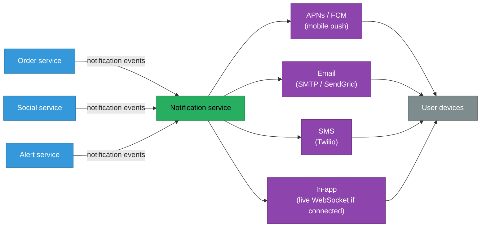
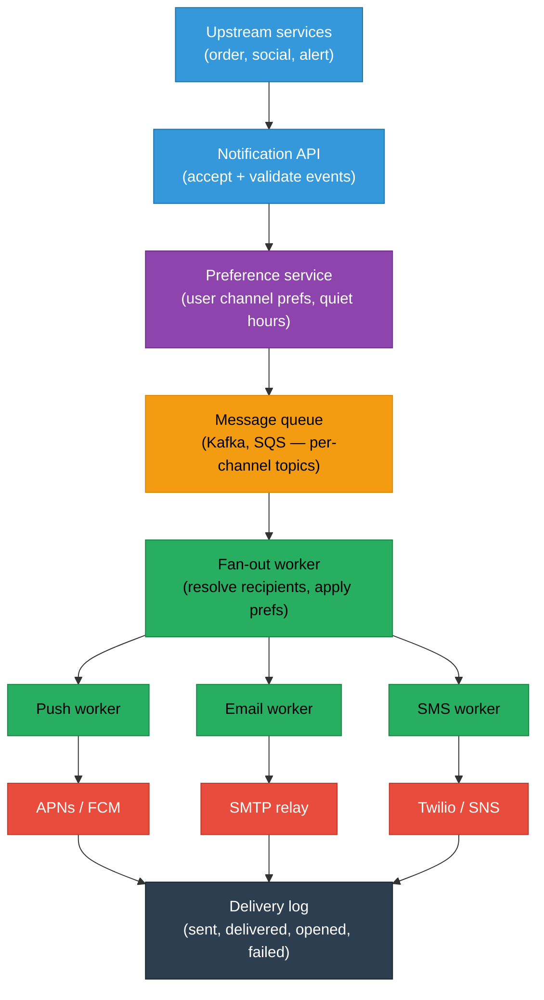
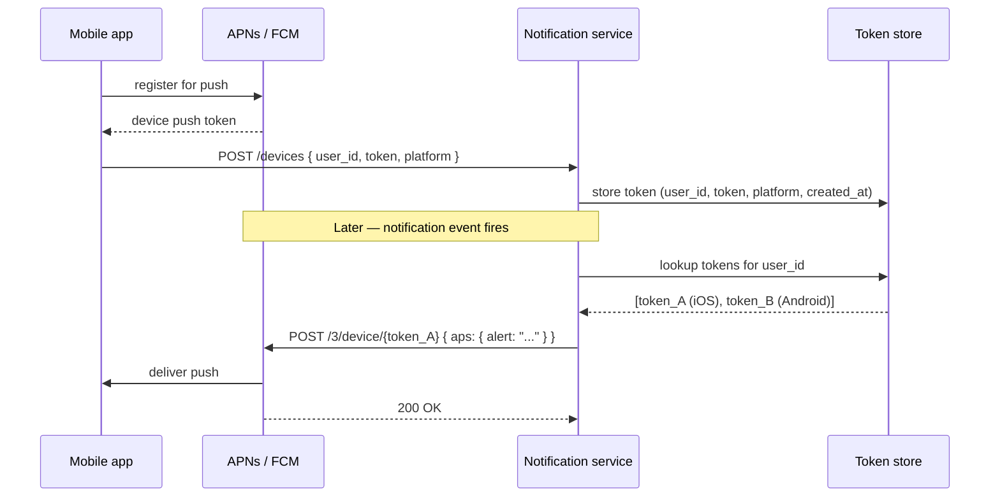
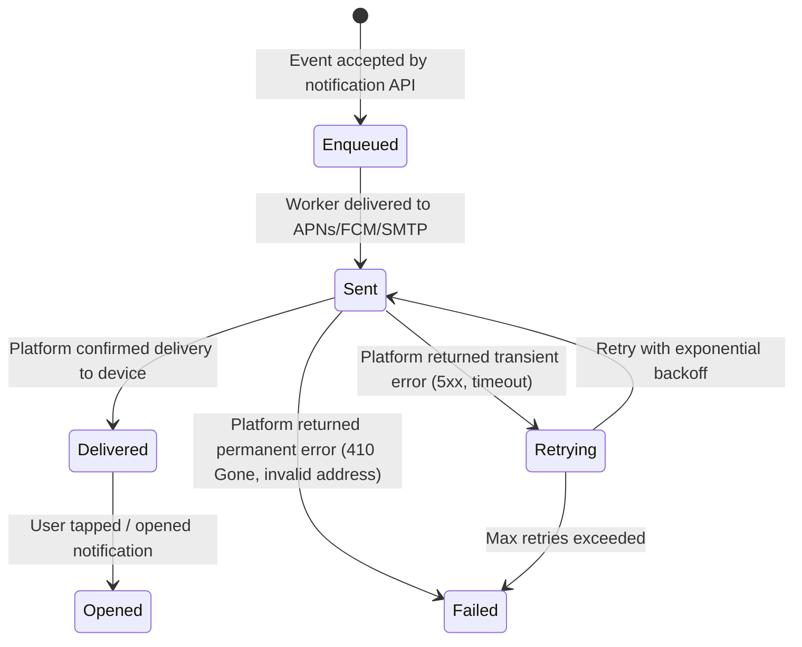

# Notification System Design

A notification system decouples the act of generating an event from the act of telling someone about it — it handles fan-out to millions of devices across channels (push, email, SMS, in-app) while enforcing rate limits, collapse keys, and per-user preferences so users receive relevant alerts rather than a firehose.

<div class="quiz-progress" data-quiz-progress>
  <span class="quiz-progress-label">0/0 checks</span>
  <span class="quiz-progress-bar"><span class="quiz-progress-fill"></span></span>
</div>

---

## 1. What a Notification System Does (and Doesn't Do)

A notification system's job is narrow but critical:
- Accept notification events from upstream services (order placed, comment received, alert fired).
- Determine who should be notified, on which channels, with what content.
- Deliver to the appropriate channel (APNs, FCM, SMTP, Twilio, in-app).
- Track delivery, suppress duplicates, apply rate limits and quiet hours.

**What it is not:** it is not the event bus (Kafka, SQS) feeding it events, and it is not the real-time chat pipeline from [realtime-chat.md](./realtime-chat.md). Those systems push bytes over a live connection; the notification system fires when there is no live connection, or when the event is channel-agnostic (email, SMS). The two systems are complementary: real-time push for live users, notification system for offline delivery and durable channels.



<div class="quiz-card">
  <p class="quiz-q">A user receives a push notification while already viewing the app on their phone. Should the in-app notification also appear?</p>
  <button class="quiz-reveal">Reveal answer</button>
  <div class="quiz-a" hidden>Typically no — the push notification is an offline fallback. If the user has a live WebSocket connection to the real-time chat or in-app notification service, the notification should arrive via that connection, and the push should either be suppressed or sent with a collapse key so it's dismissed if the app is in the foreground. Most mobile platforms (iOS/Android) support background/foreground modes where the app itself can intercept and suppress the OS-level notification when the user is actively looking at it.</div>
</div>

---

## 2. Notification Types and Channels

| Channel | Mechanism | Use case | Latency | Best for |
|---|---|---|---|---|
| **Mobile push (APNs/FCM)** | APNs for iOS, FCM for Android/web | Re-engage offline users | 1–5s | Social alerts, transactional |
| **Email** | SMTP relay, SendGrid, SES | Rich content, audit trail | 10s–5min | Receipts, digests, weekly reports |
| **SMS** | Twilio, SNS | High urgency, guaranteed reach | 5–30s | OTPs, critical alerts, 2FA |
| **In-app** | WebSocket if connected, fallback store | User is active in app | <1s | Low-priority, feed-style notifications |
| **Webhook** | HTTP POST to caller's endpoint | B2B integrations | 1–10s | API-first products, enterprise alerts |

Channels are not mutually exclusive. An order confirmation might send both an email (for the receipt) and a push notification (for immediacy), with the system handling deduplication so the user's experience is coherent.

**User preference layer:** every notification type must be gated against the user's stored preferences (`notifications.order_updates: {push: true, email: true, sms: false}`). The notification service looks up preferences before routing — an unreachable preference store should fail the notification delivery silently, not expose a default that overrides user choice.

<div class="quiz-card">
  <p class="quiz-q">A user disabled email notifications for order updates. The order service fires an event with `channel: ["push", "email"]`. What should the notification service do?</p>
  <button class="quiz-reveal">Reveal answer</button>
  <div class="quiz-a" hidden>Look up the user's preferences before routing. The user has email disabled for order updates, so the service should send push only and skip email entirely — not trust the upstream service's channel list blindly. The notification service owns preference enforcement; upstream services declare intent, not delivery decisions.</div>
</div>

---

## 3. Architecture Overview



The queue between the API and the fan-out worker is the critical isolation boundary: upstream services don't wait for delivery, rate-limit enforcement happens asynchronously, and worker failures don't affect event acceptance. Per-channel queue topics let push, email, and SMS workers scale and fail independently.

---

## 4. Fan-Out Strategies

Fan-out is the problem of delivering one event to many recipients. The scale of the recipient list determines which strategy is appropriate.

<div class="tab-group">
  <div class="tab-buttons">
    <button data-tab="push-fanout" class="active">Push fan-out (write per recipient)</button>
    <button data-tab="broadcast">Broadcast / pull (shared queue)</button>
  </div>
  <div class="tab-panels">
    <div class="tab-panel active" data-tab-panel="push-fanout">

**Push fan-out** — when the event fires, the fan-out worker immediately resolves the full recipient list and creates one delivery task per recipient. Each task is enqueued to the appropriate channel worker.

```
Event: "order_placed", user_id: 42
→ Resolve recipients: [user:42] × channels:[push, email]
→ Enqueue:
    push_queue:  { user:42, template:"order_placed_push", data:{order_id:99} }
    email_queue: { user:42, template:"order_placed_email", data:{order_id:99} }
```

**Pros:** low delivery latency — tasks are enqueued the instant the event fires, workers process them in parallel. Simple per-task retries. Each task is independent, so a failure on one user's push doesn't affect another's email.

**Cons:** if the recipient list is large (a 10M-user broadcast), fan-out creates 10M queue entries synchronously, overwhelming the queue and the workers. Write cost scales linearly with recipient count.

**Best for:** transactional notifications (1 event : 1–10 recipients), social notifications (new follower, comment), anything where immediate delivery matters more than write efficiency.

    </div>
    <div class="tab-panel" data-tab-panel="broadcast">

**Broadcast / pull fan-out** — the event is written once to a shared notification store. Each user's client (or a per-user scheduled pull) fetches new notifications since their last-seen cursor when they next open the app.

```
Event: "system_announcement", segment: "all_users"
→ Write once:
    notifications_store: { id:notify:9900, content:"...", segment:"all_users", created_at: T }

→ Each user's client on app open:
    GET /notifications?since={last_seen_id}
    → server: SELECT * FROM notifications WHERE segment=user_segment AND id > last_seen ORDER BY id
```

**Pros:** write cost is O(1) regardless of audience size. No thundering-herd problem at the queue. Storage cost is one row, not N rows.

**Cons:** latency is bounded by the pull interval — users see the notification only when they open the app (or on a background refresh). Not suitable for time-critical alerts. Per-user filtering at read time can be expensive for complex segmentation rules across millions of users.

**Best for:** product announcements, digest notifications, non-urgent feature flags, anything where eventual delivery (next app open) is acceptable and the audience is huge.

    </div>
  </div>
</div>

Production systems use both: push fan-out for transactional and social notifications (small recipient sets, time-sensitive), broadcast pull for product announcements and mass campaigns (huge audiences, latency-tolerant). The crossover point is typically around 1,000 recipients per event — below that, push fan-out is trivially cheap; above it, the write amplification starts to matter.

<div class="quiz-card">
  <p class="quiz-q">A product team wants to notify 5 million users of a new feature launch. Should they use push fan-out or broadcast pull? What breaks with the wrong choice?</p>
  <button class="quiz-reveal">Reveal answer</button>
  <div class="quiz-a" hidden>Broadcast pull. Push fan-out would enqueue 5 million tasks synchronously — this creates a queue backlog that takes hours to drain, overwhelms push workers, and may cause APNs/FCM rate limits to trigger. With broadcast pull, one database row is written. Users see the notification on their next app open or background refresh. The tradeoff is latency (not instant), which is acceptable for a feature announcement. Use push fan-out for transactional events; use broadcast pull for mass campaigns.</div>
</div>

---

## 5. Mobile Push Delivery: APNs and FCM

Mobile push is the most complex channel because it routes through two external gatekeepers — Apple's APNs (for iOS) and Google's FCM (for Android and web).



**Token lifecycle management** is the operational burden of push delivery:
- Tokens expire when users uninstall the app, revoke permissions, or reinstall.
- APNs returns a `410 Gone` response when a token is permanently invalid — the notification service must delete these tokens immediately, otherwise it wastes delivery attempts and risks APNs rate limits.
- FCM returns `registration_ids` that have changed (canonical IDs) — old tokens must be updated in the store.
- Tokens should be stored with a `last_used_at` timestamp; tokens unused for 90+ days are likely stale and can be pruned.

**APNs connection pooling:** APNs requires HTTP/2 connections using JWT or certificate authentication. Connections are expensive to establish — the notification service should maintain a pool of long-lived connections per APNs environment (sandbox / production) rather than opening a new connection per notification.

<div class="quiz-card">
  <p class="quiz-q">The notification service sends to a device token and APNs returns 410 Gone. What must happen next, and why?</p>
  <button class="quiz-reveal">Reveal answer</button>
  <div class="quiz-a" hidden>Delete the token from the store immediately. 410 Gone means the token is permanently invalid — the app was uninstalled or the user revoked push permissions. Continuing to send to it wastes APNs quota, and APNs may rate-limit or suspend the sender if it keeps attempting delivery to dead tokens. Prompt deletion also keeps the token store clean, preventing stale data from distorting delivery rate metrics.</div>
</div>

---

## 6. Rate Limiting and User Preferences

Without rate limiting, a single upstream bug (an order service looping on retries) can flood a user with hundreds of push notifications in seconds — a reliable way to trigger uninstalls and opt-outs.

**Per-user rate limiting:**

```
Key: rate_limit:{user_id}:{channel}:{window}
     e.g. rate_limit:42:push:hour

Algorithm: sliding window counter (Redis INCR + EXPIRE)

Limits (example):
  push: 10/hour, 20/day
  email: 5/hour, 10/day
  sms: 3/hour, 5/day
```

When the per-user rate limit is exceeded, the notification is either:
- **Dropped**: for low-priority notifications (marketing, feature announcements).
- **Queued for the next window**: for transactional notifications (order confirmations must eventually send).
- **Coalesced into a digest**: instead of 20 individual push notifications, send one summary push ("You have 20 new notifications").

**Quiet hours:** users set a quiet window (e.g., 11pm–7am). Non-urgent notifications arriving during quiet hours are held in a per-user hold queue and released at the start of the next allowed window. Urgent notifications (OTPs, security alerts) bypass quiet hours with an explicit priority flag set by the upstream service.

<div class="quiz-card">
  <p class="quiz-q">A bug causes the social service to emit 500 "new follower" events for a single user in one minute. The rate limit is 10 push/hour. What happens to the 490 over-limit notifications, and what would happen without rate limiting?</p>
  <button class="quiz-reveal">Reveal answer</button>
  <div class="quiz-a" hidden>With rate limiting: the first 10 are delivered, the remaining 490 are either dropped or coalesced into a single "you have many new followers" digest depending on policy. Without rate limiting: all 500 push notifications hit the user's phone simultaneously — the OS notification tray floods, the user likely disables all notifications from the app, and APNs may throttle the app for sending a spike of notifications. Rate limiting protects both users and the app's notification reputation.</div>
</div>

---

## 7. Collapse Keys and Deduplication

A **collapse key** (APNs calls it `apns-collapse-id`, FCM calls it `collapse_key`) tells the platform to replace any previously undelivered notification with the same collapse key rather than stacking multiple notifications.

**Why it matters:** if a user hasn't checked their phone in 30 minutes and the app sent 15 "new message" notifications, showing 15 separate alerts is worse UX than showing one "15 new messages" alert. Collapse keys let the device show only the latest version of a repeating notification type.

```
First notification:  collapse_key="chat_42", body="Alice: hey"
Second notification: collapse_key="chat_42", body="Alice: are you there?"
Third notification:  collapse_key="chat_42", body="Alice: 3 new messages"

→ Device shows only: "Alice: 3 new messages"
   (previous two are replaced, never shown)
```

Collapse keys are scoped per notification type, per conversation, or per sender — whatever grouping makes sense for the UX. They only replace *undelivered* notifications; once the user taps one, subsequent notifications with the same key appear as new.

**Idempotency / dedup:** upstream services may emit duplicate events (at-least-once delivery from Kafka). The notification service deduplicates on an `event_id` before fan-out, using a short-lived Redis key:

```
SETNX dedup:{event_id} 1 EX 300
→ if 0 (key existed): skip, already processed
→ if 1 (key was new): proceed with fan-out
```

TTL of 5 minutes covers the retry window for transient failures without accumulating stale dedup keys indefinitely.

<div class="quiz-card">
  <p class="quiz-q">A collapse key is set on a push notification. The user has their phone on and the notification is delivered immediately. The next notification with the same collapse key arrives 10 seconds later. Will it replace the first one?</p>
  <button class="quiz-reveal">Reveal answer</button>
  <div class="quiz-a" hidden>No — collapse keys only replace undelivered notifications. Once APNs or FCM delivers a notification to the device, the platform drops it from its hold queue. If the first notification was delivered immediately (the device was online), it already appeared on screen; the second notification arrives as a separate new alert. Collapse keys are a hold-queue optimization, not a deduplification mechanism on already-delivered notifications.</div>
</div>

---

## 8. Delivery Tracking and Retry

A notification that leaves the notification service is not the same as one that reached the user. Delivery tracking monitors each stage.



**Retry policy:**
- Transient failures (APNs 5xx, FCM 500, SMTP 4xx temporary): retry with exponential backoff, jitter, max 5 attempts over 30 minutes.
- Permanent failures (APNs 410 Gone, FCM `InvalidRegistration`, SMTP 5xx hard bounce): do not retry. Delete the token or address and mark the delivery as permanently failed.
- Retry state lives in the message queue (SQS dead-letter queue, Kafka retry topic) — the worker doesn't hold retry timers in memory, which would be lost on restart.

**Delivery rate metrics to monitor:**
- Push delivery rate (sent / attempted) — sudden drops indicate token rot or APNs issues.
- Email bounce rate (hard + soft) — above 5% triggers SendGrid/SES account review.
- SMS delivery rate — operator routing issues show as sudden regional drops.
- Notification open rate — proxy for user engagement, tracked via a callback URL in the push payload.

<div class="quiz-card">
  <p class="quiz-q">APNs returns a 500 error when the notification service tries to deliver a push. Should the service retry immediately, retry with backoff, or drop the notification?</p>
  <button class="quiz-reveal">Reveal answer</button>
  <div class="quiz-a" hidden>Retry with exponential backoff. A 500 from APNs is a transient server error — the token is valid, but APNs is temporarily unavailable or overloaded. Retrying immediately on a 500 would amplify the load on APNs during an already-strained moment; exponential backoff (e.g., 5s, 20s, 60s, 5min, 15min) gives APNs time to recover while preserving the delivery. Dropping it would silently lose a notification the user expects. Only permanent errors (410 Gone, 400 BadDeviceToken) justify dropping without retry.</div>
</div>

---

## Quick Reference

```
Notification vs real-time push       → notification system for offline/durable delivery; WebSocket for live users
Channel routing                      → look up user prefs before routing; upstream service declares intent, not delivery
Push fan-out (small recipient set)   → create one task per recipient per channel at event time; low latency
Broadcast pull (huge audience)       → write event once; users fetch on next app open; O(1) write cost
APNs token 410 Gone                  → delete token immediately, do not retry
Token freshness                      → prune tokens unused > 90 days; update on FCM canonical ID response
Rate limiting                        → sliding window counter in Redis; drop low-priority, queue transactional
Quiet hours                          → hold non-urgent notifications; release at window start; urgent bypass
Collapse key                         → replace undelivered notification of same type with latest version
Deduplication                        → SETNX on event_id with 5-minute TTL before fan-out
Transient delivery failure           → exponential backoff, max 5 retries; store state in queue, not memory
Permanent delivery failure           → delete token/address, mark failed, do not retry
Delivery tracking states             → enqueued → sent → delivered → opened (also: retrying, failed)
```
