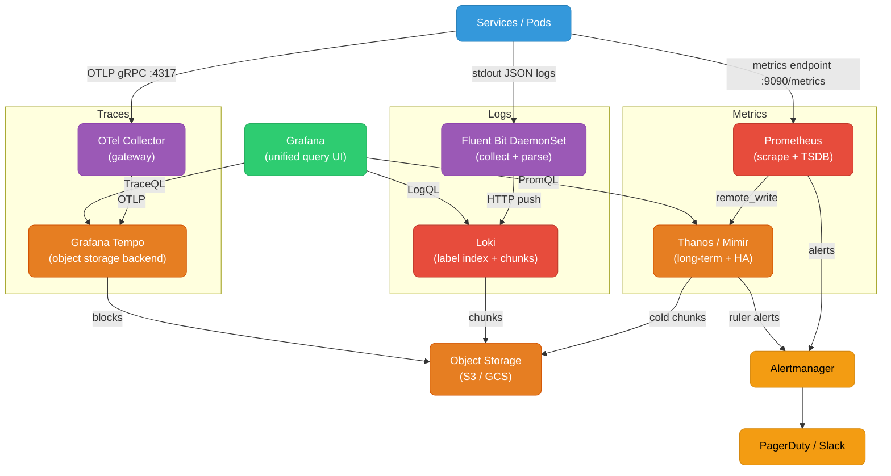

# Observability System Design

Designing an observability platform means building three interconnected pipelines — metrics, logs, and traces — that converge into a unified query and alerting layer without causing the system being observed to become the bottleneck.

<div class="quiz-progress" data-quiz-progress>
  <span class="quiz-progress-label">0/0 checks</span>
  <span class="quiz-progress-bar"><span class="quiz-progress-fill"></span></span>
</div>

---

## Requirements

**Functional:**
- Ingest metrics from all services and infrastructure (Prometheus scrape + remote_write)
- Store and query structured logs with label-based indexing
- Collect distributed traces; correlate spans across services
- Unified query UI (Grafana) with cross-pillar drill-down: metric spike → trace → log line
- Alerting with routing, inhibition, and deduplication

**Non-functional (baseline for a 100-service platform):**

| Signal | Ingestion rate | Retention | Query p99 |
|---|---|---|---|
| Metrics | 2M samples/sec (10K series × 200 metrics) | 13 months | < 2s |
| Logs | 100K lines/sec | 30 days hot, 1 year cold (S3) | < 3s |
| Traces | 50K spans/sec (10K RPS × 5 avg spans) | 7 days | < 5s |

---

## Architecture



---

## Metrics Pipeline

### Prometheus → Thanos / Mimir

Prometheus scrapes targets every 15s and writes to a local TSDB (2-hour head block + 2-hour WAL). This is sufficient for short-term query but not for:
- **Retention beyond 15 days** — local disk fills up
- **High availability** — single Prometheus is a SPOF
- **Cross-cluster querying** — each cluster has its own Prometheus

**Thanos architecture:**

| Component | Role |
|---|---|
| Sidecar | Runs beside each Prometheus; ships blocks to S3 every 2h; proxies queries to local Prometheus |
| Store Gateway | Reads blocks from S3; answers PromQL for historical data |
| Querier | Fan-out query layer; merges results from sidecar + store gateway; deduplicates HA replica data |
| Compactor | Merges 2h blocks → 24h → 48h; applies retention; runs as a singleton |
| Ruler | Evaluates recording rules and alerting rules against long-term data |

**Mimir** is the Grafana Labs alternative: a single horizontally scalable binary replacing all Thanos components. Prefer Mimir for new installations (simpler ops); Thanos for existing Prometheus fleets where sidecar is already deployed.

### Cardinality — the Critical Design Constraint

**Cardinality = number of unique label combinations** (time series). A single high-cardinality label (`user_id`, `request_id`, `pod_uid`) can explode from 10K to 10M series overnight.

Rules:
- Never use unbounded values as labels: `user_id`, `trace_id`, `IP`, `URL path with IDs`
- Bucket dynamic values: `http_request_duration_seconds{status_class="2xx"}` not `{status="200"}`
- Audit with `prometheus.tsdb.head_series` metric; alert at > 2M series

**Recording rules for expensive aggregations:**

```yaml
# rules/api-recording.yaml
groups:
  - name: api_request_rate
    interval: 1m
    rules:
      - record: job:http_requests_total:rate5m
        expr: sum by (job) (rate(http_requests_total[5m]))
      - record: job:http_request_duration_p99:5m
        expr: histogram_quantile(0.99, sum by (job, le) (rate(http_request_duration_seconds_bucket[5m])))
```

Recording rules pre-compute aggregations; dashboards query the pre-computed series, not the raw high-cardinality data. Query time drops from seconds to milliseconds.

### Downsampling

Thanos Compactor applies two levels of downsampling to old data:
- **5-minute resolution** — applied to data older than 40 days
- **1-hour resolution** — applied to data older than 10 months

Dashboards with a 6-month time range query the 1h resolution automatically (`step` parameter selects the right resolution). This keeps Grafana dashboards fast at any time range without full-scan.

---

## Log Pipeline

### Fluent Bit → Loki

**Fluent Bit DaemonSet** tails `/var/log/containers/*.log` (container stdout/stderr) on each node. It parses, filters, and batches log lines before pushing to Loki.

```yaml
# fluent-bit ConfigMap (key sections)
[INPUT]
    Name              tail
    Path              /var/log/containers/*.log
    Parser            docker
    DB                /var/log/flb_kube.db
    Mem_Buf_Limit     50MB
    Skip_Long_Lines   On

[FILTER]
    Name                kubernetes
    Match               kube.*
    Kube_URL            https://kubernetes.default.svc:443
    Merge_Log           On        # merge JSON payload into top-level fields
    Keep_Log            Off
    K8S-Logging.Parser  On

[OUTPUT]
    Name   loki
    Match  kube.*
    Host   loki.monitoring.svc
    Port   3100
    Labels job=fluentbit, namespace=$kubernetes['namespace_name'], pod=$kubernetes['pod_name']
```

### Loki Label Strategy

Loki indexes only the **labels**, not the log content. LogQL full-text search works by streaming matching chunks and applying grep. High-cardinality labels create too many streams:

**Good labels (low cardinality):**
- `namespace`, `app`, `environment`, `level`

**Bad labels (high cardinality — use structured metadata instead):**
- `pod_name` (thousands of pods), `request_id`, `user_id`

Loki 2.9+ supports **structured metadata** (key-value pairs stored per log line, not as stream labels) for high-cardinality per-line fields. This avoids stream explosion while keeping the data queryable.

### Kafka Buffer for Burst

At 100K lines/sec sustained, a log spike (deploy, incident) can hit 500K+ lines/sec. Loki ingesters will 429 if overwhelmed. Insert Kafka between Fluent Bit and Loki:

```
Fluent Bit → Kafka topic:logs → Loki Promtail (consumer) → Loki
```

Kafka absorbs bursts; Promtail consumers drain at Loki's sustainable rate. The tradeoff: ~30s additional log latency (acceptable), and Kafka adds operational complexity.

### Cold Log Storage

Loki's `compactor` component applies retention and moves old chunks to S3 object storage. Set a hot-tier retention of 30 days (SSD/NVMe) and configure S3 lifecycle rules to delete after 365 days:

```yaml
# loki.yaml
compactor:
  retention_enabled: true
  retention_delete_delay: 2h

limits_config:
  retention_period: 720h   # 30 days per-tenant default
```

---

## Trace Pipeline

### OTel Collector Gateway → Tempo

Applications instrument with the OpenTelemetry SDK and export spans to an OTel Collector **gateway** (not sidecar). The gateway batches, samples, and routes:

```yaml
# otel-collector-gateway.yaml (key sections)
receivers:
  otlp:
    protocols:
      grpc:
        endpoint: 0.0.0.0:4317

processors:
  batch:
    timeout: 1s
    send_batch_size: 10000
  tail_sampling:
    decision_wait: 10s
    policies:
      - name: errors-always
        type: status_code
        status_code: {status_codes: [ERROR]}
      - name: slow-requests
        type: latency
        latency: {threshold_ms: 1000}
      - name: probabilistic
        type: probabilistic
        probabilistic: {sampling_percentage: 10}

exporters:
  otlp:
    endpoint: tempo.monitoring.svc:4317
    tls:
      insecure: true

service:
  pipelines:
    traces:
      receivers: [otlp]
      processors: [batch, tail_sampling]
      exporters: [otlp]
```

### Sampling Strategies

| Strategy | How | When |
|---|---|---|
| **Head-based (probabilistic)** | Decision at trace root; 10% of all traces | Low cost, consistent; misses rare slow/error traces |
| **Tail-based** | Buffer all spans 10s, decide after knowing outcome | Captures all errors/slow traces; memory intensive at high RPS |
| **Hybrid** | Tail-sample for errors + head-sample 5% of successes | Best coverage, requires OTel Collector gateway (not sidecar) |

### Trace Retention vs Cost

Tempo stores traces in object storage (S3). At 50K spans/sec × 1KB avg span = 50 MB/sec = ~4 TB/day. 7 days = 28 TB. Use Tempo's block retention:

```yaml
# tempo.yaml
compactor:
  ring:
    kvstore:
      store: memberlist
  block_retention: 168h   # 7 days
```

For longer retention, apply S3 Intelligent-Tiering — traces older than 3 days are rarely queried.

---

## Alerting System Design

### Alertmanager Routing Tree

```yaml
# alertmanager.yaml
route:
  receiver: default-pagerduty
  group_by: [alertname, cluster, namespace]
  group_wait: 30s       # collect alerts for 30s before first notification
  group_interval: 5m    # resend grouped alert every 5m
  repeat_interval: 4h   # re-notify every 4h if still firing

  routes:
    - match:
        severity: critical
      receiver: pagerduty-critical
      continue: false

    - match:
        severity: warning
      receiver: slack-warnings
      continue: false

    - match:
        team: payments
      receiver: payments-pagerduty
      group_by: [alertname]
```

### Inhibition — Prevent Alert Storms

When a cluster is down, every service on it fires alerts. Inhibition silences child alerts when a parent is firing:

```yaml
inhibit_rules:
  - source_match:
      alertname: ClusterDown
    target_match_re:
      alertname: ".+"
    equal: [cluster]   # only inhibit alerts in the same cluster

  - source_match:
      alertname: NodeDown
    target_match:
      alertname: PodCrashLooping
    equal: [node]      # pod crash on a down node is a symptom, not root cause
```

### Multi-Window Burn Rate Alerts (SLO-based)

A 99.9% availability SLO allows 43.8 minutes downtime/month. A burn rate of 1.0 exhausts the error budget in exactly 30 days. Use two windows to catch both fast burns (short window) and slow burns (long window):

```yaml
# prometheus alert rules
groups:
  - name: slo-burn-rate
    rules:
      # Fast burn: 14.4× budget consumption over 1h (exhausts in 2h)
      - alert: HighErrorBudgetBurnRate
        expr: |
          (
            job:http_requests_errors:rate5m / job:http_requests_total:rate5m
            > (14.4 * 0.001)  # 1 - 0.999 SLO = 0.001 error budget
          )
          and
          (
            job:http_requests_errors:rate1h / job:http_requests_total:rate1h
            > (14.4 * 0.001)
          )
        for: 2m
        labels:
          severity: critical
        annotations:
          summary: "High error budget burn rate — page immediately"

      # Slow burn: 3× budget consumption over 6h (exhausts in 10 days)
      - alert: MediumErrorBudgetBurnRate
        expr: |
          (
            job:http_requests_errors:rate30m / job:http_requests_total:rate30m
            > (3 * 0.001)
          )
          and
          (
            job:http_requests_errors:rate6h / job:http_requests_total:rate6h
            > (3 * 0.001)
          )
        for: 15m
        labels:
          severity: warning
        annotations:
          summary: "Elevated error budget burn — ticket required"
```

The recording rules `job:http_requests_errors:rate5m` etc. are pre-computed by the rules from the Metrics section.

---

## Multi-Tenant Architecture

For a platform serving multiple teams, isolate data and apply per-tenant retention.

**Mimir / Cortex** — natively multi-tenant. Each tenant sends a `X-Scope-OrgID` header; data is stored in separate TSDB blocks per tenant:

```yaml
# mimir config
multitenancy_enabled: true
```

**Loki** — same header:

```yaml
auth_enabled: true  # enforces X-Scope-OrgID
```

**Tenant-level rate limits** (Mimir / Loki):

```yaml
overrides:
  tenant-payments:
    ingestion_rate: 100000        # samples/sec
    max_series_per_user: 5000000
  tenant-ml:
    ingestion_rate: 50000
    retention_period: 30d         # shorter retention for ML dev metrics
```

Grafana enforces tenant isolation via **Organizations** or **data source permissions** — each team's Grafana service account can only query their tenant's data sources.

---

## Failure Modes

| Failure | Symptom | Root cause | Fix |
|---|---|---|---|
| Prometheus OOM | Pod OOM-killed | Cardinality explosion — one label added millions of series | Audit with `prometheus_tsdb_head_series`; drop or aggregate the offending label |
| Loki ingester lag | Logs 5–30 min delayed | Log burst overwhelmed ingesters; WAL replay after restart | Add Kafka buffer; increase ingester replicas; tune `ingestion_rate_mb` |
| Thanos Store Gateway slow | Dashboard timeouts on 30d+ ranges | Object storage latency (S3 LIST on many blocks) | Enable compaction to merge small blocks; use Thanos query caching (`--query.response-cache`) |
| Alertmanager split-brain | Duplicate pages | Two AM instances without a mesh (clustering misconfigured) | Configure AM `--cluster.peer` flags; verify gossip with `amtool cluster show` |
| OTel Collector backpressure | Spans dropped | Downstream Tempo unavailable; queue full | Enable `queuing_exporter` with `num_consumers: 10, queue_size: 10000`; alert on `otelcol_exporter_send_failed_spans` |

---

<div class="quiz-card">
  <p class="quiz-q">Your team adds a `user_id` label to the `http_requests_total` metric. The service has 500K active users. What happens to Prometheus, and how do you fix it without losing per-user visibility?</p>
  <button class="quiz-reveal">Reveal answer</button>
  <div class="quiz-a" hidden>Adding `user_id` as a label creates 500K new time series for that single metric — likely crashing Prometheus with OOM or degrading scrape performance immediately. The fix: remove `user_id` from the metric label. For per-user visibility, use logs (emit a structured log line per request with `user_id` as a field; query with LogQL) or traces (tag spans with `user.id` as a span attribute, not a label). If you truly need per-user metrics aggregated, use a recording rule to compute user-bucket histograms, or Loki's log-to-metric ruler to derive counters from log patterns. The rule: labels must have bounded cardinality; user IDs, request IDs, and session IDs belong in logs/traces, not metrics.</div>
</div>

<div class="quiz-card">
  <p class="quiz-q">Traces are sampling at 10% head-based. An incident occurs where 0.5% of requests are failing with a 500 error. How many error traces are you capturing, and what is the better sampling strategy?</p>
  <button class="quiz-reveal">Reveal answer</button>
  <div class="quiz-a" hidden>With 10% head-based sampling, you capture 10% of error requests → 0.5% × 10% = 0.05% of total requests are error traces captured. At 10K RPS, that is 5 error traces/sec — reasonable. But at 1K RPS with a brief spike of 1% errors (10 errors/sec), you capture only 1 error trace/sec, which may not be enough to diagnose the issue. The better strategy is tail-based sampling with an `errors-always` policy: buffer all spans for a completion window (10s), and if the root span has status=ERROR, emit the entire trace regardless of sample rate. Also sample 5–10% of successful traces for baseline. This guarantees every error trace is captured while keeping storage cost bounded. Tail-sampling requires a stateful OTel Collector gateway (not per-pod sidecars), because the root span decision must wait for all child spans to arrive.</div>
</div>

<div class="quiz-card">
  <p class="quiz-q">An alert fires: `HighErrorBudgetBurnRate` at 14.4× burn rate. The service has a 99.9% SLO. At this burn rate, in how many hours will the monthly error budget be exhausted, and what severity page does it warrant?</p>
  <button class="quiz-reveal">Reveal answer</button>
  <div class="quiz-a" hidden>A 99.9% SLO has an error budget of 0.1% of requests/month. A 14.4× burn rate means the budget is consumed 14.4× faster than the baseline 30-day pace. Time to exhaustion = 30 days / 14.4 ≈ 2.08 days ≈ 50 hours. More practically: the multi-window rule requires both the 5m and 1h windows to be above the threshold, confirming this is not a transient spike. This warrants a critical page — wake someone up. The 3× slow-burn alert (30m + 6h windows) would warrant a ticket instead, since it exhausts in ~10 days. The two-alert system is designed exactly to distinguish "fix now" from "fix this week."</div>
</div>
