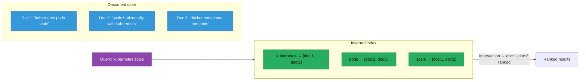
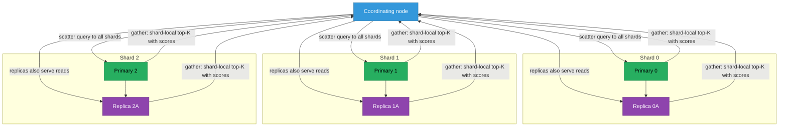
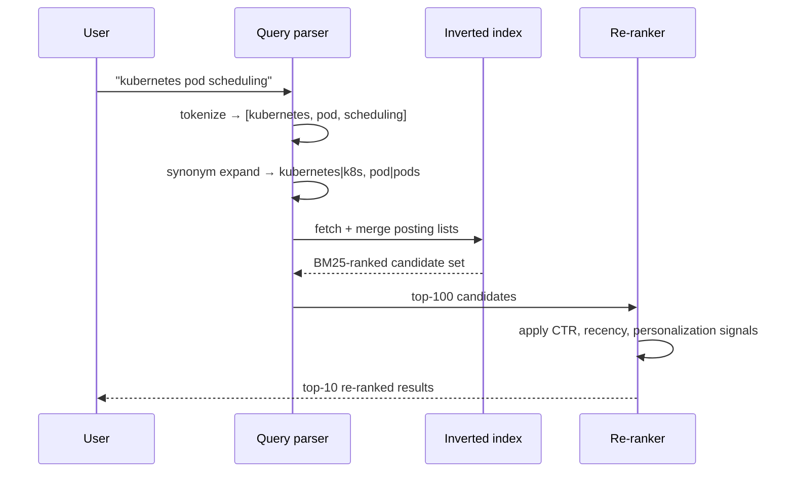
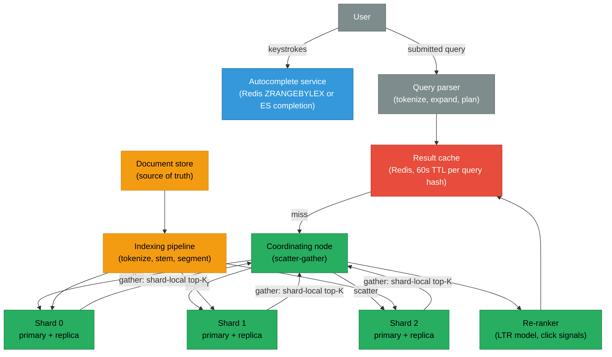

# Search System Design

An inverted index maps every term to the list of documents containing it — the core idea is the same whether you are searching 10,000 records or 10 billion. This page covers how that index is built and queried, how BM25 ranking works, how autocomplete is layered on top, and what it takes to distribute the whole system without turning it into a write bottleneck.

<div class="quiz-progress" data-quiz-progress>
  <span class="quiz-progress-label">0/0 checks</span>
  <span class="quiz-progress-bar"><span class="quiz-progress-fill"></span></span>
</div>

---

## 1. Why Search Needs an Inverted Index

A relational database can answer `SELECT * FROM docs WHERE body LIKE '%kubernetes%'` — but it does it by scanning every row, every time. At 100 million documents that scan takes minutes. No B-tree index helps because a leading wildcard means the engine can't use one. And even after the scan, results have no concept of relevance: a document with 50 occurrences of "kubernetes" ranks the same as one with one.

Search is a fundamentally different access pattern. The fix is to build an index at write time that makes text queries fast at read time: an **inverted index** that maps every term to the sorted list of documents containing it.



The query "kubernetes scale" is now a two-pointer merge of two sorted posting lists — an O(n+m) operation where n and m are posting list lengths, not the corpus size.

<div class="quiz-card">
  <p class="quiz-q">A database LIKE '%kubernetes%' and a search engine query for "kubernetes" both return matching documents. Why is the search engine faster at scale?</p>
  <button class="quiz-reveal">Reveal answer</button>
  <div class="quiz-a" hidden>LIKE with a leading wildcard forces a full table scan — B-tree indexes require a known prefix. The search engine pre-built an inverted index mapping "kubernetes" to exactly the document IDs containing it, so the query is a direct key lookup into a sorted list. The work is paid at index time, not query time. At 100M documents the difference is minutes vs milliseconds.</div>
</div>

---

## 2. Inverted Index: The Core Data Structure

An inverted index has two parts:
- A **term dictionary**: a sorted list of all unique terms, each pointing to a posting list.
- **Posting lists**: for each term, a sorted list of `(doc_id, term_frequency, positions)` tuples.

```
Term dictionary         Posting lists
───────────────────────────────────────────────────────────────────
containers          →   [(doc:3, tf:1, pos:[3])]
docker              →   [(doc:3, tf:1, pos:[0])]
kubernetes          →   [(doc:1, tf:1, pos:[0]), (doc:2, tf:1, pos:[3])]
pods                →   [(doc:1, tf:1, pos:[2]), (doc:3, tf:1, pos:[4])]
scale               →   [(doc:1, tf:1, pos:[3]), (doc:2, tf:1, pos:[0])]
```

Posting lists are sorted by `doc_id`. Merging two lists (AND query) is a two-pointer walk — O(n+m) — the same as merging two sorted arrays.

### Segment-based storage

Real search engines (Lucene/Elasticsearch, Tantivy) don't maintain one giant index file. They write **segments**: small, immutable inverted index files. New documents go into an in-memory buffer; when the buffer is full it's flushed to disk as a new segment. Segments are periodically **merged** in the background to keep their count low.


Segments are write-once. A document "update" is an indexed new version plus a deletion tombstone on the old one. Physical deletion happens only during segment merges.

<div class="quiz-card">
  <p class="quiz-q">Why are segments immutable? Why not update posting lists in place when a document changes?</p>
  <button class="quiz-reveal">Reveal answer</button>
  <div class="quiz-a" hidden>In-place updates to a sorted posting list require shifting all subsequent entries (expensive in a flat file) or B-tree page writes per change. Immutable segments sidestep both: new data is appended as a new segment, the old version gets a tombstone, and merges compact things away in the background. Reads also never contend with in-progress writes — a segment that exists is complete and safe to read concurrently without locks.</div>
</div>

---

## 3. Indexing Pipeline

Getting raw text into a searchable inverted index is a multi-step pipeline. Every step runs at index time, so the query pays none of this cost.

<div class="stepper">
  <div class="stepper-panels">
    <div class="stepper-panel active">
      <strong>Step 1 — Tokenization.</strong> Split the raw text into tokens. "Kubernetes pods scale horizontally" → ["Kubernetes", "pods", "scale", "horizontally"]. Tokenizers vary by language: CJK text needs a character-level or dictionary-based splitter; English typically splits on whitespace and punctuation. URLs, emails, and code identifiers need special rules to avoid splitting at every dot and slash.
    </div>
    <div class="stepper-panel">
      <strong>Step 2 — Normalization.</strong> Lowercase all tokens ("Kubernetes" → "kubernetes"). Apply unicode normalization and accent folding so "Café" and "cafe" hit the same index entry. Decide whether hyphens in compound words are preserved or stripped.
    </div>
    <div class="stepper-panel">
      <strong>Step 3 — Stop-word removal.</strong> High-frequency words with low discriminative value ("a", "the", "is") are dropped from the index. They add nothing to ranking and inflate index size. Some search applications skip this step to support phrase queries where stop words are semantically meaningful ("to be or not to be").
    </div>
    <div class="stepper-panel">
      <strong>Step 4 — Stemming or lemmatization.</strong> "running", "runs", "ran" all reduce to "run" so they match the same queries. Stemmers (Porter, Snowball) use rule-based suffix stripping — fast but imprecise. Lemmatizers use vocabulary lookups for the canonical word form — slower but accurate.
    </div>
    <div class="stepper-panel">
      <strong>Step 5 — Posting list construction.</strong> Processed tokens, with their doc IDs and positions, are appended to the in-memory buffer. When the buffer reaches its size threshold it flushes to disk as a new immutable segment (Section 2).
    </div>
  </div>
  <div class="stepper-controls">
    <button class="stepper-prev">← Prev</button>
    <span class="stepper-dots"></span>
    <span class="stepper-label"></span>
    <button class="stepper-next">Next →</button>
  </div>
</div>

**The analysis chain must be identical at query time.** If the indexer lowercases and stems, the query parser must do the same — otherwise querying "Running" never matches the indexed token "run". Mismatch between index-time and query-time analyzers is one of the most common causes of "search works in dev but not in prod."

<div class="quiz-card">
  <p class="quiz-q">A user searches for "Kubernetes" (capital K) but the indexed token is "kubernetes" (lowercase). Will the query match?</p>
  <button class="quiz-reveal">Reveal answer</button>
  <div class="quiz-a" hidden>Only if the query-time analyzer also lowercases the input. The term "Kubernetes" doesn't exist in the term dictionary — only "kubernetes" does. The query must go through the same pipeline: lowercase "Kubernetes" → "kubernetes", then look it up. If the query is sent raw, the result is empty. Same-analyzer-at-index-and-query-time is the invariant.</div>
</div>

---

## 4. Ranking: TF-IDF and BM25

Returning every matching document is not enough — 10,000 documents can contain "kubernetes". The engine needs to rank them by relevance.

### TF-IDF

The classic baseline: a document is more relevant if the query term appears often in it (**term frequency**, TF), discounted by how common the term is across the corpus (**inverse document frequency**, IDF — common words are less discriminative).

```
TF(t, d)    = count of t in d / total tokens in d
IDF(t)      = log(N / df(t))
              N = total documents, df(t) = docs containing t

score(t, d) = TF(t,d) × IDF(t)
```

**Problem:** a 10,000-word document with 10 occurrences of "kubernetes" scores higher than a 100-word document with 5 occurrences — even though the short document is far denser on the topic.

### BM25 — the practical standard

BM25 (Best Match 25) fixes TF-IDF's length bias with two saturation parameters: `k1` controls TF saturation (more occurrences stop helping past a threshold) and `b` controls document-length normalization. Elasticsearch, Solr, and Lucene all default to BM25.

```
BM25(t, d) = IDF(t) × TF(t,d) × (k1 + 1)
                       ─────────────────────────────────────────
                       TF(t,d) + k1 × (1 - b + b × |d| / avgdl)

k1 = 1.2  (typical default)
b  = 0.75 (typical default)
|d|    = document length in tokens
avgdl  = average document length across the corpus
```

Key effects:
- TF saturates: doubling occurrence count doesn't double the score.
- A dense short document scores higher than a sparse long one for the same term count.
- `b=0` disables length normalization; `b=1` applies full normalization.

<div class="quiz-card">
  <p class="quiz-q">Doc A is 50 words, "kubernetes" appears 3 times. Doc B is 5,000 words, "kubernetes" also appears 3 times. Which scores higher under BM25 and why?</p>
  <button class="quiz-reveal">Reveal answer</button>
  <div class="quiz-a" hidden>Doc A scores higher. BM25's length normalization divides the TF contribution by a term that includes document length relative to average length. A 5,000-word document with only 3 occurrences is sparse on the topic; a 50-word document with 3 occurrences is dense. TF-IDF scores them equally (same raw term count); BM25's `b` parameter makes document length matter, penalizing long documents that merely include the term a few times in passing.</div>
</div>

---

## 5. Autocomplete and Typeahead

A query-as-you-type experience needs sub-50ms latency on prefix lookups — "kube" must return "kubernetes", "kubeadm", "kubelet" before the user finishes typing. The inverted index from Section 2 is not designed for prefix matching; dedicated data structures handle autocomplete.

<div class="tab-group">
  <div class="tab-buttons">
    <button data-tab="trie" class="active">Trie</button>
    <button data-tab="redis-zset">Redis sorted set</button>
    <button data-tab="es-complete">ES completion</button>
  </div>
  <div class="tab-panels">
    <div class="tab-panel active" data-tab-panel="trie">

**In-memory trie** — each node is a character; a root-to-leaf path spells a complete term. Prefix lookup is O(prefix length): walk from root to the prefix node, then enumerate all leaves beneath it.

```
         k
         |
         u
         |
         b
       / | \
      e  e  e
      |  |  |
      c  a  l
      |  |  e
      t  d  t
      l  m
      l
```

Query "kube": walk to the `b` node, enumerate subtree leaves → [kubectl, kubeadm, kubelet, kubernetes].

**Pros:** very fast lookup, natural prefix semantics, supports fuzzy/edit-distance extensions.

**Cons:** lives entirely in memory — a 10M-term trie can consume several GB. Rebuilds on dictionary changes are expensive. Every server must hold a full copy, or a distributed trie adds significant complexity.

**Best for:** small-to-medium suggestion dictionaries (10k–1M terms), baked into a service with infrequent updates.

    </div>
    <div class="tab-panel" data-tab-panel="redis-zset">

**Redis sorted set + ZRANGEBYLEX** — terms are stored as members with score 0 so Redis sorts them lexicographically. A prefix lookup is a range scan.

```bash
ZADD suggestions 0 "kubectl"
ZADD suggestions 0 "kubeadm"
ZADD suggestions 0 "kubelet"
ZADD suggestions 0 "kubernetes"

ZRANGEBYLEX suggestions "[kube" "[kube\xff" LIMIT 0 10
# → ["kubeadm", "kubectl", "kubelet", "kubernetes"]
```

To incorporate popularity, maintain a parallel sorted set with scores = query count, merge the lex prefix filter with a score sort via a Lua script or client-side merge after fetching the prefix bucket.

**Pros:** trivially horizontally scalable (Redis Cluster), low operational overhead, near-zero rebuild cost (add/remove members), popularity scoring via scores.

**Cons:** exact prefix only — no fuzzy matching. At 100M+ terms, memory cost becomes the binding constraint.

**Best for:** search suggestion overlays backed by query logs, category/tag autocomplete, dictionaries that update frequently (per-minute ingestion of new search queries as popularity signals).

    </div>
    <div class="tab-panel" data-tab-panel="es-complete">

**Elasticsearch completion suggester** — a dedicated field type that builds an in-memory FST (Finite State Transducer) per shard, optimized specifically for prefix lookups.

```json
PUT /search-index
{
  "mappings": {
    "properties": {
      "suggest": { "type": "completion" }
    }
  }
}

PUT /search-index/_doc/1
{
  "suggest": {
    "input": ["kubectl", "kubernetes", "kubeadm"],
    "weight": 100
  }
}

POST /search-index/_suggest
{
  "my-suggestion": {
    "prefix": "kube",
    "completion": { "field": "suggest", "size": 5 }
  }
}
```

**Pros:** integrated with the existing ES cluster (no separate infra), supports context-based filtering (only show completions for the user's current category/tenant), weight-based ranking, fuzzy prefix out of the box.

**Cons:** FST is rebuilt on every segment merge — completion fields are sensitive to heavy index churn. Weight is the only ranking signal (can't use standard ES scoring). Large completion dictionaries inflate shard heap memory significantly.

**Best for:** document-search products already running Elasticsearch where the suggestion dictionary is the indexed document corpus (titles, tags, named entities).

    </div>
  </div>
</div>

**Personalization layer:** all three structures above return globally popular completions. To personalize, add a rerank step: fetch 50 completions from the global structure, score each with user-specific signals (search history, recent interactions), return the top 10. The global prefix lookup stays O(prefix length); personalization is a tiny in-memory operation on the candidate list.

<div class="quiz-card">
  <p class="quiz-q">A user types "kube" and expects to see their recently searched "kubefwd" at the top, even though it's globally unpopular. Does a global trie or Redis sorted set handle this without modification?</p>
  <button class="quiz-reveal">Reveal answer</button>
  <div class="quiz-a" hidden>No — both return globally ranked results. The personalization layer sits on top: the global structure returns its top-N completions for the prefix (fast, cheap), then a per-user rerank step fetches the user's recent queries matching the prefix and promotes them. The global structure doesn't know about individual users; the rerank step adds that signal without making the prefix lookup expensive.</div>
</div>

---

## 6. Distributed Search: Sharding and Replication

A corpus of one billion documents doesn't fit on one machine. The Lucene/Elasticsearch model distributes across two dimensions:

- **Primary shards**: the index is split into N shards, each holding a non-overlapping slice of the document space. Routing is typically `hash(doc_id) % N`. Each machine holds 1/N of the index and serves 1/N of indexing throughput.
- **Replica shards**: each primary is copied to M replicas. Replicas serve read queries (improving throughput and availability) and receive updates from the primary after commit.



### Scatter-gather query execution

A query lands on a **coordinating node** (any ES node can coordinate). The coordinator:
1. Broadcasts the query to one copy of every shard (scatter).
2. Each shard runs the query locally, returns its local top-K results with scores.
3. Coordinator merges all results by score globally and returns the final top-K (gather).

**IDF artifact:** each shard computes IDF relative to its own local corpus slice — a term appearing in all documents on one shard looks artificially rare from that shard's perspective. The fix is computing global IDF statistics before scatter, at the cost of an extra round trip.

<div class="quiz-card">
  <p class="quiz-q">You have 5 shards and run a query for top 10 results. How many results must each shard return to the coordinator, and why?</p>
  <button class="quiz-reveal">Reveal answer</button>
  <div class="quiz-a" hidden>Each shard returns its own top 10 (50 total across all shards). The coordinator can't ask each shard for only 2 (10/5) because the globally highest-scored results might all live on one shard. Undercounting per shard means the coordinator could miss them. The default (top-K per shard, global merge) trades modest over-fetching for correctness. For deep pagination this multiplier compounds — `from: 1000, size: 10` requires each shard to return 1,010 results.</div>
</div>

---

## 7. Query Processing

A user query like `"kubernetes pod scheduling"` goes through several transformations before the index is touched:

1. **Parsing**: tokenize and analyze using the same analyzer as the indexer.
2. **Query rewriting**: synonym expansion ("k8s" → "kubernetes"), spell correction ("kubernets" → "kubernetes").
3. **Query planning**: decide clause combination. AND = high precision, lower recall. OR = high recall, ranked by match count. Phrase query = terms must appear adjacent, in order (requires position data in posting lists).
4. **Posting list merge**: execute the plan against the inverted index to produce a scored candidate set.
5. **Re-ranking**: apply secondary signals (recency, click-through rate, personalization) to the top-K BM25 results.



<div class="quiz-card">
  <p class="quiz-q">A user searches for "k8s" but all documentation is indexed as "kubernetes". How does the system return results?</p>
  <button class="quiz-reveal">Reveal answer</button>
  <div class="quiz-a" hidden>Query-time synonym expansion: before touching the index, the query parser rewrites "k8s" to "kubernetes" (or queries both as an OR clause). This happens at query time — no reindex needed. Synonym configuration lives in the analyzer chain (Elasticsearch uses a synonym token filter) and can be updated without modifying any documents.</div>
</div>

---

## 8. Relevance Tuning

Raw BM25 scores reflect term-corpus statistics, not user intent or business priorities. A search for "security guide" might BM25-rank a 2015 article higher than a 2024 one because the older page has accumulated more links. Relevance tuning adds signals beyond the inverted index.

| Signal type | Examples | How applied |
|---|---|---|
| **Freshness** | Published date, last-modified | Multiply BM25 score by a recency decay function |
| **Popularity** | Click-through rate, view count | Boost documents with high historical engagement for this query |
| **Personalization** | User's past clicks, role, department | Re-rank top-K in a post-processing step |
| **Business rules** | Featured content, sponsored results | Force-inject or boost specific results regardless of score |
| **Field weights** | Title match > body match | BM25 per field with different boosts (title: 3×, body: 1×) |

### Learning to Rank

Learning to Rank (LTR) trains a model (gradient boosted trees — LambdaMART, XGBoost are common) on historical click data to predict the ideal ranking given a (query, document) pair and a feature vector (BM25 score, field boosts, freshness, CTR). LTR is applied as the final re-ranking step on top-N BM25 candidates, not as a replacement. BM25 is the fast recall pass; LTR is the precision pass.

<div class="quiz-card">
  <p class="quiz-q">Why is Learning to Rank applied to only the top-N BM25 candidates instead of all documents in the corpus?</p>
  <button class="quiz-reveal">Reveal answer</button>
  <div class="quiz-a" hidden>Running ML inference on every document for every query is prohibitively slow at scale — even a fast model takes microseconds per inference, and multiplied by 100M documents per query that's orders of magnitude too slow for interactive search. BM25 narrows the candidate set to something manageable (top 100–1000 documents), and LTR is the accurate-but-expensive pass on that small set. A document BM25 ranks below position 1000 is very unlikely to be the best result, so the accuracy cost of this two-stage approach is minimal.</div>
</div>

---

## 9. Architecture: Putting It Together



**Indexing path (write):** documents enter the indexing pipeline (tokenize, analyze, build posting lists), are written as segments on primary shards and replicated to replicas. Lucene's `refresh` interval (default 1s) makes new segments visible to queries without a full `fsync` — near-real-time search with no durability cost on reads.

**Query path (read):** the query is parsed, checked against the result cache (fast path on hit), then scattered to all shards (primaries or replicas), gathered and re-ranked, returned to the user.

**Autocomplete path:** runs in parallel with the query pipeline, hitting its own data store at every keystroke before the full query is submitted.

<div class="quiz-card">
  <p class="quiz-q">After indexing a new document, how quickly does it appear in search results — and what's the tradeoff in shortening this delay?</p>
  <button class="quiz-reveal">Reveal answer</button>
  <div class="quiz-a" hidden>With Elasticsearch's default 1-second refresh interval, a new document is searchable within ~1 second — the buffer flushes into a new in-memory segment visible on the next refresh. Shortening the interval (e.g., 100ms) means more frequent segment creation, more concurrent small segments to merge, higher I/O churn, and lower indexing throughput. Disabling refresh temporarily during bulk indexing maximizes throughput at the cost of freshness. The 1-second default is a deliberate balance.</div>
</div>

---

## Quick Reference

```
Text search faster than LIKE           → inverted index, built at write time not read time
Core data structure                    → term dictionary + sorted posting lists (doc_id, tf, pos)
Write model                           → immutable segments, in-memory buffer flushed, background merges
Analyzer chain rule                   → identical at index time and query time
Ranking baseline                      → BM25 (length-normalized TF-IDF, k1=1.2, b=0.75)
Dense short doc > sparse long doc     → BM25 length normalization (b parameter)
Prefix autocomplete, small dict        → in-memory trie, O(prefix length)
Prefix autocomplete, high churn dict   → Redis ZRANGEBYLEX, operationally simple, memory-bound
Autocomplete in existing ES cluster    → completion suggester field, FST-backed per shard
Distribute across many nodes           → primary shards (data partition) + replicas (read scale)
Cross-shard query execution            → coordinator scatter-gather, each shard returns top-K
Synonym / spell correction             → query-time rewriting, no reindex needed
Result caching                         → hash(query+filters) → serialized response, TTL invalidation
Add ML ranking                         → BM25 for recall, LTR on top-N candidates for precision
```
